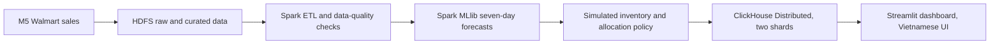

# warehouse-bigdata

## Project Overview

`warehouse-bigdata` is a proposed academic Big Data decision-support prototype for
retail inventory replenishment and store-level stock allocation. It is designed to
turn Walmart M5 observed sales into auditable forecasts and simulated inventory
recommendations through a batch-oriented distributed architecture.

The repository currently contains project metadata, a placeholder Python package,
and design specifications. The data pipeline, services, model training, database
publication, and dashboard are not implemented yet.

## Project Objectives

- Preserve the meaning and provenance of the M5 source data.
- Demonstrate a planned HDFS and Spark batch workflow for large-scale processing.
- Evaluate a seven-day Spark MLlib forecasting workflow without future-data leakage.
- Compare simulated replenishment and store-allocation policies under explicit
  assumptions.
- Publish approved analytical outputs to a planned ClickHouse serving layer and
  present them through a lightweight Vietnamese-language Streamlit application.

These are project objectives and design targets, not current implementation claims.

## High-Level System Architecture

The following flow is the planned architecture. It is not a report of running
services or completed experiments.



HDFS is planned as the raw and curated data layer. Spark is planned for distributed
ETL and Spark MLlib forecasting. The policy stage uses simulated inventory state,
not operational Walmart stock. ClickHouse is planned as the distributed analytical
serving layer, and Streamlit is planned as a read-oriented presentation layer.

## Technology Stack

| Layer | Planned technology | Current status |
|---|---|---|
| Project runtime | Python 3.11 and `uv` | Project metadata and `uv.lock` exist |
| Distributed storage | Hadoop HDFS | Designed only; no configuration is tracked |
| Distributed processing | Apache Spark | Designed only; no jobs are implemented |
| Forecasting | Spark MLlib `RandomForestRegressor` | Selected in design; no model is trained |
| Analytical serving | ClickHouse Distributed, two shards and one replica per shard | Designed only; no SQL or deployment is implemented |
| Application | Streamlit and Plotly | Designed only; no application code is implemented |
| Local environment | Docker Compose on Ubuntu/WSL2 | Planned topology; no Compose files are tracked |

## Dataset Overview

The source is the [Kaggle M5 Forecasting Accuracy dataset](https://www.kaggle.com/competitions/m5-forecasting-accuracy/data).
Its sales matrix is intended to be transformed into product-store-day observations,
with calendar and price data used for enrichment.

Important limitations:

- M5 records observed unit sales, not individual orders, verified inventory, or
  warehouse balances.
- Observed sales can be affected by stockouts and therefore are not automatically
  unconstrained customer demand.
- The source does not provide central supply, lead times, transport costs, or
  warehouse-to-store movement records.
- A fully normalized source is commonly described as approximately 59.18 million
  derived daily observations. These are derived rows, not purchases, and no raw
  dataset is stored in this repository.
- Inventory state, replenishment outcomes, and allocation results must be explicitly
  labeled as simulated. Forecasts and other derived outputs must retain their own
  provenance labels.

Detailed source semantics and data-quality obligations are defined in
[`docs/04_DATASET.md`](docs/04_DATASET.md).

## Repository Structure

The tracked repository is intentionally small at this stage:

| Path | Purpose and status |
|---|---|
| [`pyproject.toml`](pyproject.toml) | Python project metadata and the placeholder console entry point |
| [`uv.lock`](uv.lock) | Committed dependency-resolution metadata |
| [`.python-version`](.python-version) | Python 3.11 project marker |
| [`src/warehouse_bigdata/`](src/warehouse_bigdata/) | Tracked package scaffold; currently only a placeholder entry point |
| [`docs/`](docs/01_PROJECT_OVERVIEW.md) | Design specifications and repository guidance |
| `infrastructure/` | Local directory reserved for Hadoop, Spark, and ClickHouse configuration; no tracked configuration yet |
| `tests/` | Local directory reserved for focused tests; no tracked tests or fixtures yet |
| `app/`, `sql/`, `scripts/`, `data/`, `artifacts/` | Planned areas described by the design; not currently present in the tracked tree |

[`docs/BASED_STRUCTURE.md`](docs/BASED_STRUCTURE.md) is a reference layout, not
an inventory of directories that already exist. Create directories when their
first real implementation requires them.

## Current Development Status

### Implemented or scaffolded

- Python project metadata for Python 3.11 managed with `uv`.
- A placeholder `warehouse-bigdata` console entry point that prints a greeting.
- Design documents covering requirements, architecture, data, forecasting,
  inventory policy, database design, application design, and testing.
- Repository cleanup and documentation alignment for the FND-01 foundation task.

### Planned but not implemented

- M5 download, profiling, ingestion, HDFS storage, and Spark ETL.
- Spark MLlib training, chronological evaluation, and seven-day forecast artifacts.
- Inventory simulation, replenishment, and constrained allocation execution.
- ClickHouse schemas, shard publication, and analytical queries.
- Streamlit pages, Vietnamese labels, and dashboard data access.
- Infrastructure definitions, SQL migrations, operational scripts, automated tests,
  measured benchmarks, and end-to-end evidence.

No distributed execution, trained model, dashboard, service startup, or performance
result should be inferred from the design documents.

## Getting Started

Prerequisites are Python 3.11 and `uv`. The versions are recorded in
[`.python-version`](.python-version) and [`uv.lock`](uv.lock).

From the repository root, the current Python scaffold can be synchronized and
invoked with:

```bash
uv sync
uv run warehouse-bigdata
```

The entry point currently prints a placeholder greeting. It does not download data,
start HDFS, run Spark, train a model, load ClickHouse, or start Streamlit. There is
currently no operational pipeline or service quickstart; those instructions belong
with the corresponding implementation in a later foundation task.

## Documentation Guide

Use the documents in this order when implementing the design:

1. [Project Overview](docs/01_PROJECT_OVERVIEW.md) defines the problem, objectives,
   boundaries, and risks.
2. [System Requirements](docs/02_SYSTEM_REQUIREMENTS.md) defines required behavior
   and acceptance criteria.
3. [System Architecture](docs/03_SYSTEM_ARCHITECTURE.md) defines components,
   topology, interfaces, and architectural trade-offs.
4. [Dataset](docs/04_DATASET.md) defines M5 semantics, grain, provenance, and data
   quality.
5. [Technology Stack](docs/05_TECH_STACK.md) records technology choices and open
   compatibility questions.
6. [Data Pipeline](docs/06_DATA_PIPELINE.md) defines batch stages, transformations,
   and handoff contracts.
7. [Machine Learning](docs/07_MACHINE_LEARNING.md) defines the seven-day forecasting
   target, features, chronological evaluation, and leakage controls.
8. [Business Rules and Optimization](docs/08_BUSINESS_RULES_AND_OPTIMIZATION.md)
   defines simulated inventory, replenishment, and allocation policies.
9. [Database Design](docs/09_DATABASE_DESIGN.md) defines ClickHouse schemas,
   sharding, and publication contracts.
10. [Application Design](docs/10_APPLICATION_DESIGN.md) defines the Vietnamese UI,
    user journeys, queries, and presentation behavior.
11. [Testing and Performance Evaluation](docs/11_TESTING.md) owns software testing,
    data-quality verification, integration and distributed-system testing,
    performance evaluation, test evidence, and acceptance checks. It does not own
    presentation scripts, oral-defense preparation, demonstration walkthroughs, or
    slide content.

The design documents remain proposals until implementation produces measured
evidence. [`AGENTS.md`](AGENTS.md) defines repository boundaries and the PLAN/BUILD
workflow.

## Development Conventions

- Use `uv` and the pinned Python version for Python work; keep required metadata,
  including `uv.lock`, under version control.
- Write engineering documentation, code, identifiers, SQL, and logs in English.
  Future user-facing Streamlit text is Vietnamese.
- Preserve the batch architecture: HDFS, distributed Spark, Spark MLlib,
  ClickHouse Distributed, and a lightweight Streamlit UI.
- Keep observed, derived, forecast, and simulated records distinguishable through
  explicit provenance.
- Preserve the seven-day horizon, chronological evaluation, and future-data leakage
  controls when implementation begins.
- Keep business logic in its owning module and keep the UI read-only with respect
  to analytical outputs.
- Do not add raw datasets, generated artifacts, secrets, or runtime data to source
  control. Follow [`.gitignore`](.gitignore) and [`AGENTS.md`](AGENTS.md).

## Project Limitations

- This is a planned local academic prototype, not a production warehouse system.
- A multi-container deployment on one physical host would demonstrate distributed
  software roles, not physical host fault tolerance. Two ClickHouse shards with one
  replica each would demonstrate sharding, not high availability.
- M5 does not support claims about real Walmart stock, operational savings, purchase
  orders, or unconstrained demand.
- Forecast accuracy, policy effectiveness, throughput, latency, data coverage, and
  resource usage are unmeasured until the planned implementation is executed.
- The proposed design must fit a resource-constrained development host and may use
  declared, reproducible scope reductions. Any reduction must be disclosed rather
  than presented as full historical coverage.
