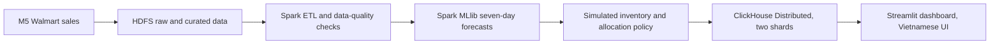

# warehouse-bigdata

## Project Overview

`warehouse-bigdata` is a proposed academic Big Data decision-support prototype for
retail inventory replenishment and store-level stock allocation. It is designed to
turn Walmart M5 observed sales into auditable forecasts and simulated inventory
recommendations through a batch-oriented distributed architecture.

The repository currently contains project metadata, a Python package, developer
tooling, design specifications, a persistent local HDFS deployment with a passing
four-scenario integration suite, and an opt-in Spark Standalone deployment with
passing live infrastructure acceptance, a short-lived Spark submission runtime,
and a bounded synthetic distributed Spark–HDFS acceptance that passed on
**2026-10-21**. Local M5 source profiling, immutable raw HDFS ingestion, Contract v1
run manifests, and an opt-in real-M5 Spark Standalone read verification are implemented;
curated ETL, other services, model training, database publication, and the dashboard are
not implemented yet.

## Project Objectives

- Preserve the meaning and provenance of the M5 source data.
- Demonstrate a planned HDFS and Spark batch workflow for large-scale processing.
- Evaluate a seven-day Spark MLlib forecasting workflow without future-data leakage.
- Compare simulated replenishment and store-allocation policies under explicit
  assumptions.
- Publish approved analytical outputs to a planned ClickHouse serving layer and
  present them through a lightweight Vietnamese-language Streamlit application.

These are project objectives and design targets, not current implementation claims.

## High-Level System Architecture

The following flow is the planned architecture. It is not a report of running
services or completed experiments.



HDFS is planned as the raw and curated data layer. Spark is planned for distributed
ETL and Spark MLlib forecasting. The policy stage uses simulated inventory state,
not operational Walmart stock. ClickHouse is planned as the distributed analytical
serving layer, and Streamlit is planned as a read-oriented presentation layer.

## Technology Stack

| Layer | Planned technology | Current status |
|---|---|---|
| Project runtime | Python 3.11 and `uv` | Project metadata and `uv.lock` exist |
| Distributed storage | Hadoop HDFS 3.4.3 | Persistent one-NameNode/two-DataNode deployment and configuration loaders implemented; complete four-scenario HDFS integration suite passed |
| Distributed processing | Apache Spark 3.5.7 | Opt-in one-Master/two-Worker deployment, qualified Python 3.11 image, client-mode submission runtime, and passing synthetic Spark–HDFS verification job; production ETL/MLlib jobs remain planned |
| Forecasting | Spark MLlib `RandomForestRegressor` | Selected in design; no model is trained |
| Analytical serving | ClickHouse Distributed, two shards and one replica per shard | Designed only; no SQL or deployment is implemented |
| Application | Streamlit and Plotly | Designed only; no application code is implemented |
| Local environment | Docker Compose on Ubuntu/WSL2 | HDFS default topology and opt-in Spark profile implemented; other services remain planned |

## Dataset Overview

The source is the [Kaggle M5 Forecasting Accuracy dataset](https://www.kaggle.com/competitions/m5-forecasting-accuracy/data).
Its sales matrix is intended to be transformed into product-store-day observations,
with calendar and price data used for enrichment.

Important limitations:

- M5 records observed unit sales, not individual orders, verified inventory, or
  warehouse balances.
- Observed sales can be affected by stockouts and therefore are not automatically
  unconstrained customer demand.
- The source does not provide central supply, lead times, transport costs, or
  warehouse-to-store movement records.
- A fully normalized source is commonly described as approximately 59.18 million
  derived daily observations. These are derived rows, not purchases, and no raw
  dataset is stored in this repository.
- Inventory state, replenishment outcomes, and allocation results must be explicitly
  labeled as simulated. Forecasts and other derived outputs must retain their own
  provenance labels.

Detailed source semantics and data-quality obligations are defined in
[`docs/04_DATASET.md`](docs/04_DATASET.md).

## Repository Structure

The tracked repository is intentionally small at this stage:

| Path | Purpose and status |
|---|---|
| [`pyproject.toml`](pyproject.toml) | Python project metadata and developer tooling configuration |
| [`uv.lock`](uv.lock) | Committed dependency-resolution metadata |
| [`.python-version`](.python-version) | Python 3.11 project marker |
| [`.env.example`](.env.example) | Safe template for the shared environment-variable contract |
| [`src/warehouse_bigdata/`](src/warehouse_bigdata/) | Tracked package and minimal CLI entry point |
| [`docs/`](docs/01_PROJECT_OVERVIEW.md) | Design specifications and repository guidance |
| [`infrastructure/`](infrastructure/) | HDFS deployment, Hadoop configuration, and opt-in Spark topology/runtime/probes; ClickHouse remains planned |
| `tests/` | Focused offline checks, Spark registration/lifecycle checks, and opt-in HDFS and distributed Spark–HDFS integration scenarios |
| [`scripts/`](scripts/) | Repository environment loading, explicit HDFS initialization, scoped Spark lifecycle/submission commands, and focused smoke checks |
| `app/`, `sql/`, `data/`, `artifacts/` | Planned areas described by the design; not currently present in the tracked tree |

[`docs/BASED_STRUCTURE.md`](docs/BASED_STRUCTURE.md) is a reference layout, not
an inventory of directories that already exist. Create directories when their
first real implementation requires them.

## Current Development Status

### Implemented or scaffolded

- Python project metadata and reproducible developer tooling for Python 3.11 managed with `uv`.
- A `warehouse-bigdata` console entry point with `--help` and `--version` support.
- Focused pytest checks for package importability and CLI argument handling.
- Design documents covering requirements, architecture, data, forecasting,
  inventory policy, database design, application design, and testing.
- Repository cleanup and documentation alignment for the FND-01 foundation task.
- M01 T01 HDFS deployment: pinned official image, guarded initialization, three separate
  persistent volumes, bounded health checks, and volume-preserving lifecycle commands.
- M01 T02 typed, side-effect-free shared configuration loaders with an explicit HDFS URI.
- M01 T03 HDFS verification: separate-client byte/hash integrity and audited
  two-node block placement, plus maintenance-window restart, recreation, and
  DataNode interruption/recovery scenarios.
- M02 T01 Spark infrastructure implementation: a pinned, checksum-qualified shared
  runtime, an opt-in Master and two Workers, current-registration probes, bounded
  resources/logs/tmpfs, and Spark-only lifecycle/smoke tooling. Live acceptance
  passed on **2026-10-20** with **10.70 GiB** of Docker-visible RAM: two registered
  Workers, both lifecycle smoke checks, and Worker interruption/recovery, with
  HDFS identities and volumes preserved. A 120-second idle-daemon sample observed
  about **1.26 GiB** current HDFS+Spark cgroup usage; this does not measure job loads
   or establish a minimum memory requirement.
- M02 T02 Spark job submission runtime: a separate locked, non-editable driver image
  and project ZIP, an ephemeral Standalone client-mode Compose service, validated
  CLI submission, and an attached host launcher with ownership-scoped cancellation
  cleanup. Runtime resources are bounded; T03 supplies the separate distributed
  verification workload and its acceptance evidence.
- M02 T03 distributed Spark–HDFS acceptance: the ZSTD JNI rollout was historically
  verified as `PHASE_1_VERIFIED`; one live execution on **2026-10-21** passed
  (`app-20261021012008-0000`, **1 passed in 309.02s**, 30 successful tasks across both
  Workers). The synthetic oracle, shuffle, Parquet/replication, complete event log,
  executor JNI inheritance, termination and HDFS preservation were checked. See the
  [dated M02 execution record](infrastructure/spark/README.md#historical-phase-2-live-acceptance--2026-10-21)
  for evidence paths, measured resource observations and limitations.

M01 T01, T02, and T03 are implemented. The reported manual execution on the local
Docker-based Hadoop cluster on **2026-10-19** passed all four HDFS integration
scenarios: **4 passed in 384.85 seconds**. M02 T01/T02/T03 acceptance is complete for
the bounded local infrastructure/synthetic-workload scope recorded above. M5 raw
ingestion is implemented; curated end-to-end data-pipeline acceptance remains a future
gate. See the
[HDFS operations guide](infrastructure/hadoop/README.md#t03-integration-verification)
for the execution snapshot and operational procedures.

### Planned but not implemented

- M5 downloading and Spark ETL. Local profiling, immutable raw HDFS ingestion, and
  source/run manifest generation are implemented for already-acquired CSV packages;
  the real-M5 Spark check only verifies HDFS reads and source metadata.
- Spark MLlib training, chronological evaluation, and seven-day forecast artifacts.
- Inventory simulation, replenishment, and constrained allocation execution.
- ClickHouse schemas, shard publication, and analytical queries.
- Streamlit pages, Vietnamese labels, and dashboard data access.
- Remaining service infrastructure, SQL migrations, pipeline operational scripts,
  cross-service integration tests, measured benchmarks, and end-to-end evidence.

No distributed execution, trained model, dashboard, service startup, or performance
result should be inferred from the design documents.

## Getting Started

Prerequisites are `uv` and Python 3.11. The required Python version is recorded in
[`.python-version`](.python-version), and resolved development dependencies are recorded
in [`uv.lock`](uv.lock).

From the repository root, install/select Python 3.11 and synchronize the locked
development environment. The full default test suite includes Spark unit tests, so
select the dedicated `spark-test` group:

```bash
uv python install 3.11
uv sync --locked --group spark-test
```

For host workflows, create the ignored local configuration before running the validation
or integration commands below: `cp .env.example .env`, then fill only the values needed
for the selected workflow. The shared-configuration section documents validation,
precedence, and migration from older `.zshrc` exports.

Run the CLI, lint checks, formatting check, tests, and package build with:

```bash
uv run --locked warehouse-bigdata --help
uv run --locked warehouse-bigdata --version
uv run --locked ruff check .
uv run --locked ruff format --check .
uv run --locked pytest -q
uv build
```

The CLI provides packaging/help/version checks, local M5 source profiling, the combined
M5 raw-ingestion workflow, and the explicit `spark-submit` subcommand for the prepared
container runtime. The pipeline does not download M5 data or verify when Kaggle delivery
occurred. Use the supported manual workflow: download and extract the package externally,
then copy the original CSVs unchanged into `data/m5/source/` (or another explicit source
directory). Profile the already-acquired package without modifying its CSV files; the
acquisition timestamp may be omitted when it is unknown:

```bash
bash scripts/load-env.sh uv run --locked warehouse-bigdata profile-m5-source \
  --source-dir /path/to/m5-csvs \
  --source-url https://www.kaggle.com/competitions/m5-forecasting-accuracy/data
```

The command writes `source_profile.json` and `source_manifests.json` below the
ignored `WAREHOUSE_ARTIFACTS_DIR` run directory. `downloaded_at_utc` contains the supplied
actual UTC acquisition time when known, otherwise JSON `null`; `profiled_at_utc` is the
automatically recorded UTC time of profiling. For HDFS initialization, startup,
smoke checks, and safe lifecycle operations, follow the
[HDFS operations guide](infrastructure/hadoop/README.md). The combined raw-ingestion
workflow is documented below; curated transformations remain out of scope.

### M5 Raw Ingestion And Verification

The combined workflow accepts an extracted, already-acquired M5 directory. The source
URL must be the official Kaggle dataset URL. Pass `--downloaded-at-utc` only when the
actual UTC acquisition time is known; omitting it records JSON `null` rather than a
fabricated time. The host launcher reads the source locally, writes run-scoped evidence
under the ignored local `artifacts/` directory, and uses a disk-backed
`WAREHOUSE_SCRATCH_DIR` for SQLite profiling indexes. HDFS must already be running and
write-ready; the launcher creates only its uniquely named Hadoop CLI client:

```bash
bash scripts/ingest-m5.sh \
  --source-dir /path/to/m5-csvs \
  --source-url https://www.kaggle.com/competitions/m5-forecasting-accuracy/data
```

The launcher loads the repository `.env` automatically. `--source-dir` and
`--source-url` remain explicit command arguments and override matching optional
`WAREHOUSE_M5_*` values from `.env`.

Each attempt receives a unique `pipeline_run_id`. Its local profile, quality report, and
`PIPELINE_RUN_MANIFEST` are stored below `artifacts/m5-ingestion/<pipeline_run_id>/`.
The raw HDFS path is keyed by the content-derived `source_version`; a matching rerun
gets a new run ID and returns `REUSED` without overwriting the validated raw snapshot or
the prior run manifest. A failed profile stops before HDFS client construction. HDFS,
integrity, or run-manifest publication failures remain `FAILED`, even when an already
promoted raw snapshot is left immutable.

The launcher uses the pinned Apache Hadoop 3.4.3 image, the existing `warehouse-bigdata`
bridge, and read-only Hadoop XML binds. Python remains on the Ubuntu host and all Hadoop
CLI transfers use `docker exec -i` through the owned client. The client is inspected for
ownership, health, image, network, effective configuration, and read-only mounts, then
removed only when its exact name and run label match. `scripts/ingest-m5-raw.sh` is retired
to avoid a second ingestion runtime; use the combined launcher or the explicitly configured
Python CLI for focused low-level tests.

After ingestion, the minimal distributed read check can be run explicitly with the raw
URI and exact source identity printed by the workflow:

```bash
bash scripts/spark-submit.sh -- \
  warehouse_bigdata/jobs/verify_m5_raw_hdfs.py \
  --raw-uri hdfs://hdfs-namenode:8020/data/warehouse/raw/m5/source_version=sha256-... \
  --source-version sha256:...
```

The Spark job requires a `spark://` Standalone master, checks effective HDFS
configuration, and reads `source_manifests.json` and the stored sales header from the
explicit HDFS URI. It rejects local paths and never substitutes local files. An opt-in
real-source acceptance test additionally checks remote byte hashes, replication and
both-DataNode block placement:

```bash
bash scripts/load-env.sh uv run --locked pytest -q -m integration tests/integration/test_m5_ingestion.py
```

The live check is non-disruptive and leaves validated M5 raw snapshots and run
manifests in HDFS for review; it does not initialize services, delete volumes, or
remove validated raw data. The Docker Compose cluster remains a single-host distributed
software demonstration, not physical multi-host fault tolerance.

### Opt-in Spark infrastructure

The default Compose selection remains the three HDFS daemons. The `spark` profile
adds one Master and two Workers on the existing bridge. First provide at least
**10 GiB of Docker-visible memory** and an already initialized, running HDFS
deployment, then use the repository-relative wrappers:

```bash
bash scripts/spark-cluster.sh up
bash scripts/spark-cluster.sh status
bash scripts/spark-cluster.sh check
bash scripts/smoke-spark.sh
bash scripts/spark-cluster.sh logs
bash scripts/spark-cluster.sh stop
```

The Master UI is bound to `http://127.0.0.1:8080`; its RPC endpoint is
`spark://spark-master:7077` inside the Compose network. The smoke check reports
registration, runtime, connectivity, limits, and scratch configuration. Runtime
qualification has passed, including read-only HDFS metadata access. The live
up/smoke/stop/up/smoke cycle and Worker interruption/recovery checks also passed
on **2026-10-20** after the Docker memory allocation was increased.
See the [Spark operations guide](infrastructure/spark/README.md) for pins, resource
budgets, measured qualification/deployment evidence, and focused acceptance procedures.

### Short-lived Spark job submission

With T01's qualified local image already prepared, explicitly build the driver layer:

```bash
docker compose -f infrastructure/compose.yaml --profile spark-submit build spark-submit
```

After the existing HDFS and Spark services are ready, the repository-relative host API is:

```text
bash scripts/spark-submit.sh [--conf KEY=VALUE ...] -- APPLICATION.py [APPLICATION_ARGS...]
```

The application must already exist under the image's `/opt/warehouse-app/src`;
paths such as `warehouse_bigdata/jobs/my_job.py` are **future entrypoints**, not
implemented jobs. Rebuild the driver image after code changes. The image installs
the project non-editably and ships the same sources through `--py-files` for
executor imports; nothing is installed at submission time.

The launcher checks the prepared image and T01 readiness, then attaches to one
ephemeral container without starting dependencies. It uses explicit Standalone
**client** mode, unique bridge DNS, canonical HDFS configuration, fixed compatible
Python paths, and bounded resources. Application arguments and failure statuses
are preserved; cancellation cleans up only the invocation-owned driver.
See [T02 submission operations](infrastructure/spark/README.md#short-lived-submission-runtime--m02-t02)
for supported `--conf`, limits, exit codes, and focused verification. The separately
executed [M02 T03 acceptance](infrastructure/spark/README.md#historical-phase-2-live-acceptance--2026-10-21)
passed for its bounded synthetic distributed read/write workload. Future live runs
require their own explicit approval and current prerequisite checks.

### Opt-in live M04 smoke acceptance

The separate M04 smoke test uses real M5 CSV data in real HDFS and the existing
`spark-worker-1` and `spark-worker-2`. It selects **`d_1` through `d_30` for all
30,490 evaluation series**, expecting exactly **914,700 rows** in each of
`sales_daily` and `sales_enriched`. These are derived observed-sales records.

Run serially from the repository root against already-ready HDFS and Spark services.
Prepare/rebuild the driver image after source changes using the explicit build command
in the submission section above. Set `WAREHOUSE_HDFS_URI` and
`WAREHOUSE_SPARK_MASTER_URL` to the canonical cluster endpoints in `.env`.

For repeat smoke runs, set `WAREHOUSE_M04_SOURCE_VERSION=sha256:<64 lowercase hex>`
in `.env` to the exact source version printed by a successful M5 raw ingestion.
This reuses that immutable raw snapshot through the **production HDFS validator**:
all raw bytes are hashed again; source manifests, provenance, integrity sidecars,
checksums, replication, and current two-DataNode block placement are checked. The
content-derived source version is reconciled with the manifest file hashes. Local
CSVs and full local CSV profiling are unnecessary in this mode. Any supplied
`WAREHOUSE_M5_SOURCE_URL` or `WAREHOUSE_M5_DOWNLOADED_AT_UTC` must match stored
provenance; an invalid or missing selected snapshot fails without fallback.

If `WAREHOUSE_M04_SOURCE_VERSION` is blank, provide `WAREHOUSE_M5_SOURCE_DIR` and
the official `WAREHOUSE_M5_SOURCE_URL`; the existing production ingestion flow
profiles and validates the complete original package before the reduced ETL run.
That initial profiling remains expensive. Keep the acquisition timestamp blank
when unknown.

Explicit smoke command:

```bash
bash scripts/load-env.sh uv run --locked pytest -q -m integration --run-m04-smoke tests/integration/test_m04_smoke.py
```

Default pytest runs exclude integration tests. Even `-m integration` skips this
smoke test unless `--run-m04-smoke` is present, before its HDFS fixture is set up.

Before expensive source preparation, the harness checks run-path collisions,
the two Workers' current readiness, the prepared image, and empty run-owned event
directories. A small non-Spark driver probe verifies the HDFS CLI, effective Spark
staging/event-log ACL access, writable output ancestors, and driver/archive/XML
fingerprints against the checkout. It does not build or start cluster services.

The test then calls the existing production **J02**, **J03**, and **independent M04
verifier**. It retains physical-schema and nullability checks, complete selected-day
and series coverage, unique keys, zero-sales preservation, calendar/price and aggregate
reconciliation, manifest lineage, persisted Parquet rereads and SHA-256 audits, and
successful-task evidence from **both** Workers for each of the three applications.
Raw validation still reads the full source files; the 30-day limit bounds expanded
sales processing, not raw-source integrity work.

Every invocation uses a new `m04-smoke-snapshot-<uuid>` and distinct J02/J03/verifier
run IDs, staging/event paths, and `artifacts/m04/smoke/<uuid>/` evidence. Reports,
commands, full job logs, event logs, reconciliation, and hashes are retained there;
preflight diagnostics are also recorded in the unique `artifacts/test-runs/` run.
Existing raw snapshots and curated data are never overwritten. Smoke reports state
`acceptance_scope=reduced-history` and `full_history_accepted=false`.

**Smoke acceptance does not establish full-history correctness or retry/recovery
acceptance.** The existing full test still processes **1,941 days / 59,181,090 rows**,
including immutable J02/J03 retry checks, with its original command:

```bash
bash scripts/load-env.sh uv run --locked pytest -q -m integration tests/integration/test_m04_processing.py
```

The smoke test omits those two retry submissions to keep the live check smaller.
It is a single-host, two-Worker simulation, not a benchmark, speedup claim, or
physical multi-host fault-tolerance certification. No live M04 result is implied
by adding this test.

Focused offline regression checks (no live workloads):

```bash
uv run --locked ruff check .
uv run --locked pytest -q tests/unit/test_m04_support.py tests/unit/test_m04_smoke.py tests/unit/test_m04_verification.py tests/unit/test_spark_job_permissions.py tests/unit/test_spark_verification.py tests/unit/test_hdfs_raw_ingestion.py
```

### Opt-in HDFS integration verification

Against an already initialized, running T01 cluster, run the non-disruptive
independent-client registration, read/write integrity, and two-replica placement check:

```bash
bash scripts/load-env.sh uv run --locked pytest -q -m integration tests/integration/test_hdfs.py
```

Default pytest runs and lightweight CI exclude live HDFS integration tests. The
command above selects only the non-disruptive scenario; the complete suite additionally
requires `--run-hdfs-disruptions` and an exclusive, serial maintenance window. The
complete four-scenario suite was executed manually for the result recorded above.
See the [T03 operations guide](infrastructure/hadoop/README.md#t03-integration-verification)
for focused offline checks, controlled disruption commands, recovery, and the M02
connectivity checklist. The harness writes unique, Git-ignored evidence under
`artifacts/test-runs/`; only each run's owned fixture/client is cleaned up. Spark and
M5 ingestion are outside this verification.

## Collaboration and CI

The task-oriented Git workflow and pull request expectations are documented in
[`CONTRIBUTING.md`](CONTRIBUTING.md). Pull requests targeting `develop` and pushes to
`develop` use [`.github/workflows/ci.yml`](.github/workflows/ci.yml) for locked
dependency synchronization, Ruff lint and formatting checks, and the lightweight
pytest suite, which excludes live HDFS integration tests. Branch protection is a
separate GitHub administrative setting and is not implied by the workflow file.

### Shared Configuration

Python components use the typed loaders in
`warehouse_bigdata.common.config` rather than reading environment variables directly.
The loaders validate syntax and required fields without reading `.env` files, creating
directories, resolving paths, opening sockets, or checking service availability. Host-side
Bash workflows use `scripts/load-env.sh` to inject the repository-local `.env` before
invoking those typed loaders; this does not add a Python dotenv dependency or a second
Python configuration system.

Create a local environment file from the safe template when local values are needed:

```bash
cp .env.example .env
${EDITOR:-vi} .env
bash scripts/load-env.sh uv run --locked python -c \
  'from warehouse_bigdata.common.config import load_hdfs_config, load_paths_config, load_runtime_config, load_spark_config; load_runtime_config(); load_hdfs_config(); load_spark_config(); load_paths_config(); print("warehouse environment syntax is valid")'
```

The validation command requires the HDFS and Spark values to be filled in. It prints no
credentials. `.env` is ignored by Git and `.env.example` is the only environment file
intended for source control. Tests and callers that need deterministic settings can pass a
complete mapping directly:

```python
from warehouse_bigdata.common.config import load_hdfs_config, load_runtime_config

runtime = load_runtime_config({"WAREHOUSE_ENV": "test"})
# Container-network example: use only where hdfs-namenode resolves.
hdfs = load_hdfs_config({"WAREHOUSE_HDFS_URI": "hdfs://hdfs-namenode:8020"})
```

Runtime settings default to `local` and `INFO`. HDFS requires an explicitly supplied
`WAREHOUSE_HDFS_URI` in every runtime mode (`local`, `test`, and `container`); the mode
does not select an endpoint. Omitting `WAREHOUSE_HDFS_BASE_PATH` uses `/data/warehouse`,
matching the frozen Contract v1 namespace. Explicit valid absolute base-path overrides
remain supported but do not redefine frozen Contract v1 artifact identities or templates.

The canonical container-internal NameNode RPC endpoint is `hdfs://hdfs-namenode:8020`,
usable only where that service hostname resolves. Host-side clients must explicitly
supply an endpoint reachable from their network and cannot assume Docker service DNS.
Actual HDFS access requires both NameNode RPC and DataNode connectivity; see the
[operations guide](infrastructure/hadoop/README.md).

Host workflow precedence is consistent across the Bash launchers: explicit command
arguments, the project `.env`, inherited process environment, then application defaults.
The `.env` file therefore intentionally wins over an inherited value with the same name;
remove or edit the local entry when testing an inherited value. The ingestion wrapper
accepts `WAREHOUSE_M5_SOURCE_DIR`, `WAREHOUSE_M5_SOURCE_URL`, and
`WAREHOUSE_M5_DOWNLOADED_AT_UTC` from `.env`, while its explicit source flags take priority.
The typed Python loaders retain their existing defaults and validation rules.

The loader resolves `.env` from the repository containing `scripts/load-env.sh`, not from
the caller's current directory. Use `source scripts/load-env.sh` for a longer host shell
session or `bash scripts/load-env.sh <command> ...` for a one-shot command. This replaces
project-specific exports in `.zshrc`: copy the values into the ignored `.env`, remove the
corresponding `.zshrc` exports, open a new shell (or `unset` the old values), and run the
launcher or one-shot command through the loader. Existing callers without `.env` continue
to use inherited variables, and application defaults remain in the typed loaders.

The host file is not used to rewrite Compose networking. The Hadoop client and Spark
submission containers retain their explicit internal endpoints (`hdfs://hdfs-namenode:8020`
and `spark://spark-master:7077`) and existing `warehouse-bigdata` bridge. Do not place
container-only endpoint substitutions or credentials in `infrastructure/compose.yaml`;
host launchers load `.env` without forwarding unrelated secrets to Compose services.

Spark's shared loader requires `WAREHOUSE_SPARK_MASTER_URL`; it accepts `local[*]`
for explicit local callers. The submission runtime requires Standalone and rejects
all local modes. The Standalone endpoint `spark://spark-master:7077` is reachable inside
the Compose bridge and requires Docker service DNS. ClickHouse requires its host,
port, database, and user, while its password
is optional and empty by default. Local generated artifacts use
`WAREHOUSE_ARTIFACTS_DIR`, which defaults to `artifacts`, and profiling scratch uses
`WAREHOUSE_SCRATCH_DIR`, which defaults to `artifacts/scratch`; both are local filesystem
paths distinct from the HDFS base path.

Invalid or missing values raise `ConfigurationError` with the variable and expected
format. Required HDFS, Spark, and ClickHouse endpoints remain blank in
`.env.example`. Successful parsing only validates configuration syntax; it does not
prove that a service is reachable or that HDFS paths exist. Runtime environments,
including application containers, must explicitly receive their required variables
through process-environment injection or a caller-supplied mapping.

## Documentation Guide

Use the documents in this order when implementing the design:

1. [Project Overview](docs/01_PROJECT_OVERVIEW.md) defines the problem, objectives,
   boundaries, and risks.
2. [System Requirements](docs/02_SYSTEM_REQUIREMENTS.md) defines required behavior
   and acceptance criteria.
3. [System Architecture](docs/03_SYSTEM_ARCHITECTURE.md) defines components,
   topology, interfaces, and architectural trade-offs.
4. [Dataset](docs/04_DATASET.md) defines M5 semantics, grain, provenance, and data
   quality.
5. [Technology Stack](docs/05_TECH_STACK.md) records technology choices and open
   compatibility questions.
6. [Data Pipeline](docs/06_DATA_PIPELINE.md) defines batch stages, transformations,
   and handoff contracts.
7. [Machine Learning](docs/07_MACHINE_LEARNING.md) defines the seven-day forecasting
   target, features, chronological evaluation, and leakage controls.
8. [Business Rules and Optimization](docs/08_BUSINESS_RULES_AND_OPTIMIZATION.md)
   defines simulated inventory, replenishment, and allocation policies.
9. [Database Design](docs/09_DATABASE_DESIGN.md) defines ClickHouse schemas,
   sharding, and publication contracts.
10. [Application Design](docs/10_APPLICATION_DESIGN.md) defines the Vietnamese UI,
    user journeys, queries, and presentation behavior.
11. [Testing and Performance Evaluation](docs/11_TESTING.md) owns software testing,
    data-quality verification, integration and distributed-system testing,
    performance evaluation, test evidence, and acceptance checks. It does not own
    presentation scripts, oral-defense preparation, demonstration walkthroughs, or
    slide content.

The design documents remain proposals until implementation produces measured
evidence. [`AGENTS.md`](AGENTS.md) defines repository boundaries and the PLAN/BUILD
workflow.

## Development Conventions

- Use `uv` and the pinned Python version for Python work; keep required metadata,
  including `uv.lock`, under version control.
- Write engineering documentation, code, identifiers, SQL, and logs in English.
  Future user-facing Streamlit text is Vietnamese.
- Preserve the batch architecture: HDFS, distributed Spark, Spark MLlib,
  ClickHouse Distributed, and a lightweight Streamlit UI.
- Keep observed, derived, forecast, and simulated records distinguishable through
  explicit provenance.
- Preserve the seven-day horizon, chronological evaluation, and future-data leakage
  controls when implementation begins.
- Keep business logic in its owning module and keep the UI read-only with respect
  to analytical outputs.
- Do not add raw datasets, generated artifacts, secrets, or runtime data to source
  control. Follow [`.gitignore`](.gitignore) and [`AGENTS.md`](AGENTS.md).

## Project Limitations

- This is a planned local academic prototype, not a production warehouse system.
- A multi-container deployment on one physical host would demonstrate distributed
  software roles, not physical host fault tolerance. Two ClickHouse shards with one
  replica each would demonstrate sharding, not high availability.
- M5 does not support claims about real Walmart stock, operational savings, purchase
  orders, or unconstrained demand.
- Forecast accuracy, policy effectiveness, and full-dataset throughput, latency,
  data coverage and resource demand remain unmeasured. The recorded infrastructure
  and synthetic M02 acceptance observations are not full M5 workload benchmarks.
- The proposed design must fit a resource-constrained development host and may use
  declared, reproducible scope reductions. Any reduction must be disclosed rather
  than presented as full historical coverage.
