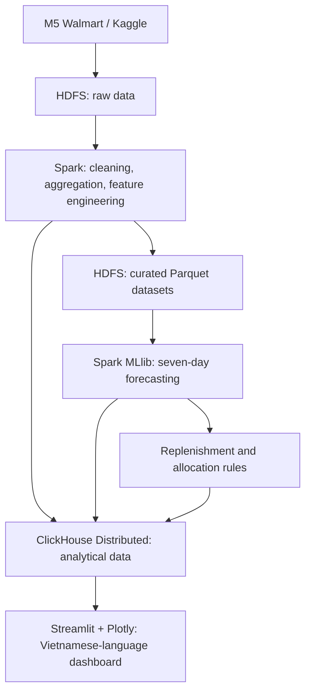

# 01 — Project Overview

> **Project title:** Big Data–Driven Inventory and Distribution Optimization  
> **Original Vietnamese title:** Tối ưu hóa hệ thống quản lý kho hàng  
> **Course:** Introduction to Big Data  
> **Team size:** 2 students  
> **Document status:** Agreed project direction; implementation and experimental outcomes are not yet verified  
> **Version:** 1.1 — October 15, 2026

## 1. Executive Summary

This project proposes a **data-driven decision-support system for inventory replenishment and product allocation** based on historical retail sales. Rather than merely reporting past sales, the system will **forecast product demand for the next seven days**, then use those forecasts to **recommend replenishment quantities** and **allocate limited central inventory across stores**.

The primary dataset is **M5 Forecasting – Accuracy**, which contains historical Walmart sales data. **Apache Hadoop HDFS** and **Apache Spark** provide distributed storage and data processing. **Random Forest Regression implemented with Spark MLlib** will be used for demand forecasting. Analytical data and generated results will be served through a **two-shard ClickHouse Distributed cluster**, while a **Streamlit and Plotly** application will present interactive dashboards.

The deliverable is an **academic, reproducible prototype**, not a production Enterprise Resource Planning (ERP) or Warehouse Management System (WMS). Its core value is a verifiable end-to-end workflow:

**Real-world data → distributed storage → distributed processing → machine learning → inventory and allocation recommendations → visualization and evaluation.**

## 2. Business Context and Problem Statement

A multi-store retailer must determine how much inventory to replenish at each store. Decisions based only on historical averages or equal allocation can lead to:

- **Stockouts:** available inventory cannot satisfy observed demand, resulting in potential lost sales.
- **Overstock:** replenishment exceeds likely near-term sales, increasing inventory holding and capital requirements.
- **Inefficient allocation:** when central inventory is limited, higher-need stores may receive insufficient stock.
- **Limited analytical scalability:** product, store, and daily sales data become increasingly difficult to process and explore using manual reporting workflows.

**Core research question:** Given historical sales and an explicitly simulated inventory state, can short-term forecasting and a transparent replenishment/allocation policy yield better outcomes than reasonable baseline policies under the same assumptions?

> **Important distinction:** M5 contains **observed unit sales**, not necessarily unconstrained customer demand. Sales may be lower than true demand when products were out of stock. Without actual inventory or stockout records, the forecast estimates future sales patterns from available observations; it must not be presented as a perfect measurement of latent demand.

## 3. Project Objectives

### 3.1. General Objective

Design and demonstrate a reproducible Big Data pipeline that combines distributed processing and machine learning to **support inventory replenishment and store-level stock allocation decisions**.

### 3.2. Specific Objectives

| ID | Objective | Expected deliverable |
|---|---|---|
| O-01 | Understand a real retail dataset | Document M5's source, structure, scale, and limitations. |
| O-02 | Implement distributed storage and processing | Store data in HDFS and transform/aggregate it with Spark, with execution evidence. |
| O-03 | Build a demand forecasting model | Train Random Forest, produce seven-day forecasts, and evaluate errors on a chronological holdout. |
| O-04 | Support inventory replenishment | Recommend replenishment quantities from forecasts and simulated inventory levels. |
| O-05 | Support constrained stock allocation | Allocate limited central stock across stores using an explicit policy. |
| O-06 | Support distributed analytical queries and visualization | Use an actual two-shard ClickHouse cluster and deliver a clear interactive dashboard. |
| O-07 | Evaluate decision quality | Compare forecasting with a baseline and inventory/allocation policies with baseline strategies. |

These are **targets to implement and verify**, not claims that the system already works or improves performance. Improvement figures must come from experiments.

## 4. Users and Representative Use Cases

### 4.1. Intended Users

- **Inventory manager:** reviews historical sales, demand forecasts, and replenishment recommendations.
- **Distribution coordinator:** reviews proposed allocation of limited stock from a simulated central warehouse to stores.
- **Instructor/evaluator:** verifies the dataset source, distributed technologies, machine-learning methodology, cluster queries, and demo outputs.

### 4.2. Typical User Journey

1. Open the dashboard and inspect sales trends by store, product, or category.
2. Select a store–product pair and inspect its **seven-day forecast**.
3. Review replenishment quantities computed from the forecast, **simulated inventory**, and a safety-stock assumption.
4. If **central stock is insufficient**, inspect the proposed allocation among eligible stores.
5. Compare the recommendations against baseline policies through tables and charts.

Forecasts and core aggregates will be **precomputed in batch jobs**. The dashboard should query and display those results rather than retraining the model each time the user changes a filter.

### 4.3. Project Language Convention

The project follows a deliberate separation between the implementation language and the user-facing language:

| Area | Language | Examples |
|---|---|---|
| **Engineering documentation** | **English** | `README.md`, all files in `docs/`, architectural diagrams, technical explanations. |
| **Source code and identifiers** | **English** | Python modules, functions, variables, classes, SQL schemas, comments, docstrings, configuration keys, and developer-facing logs. |
| **User-facing application** | **Vietnamese** | Streamlit page titles, menus, filters, action labels, explanations, warnings, charts, and table column headings. |
| **Original dataset fields and technology names** | Retain their official spelling | `item_id`, `store_id`, Spark, HDFS, ClickHouse, etc. |

For example, the application may use a Python variable named `forecast_quantity` while displaying the label **“Số lượng dự báo”** to users. Developer error messages remain in English; errors shown to end users should be translated into Vietnamese.

## 5. Input Data

### 5.1. Primary Data Source: M5 Walmart

- **Official dataset page:** [Kaggle — M5 Forecasting Accuracy](https://www.kaggle.com/competitions/m5-forecasting-accuracy/data)
- **Context:** Walmart retail sales data released for the M5 time-series forecasting competition.
- **Product catalog:** approximately **3,049 distinct items** across **10 stores** in three U.S. states.
- **Bottom-level series:** **30,490 product–store combinations**.
- **Historical period in `sales_train_evaluation.csv`:** **1,941 daily columns**, `d_1` through `d_1941`.
- **Potential long-format row count:** `30,490 × 1,941 = 59,181,090` **product–store–day observations**.
- **Dataset download size:** approximately **450 MB** as previously referenced; actual extracted and processed sizes depend on file formats and transformations and must be measured locally.

> **Observations are not transactions:** The approximately **59.18 million rows** refer to values obtained by transforming the wide sales matrix into long format. They do **not** represent 59 million independent orders or customer transactions. Some observations have zero sales.

Key source files:

| File | Main contents | Intended role |
|---|---|---|
| `sales_train_evaluation.csv` | Daily unit sales per product–store series | Primary training and analytical source. |
| `calendar.csv` | Date mapping, weeks, holidays, and events | Calendar-based features and time joins. |
| `sell_prices.csv` | Selling prices by product, store, and week | Price-related analytical and forecasting features. |
| `sales_train_validation.csv` | An earlier historical snapshot containing 1,913 daily columns | Structural checks and historical experiment comparison when relevant. |

Column definitions, join keys, data-quality checks, and exact dataset profiling are covered in [`04_DATASET.md`](04_DATASET.md).

### 5.2. Missing Operational Data and Simulation

M5 does **not** contain actual on-hand inventory, central warehouse stock, safety stock, supplier lead times, inventory carrying costs, stockout penalties, warehouse locations, or transport routes. The project will therefore use **clearly declared simulation scenarios** with reproducible generation rules and parameters for operational information required by the inventory decision module.

All datasets and outputs must distinguish among:

- **Observed data:** source sales history, calendar data, and prices from M5.
- **Derived data:** transformed sales records, engineered features, analytical aggregates, and model predictions.
- **Simulated data:** opening inventory, central available stock, safety-stock levels, and other explicitly assumed business parameters.

**Simulated inventory must never be described as actual Walmart inventory data.**

## 6. Scope

### 6.1. In Scope

1. **Historical sales analytics:** sales quantities, time trends, and breakdowns by store, item, and category.
2. **Seven-day demand forecasting:** accessible forecasts for eligible product–store pairs; the actual forecasting coverage must be disclosed if it does not include all pairs.
3. **Replenishment recommendations:** quantities derived from predicted demand, simulated available inventory, and a safety-stock rule.
4. **Constrained allocation recommendations:** distribution of limited central stock to stores under an explainable priority policy and quantity constraints.
5. **Simple interactive dashboard:** overview, forecasting, inventory, and distribution views with interpretable charts and tables.
6. **Technology evidence:** actual HDFS storage, Spark distributed execution, and distributed querying on a two-shard ClickHouse cluster.
7. **Controlled evaluation:** forecasting metrics and comparisons between the proposed inventory/allocation policy and meaningful baselines.

### 6.2. Out of Scope

- A complete commercial ERP or WMS, including complex roles and permissions, invoicing, payments, accounting, or human-resources modules.
- Live integration with Walmart or suppliers; physically verified real-time stock movements.
- Vehicle routing, GPS path optimization, real-world delivery-time estimation, or fleet management.
- Real-time event streaming or a production deployment on multiple physical machines.
- Claims about cost savings or operational improvement at Walmart without the corresponding real operational data.
- Multiple forecasting models, Kafka, Kubernetes, or microservices added only to increase the number of technologies.

**Meaning of “optimization” in this project:** The project aims to **improve and evaluate replenishment and allocation decisions under explicit simulated objectives and constraints**. It does not claim to optimize an entire supply chain or prove real-world financial returns.

## 7. Proposed Solution at a Glance

| Component | Project responsibility | Rationale |
|---|---|---|
| **Hadoop HDFS** | Store source data, curated datasets, and selected intermediate outputs | Demonstrate actual data placement on DataNodes rather than merely naming HDFS. |
| **Apache Spark / PySpark** | Perform wide-to-long transformations, cleaning, aggregation, and feature engineering | Show real jobs, stages, tasks, partitions, and worker execution. |
| **Spark MLlib — Random Forest Regression** | Forecast daily unit sales | Compare against a baseline and avoid future-data leakage. |
| **ClickHouse Distributed — 2 shards** | Store/query analytical data and results for the application | Demonstrate real sharding and queries spanning shards. |
| **Streamlit + Plotly** | Present an accessible, interactive **Vietnamese-language** dashboard | Prioritize clarity and demonstrability over unnecessary UI complexity. |
| **Docker Compose + Ubuntu on WSL2** | Run a bounded-resource development/demo environment on a 16 GB RAM host | Keep services manageable and verify actual resource consumption. |

**HDFS versus ClickHouse:** HDFS is the primary raw/curated data layer for batch processing. ClickHouse is the query-serving layer for analytics and dashboard consumption. Both components must have distinct, demonstrated responsibilities; they are not included merely to increase the technology count.

**Infrastructure limitations:** A **2-shard × 1-replica** ClickHouse cluster can demonstrate data sharding and distributed queries, but **not replica-based high availability**. Running multiple nodes as containers on one physical host also does not demonstrate resilience to physical machine failures.

Detailed design decisions belong in [`03_SYSTEM_ARCHITECTURE.md`](03_SYSTEM_ARCHITECTURE.md), [`05_TECH_STACK.md`](05_TECH_STACK.md), and [`09_DATABASE_DESIGN.md`](09_DATABASE_DESIGN.md).

## 8. Problem-Solving Approach

### 8.1. From Historical Sales to Forecasts

- Normalize the wide daily sales matrix into a long-format table.
- Engineer legitimate time, lagged-sales, rolling-statistics, product/category, store, and price features.
- Train a **Spark MLlib Random Forest Regressor**.
- Generate forecasts for the **next seven days** for the explicitly supported product–store population.
- Evaluate on a **chronologically later** holdout period. Do not randomly mix dates across train and test if that creates temporal leakage.

The original M5 competition targeted a **28-day** forecasting horizon. This project deliberately focuses on **seven days** to support short-term inventory replenishment. The project does not claim to reproduce the official M5 competition evaluation.

### 8.2. From Forecasts to Inventory Decisions

- Estimate total demand over the planning horizon.
- Apply disclosed simulation assumptions for on-hand inventory, safety stock, and available central supply.
- Produce **nonnegative replenishment recommendations** subject to allocation constraints.
- When supply is insufficient, apply an explainable allocation policy and compare it with a baseline, such as equal distribution or historical-average-driven allocation.

**“Optimal” is not an automatic label:** a proposed policy may be called better on a specific metric only after its measured results support that statement.

Detailed rules, constraints, assumptions, and edge cases belong in [`08_BUSINESS_RULES_AND_OPTIMIZATION.md`](08_BUSINESS_RULES_AND_OPTIMIZATION.md). Forecasting design and validation belong in [`07_MACHINE_LEARNING.md`](07_MACHINE_LEARNING.md).

## 9. Deliverables and Expected Value

### 9.1. Deliverables

| Category | Deliverable |
|---|---|
| **Data** | Curated and aggregated datasets with traceable provenance and row-count checks. |
| **Machine learning** | Trained forecasting model, seven-day prediction outputs, and baseline comparison metrics. |
| **Inventory decisions** | Replenishment table and constrained stock-allocation results. |
| **Application** | Four **Vietnamese-language** views: “Tổng quan”, “Dự báo nhu cầu”, “Tồn kho”, and “Phân bổ hàng”. |
| **Distributed-systems evidence** | HDFS views, Spark execution evidence, and ClickHouse shard/distributed-query checks. |
| **Academic evidence** | Architecture, dataset analysis, method descriptions, experiments, limitations, and demonstration results. |

### 9.2. Expected Benefits

- Transform historical data into actionable, explainable inventory decision support.
- Demonstrate distributed processing over tens of millions of product–store–day observations.
- Analyze how **forecasting accuracy** relates to **replenishment and allocation quality**.
- Produce a prototype whose technical layers are inspectable, rather than relying solely on screenshots of an application UI.

**Expected benefits are not measured outcomes.** Processing times, model accuracy, stockout reduction, and excess-stock reduction must be recorded only after experiments are conducted.

## 10. Success Criteria and Evidence

The project should be assessed on **correctness**, **decision usefulness**, and **authentic distributed execution**:

| Dimension | Verification question | Planned evidence |
|---|---|---|
| **Data provenance and scale** | Is the M5 source identifiable, and are transformations and row counts auditable? | Kaggle source, dataset profile, counts before and after transformation. |
| **HDFS** | Are files actually stored in a distributed file system? | HDFS Web UI, DataNode and file/block checks. |
| **Spark** | Are data operations actually executed as distributed tasks? | Spark UI, jobs/stages/tasks, executor logs, and configuration benchmarks. |
| **Machine learning** | Does the model produce valid forecasts, and how well does it perform? | Chronological evaluation; MAE, RMSE, WAPE and a forecast baseline. |
| **ClickHouse** | Are records distributed across two shards and queried through the Distributed engine? | Cluster configuration, per-shard row counts, and distributed-query results. |
| **Inventory logic** | Do recommendations obey declared constraints? | Unit tests for ordinary, surplus, shortage, and supply-constrained cases. |
| **Operational value** | How does the proposed policy compare with the baseline? | Backtesting/simulation results for stockouts, unmet demand, and remaining stock. |
| **User experience** | Can a user inspect and understand results? | A working Vietnamese-language dashboard using real processed results. |

Do not invent performance thresholds or claim that Random Forest outperforms a baseline before testing. Acceptance checks and their test evidence belong in [`11 — Testing and Performance Evaluation`](11_TESTING.md). Academic demonstration and presentation requirements remain part of the overall deliverable and are described by the relevant requirements and application documents.

## 11. Assumptions, Limitations, and Risks

| Topic | Assumption or limitation | Mitigation |
|---|---|---|
| **Inventory records** | M5 does not provide actual inventory balances. | Generate explicit, reproducible simulations and label them clearly. |
| **True demand** | Observed sales may be censored by stockouts. | State the limitation; do not describe predictions as unconstrained demand. |
| **Distribution data** | M5 has stores but lacks central-warehouse and transportation records. | Simulate **quantity allocation**, not delivery-route optimization. |
| **Dataset scale** | Approximately 59.18 million observations result from reshaping data, not 59 million purchases. | Define the unit of observation and validate counts with Spark. |
| **ML costs** | Random Forest can be resource-intensive and multi-step forecasting is nontrivial. | Begin with a representative training subset, validate leakage prevention, then scale pragmatically. |
| **Hardware resources** | The host has 16 GB RAM; Ubuntu runs through WSL2. | Apply memory limits, schedule batch stages, and avoid simultaneous heavy jobs. |
| **Cluster resilience** | Containers share a physical host; two ClickHouse shards have no redundant replicas. | Do not claim hardware fault tolerance or high availability. |
| **Data terms** | M5 is available under the competition's data-access terms. | Keep the source link and verify redistribution conditions before sharing raw data. |
| **Effectiveness** | Decision metrics are measured on historical/simulated scenarios. | Clearly separate simulated outcomes from production business results. |

## 12. Engineering Principles

> **Do not choose the easiest solution merely to finish the assignment; equally, do not introduce complexity without a proportionate technical or business benefit.**

The team will apply the following principles:

1. **Technical authenticity:** Distributed storage, processing, and sharding must be implemented and exercised, not only listed in documentation.
2. **Justified responsibilities:** HDFS, Spark, ClickHouse, ML, and the dashboard must each serve a distinct, verifiable purpose.
3. **Controlled comparison:** Evaluate both the predictive model and inventory policies against meaningful baselines.
4. **Honest data provenance:** Keep observed, derived, simulated, and predicted data clearly separated.
5. **Hardware-aware design:** Work within the 16 GB RAM constraint instead of copying an unnecessary production-scale architecture.
6. **Reproducibility:** Document assumptions, inputs, parameters, and verification steps so either teammate can reproduce the work.
7. **Language consistency:** Write all engineering docs and code in English, while keeping end-user Streamlit copy in Vietnamese.

## 13. Relationship to Other Documents

This document answers **“What problem are we solving, why does it matter, and where does the project scope end?”** It is not a substitute for detailed requirements, algorithms, schemas, or implementation instructions.

| Document | Primary responsibility |
|---|---|
| [`02_SYSTEM_REQUIREMENTS.md`](02_SYSTEM_REQUIREMENTS.md) | Functional/non-functional requirements, acceptance criteria, and constraints. |
| [`03_SYSTEM_ARCHITECTURE.md`](03_SYSTEM_ARCHITECTURE.md) | System components, interactions, data flow, and architecture decisions. |
| [`04_DATASET.md`](04_DATASET.md) | Detailed schemas, profiling, data quality, and source limitations. |
| [`05_TECH_STACK.md`](05_TECH_STACK.md) | Technology versions, selection rationale, and trade-offs. |
| [`06_DATA_PIPELINE.md`](06_DATA_PIPELINE.md) | ETL/ELT, Spark transformations, partitioning, formats, and outputs. |
| [`07_MACHINE_LEARNING.md`](07_MACHINE_LEARNING.md) | Forecast target, features, data splitting, training, and metrics. |
| [`08_BUSINESS_RULES_AND_OPTIMIZATION.md`](08_BUSINESS_RULES_AND_OPTIMIZATION.md) | Inventory/replenishment formulas, allocation constraints, and policy baselines. |
| [`09_DATABASE_DESIGN.md`](09_DATABASE_DESIGN.md) | ClickHouse cluster, schemas, sharding keys, and analytical queries. |
| [`10_APPLICATION_DESIGN.md`](10_APPLICATION_DESIGN.md) | Vietnamese-language UI, user journeys, charts, and result presentation. |
| [`11 — Testing and Performance Evaluation`](11_TESTING.md) | Software, data-quality, integration and distributed-system tests, performance evaluation, test evidence, and acceptance checks. |

> **Note:** The numbered design documents listed above are present in this repository. Their proposals remain subject to implementation validation.

## 14. Primary References

1. **Kaggle — M5 Forecasting Accuracy (Data):** <https://www.kaggle.com/competitions/m5-forecasting-accuracy/data>  
   Primary competition data source, including the `d_1` to `d_1941` historical sales columns.
2. **Kaggle — M5 Forecasting Accuracy (Overview):** <https://www.kaggle.com/competitions/m5-forecasting-accuracy/overview>  
   Competition context and its original 28-day forecasting objective.
3. **Makridakis, Spiliotis, and Assimakopoulos (2022), “M5 accuracy competition: Results, findings, and conclusions”:** <https://doi.org/10.1016/j.ijforecast.2021.11.013>  
   Research paper describing the M5 competition and hierarchical retail forecasting context.

---

**Scope statement:** This is a **data-driven decision-support prototype** using real distributed storage, processing, and analytical querying plus an evaluated forecasting model. Conclusions about replenishment, allocation, and operational effectiveness apply only to the documented historical data and simulation scenarios; they must not be generalized as proven improvements in Walmart's production operations.
