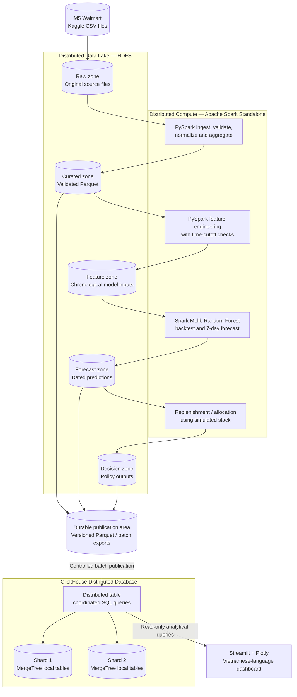
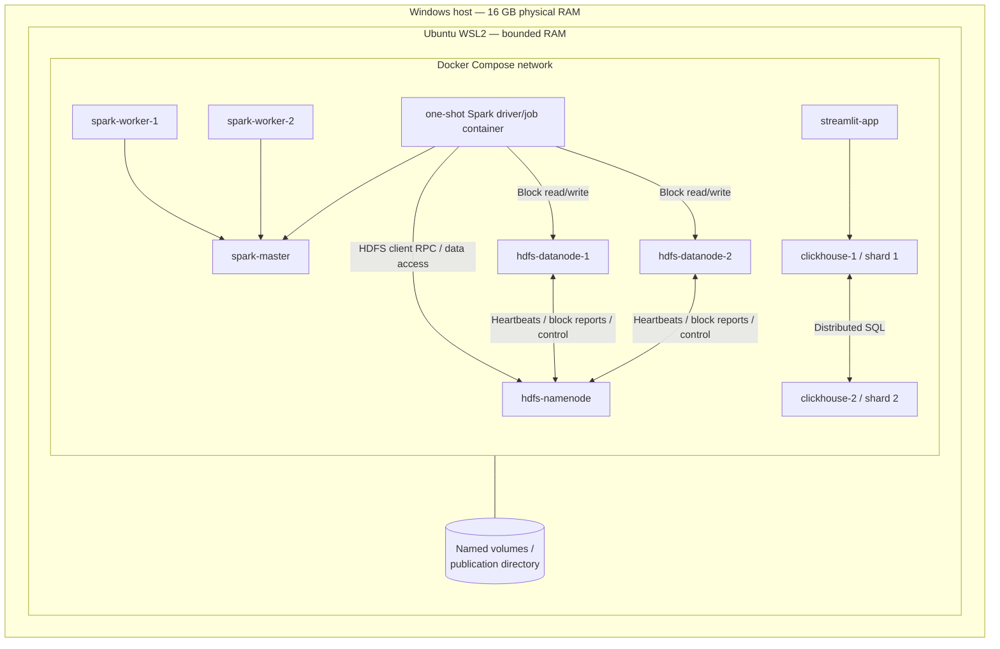
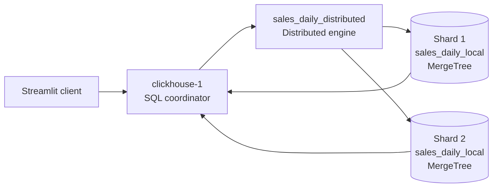
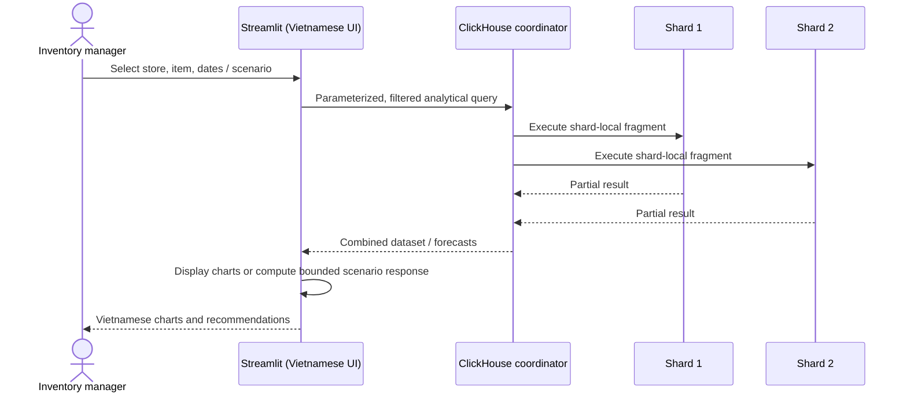

# 03 — System Architecture

> **Project:** Big Data–Driven Inventory and Distribution Optimization  
> **Original title:** Tối ưu hóa hệ thống quản lý kho hàng  
> **Course:** Introduction to Big Data  
> **Status:** Proposed architecture — implementation and performance are not yet verified  
> **Version:** 1.1  
> **Last updated:** October 15, 2026  
> **Maintainers:** Two-person project team  
> **Related documents:** [01 — Project Overview](01_PROJECT_OVERVIEW.md) · [02 — System Requirements](02_SYSTEM_REQUIREMENTS.md)

## 1. Purpose and Boundaries

This document defines the **system's components, responsibilities, data movement, deployment topology, operational modes, and architectural trade-offs**. It explains how the Big Data technologies fit together as a coherent system rather than a collection of disconnected demonstrations.

The solution is an **academic, batch-oriented decision-support prototype** for short-term inventory replenishment and store-level stock allocation. It is **not** a production warehouse management system, a live Walmart integration, a logistics route optimizer, or a high-availability cluster.

**Documentation and code language:** English. **End-user dashboard language:** Vietnamese. Official dataset fields and technology/product names keep their original identifiers.

### 1.1 Architectural goals

| ID | Goal | Architectural response |
|---|---|---|
| AG-01 | Process the genuine M5 sales history | HDFS stores source and curated data; Spark converts and processes the wide daily-sales matrix. |
| AG-02 | Demonstrate distributed storage | One HDFS NameNode and two independent DataNode containers with inspected file/block placement. |
| AG-03 | Demonstrate distributed computation | Spark Standalone Master plus two Worker containers; jobs execute distributed tasks on both Workers. |
| AG-04 | Apply reproducible machine learning | A separately runnable Spark MLlib Random Forest forecasting stage and chronological evaluation. |
| AG-05 | Demonstrate a **distributed database** | ClickHouse with **two shards, one replica per shard**, real data placement and distributed queries. |
| AG-06 | Support inventory decisions | Explicitly simulated inventory inputs; deterministic replenishment and constrained-allocation logic. |
| AG-07 | Keep the app lightweight | Streamlit reads prepared analytical and prediction outputs instead of triggering expensive batch jobs. |
| AG-08 | Remain viable on a 16 GB host | Resource limits, durable artifacts and **separate heavy-compute and serving phases** on WSL2. |
| AG-09 | Support academic verification | Clear dataset lineage, counts, job/cluster evidence, model metrics and business-policy comparisons. |

The design deliberately includes no Kafka, Flink, Kubernetes, dedicated API microservice, separate relational database, or additional ML service. None is necessary for this dataset, batch workflow, or demo scope.

### 1.2 Source-of-truth distinctions

- **Observed:** M5 daily unit sales, product/store hierarchy, calendar fields and weekly prices.
- **Derived:** Normalized sales, features, summaries, trained forecasts and evaluation metrics.
- **Simulated:** Store inventory, central warehouse supply, safety stock and operational constraints.
- **Calculated decisions:** Replenishment and allocation recommendations under the documented assumptions.

M5 sales are **recorded sales**, not a guaranteed measure of unconstrained customer demand. The inventory module must never imply that its simulated stock records are actual Walmart inventory.

## 2. Architecture at a Glance

### 2.1 Logical data flow



**Important:** Arrows show **logical dependencies**, not a requirement that every service run simultaneously. In particular, ClickHouse publication may happen after the Spark processing job has finished. The publication area makes these phases reproducible without holding the entire dataset in memory or requiring all containers to remain active.

### 2.2 Responsibilities and non-responsibilities

| Component | Owns | Explicitly does **not** own |
|---|---|---|
| **M5 data files** | Ground-truth historical sales and reference data | Real inventory, warehouse supply or transport network |
| **HDFS** | Raw and curated file storage; ML-oriented Parquet datasets | Dashboard SQL serving or application interaction |
| **PySpark** | Distributed transformation, validation, joins, feature generation and aggregates | Persistent dashboard state or interactive page rendering |
| **Spark MLlib** | Forecast training, batch scoring and quantitative model evaluation | Operational inventory availability or delivery-route decisions |
| **Inventory policy module** | Rule-based replenishment and supply-constrained quantity allocation | Replacing a forecasting model or proving global logistical optimality |
| **ClickHouse** | Sharded analytical serving tables and historical/forecast-result queries | Distributed model training, transactional ERP inventory, raw-file lake ownership |
| **Streamlit / Plotly** | Vietnamese-language filters, charts, scenario controls and recommendations | Expensive ETL, model retraining or fetching M5 directly from Kaggle |
| **Docker Compose / WSL2** | Repeatable local topology, service connectivity and resource boundaries | Resilience to physical-host failure |

**Why both HDFS and ClickHouse?** HDFS is the **batch-oriented source/curated data layer** read and written by Spark. ClickHouse is the **indexed/column-oriented, SQL-serving analytical layer** for fast filtered queries and shard evidence. The duplicated data is an intentional serving copy with an auditable publication boundary; the tools do not perform the same job.

## 3. Physical Deployment Topology

### 3.1 Host and operating environment

- **Physical machine:** Windows host with **16 GB RAM**.
- **Development/runtime:** Ubuntu under **WSL2**.
- **Container orchestration:** Docker Compose with named services, isolated Docker networking and durable volumes.
- **Initial WSL2 maximum RAM target:** approximately **10 GB**, configurable after measurement. This is a limit, **not** an amount pre-allocated at startup.
- **Source/data placement:** keep working datasets and Docker bind mounts in the Ubuntu Linux filesystem when practical (not large, actively processed files on `/mnt/c`).
- **Deployment claims:** different containers simulate different software nodes **on one physical host**. This validates distributed protocols and partitioned execution, **not** physical-machine fault tolerance.

### 3.2 Container/service topology



**HDFS protocol note:** NameNode carries namespace metadata and block-location control; actual HDFS block payloads are read from or written to DataNodes by HDFS clients. The diagram intentionally separates those paths.

The diagram represents **nine long-lived service roles** (3 HDFS + 3 Spark + 2 ClickHouse + 1 Streamlit) plus an **optional short-lived Spark job/driver container**. All nine are not required to be running throughout a full demo. A dedicated ClickHouse router container is unnecessary: a ClickHouse server can coordinate a query to its configured shards.

| Subsystem | Planned services | Notes |
|---|---|---|
| HDFS | `hdfs-namenode`, `hdfs-datanode-1`, `hdfs-datanode-2` | Start with replication factor **2** where storage allows; demonstrate replicas on two DataNodes. |
| Spark Standalone | `spark-master`, `spark-worker-1`, `spark-worker-2` | Jobs must actually schedule tasks on both Workers; control executor core/memory settings. |
| ClickHouse | `clickhouse-1`, `clickhouse-2` | One local `MergeTree` shard per server; `Distributed` engine queries a two-shard cluster. |
| Application | `streamlit-app` | Queries ClickHouse through one selected coordinator endpoint; no database-write requirement for normal viewing. |
| Batch launcher | Short-lived driver container / controlled `spark-submit` | Runs ingestion, quality checks, training and scoring as explicit jobs. |

### 3.3 Demonstrated distribution versus real availability

| Technology | Can demonstrate | Cannot claim |
|---|---|---|
| HDFS, 2 DataNodes | Distinct storage processes, block locations, file replication | Survival of physical-host failure; NameNode HA (not configured) |
| Spark, 2 Workers | Distributed execution, executors, tasks, partitions and shuffle | Parallelism across separate physical computers |
| ClickHouse, 2 shards × 1 replica | Rows physically split across shard tables; combined SQL across both | Replica-based high availability, safe loss of either shard or production-grade failover |

A **two-shard ClickHouse cluster without replication** is a distributed database configuration, but it is **not fault tolerant**. If one shard becomes unavailable, queries needing complete data may fail. Do not hide this limitation or set options that silently skip unavailable shards and then present partial results as complete.

## 4. Data Architecture

### 4.1 Primary dataset and grain

The primary input is the **M5 Forecasting – Accuracy** Walmart dataset:

| File | Role |
|---|---|
| `sales_train_evaluation.csv` | Daily sales history, 30,490 product–store series and 1,941 day columns (`d_1`–`d_1941`). |
| `calendar.csv` | Mapping from M5 day keys to dates, week identifiers and optional calendar/event attributes. |
| `sell_prices.csv` | Weekly item selling prices at each store, joined through store/item/week keys. |

When normalized, the daily-sales fact table has a **product–store–date grain**. Its expected initial count is:

```text
30,490 product-store series × 1,941 daily observations
= 59,181,090 product-store-day rows
```

This number refers to **observations after a reshape**, not 59 million independent customer transactions. Zero unit sales are meaningful values and must not automatically be interpreted as missing observations.

### 4.2 HDFS data zones and contracts

Illustrative logical paths (final exact paths are owned by `06_DATA_PIPELINE.md`):

```text
/data/warehouse/
  raw/m5/                         # Immutable original CSVs, source manifest
  curated/sales_daily/            # Parquet: item, store, date, units, dimensions
  curated/analytics/              # Filterable aggregations and reference data
  features/demand_forecasting/    # Leakage-controlled training/scoring features
  outputs/forecasts/              # Model predictions with run IDs and horizons
  outputs/evaluation/             # ML and business-policy metrics
  outputs/decisions/              # Replenishment/allocation outputs
```

| Dataset | Grain / unique logical key | Owner | Consumer |
|---|---|---|---|
| `sales_daily` | `(source_snapshot_id, item_id, store_id, date)` | Spark ETL | Spark features, ClickHouse analytics |
| `store_daily_sales` | `(source_snapshot_id, store_id, date)` | Spark analytics | ClickHouse / dashboard |
| `forecast_daily` | `(forecast_run_id, item_id, store_id, forecast_date)` | Spark ML | Inventory rules / ClickHouse / dashboard |
| `inventory_scenario` | `(scenario_id, issue_date, item_id, store_id)` | Simulation data generator | Inventory rules / dashboard |
| `replenishment_recommendations` | `(decision_run_id, item_id, store_id)` | Decision module | ClickHouse / dashboard |
| `allocation_recommendations` | `(decision_run_id, policy_id, item_id, store_id)` | Decision module | ClickHouse / dashboard |
| `forecast_metrics` | `(evaluation_run_id, holdout_id, method_id, metric_name, horizon)` | Evaluation stage | ClickHouse / dashboard / report |
| `inventory_policy_evaluation` | `(evaluation_run_id, decision_run_id, policy_id, item_id, store_id, issue_date)` | Decision evaluation stage | ClickHouse / dashboard / report |

The precise column types, nullable fields, partition strategy and storage schemas are specified separately in `04_DATASET.md`, `06_DATA_PIPELINE.md`, `09_DATABASE_DESIGN.md`, and the machine-readable [`CONTRACTS.md`](CONTRACTS.md). These keys establish boundaries; they are **not yet implemented schemas**.

### 4.3 Storage formats and partition strategy

- **Raw zone:** original CSV files preserved unchanged; source manifest records provenance, file sizes and optional checksums.
- **Curated zone:** columnar **Parquet** for efficient Spark scans; use sensible partitions (for example, month or store plus a coarse time bucket) and avoid thousands of tiny files.
- **HDFS replication:** initially factor 2 for demonstration, subject to disk capacity; file and block placements must be verified.
- **ClickHouse:** append/rebuild controlled analytical tables organized for time-bounded product/store filtering. Avoid treating ClickHouse as a transactionally updated source of inventory truth.
- **Dataset versioning:** every published forecast and decision batch carries its distinct `forecast_run_id` or `decision_run_id`, issue date, model lineage, source snapshot, scenario and policy references, and publication identity so results are not mixed across incompatible runs.

### 4.4 Data correctness invariants

The ETL and publication process must verify at least:

1. Every normalized sales record has non-null, valid **item**, **store**, **date**, and a nonnegative integral **unit sales** value.
2. Calendar joins do not create duplicate `(item_id, store_id, date)` rows.
3. Weekly price joins do not duplicate sales records; unavailable prices are handled explicitly rather than silently treated as zero.
4. Row counts are reconciled before and after normalization; the initial expected long-form count is **59,181,090** if all 1,941 values in every series are retained.
5. ClickHouse publication counts and aggregates are compared with the source curated outputs.
6. Forecast issue date strictly precedes the forecast dates, and features cannot use sales occurring after the issue date.
7. No chart or business claim blends **observed**, **forecast**, and **simulated** values without visible labeling.

## 5. Processing and Forecasting Architecture

### 5.1 Batch, not streaming

The dataset is a fixed historical export. A **batch pipeline** is the appropriate architecture. Kafka and Spark Structured Streaming would add operational complexity but no genuine streaming source or requirement.

Recommended logical jobs:

| Job | Input | Main operation | Output |
|---|---|---|---|
| `J01 — Ingest / profile` | Original CSVs | Record source metadata, validate expected fields | Raw HDFS files and quality report |
| `J02 — Normalize sales` | Raw sales + calendar | Reshape wide daily columns, map dates, validate keys | Curated Parquet `sales_daily` |
| `J03 — Enrich / aggregate` | `sales_daily` + prices | Join reference data and calculate dashboard aggregates | Curated/analytical Parquet |
| `J04 — Build features` | Chronological curated history | Leakage-safe lag/rolling/calendar features | Training/scoring feature sets |
| `J05 — Train / evaluate` | Feature sets | Random Forest, chronological holdout, baseline comparison | Model artifact and metric outputs |
| `J06 — Forecast` | Model + eligible series features | Seven-day predictions | `forecast_daily` |
| `J07 — Decide / evaluate` | Predictions + stock scenarios | Replenishment, supply-constrained allocation, policy backtest | Decision and policy-metric outputs |
| `J08 — Publish` | Validated Parquet / batch exports | Load ClickHouse shards; reconcile rows/aggregates | Query-ready ClickHouse tables |

These are **logical stages**, not a demand for eight separately deployed applications. Several can share modules or scripts. Each stage must have a defined input, output, repeatable execution and a failure checkpoint.

### 5.2 ML boundary

- **Algorithm:** Spark MLlib `RandomForestRegressor`.
- **Objective:** predict store–item unit sales for the **next seven days**.
- **Historical evaluation:** split by date; keep future targets out of earlier features.
- **Forecast output:** one row per eligible item–store–forecast-date, keyed by `forecast_run_id` with `model_run_id` lineage and the issue date.
- **Baseline:** a transparent historical method, such as trailing-period sales average or seasonal naive prediction.
- **Metrics:** MAE, RMSE and WAPE where mathematically applicable.

The precise multi-step forecasting strategy (direct horizon-specific versus recursive, feature snapshot rules and selection of training series) remains a **design decision for `07_MACHINE_LEARNING.md`** and must be finalized **before implementation**. The architecture requires the **seven dated outputs and honest coverage reporting**, not a particular internal forecasting trick. A 16 GB host may require training on a documented subset of eligible series or time windows; this must not be confused with processing the full normalized M5 history in Spark.

### 5.3 Inventory decision boundary

The recommendation layer receives **forecasted sales plus a reproducible simulated inventory scenario**. It:

1. Calculates replenishment needs for each eligible item–store over the declared planning window.
2. Applies a documented safety-stock or service-level rule.
3. Respects available central supply when allocating quantities to stores.
4. Produces nonnegative, integer recommendations and exposes unfulfilled demand when supply is insufficient.
5. Compares proposed policies against transparent baselines under **the same simulation conditions**.

The outcome is an evaluated **decision policy**, not proof of a globally optimal real-world logistics plan. Route planning and physical delivery costs remain out of scope. See `08_BUSINESS_RULES_AND_OPTIMIZATION.md` for rules, tie-breaking, constraints and edge cases.

## 6. ClickHouse Distributed Query Architecture

### 6.1 Two-shard design



- ClickHouse shard nodes run as **separate server containers with separate durable storage volumes**.
- Both are declared in a common **static cluster configuration** such as `warehouse_cluster`.
- Each shard stores a subset of records in a local `MergeTree` table.
- Queries to a `Distributed` table contact the configured shards and combine results.
- A stable sharding key derived from `(item_id, store_id)` is a reasonable **candidate**: it can keep a store–item time series on one shard. Validate distribution skew before finalizing the expression.
- **No Keeper/ZooKeeper is required solely to demonstrate plain `MergeTree` tables behind static `Distributed` tables**. Distributed DDL (`ON CLUSTER`) is not a dependency in the initial design: create matching tables/configuration explicitly on each server.
- With one replica per shard, replication/high availability is **not provided**. No third ClickHouse router node is required for this prototype.

**Read/write pattern:** the app performs bounded analytical reads; a controlled publication process inserts batches. The project does not require high-frequency row-by-row transactional stock updates or real-time event ingestion.

### 6.2 Publishing from Spark to ClickHouse

Spark produces **durable, validated Parquet outputs** before ClickHouse ingestion. `J08` reads those published outputs and inserts them in manageable batches using a compatible connector or ingestion client, through a `Distributed` table or explicitly targeted shards with verified partition logic.

A defensible initial approach is:

1. Finish the heavy Spark transform/forecast stage.
2. Materialize required outputs to **versioned Parquet**, with a bounded local/container-accessible publication area if ingestion runs without HDFS.
3. Load analytics and forecast tables **incrementally by bounded files/time batches**; avoid collecting 59 million rows into Python driver memory.
4. Verify total counts, per-shard counts, duplicates and reference aggregates before marking the batch **published**.
5. Expose only a validated dataset/run to Streamlit; when an import fails, retain the previously valid outputs or rebuild an isolated table.

The team should **aim to publish the full normalized fact dataset** to demonstrate ClickHouse scale if hardware and disk tests confirm feasibility. If only a documented analytical subset fits, the dashboard and defense must state the exact loaded population; it is unacceptable to imply that ClickHouse stores all 59.18 million rows when it does not.

### 6.3 Evidence queries (illustrative)

```sql
-- The cluster must contain two distinct shard entries.
SELECT shard_num, host_name
FROM system.clusters
WHERE cluster = 'warehouse_cluster'
ORDER BY shard_num;

-- Inspect rows assigned to each physical shard through the Distributed table.
SELECT _shard_num AS shard, count() AS rows_on_shard
FROM warehouse.sales_daily
GROUP BY _shard_num
ORDER BY shard;

-- Verify cross-shard aggregation through the same query endpoint.
SELECT store_id, sum(unit_sales) AS units_sold
FROM warehouse.sales_daily
GROUP BY store_id
ORDER BY units_sold DESC;
```

These names are **proposed contracts**, not claims that tables exist today. The full DDL, type choices, sharding expression, ingestion protocol and query plans belong in `09_DATABASE_DESIGN.md`.

## 7. Serving and Application Architecture

### 7.1 Read-oriented interactive application



The four user-facing views are:

| View (Vietnamese label) | What it shows | Typical source |
|---|---|---|
| **Tổng quan** | Sales history, products, stores, trends and summary indicators | ClickHouse aggregates / sales fact |
| **Dự báo nhu cầu** | Seven dated predictions for a selected store–item pair, alongside model information | Published predictions and metrics |
| **Tồn kho** | Clearly simulated inventory, stock risk and recommended replenishment quantities | Scenario inputs + published forecasts/decisions |
| **Phân bổ hàng** | How constrained central supply is divided across stores; baseline comparison | Simulated scenario + published policy outputs |

All **visible** UI labels, charts, explanatory messages and warnings must be in **Vietnamese**. Engineering names (variables, classes, table schemas, comments, scripts and docs) remain **English**.

### 7.2 Interaction and state boundaries

- **Read-only analytical flow:** Streamlit issues filtered, parameterized ClickHouse queries. It should never load the entire 59-million-row fact table into its memory.
- **Scenario adjustments:** simple user-controlled inventory/supply parameters may be held in Streamlit session state or a versioned scenario file, with calculated results rendered immediately on **bounded data**. No additional transactional database is required for the demo.
- **Batch calculation:** large-scale recommendation comparisons are computed in an offline stage and published as read-ready results.
- **Model lifecycle:** no retraining from dashboard buttons. A new model/run is produced through the controlled pipeline, then published.
- **Caching:** only safe query results, keyed by filters and publication version, may be cached; prevent stale forecast/scenario mixing.

A separate FastAPI backend is **not part of the initial architecture** because Streamlit can directly query the analytical store and execute small scenario calculations. Add an API layer only if testing reveals a concrete need such as shared external clients or robust access control.

## 8. Execution Modes and Resource Strategy

The 16 GB host does not have 16 GB freely available to containers. Windows, WSL2, Docker, JVM runtimes, ClickHouse, the app and filesystem cache all share physical memory. **Memory limits must be tested empirically.**

| Mode | Primary active components | Purpose | Expensive tasks to keep stopped |
|---|---|---|---|
| **A — Data engineering** | HDFS (3) + Spark (3) + short-lived driver | Ingest, validate, normalize and write curated Parquet | ClickHouse bulk ingest, UI if memory tight |
| **B — ML / decision batch** | HDFS + Spark + driver | Train, backtest, predict and calculate scenarios | ClickHouse merge-heavy ingestion |
| **C — Publication** | ClickHouse (2) + publication job, optional HDFS if source files are needed | Ingest staged analytical outputs and validate shard counts | Spark executors and heavy ML jobs |
| **D — Dashboard demo** | ClickHouse (2) + Streamlit | Fast, stable visual demonstration | Spark training and large ETL jobs |
| **E — Technical proof** | Bring up HDFS/Spark/ClickHouse **as needed** | Capture authentic UI/query evidence | Unnecessary concurrent full-scale workloads |

**Persistence makes modes safe:** HDFS data uses persistent volumes; ClickHouse tables use independent persistent volumes; Parquet/model artifacts and publication manifests have durable locations. Stopping compute containers does not imply deleting their outputs.

### 8.1 Initial resource policies (not promises)

- Begin with a **10 GB WSL2 memory cap**, then measure host and guest memory pressure before increasing it.
- Explicitly cap Spark Worker CPU and memory; prevent Spark executors from taking the entire guest allocation.
- Use bounded JVM heaps for Hadoop and Spark daemons; do not accept unrestricted container defaults blindly.
- Constrain ClickHouse memory/query settings and load data in batches; allow background merges to settle before benchmarking.
- Use Parquet, streaming/batched reads and disk spill; avoid `collect()`, `toPandas()` or a global `coalesce(1)` on the full fact table.
- Reserve free disk for HDFS replicas, intermediate shuffle, ClickHouse storage and WSL2's virtual disk; measure real output sizes rather than assuming they equal the Kaggle compressed download size.
- For model training, start with a representative, time-consistent sample; report training coverage separately from the full historical dataset processed by Spark.

No arbitrary throughput, latency, accuracy, or container-heap target is presented as a guaranteed achievement. Those values must be discovered and documented during testing.

## 9. Operational Contracts, Lineage and Recovery

### 9.1 Batch run contract

Every major stage should record enough metadata to reproduce its outcome:

```text
source_version / source file manifest
source_snapshot_id
pipeline_run_id
sales_data_cutoff_date
pipeline_code_version
forecast_issue_date and horizon
model_run_id and training_window
forecast_run_id, where applicable
scenario_id and parameters, where applicable
decision_run_id, evaluation_run_id, publication_id, where applicable
row_counts_in / row_counts_out
status: completed | validated | failed; publication approval is a separate APPROVED state
artifact_paths and execution timestamps
```

A text or JSON manifest alongside outputs is sufficient for the prototype; **a workflow orchestration platform is not necessary**.

### 9.2 Consistency and idempotency

- Raw source files are treated as **immutable**.
- ETL outputs are written to run-specific or temporary paths and exposed as final only after validation.
- A failed or repeated ingestion must **not silently double-count** ClickHouse sales. Use controlled replacement/rebuild or a validated publication/swap strategy rather than blindly appending the same batch twice.
- Published dashboard outputs must refer to a **single compatible set of source/forecast/scenario versions**.
- Partial ClickHouse imports must not be labeled as a complete dataset.

ClickHouse does not provide the same transactional workflow semantics as a conventional OLTP inventory database. For this batch analytical prototype, **controlled publication** is the appropriate consistency boundary.

### 9.3 Expected failure and recovery paths

| Failure | Expected behavior / recovery |
|---|---|
| Missing/corrupt CSV | Stop ingestion, report source file and schema error; keep prior raw files intact. |
| Missing/duplicate day mapping | Fail dataset-quality checks before training/publication. |
| Spark out-of-memory | Reduce batch size/feature scope and tune worker memory/partitions; restart from persisted prior stage. |
| HDFS unavailable | Do not run dependent Spark reads; restore NameNode/DataNode services and check file/block health. |
| ClickHouse shard unavailable | Declare analytics unavailable/incomplete; do not show partial totals as complete. |
| Partial or repeated publication | Reconcile manifest and shard counts; recover from a stable output snapshot or rebuild target tables. |
| Model cannot forecast a requested series | Show a Vietnamese explanation of forecast coverage; do not fabricate a value. |
| Simulated inventory input invalid | Validate nonnegative integer quantities and reject invalid scenario values. |

## 10. Observability and Defense Evidence

The goal is **verifiable behavior**, not screenshots of technologies that are merely installed.

| Claim | Minimum credible evidence | What would **not** suffice |
|---|---|---|
| “HDFS is used” | Actual source/curated files visible in HDFS, DataNode status, replication/block-location inspection | A running HDFS container with empty directories |
| “Spark processing is distributed” | Real ingestion/ETL job with tasks/executors scheduled across the two configured Workers | A script that imports PySpark but runs in `local[*]` |
| “The data is large” | Source file manifest; count and grain of long-form rows; retained transformation code | Calling 59M records “transactions”; repeating data to inflate counts |
| “Machine learning is used” | Model training job, held-out predictions, reproducible metrics and baseline | A chart of manually entered future sales |
| “ClickHouse is distributed” | Two shard entries, separate local data placement, distributed aggregation and reconciliation | Two isolated databases that never form one logical query |
| “Inventory is optimized” | Declared scenario, rules/constraints, baseline comparison and measured outcomes | Claiming reduced real Walmart cost without stock/cost data |
| “The app works” | Vietnamese UI reading real published forecasts and recommendations | Static screenshots unrelated to pipeline results |

Technical testing, benchmark methodology, expected outputs, and acceptance evidence are specified in [`11_TESTING.md`](11_TESTING.md).

## 11. Architecture Decisions and Trade-offs

| ADR | Decision | Reasoning | Accepted trade-off |
|---|---|---|---|
| ADR-01 | Use **batch** instead of streaming | M5 is historical static data; no live event requirement | No real-time warehouse update capability |
| ADR-02 | Use **HDFS** as the data lake | Directly demonstrates file-based distributed storage for Spark | Operational overhead compared with a local filesystem |
| ADR-03 | Use **Spark Standalone** with 2 Workers | Real distributed execution, lower complexity than Kubernetes/YARN | All software workers share one host |
| ADR-04 | Use **Spark MLlib Random Forest** | Aligns with project ML goal and Spark data flow | Resource-aware training scope required; not guaranteed best model |
| ADR-05 | Use **ClickHouse Distributed, 2 shards** | True distributed database queries, suited to historical sales analytics | No shard replication or high availability |
| ADR-06 | Use **Parquet and staged publication** | Enables checkpoint/restart and separates heavy compute from serving | Extra disk storage and explicit consistency checks |
| ADR-07 | Use **Streamlit only** for the UI | Simple Vietnamese demo without needless API/service layers | Not a multi-user transactional production application |
| ADR-08 | Use **simulated inventory** with explicit provenance | M5 lacks operational stock and transport data | Decision outcomes are simulation-based only |
| ADR-09 | Run resource-intensive jobs in **separate modes** | Fits 16 GB physical RAM and improves demo reliability | The entire pipeline is not concurrently active at all times |

### 11.1 Complexity budget

A technology is justified only if it adds demonstrable value against implementation, memory and operational costs. The selected stack is deliberately at the **upper end of acceptable complexity** for a two-person, 16 GB WSL2 academic prototype. **Do not add another data platform, message broker or database unless a tested requirement cannot be met by this architecture.**

## 12. Interfaces and Document Ownership

| Boundary/interface | Contract | Detailed owner |
|---|---|---|
| Kaggle CSV → HDFS raw | Data source, integrity, original column meanings | [`04_DATASET.md`](04_DATASET.md) |
| HDFS raw → Spark curated | ETL transformations, partitioning, data quality | [`06_DATA_PIPELINE.md`](06_DATA_PIPELINE.md) |
| Curated → Spark MLlib | Features, label semantics, splits, forecasting strategy | [`07_MACHINE_LEARNING.md`](07_MACHINE_LEARNING.md) |
| Predictions → inventory decisions | Inventory assumptions, equations, allocation constraints | [`08_BUSINESS_RULES_AND_OPTIMIZATION.md`](08_BUSINESS_RULES_AND_OPTIMIZATION.md) |
| Published artifacts → ClickHouse | DDL, sharding key, write/load method and SQL | [`09_DATABASE_DESIGN.md`](09_DATABASE_DESIGN.md) |
| ClickHouse → Streamlit | Filters, page behavior, visualization and Vietnamese copy | [`10_APPLICATION_DESIGN.md`](10_APPLICATION_DESIGN.md) |
| All components → verification | Software, data-quality, integration and distributed-system tests, performance evaluation, and acceptance evidence | [`11_TESTING.md`](11_TESTING.md) |
| Whole system → acceptance | FR/NFR and traceability | [`02_SYSTEM_REQUIREMENTS.md`](02_SYSTEM_REQUIREMENTS.md) |
| Technology choices → compatibility | Versions, environment and alternatives | [`05_TECH_STACK.md`](05_TECH_STACK.md) |

This document defines **interfaces and reasoning**, not full Docker Compose YAML, production credentials, final SQL schemas, screen-by-screen UI wireframes or ML training code. Those belong in implementation or the more specific documents above.

### 12.1. Requirement-to-architecture mapping

The following mapping identifies **which architectural component makes each requirement feasible**. It is not a substitute for the acceptance tests in `02_SYSTEM_REQUIREMENTS.md`.

| Requirement IDs | Architectural responsibility | Primary verification boundary |
|---|---|---|
| FR-01, DR-01–DR-02 | Dataset manifest and original raw HDFS files | Source provenance, record grain and audited row counts |
| FR-02, NFR-01 | HDFS NameNode and two DataNodes | HDFS paths, block locations and DataNode status |
| FR-03–FR-05, DR-03 | Spark ETL, curated Parquet and feature generation | Executed Spark job, validation report and schema/row-count checks |
| FR-06–FR-08, DR-05–DR-06 | Spark MLlib training, holdout evaluation and batch scoring | Model artifact, baseline metrics and dated forecast outputs |
| FR-09–FR-12, DR-04, DR-08 | Simulated stock scenarios and decision-policy stage | Reproducible assumptions, stock constraints and policy backtests |
| FR-13, NFR-03, DR-07 | Two ClickHouse shards, local MergeTree and Distributed query table | Distinct physical shard counts and reconciled distributed SQL |
| FR-14–FR-17, NFR-07–NFR-08 | Read-oriented Streamlit/Plotly application | Four Vietnamese pages and explicit error/empty states |
| FR-18, NFR-04–NFR-06, NFR-09 | Run manifests, observability and resource-aware operating modes | Repeatable evidence and honestly reported measurements |

## 13. Open Design Questions to Resolve Before Coding

These are explicitly **open**, not decisions silently assumed to be complete:

1. **Exact pinned versions:** Which compatible Hadoop, Spark/PySpark, Java, Python and ClickHouse versions will be built together? (`05_TECH_STACK.md`)
2. **Seven-day forecasting formulation:** How will the model generate leakage-free daily predictions for horizons 1–7? (`07_MACHINE_LEARNING.md`)
3. **Forecast coverage:** Which product–store series will be scored and demoed if resource limits prevent training/scoring all series? (`07_MACHINE_LEARNING.md`)
4. **Parquet layout:** Which partition granularity and output file targets minimize small files while supporting joins and scans? (`06_DATA_PIPELINE.md`)
5. **ClickHouse sharding and publication:** Which sharding expression, ingestion method and safe rerun/swap strategy are used? (`09_DATABASE_DESIGN.md`)
6. **Inventory scenario:** How are deterministic opening stock and central supply generated and how are constraints measured? (`08_BUSINESS_RULES_AND_OPTIMIZATION.md`)
7. **Hardware benchmarking:** Which resource ceilings and running modes remain stable on the actual 16 GB Windows + WSL2 machine? (`11_TESTING.md`)

The team should resolve these through **small, measured spikes** rather than by prematurely adding more infrastructure.

## 14. Primary Technical References

- [Apache Hadoop — HDFS Architecture](https://hadoop.apache.org/docs/stable/hadoop-project-dist/hadoop-hdfs/HdfsDesign.html): NameNode, DataNodes, blocks and replication.
- [Apache Spark — Standalone Mode](https://spark.apache.org/docs/latest/spark-standalone.html): master/worker topology, executors and resource controls.
- [Apache Spark — MLlib](https://spark.apache.org/docs/latest/ml-guide.html): distributed machine-learning pipelines and estimators.
- [ClickHouse — Distributed Table Engine](https://clickhouse.com/docs/engines/table-engines/special/distributed): cluster/shard routing and distributed SQL behavior.
- [ClickHouse — MergeTree Table Engine](https://clickhouse.com/docs/engines/table-engines/mergetree-family/mergetree): local analytical table storage.
- [Microsoft — WSL Configuration](https://learn.microsoft.com/en-us/windows/wsl/wsl-config): `.wslconfig` guest limits and related settings.
- [Kaggle — M5 Forecasting Accuracy Dataset](https://www.kaggle.com/competitions/m5-forecasting-accuracy/data): dataset provenance and source files.

---

**Architecture commitment:** Real HDFS file distribution, real Spark worker execution and real ClickHouse sharding are **three separate, testable responsibilities**. Machine-learning forecasts and inventory decisions must be independently evaluated, clearly traced to their inputs and honestly labeled when they rely on simulation. The architecture should remain explainable, reproducible and stable on a 16 GB host—not complex for complexity's sake.
