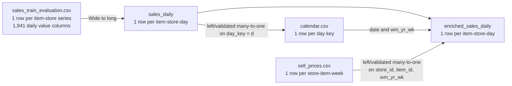

# 04 — Dataset Specification and Data Understanding

> **Project:** Big Data–Driven Inventory and Distribution Optimization  
> **Original Vietnamese title:** Tối ưu hóa hệ thống quản lý kho hàng  
> **Course:** Introduction to Big Data  
> **Document type:** Dataset specification, source provenance, and data-quality contract  
> **Status:** Design baseline — source facts verified from published documentation; project-specific profiling results pending execution  
> **Version:** 1.0 — October 15, 2026  
> **Primary source:** [Kaggle — M5 Forecasting – Accuracy](https://www.kaggle.com/competitions/m5-forecasting-accuracy/data)

## 1. Purpose and Document Boundaries

This document explains **what the dataset is, where it comes from, how its records are organized, which fields can be trusted for which purposes, and how the project will validate and use them**. It is the data reference for both team members and for the project defense.

This document owns:

- The source dataset, original filenames, usage conditions, and provenance requirements.
- Source tables, field meanings, row granularity, identifiers, and join relationships.
- Correct interpretation of data volume, date coverage, and zero-sales observations.
- Known gaps, limitations, data-quality risks, and acceptance checks.
- The boundary between **observed**, **derived**, **forecast**, and **simulated** data.

This document does **not** own full Spark ETL implementation (`06_DATA_PIPELINE.md`), forecasting design (`07_MACHINE_LEARNING.md`), stock-policy formulas (`08_BUSINESS_RULES_AND_OPTIMIZATION.md`), physical ClickHouse tables (`09_DATABASE_DESIGN.md`), or dashboard wireframes (`10_APPLICATION_DESIGN.md`). Requirements are defined in [`02_SYSTEM_REQUIREMENTS.md`](02_SYSTEM_REQUIREMENTS.md); the end-to-end topology is defined in [`03_SYSTEM_ARCHITECTURE.md`](03_SYSTEM_ARCHITECTURE.md).

**Language convention:** technical documentation, source code, metadata keys, table names, and logs are in **English**. All user-facing Streamlit text is in **Vietnamese**. Original M5 column names are preserved.

**Evidence convention:** published dataset characteristics below are reference values. The team must record **actual** row counts, file sizes, checksums, null rates, and processing results from its own downloaded copy before calling them verified experiments.

---

## 2. Dataset Identity, Source, and Authorization

| Property | Description |
|---|---|
| Official name | **M5 Forecasting – Accuracy** |
| Source | Kaggle competition dataset associated with the M5 forecasting competition; the records describe Walmart retail unit sales. |
| Official page | <https://www.kaggle.com/competitions/m5-forecasting-accuracy/data> |
| Original competition goal | Forecast **28-day** retail item sales at multiple aggregation levels. |
| This project's goal | Forecast **seven days** of observed unit sales and use the forecasts for **simulated** replenishment and store allocation decisions. |
| Dataset modality | Structured, historical, batch CSV files; **not** a live sales feed. |
| Geographic scope | Ten stores in three U.S. states: California (`CA`), Texas (`TX`), and Wisconsin (`WI`). |
| Catalog scope | 3,049 distinct item identifiers appearing across ten store-level series per item. |
| Source access | Kaggle account/competition-rule acceptance may be required. |
| Redistribution | **Do not assume an unrestricted open-data license.** Follow the competition rules; share the official link and acquisition steps rather than committing raw source files to a public Git repository. |

### 2.1. Why M5 is appropriate

M5 is suitable because it provides a **multiyear, multistore, product-level sales history**, accompanied by calendar and price context. It supports:

1. Distributed parsing, normalization, aggregation, and quality checks.
2. Store/product-level historical analytics.
3. Time-aware demand forecasting using Spark MLlib.
4. Replenishment and allocation **experiments based on declared simulated inventory**, rather than invented claims about Walmart's actual stock.
5. A factual comparison of Spark processing, HDFS file distribution, and ClickHouse distributed analytical queries.

**Scope caveat:** M5 is sufficiently substantial for a student-scale Big Data pipeline, but its downloadable size is not “petabyte scale,” and a wide-to-long reshape does **not** create new transactions. The team must demonstrate the engineering work; row count alone does not prove distributed computing is necessary.

### 2.2. Acquisition and source manifest

Recommended acquisition is through the official Kaggle competition page or its authenticated competition-download interface after accepting applicable rules. An example CLI invocation (subject to the user's Kaggle setup) is:

```bash
kaggle competitions download -c m5-forecasting-accuracy -p ./data/downloads
```

The pipeline does not perform this download and cannot verify Kaggle's download time. The
supported manual acquisition workflow is to download and extract the package externally,
then copy the original CSVs unchanged into `data/m5/source/` (or another explicit source
directory). Keep that directory read-only for profiling and ingestion; work on versioned
derived outputs instead of altering the source files. After the copy, record a **source
manifest** through the profiling command.

| Manifest field | Meaning | Required? |
|---|---|---|
| `source_name` | `M5 Forecasting - Accuracy` | Yes |
| `source_url` | Official competition data URL | Yes |
| `downloaded_at_utc` | Actual UTC date/time of acquisition, when known; `null` means unknown | Optional (field remains present) |
| `profiled_at_utc` | UTC time automatically observed when local profiling ran | Generated in `source_profile.json` |
| `original_archive_name` | Downloaded archive filename if applicable | When applicable |
| `source_file` | Individual original CSV filename | Yes |
| `size_bytes` | Actual local file size in bytes | Yes |
| `sha256` | SHA-256 checksum of source file | Recommended |
| `source_schema_version` | Team-managed identifier for source schema/snapshot | Yes |
| `source_file_row_count` | Measured data rows excluding header | Yes |
| `notes` | Extraction method, warnings, deviations | As needed |

`downloaded_at_utc` is provenance metadata, not a data-quality result. Do not substitute
the current time, file modification time, or ingestion time when the actual acquisition
time is unavailable. `source_url` remains required and must be the official M5 Kaggle URL.
`profiled_at_utc` describes the profiling operation and is distinct from acquisition time
and manifest lifecycle fields such as `created_at` and `completed_at`.

**Current status:** no locally executed manifest or verified file-level profile has been supplied. All fields requiring measurement remain **TBD** until ingestion.

### 2.3 Cross-module source identity

`source_version` identifies the immutable acquired raw package and is created by J01 from
the canonical sorted present filenames and their source-file SHA-256 checksums. It is
stable for the same CSV bytes regardless of `downloaded_at_utc` or profiling time.
`source_snapshot_id` identifies the immutable validated curated derivation created after
the J02/J03 quality gates. A curated or downstream artifact must retain the parent
`source_version` in its manifest even when its row-level contract uses
`source_snapshot_id`. These identifiers are not interchangeable: a new acquisition or a
different validated derivation cannot silently reuse the other identity.

---

## 3. Source File Inventory

The official dataset package contains **five CSV files**.

| Original file | Contents | Role in this project |
|---|---|---|
| `sales_train_evaluation.csv` | Product/store daily **unit sales** from `d_1` through `d_1941` | **Primary sales-history input** |
| `sales_train_validation.csv` | An earlier snapshot of those sales series, `d_1` through `d_1913` | Optional consistency check; **not** an additional independent history |
| `calendar.csv` | Daily dates, Walmart week keys, events, and SNAP indicators | Day-key/date mapping and known calendar context |
| `sell_prices.csv` | Selling price by `(store_id, item_id, wm_yr_wk)` | Weekly price enrichment; missing joins must be handled explicitly |
| `sample_submission.csv` | Competition forecast-submission template | Reference only; **not** a source of observed sales or target labels |

### 3.1. Critical non-duplication rule

`validation` and `evaluation` describe essentially **the same product–store series at different historical cutoffs**. The evaluation file includes the historical period already present in validation, plus 28 additional observed days. **Never concatenate these two files as if they represented separate sales transactions.**

The project uses `sales_train_evaluation.csv` as its canonical observed-sales input. The earlier validation snapshot is retained only for checks or reproducible comparisons where needed.

### 3.2. Reference scale

| Metric | Reference value | Interpretation |
|---|---:|---|
| Distinct products | **3,049** | Unique `item_id` catalog |
| Stores | **10** | Four in CA, three in TX, three in WI |
| States | **3** | `CA`, `TX`, `WI` |
| Bottom-level series | **30,490** | 3,049 item–store combinations |
| Evaluation sales days | **1,941** | `d_1` to `d_1941`, inclusive |
| Validation sales days | **1,913** | `d_1` to `d_1913`, inclusive |
| Calendar days | **1,969** | `d_1` to `d_1969`, inclusive |
| Calendar columns | **14** | Including `d`, `date`, events and SNAP fields |
| Weekly-price records | **approximately 6.84 million** | Published reference; measure actual imported CSV rows |
| Kaggle package size | **approximately 450.47 MB** | Kaggle-reported file package size; not a measured HDFS/Parquet size |
| Evaluation source sales matrix | **30,490 rows × 1,941 daily values** | Wide format; separate metadata columns also exist |
| Full unfiltered daily observations | **59,181,090** | Product–store–day rows **after normalization** |

**Do not state:** “59 million products,” “59 million orders,” or “59 million customer transactions.” Each long-form row corresponds to one **product at one store on one day**, including days with zero recorded sales.

---

## 4. Business Grain and Data Semantics

### 4.1. Four distinct concepts

| Concept | Definition | Example / caution |
|---|---|---|
| Product | A distinct `item_id` in the catalog | 3,049 products, **not** 30,490 distinct products |
| Item–store series | One `item_id` sold/represented at one `store_id` | A product in CA_1 is a different series from the same product in TX_1 |
| Daily sales observation | Number of units recorded as sold for that item/store/day | `unit_sales = 0` is still an observation |
| Transaction / order | An individual customer's purchase event | **Not provided** in M5 daily sales; cannot be counted from this dataset |

### 4.2. Important retail interpretation

- `unit_sales` is **observed units sold**, not verified underlying customer demand.
- A zero-sales day can represent low demand, prelaunch unavailability, discontinuation, or a stockout; without actual stock records, its cause is usually unknown.
- A positive sales value does not reveal customers, baskets, individual orders, profit margin, or available inventory.
- Weekly prices can support analysis of associations with sales but do **not**, by themselves, establish causal price elasticity.
- The target of the ML task should be labeled **predicted unit sales**. “Demand forecast” is an accepted business shorthand, provided the sales-versus-unconstrained-demand limitation is disclosed.

---

## 5. Source Schema: `sales_train_evaluation.csv`

### 5.1. Physical layout and keys

**Row grain:** one historical series identified by a product and a store.  
**Logical unique key:** `(item_id, store_id)` within this source snapshot.  
**Observed sales-value columns:** `d_1`, `d_2`, ..., `d_1941`.  
**Expected shape:** **30,490 data rows × 1,947 columns** (6 identifying columns + 1,941 day columns).

| Column | Suggested logical type | Meaning / required handling |
|---|---|---|
| `id` | String | Competition series ID, usually containing a snapshot suffix such as `_evaluation`; retain as provenance, **not** the sole cross-snapshot key |
| `item_id` | String | Product identifier; retain the original text |
| `dept_id` | String | Product department identifier |
| `cat_id` | String | Broader product category identifier |
| `store_id` | String | Store identifier |
| `state_id` | String | State identifier, e.g. CA/TX/WI |
| `d_1` ... `d_1941` | Nonnegative integer (after validation) | Units sold by this item/store on the specified relative day |

Hierarchy (source dimension semantics):

```text
Category (cat_id)
  └── Department (dept_id)
       └── Item (item_id)
            └── Store (store_id) / State (state_id)
```

The dataset has **three broad categories**: `FOODS`, `HOBBIES`, and `HOUSEHOLD`. The team's profile must verify category and department distinct counts from the downloaded files. Keep all ID fields as strings even if some identifiers end with numbers.

### 5.2. Canonical long format

Before feature engineering, normalize into one record per observed **item–store–day**:

| Canonical logical field | Type / semantics | Origin |
|---|---|---|
| `item_id` | Non-null string | Original sales file |
| `store_id` | Non-null string | Original sales file |
| `state_id` | Non-null string | Original sales file |
| `cat_id` | Non-null string | Original sales file |
| `dept_id` | Non-null string | Original sales file |
| `day_key` | Non-null string, e.g. `d_123` | Pivoted name of `d_*` sales column |
| `unit_sales` | Nonnegative integral quantity | Pivoted value of `d_*` sales column |
| `date` | Non-null calendar date | `calendar.csv` via `day_key = d` |
| `wm_yr_wk` | Walmart year-week identifier | `calendar.csv` via `day_key = d` |

**Logical uniqueness:** `(item_id, store_id, day_key)` and equivalently `(item_id, store_id, date)` after a successful one-to-one day/date mapping.

Illustrative records — **fabricated only to explain the schema; not dataset samples**:

| `item_id` | `store_id` | `day_key` | `date` | `unit_sales` |
|---|---|---|---|---:|
| `EXAMPLE_ITEM_1` | `CA_1` | `d_1` | `2011-01-29` | 5 |
| `EXAMPLE_ITEM_1` | `CA_1` | `d_2` | `2011-01-30` | 0 |
| `EXAMPLE_ITEM_2` | `TX_1` | `d_1` | `2011-01-29` | 9 |

The output schema is a **logical data contract**, not yet a finalized Parquet schema or ClickHouse DDL. Physical columns, data types, and partitioning will be defined in `06_DATA_PIPELINE.md` and `09_DATABASE_DESIGN.md`.

`source_snapshot_id` scopes the physical dataset and is authoritative in the dataset manifest/path for `sales_daily`; `pipeline_run_id` identifies the execution attempt in the run manifest. It is not silently substituted into the logical fact key.

### 5.3. Deriving the large row count correctly

```text
3,049 distinct item IDs
× 10 stores
= 30,490 item-store series

30,490 item-store series
× 1,941 daily value columns
= 59,181,090 product-store-day observations
```

Comparison using the earlier validation snapshot:

```text
30,490 × 1,913 = 58,327,370 daily observations
```

The two figures come from **different history cutoffs of the same series**, not from independent datasets. The full count includes zero-sales observations; filtering prelaunch/invalid rows or enriching with an inner price join can change it. The project must always report both the **raw normalized count** and the **post-filter training/serving counts** separately.

---

## 6. Source Schema: `calendar.csv`

**Row grain:** one M5 calendar day.  
**Expected logical key:** `d` (and unique `date`).  
**Reference extent:** `d_1` ... `d_1969` (**1,969 days**).

| Column | Suggested type | Meaning / treatment |
|---|---|---|
| `date` | Date (`YYYY-MM-DD`) | Actual calendar date |
| `wm_yr_wk` | Integer identifier | Retail week used to connect to weekly prices; **not** an ISO week number |
| `weekday` | String | Weekday name |
| `wday` | Integer identifier | Weekday index in the M5-specific convention |
| `month` | Integer | Month number |
| `year` | Integer | Calendar year |
| `d` | String | Relative M5 day key, e.g. `d_1` |
| `event_name_1` | Nullable string | First named event on the date, if any |
| `event_type_1` | Nullable string | First event category, if any |
| `event_name_2` | Nullable string | Second named event, if any |
| `event_type_2` | Nullable string | Second event category, if any |
| `snap_CA` | Binary 0/1 | SNAP program indicator associated with California |
| `snap_TX` | Binary 0/1 | SNAP indicator associated with Texas |
| `snap_WI` | Binary 0/1 | SNAP indicator associated with Wisconsin |

**Interpretation:** Event fields may legitimately be blank when no event is recorded. Those nulls are **not automatically corrupt records**. Preserve missingness in the raw layer and apply explicit feature coding downstream (for example, a derived “no recorded event” category, without overwriting the source).

### 6.1. Day coverage and calendar cutoffs

| Day key | Date | Relevance |
|---|---|---|
| `d_1` | **2011-01-29** | First historical sales day |
| `d_1913` | **2016-04-24** | Last historical day in `sales_train_validation.csv` |
| `d_1941` | **2016-05-22** | Last observed day in `sales_train_evaluation.csv` |
| `d_1969` | **2016-06-19** | Last day covered by the competition calendar |

The dates `d_1942`–`d_1969` are part of the competition's subsequent forecast horizon and have **calendar information**, but they are **not additional observed sales labels** in `sales_train_evaluation.csv`.

**Seven-day project horizon:** Our project chooses seven days for replenishment scenarios; it does **not** claim to reproduce the official M5 28-day benchmark. A historical evaluation window must have available observed labels in `d_1`–`d_1941` and must be strictly later than the corresponding model input cutoff.

---

## 7. Source Schema: `sell_prices.csv`

**Row grain:** one selling-price entry for a particular **store, product, and retail week**.  
**Expected logical key:** `(store_id, item_id, wm_yr_wk)`.  
**Reference scale:** around **6,841,121** weekly-price rows; confirm by measured `count()`.

| Column | Suggested type | Meaning / treatment |
|---|---|---|
| `store_id` | String | Store to which the weekly price applies |
| `item_id` | String | Product to which the weekly price applies |
| `wm_yr_wk` | Integer | Retail week key from `calendar.csv` |
| `sell_price` | Positive numeric / decimal where present | Selling price for that product/store/week |

### 7.1. Join contract and caveats

To enrich a normalized daily sales row with price:

1. Join `sales_daily.day_key` to `calendar.d` to retrieve `date` and `wm_yr_wk`.
2. Join on **all three** `(store_id, item_id, wm_yr_wk)` keys from the calendar-enriched row to `sell_prices.csv`.
3. Verify the right-hand price key is unique **before** joining, to prevent multiplying fact rows.
4. Prefer a **left join** from sales to prices; do not silently discard historical sales observations missing an associated price.
5. Track `price_missing` and its counts. A missing weekly price **does not prove** that customer demand was zero or the item was out of stock.

Never join price data by `item_id` alone (prices are store/week specific) or by `date` alone (price rows are weekly, not daily).

### 7.2. Time-aware price features

For any forecast issued at historical cutoff `t`, use only prices known/assumed available **at that cutoff** when building predictive features. An actual historical price for a later week is not automatically a valid input to a forecast made earlier. Forward-price assumptions, if used, must be labeled and applied consistently in backtests.

---

## 8. Source Schema: Other Competition Files

### 8.1. `sales_train_validation.csv`

The column layout resembles the evaluation sales file, but only contains `d_1`–`d_1913` (1,913 day columns; **1,919 total columns** including the six ID fields). Its `id` series suffix can differ from the evaluation snapshot, so **match series by `(item_id, store_id)`**, not by literal equality of the competition `id` string.

Use this snapshot for optional source-consistency assertions, such as matching earlier observed sales for a selected set of products. **Do not concatenate it with evaluation sales.**

### 8.2. `sample_submission.csv`

A competition-formatted forecast submission template, including 28 forward-day columns. It contains **output placeholders**, not source sales history or customer transactions. It is unnecessary for the project's seven-day forecasting and inventory decisions; preserve it only in source provenance if acquired.

---

## 9. Relationships and Cardinality



| Relationship | Key | Expected cardinality | Data-quality implication |
|---|---|---|---|
| Sales wide → sales long | `item_id`, `store_id`, pivoted `day_key` | One wide row becomes 1,941 daily records | Preserve zeros and day keys; full reshape must reconcile |
| Sales long → calendar | `day_key = d` | Many sales rows to one day row | Calendar uniqueness prevents duplicate fact records |
| Calendar-enriched sales → prices | `store_id`, `item_id`, `wm_yr_wk` | Many daily rows to one weekly-price row | Price key uniqueness avoids row multiplication |
| Product → store | `item_id`, `store_id` | One product may appear in multiple stores | No reason to treat every store occurrence as a different product |

**Reference identity:** the historical product/store hierarchy comes from the sales file, not a separate product-master database. M5 does not supply rich product descriptions, supplier IDs, pack sizes, warehouse IDs, or restocking lead times.

---

## 10. Data Quality Risks and Validation Rules

All checks below are **planned validations**, not claims about a dataset already profiled on the team's machine. Record actual findings (including zeros and warnings) during ETL.

| Check ID | Source / object | Rule or audit | Expected action on failure |
|---|---|---|---|
| DQ-01 | Source manifest | All required core files exist and are nonempty; record bytes/checksums | Stop ingestion; log missing/changed file |
| DQ-02 | Sales wide | Required six ID fields and consecutive `d_1`–`d_1941` columns exist | Stop or declare alternate source snapshot explicitly |
| DQ-03 | Sales wide | `(item_id, store_id)` series key is unique | Stop; inspect duplicate series |
| DQ-04 | Sales wide | Daily unit values are numeric, non-null and nonnegative integral values | Count and quarantine invalid values; do not fabricate replacements |
| DQ-05 | Sales → long | Raw full-reshape count reconciles to rows × day columns | Stop/review unexpected dropped or duplicated observations |
| DQ-06 | Sales long | `(item_id, store_id, day_key)` is unique | Stop/review conflicting facts |
| DQ-07 | Calendar | `d` and `date` are unique, valid and mutually consistent | Stop; incorrect mapping corrupts time features |
| DQ-08 | Calendar join | Every observed `day_key` maps to exactly one date/week | Stop or quarantine unmatched rows |
| DQ-09 | Prices | `(store_id, item_id, wm_yr_wk)` unique; positive price for populated rows | Stop/review duplicate keys and bad price records |
| DQ-10 | Price join | Joining prices does not increase fact-row count | Stop/review join multiplicity |
| DQ-11 | Price coverage | Report unmatched/nullable prices by store/category/time | Preserve facts and flag missing values |
| DQ-12 | Product hierarchy | Map each item consistently to documented category/department; store to state | Flag inconsistent mappings for review |
| DQ-13 | Timeline | No training label or lag feature crosses its forecast cutoff | Block contaminated ML dataset |
| DQ-14 | Published outputs | Scope, grain, cutoff, row count, and source version are recorded | Reject ambiguous publication or dashboard claims |

### 10.1. Special treatment of zeros and missing values

**Zero sales (`unit_sales = 0`):** Preserve by default in the raw normalized sales table. Do not drop every zero day to make training faster; that would change the time-series target distribution and inflate apparent demand. A separately derived `is_prelaunch_candidate` or similar flag may be built using an explicitly documented rule, but **prelaunch cannot be proven solely from a zero value**.

**Missing events:** May mean no recorded calendar event. Null-aware derived features are preferable to silently rewriting raw input.

**Missing weekly price:** Preserve the sales fact; keep `sell_price = NULL` and a reason/availability flag where feasible. If imputation is required for ML, its method, training cutoff, and effect must be recorded; never treat unknown price as `0` by default.

**Potential outliers:** Extreme daily sales or unusual prices may be legitimate retail events. Investigate using distributions and time context before filtering. Report every rule that removes or clips data.

### 10.2. Profile outputs to persist

At minimum, store these measured results as a versioned data-quality report:

- Source file sizes, headers, row counts and checksums.
- Distinct counts by `item_id`, `store_id`, `state_id`, `cat_id`, `dept_id`.
- Row count and zero/positive sales counts for normalized history.
- Min/max observed dates and missing/invalid day-key mappings.
- Duplicate-key counts for sales, calendar and price tables.
- Price match percentage and missing-price counts by group/time.
- Nonnegative/integrality violations and null counts in critical fields.
- Final curated output count and documented reasons for differences from the unfiltered count.
- Spark processing run ID, output location, and data-quality pass/fail status.

**Recommended reproducibility metadata:** `source_version`, `source_snapshot_id`, `pipeline_run_id`, `profiled_at_utc`, `raw_row_count`, `normalized_row_count`, `curated_row_count`, and `filters_applied`.

---

## 11. Data Representations and Lineage

Separate the categories below in storage and visualization.

| Data class | Typical fields / content | Provenance | Labeling rule |
|---|---|---|---|
| **Observed** | Daily units sold, item/store hierarchy, source calendar, source weekly prices | Original M5 CSVs | “Observed sales / recorded source data” |
| **Derived** | Long-format daily fact, rolling summaries, category aggregates, lag/rolling features | Spark transformations | “Calculated from M5” plus transform/run metadata |
| **Predicted** | Model estimates of future unit sales, forecast dates, errors | Spark MLlib model and trained run | “Forecast” / “Predicted sales”; never actual orders |
| **Simulated** | Store stock-on-hand, central inventory, safety stock, lead-time assumptions | Deterministic project scenario generator | **“Simulated inventory”**, never actual Walmart inventory |
| **Decision** | Replenishment quantity, stock allocations, unmet request | Forecast + simulated scenario + policy | “Recommendation under assumptions” |

A data record should be traceable through:

```text
M5 source package / source manifest
   -> raw HDFS file
   -> Spark transformation run
   -> curated Parquet dataset/version
   -> forecasting model run and cutoff (when applicable)
   -> inventory scenario / decision policy version (when applicable)
   -> ClickHouse published serving batch
   -> Streamlit chart/table with explicit scope label
```

`source_version`, `source_snapshot_id`, and the downstream stage-specific identities must prevent mixing forecasts or decisions computed from different source snapshots or incompatible scenario settings. A model, forecast, scenario, decision, evaluation, or publication identity is not a generic replacement for another stage's identity.

---

## 12. Data Implications for Forecasting

This dataset supports a forecasting experiment, but **the ML design must address time correctly**.

### 12.1. Candidate feature families

| Feature family | Data source | Constraint |
|---|---|---|
| Lagged unit sales | Normalized daily history | Only earlier dates than forecast issue/origin |
| Rolling sales summaries | Normalized daily history | Rolling windows must shift behind the prediction target and respect recursive/direct horizon logic |
| Calendar | `calendar.csv` | Day-of-week, seasonal and known event fields may be used if information is available at issue time |
| Store / product hierarchy | Original sales metadata | Stable categories/IDs; encode consistently between training and inference |
| Weekly price | `sell_prices.csv` | Do not leak retrospectively observed future prices unless valid availability assumptions are explicit |
| SNAP indicator | `calendar.csv` | Use state-specific SNAP field aligned to the store's `state_id` |

### 12.2. Training, evaluation, and coverage

- **Prediction horizon:** seven daily unit-sales values per **eligible item–store pair**.
- **Training population:** may be a documented subset due to the 16 GB host. Report eligible series, selected series, time period, and sampling rules.
- **Full-data processing:** processing all 59,181,090 normalized records with Spark is a different obligation from training Random Forest on all of them. Do not equate one with the other.
- **Holdout:** choose chronological historical windows with observed sales labels available for every scored date. A model fit at cutoff `t` must not use outcomes after `t`.
- **Metrics and baseline:** defined and reported in `07_MACHINE_LEARNING.md`, using identical scored samples for fair comparison.
- **Label ambiguity:** since M5 does not contain true on-hand inventory or lost-sales counts, model evaluation measures predictive performance on **recorded unit sales**, not recovery of hidden unmet demand.

The seven-day forecasting strategy (direct, recursive, or horizon-specific) and exact backtest cutoffs belong to `07_MACHINE_LEARNING.md`; **do not invent those decisions here**.

---

## 13. Missing Operational Data and Simulation Boundary

M5 **does not provide** the operational data required to claim real-world warehouse optimization.

| Missing source information | Why the inventory use case needs it | Project treatment |
|---|---|---|
| On-hand stock at each store | Estimate remaining stock and replenishment need | **Simulated**, deterministic and clearly labeled |
| Central warehouse stock | Bound total allocation quantity | **Simulated** |
| Safety stock targets | Buffer against variation | Explicit policy parameter/assumption |
| Supplier lead time, deliveries and purchase orders | Model replenishment timing | Simplified stated assumption, not observed fact |
| Lost sales / stockout events | Separate true demand from observed sales | **Unavailable**; present as limitation |
| Holding, purchase, transport and stockout costs | Monetary objective functions | Do not claim real cost savings without justified cost assumptions |
| Physical warehouse/store distances or routes | Optimize logistics routes | **Out of scope**; the project allocates quantities, not truck routes |

### 13.1. Required simulation disclosure

Every simulated stock scenario must declare its:

- `scenario_id`, reproducible random seed (if any), and version.
- Planning date/cutoff and seven-day horizon.
- Inventory units (same units as `unit_sales` / forecasts).
- Initial stock generation rule and central-stock assumption.
- Safety-stock policy and shortage/allocation constraints.
- Any caps, exclusions, or eligibility criteria.

The scenario must **not** be labeled as actual Walmart inventory, actual supply-chain data, or a deployed optimization result. Comparisons between decision strategies must use the **same simulated conditions and the same observed holdout**, and must describe what is and is not measured.

---

## 14. Storage and Publication Boundaries

The dataset specification identifies **logical contents and provenance**, not a deployment tutorial.

### 14.1. HDFS data lake

The architecture expects these **illustrative** zones; `06_DATA_PIPELINE.md` owns exact paths and transformations:

```text
/data/warehouse/
  raw/m5/source_version=<source_version>/  # Immutable source CSVs and manifest
  curated/sales_daily/source_snapshot_id=<source_snapshot_id>/
  curated/sales_enriched/source_snapshot_id=<source_snapshot_id>/
  features/demand_forecasting/             # source + feature_version dimensions
  outputs/forecasts/<forecast_run_id>/     # Versioned seven-day predictions
  outputs/evaluation/<evaluation_run_id>/  # Forecast/policy metrics
  outputs/decisions/<decision_run_id>/     # Scenario-based recommendations
  manifests/publications/<publication_id>.json
  manifests/published/current.json         # Approved publication pointer
```

### 14.2. ClickHouse distributed serving

The project uses **two shards, one replica each**. ClickHouse holds a controlled analytical serving copy, not the authoritative raw M5 CSV archive. A published table could hold all validated daily sales records, aggregates, or a declared subset, but each table must state its **row grain, loaded dates, item/store coverage, row counts and publishing run**.

If memory/disk constraints prevent storing all 59.18 million normalized observations in ClickHouse, that **must be disclosed** rather than describing a partial serving copy as the complete history. The logical `date` field maps to serving `sale_date`; `unit_sales` remains canonical and `units_sold` is only a documented query alias. Sharding evidence and reconciliation are the responsibilities of `09_DATABASE_DESIGN.md` and `11_TESTING.md`.

### 14.3. Practical disk planning

The Kaggle package size is **not** the total project footprint. Allow additional disk space for:

- Downloaded archive and extracted CSVs.
- HDFS blocks and replication overhead (initial architecture target: replication factor 2).
- Parquet datasets and intermediate checkpoints.
- Spark temporary/shuffle files and model artifacts.
- ClickHouse local shard data, import staging and logs.

**Capacity is TBD** until local disk and actual file sizes are inspected. WSL2 RAM limits do not substitute for free-disk-capacity checks.

---

## 15. Acceptance Evidence and Dataset Readiness

### 15.1. Dataset-readiness checklist

- [ ] Official Kaggle access and applicable rules reviewed.
- [ ] Canonical dataset copy downloaded; original CSVs kept unchanged.
- [ ] File sizes, row counts and optionally SHA-256 hashes stored in a manifest.
- [ ] Required identifiers and all 1,941 evaluation day columns verified.
- [ ] Product/store/department/category distinct counts measured.
- [ ] Full unfiltered wide-to-long count reconciled to **59,181,090** if source dimensions match references.
- [ ] Zero-sales ratio measured; zeros preserved or transformed only under a documented policy.
- [ ] Calendar unique keys and coverage verified (`d_1`–`d_1969`).
- [ ] Price join key uniqueness and missing-price rate measured.
- [ ] Actual raw/curated file sizes and processed-data scope recorded.
- [ ] Source version, transform run, and output version traceable.
- [ ] All simulated stock records visibly marked as simulated.
- [ ] Forecast and ClickHouse serving coverage not overstated.

### 15.2. Required evidence for instructor defense

| Question | Expected evidence |
|---|---|
| “Where did the data come from?” | Official Kaggle URL; file manifest; access/usage statement |
| “How large is it?” | Exact source row/column counts; 59,181,090 **derived daily observations**; actual file sizes |
| “Is that 59 million purchases?” | Explain wide-to-long transformation and product–store–day grain |
| “Did you duplicate the dataset to increase size?” | Source matrix shape, pivot logic and before/after reconciliation |
| “Does it include inventory?” | Explicit statement **no**; simulated stock scenario documentation |
| “Does the pipeline handle data quality?” | Quality report including duplicates, nulls, key checks and price coverage |
| “Are these forecasting labels available?” | Chronological cutoff and observed date range ending at `d_1941` |
| “How much data is actually in ClickHouse?” | Per-shard and distributed-table counts, publication scope and checks |

### 15.3. Requirement traceability

| Requirement | Dataset design obligation | Expected evidence / next document |
|---|---|---|
| `FR-01`, `DR-01` | Official source and measured manifest | This document + ingestion profile |
| `FR-03`, `DR-02` | Correct wide-to-long row grain and count | `06_DATA_PIPELINE.md` + count report |
| `DR-03` | Calendar and price joins preserve cardinality | `06_DATA_PIPELINE.md` + quality checks |
| `DR-04`, `DR-05` | Distinguish observed, derived, predicted, simulated | `07_MACHINE_LEARNING.md`, `08_BUSINESS_RULES_AND_OPTIMIZATION.md` |
| `DR-06` | Historical cutoff and temporal source availability | `07_MACHINE_LEARNING.md` |
| `DR-07` | Serving scope and source-vs-shard reconciliation | `09_DATABASE_DESIGN.md` |
| `DR-08` | Correct quantity units and nonnegative valid scenario inputs | `08_BUSINESS_RULES_AND_OPTIMIZATION.md` |
| `DR-09` | Run-level source, model, and scenario lineage | `06_DATA_PIPELINE.md`, `11_TESTING.md` |

---

## 16. Open Data Decisions and Risks

These matters must be resolved during profiling/implementation, not described as already achieved:

| ID | Open item | Owner document / action |
|---|---|---|
| DATA-OPEN-01 | Actual file sizes, hashes, schema and column types after download | Ingestion/profile run; record results here |
| DATA-OPEN-02 | Actual missing price coverage and safe representation | `06_DATA_PIPELINE.md` after audit |
| DATA-OPEN-03 | Whether to flag prelaunch periods or filter eligibility for training | `07_MACHINE_LEARNING.md`; never alter raw full-count claim |
| DATA-OPEN-04 | Exact training/backtest dates and seven-day forecast strategy | `07_MACHINE_LEARNING.md` |
| DATA-OPEN-05 | Exact ClickHouse publication granularity and full-data feasibility | `09_DATABASE_DESIGN.md` and hardware experiments |
| DATA-OPEN-06 | Deterministic inventory scenario and allocation assumptions | `08_BUSINESS_RULES_AND_OPTIMIZATION.md` |
| DATA-OPEN-07 | Final Parquet partitions and cluster load-performance benchmarks | `06_DATA_PIPELINE.md`, `11_TESTING.md` |

---

## 17. Sources and Further Reading

Primary sources:

1. **Kaggle — M5 Forecasting – Accuracy (official dataset).** <https://www.kaggle.com/competitions/m5-forecasting-accuracy/data> — official competition description, five CSV filenames, and the 1,913/1,941 sales-day ranges.
2. **Kaggle — M5 dataset discussion / source file documentation.** <https://www.kaggle.com/competitions/m5-forecasting-accuracy/discussion/134910> — field meanings, snapshots, and historical cutoff conventions.

Secondary cross-checks (not substitutes for local profiling):

3. **Dataset structure example.** <https://github.com/Sachin-278/Retail-Demand-Forecasting-Inventory-Optimization/blob/main/docs/m5_dataset_structure.md> — calendar and price-table reference dimensions.
4. **Nixtla M5 dataset loader (open-source processing example).** <https://github.com/Nixtla/datasetsforecast/blob/main/datasetsforecast/m5.py> — example handling of source CSVs, date keys, price joins, and time-series representation.

Related project documentation:

- [`01_PROJECT_OVERVIEW.md`](01_PROJECT_OVERVIEW.md) — business scope and research objective.
- [`02_SYSTEM_REQUIREMENTS.md`](02_SYSTEM_REQUIREMENTS.md) — required behaviors and acceptance criteria.
- [`03_SYSTEM_ARCHITECTURE.md`](03_SYSTEM_ARCHITECTURE.md) — HDFS, Spark, ClickHouse, and application boundaries.
- [`06_DATA_PIPELINE.md`](06_DATA_PIPELINE.md) — ingestion, data-quality implementation, Parquet transformations, and partitioning.
- [`07_MACHINE_LEARNING.md`](07_MACHINE_LEARNING.md) — leakage-safe seven-day forecasting and evaluation.
- [`08_BUSINESS_RULES_AND_OPTIMIZATION.md`](08_BUSINESS_RULES_AND_OPTIMIZATION.md) — simulated inventory and quantity-allocation logic.
- [`09_DATABASE_DESIGN.md`](09_DATABASE_DESIGN.md) — ClickHouse table structures and sharding.
- [`11_TESTING.md`](11_TESTING.md) — software and distributed-system test evidence, performance evaluation results, and acceptance checks.

**Document principle:** The source data is real, but the warehouse state is simulated. Large scale must be **measured and explained**, distributed processing must be **demonstrated**, and forecast/optimization claims must be **evaluated rather than asserted**.
