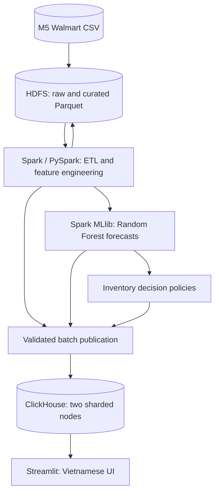
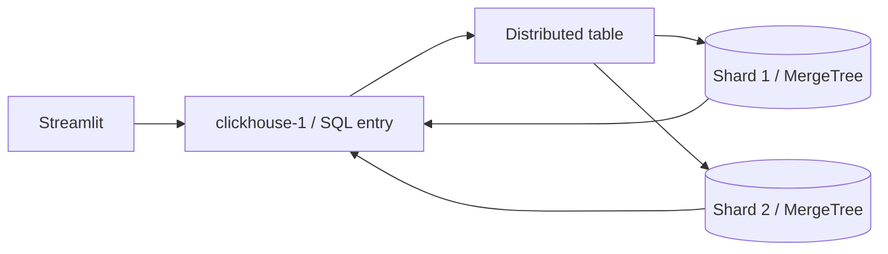

# 05 — Technology Stack and Engineering Choices

> **Project:** Big Data–Driven Inventory and Distribution Optimization  
> **Original title:** Tối ưu hóa hệ thống quản lý kho hàng  
> **Course:** Introduction to Big Data  
> **Document type:** Technology selection and compatibility specification  
> **Status:** Proposed stack baseline — versions and runtime behavior must be validated during implementation  
> **Version:** 1.0  
> **Last updated:** October 15, 2026  
> **Maintainers:** Two-person project team  
> **Related documents:** [Project Overview](01_PROJECT_OVERVIEW.md) · [System Requirements](02_SYSTEM_REQUIREMENTS.md) · [System Architecture](03_SYSTEM_ARCHITECTURE.md) · [Dataset](04_DATASET.md)

---

## 1. Purpose and Document Boundary

This document explains **which technologies are selected, why they are appropriate, what they are responsible for, how they interoperate, and what trade-offs the team accepts**.

It addresses technology-selection decisions rather than restating functional requirements or prescribing full implementation procedures.

**Included:** component selection, alternatives, compatibility strategy, boundaries, resource implications, integration options, evidence of authentic use, operational risks, and decisions that remain open.

**Excluded:** detailed infrastructure commands, exact Docker Compose configurations, full ClickHouse DDL, model hyperparameters, feature definitions, inventory formulas, and UI layouts. These belong in the relevant design documents and executable configuration.

**Language convention:** engineering documents, code, database identifiers, configuration, and technical logs are **English**. All end-user labels, menus, explanations, charts, and errors in Streamlit are **Vietnamese**. Official M5 column names remain unchanged.

### 1.1. Guiding philosophy

> **Use technology for a demonstrable responsibility, not to make the architecture look more complicated. Do not simplify away the very distributed and analytical capabilities that the project is intended to demonstrate.**

The project commits to six principles:

1. **Authentic distribution:** HDFS, Spark, and ClickHouse must each operate through their actual distributed mechanisms, not merely appear in the diagram.
2. **Justified complexity:** each component must solve a distinct problem or satisfy a verifiable academic requirement.
3. **Correctness over impressive-looking numbers:** faithfully distinguish observations, transactions, forecasts, and simulated stock.
4. **Measured outcomes:** claims about model quality, processing time, scalability, and inventory improvements require recorded experiments.
5. **Reproducible implementation:** versions, source data, configuration, runs, and assumptions must be identifiable.
6. **Resource awareness:** design for the **16 GB physical RAM** Windows host running Ubuntu under WSL2; schedule heavy stages rather than assuming unlimited resources.

---

## 2. Technology Stack at a Glance

| Layer | Selected technology | Core responsibility | Distributed role |
|---|---|---|---|
| Data source | **M5 Forecasting — Accuracy (Kaggle)** | Real historical Walmart sales, calendar, and price data | Large analytical input, not an infrastructure component |
| Programming language | **Python 3.11 (candidate)** | Data jobs, policies, application, tests | Spark Python API, where applicable |
| Distributed file storage | **Apache Hadoop HDFS 3.4.x** | Persist raw CSV and versioned Parquet datasets | **NameNode + 2 DataNodes** |
| Data representation | **Apache Parquet** plus original CSV | Compressed, typed, columnar analytical datasets | Files distributed across HDFS blocks |
| Distributed computation | **Apache Spark 3.5.x / PySpark** | ETL, validation, aggregation, feature engineering | **Standalone Master + 2 Workers** |
| Machine learning | **Spark MLlib (`pyspark.ml`)** | Train and evaluate a Random Forest Regressor | Model training executed using Spark resources |
| Business decision engine | **Python / PySpark** | Simulated replenishment and constrained stock allocation | Batch Spark when data volume warrants it; bounded Python for UI scenarios |
| Distributed analytical database | **ClickHouse 26.8 LTS branch (candidate)** | Persist and query analytical serving data | **2 shards × 1 replica**, `MergeTree` + `Distributed` |
| Application | **Streamlit** | Read-oriented dashboard and user-controlled scenarios | Not itself distributed |
| Visualizations | **Plotly** | Interactive trends, forecasts, inventory and allocation plots | Not itself distributed |
| Python-to-ClickHouse client | **ClickHouse Connect** | Bounded SQL reads for the Streamlit application | Sends queries to a ClickHouse coordinator node |
| Environment | **Windows + Ubuntu on WSL2** | Local development and Linux runtime | One physical host, isolated software nodes |
| Container management | **Docker Engine / Docker Desktop + Compose** | Repeatable service lifecycle, networking, volumes and resource caps | Runs software-node containers; not a multi-host orchestrator |
| Collaboration | **Git + GitHub** | Source history, review and team contributions | Development tooling, not runtime infrastructure |
| Documentation / testing | **Markdown, Mermaid, Python tests, SQL checks** | Technical specification and verification evidence | Independent confirmation of distributed functionality |

**Architectural non-goal:** the chosen tools are not all expected to run at peak capacity simultaneously. Durable HDFS, Parquet, model, and ClickHouse artifacts allow **separate processing, publication, and demo modes**.

### 2.1. Logical responsibilities (Mermaid)



The diagram represents **logical flows**. The processing stages and interactive serving stage need not execute concurrently.

---

## 3. Workload Characteristics Drive the Selection

Technology must be chosen against the actual M5 dataset and project deliverables, not only a generic definition of Big Data.

| Characteristic | Project implication |
|---|---|
| **30,490** product–store time series | Product and store are core analytical dimensions. |
| **1,941** daily values in `sales_train_evaluation.csv` | Original sales data is wide and requires normalization for many downstream operations. |
| **59,181,090** potential product–store–day rows after a full unfiltered reshape | Demonstrates a large **derived observation table**, not 59 million independent transactions. |
| Calendar and weekly selling prices | Enable time-aware joins and forecasting features. |
| No real store/warehouse inventory or distribution-network records | Inventory and supply inputs must be explicitly **simulated**. |
| Historical static data rather than a continuous feed | **Batch processing** is appropriate; a streaming platform is not justified. |
| Four concise application views | A separate frontend framework or microservice API is unnecessary. |
| Windows host with **16 GB total physical RAM** | Prefer bounded jobs, columnar storage, batching, and staged service startup. |

**Dataset authority:** see [04 — Dataset](04_DATASET.md) for field-level definitions, source files, source provenance, quality checks, and the distinction between observed and simulated data.

---

## 4. Distributed Storage: Apache Hadoop HDFS

### 4.1. Why HDFS is selected

HDFS explicitly satisfies the academic **distributed file storage** objective. It can store the original M5 files and large, versioned Spark outputs in a filesystem accessed over the network by Spark jobs.

Planned topology:

- **1 NameNode:** maintains namespace and block-location metadata.
- **2 DataNodes:** each stores actual HDFS data blocks on a distinct container volume.
- **Replication factor 2 (initial target):** if both DataNodes are healthy and volumes permit, selected blocks can be replicated to both nodes.
- **Persistent volumes:** files survive planned container restarts and stage changes.

### 4.2. What HDFS does and does not do

| HDFS owns | HDFS does not own |
|---|---|
| Raw source-file storage | Interactive SQL queries for the dashboard |
| Typed Parquet and analytical intermediate datasets | Machine-learning algorithm logic |
| Distributed blocks and optional replicas | ClickHouse table sharding |
| Inputs and outputs for Spark pipelines | Real-world inventory transactions |

HDFS replication and ClickHouse sharding are **different mechanisms**. HDFS replication creates additional copies of blocks; ClickHouse sharding partitions database rows among servers.

### 4.3. Evidence required

The team must be able to demonstrate a real HDFS path read by Spark, DataNode status, stored files/blocks, and expected replication status. Merely having Hadoop installed is insufficient.

### 4.4. Trade-offs

- **Advantages:** visible distributed-storage behavior; natural Spark/Hadoop integration; durable batch datasets.
- **Costs:** JVM services, containers, disk duplication and NameNode administration on a small machine.
- **Scope limit:** the project does not need Hadoop MapReduce or YARN as additional processing platforms because Spark Standalone already owns distributed computation.

---

## 5. Data Representation: CSV and Apache Parquet

### 5.1. CSV for provenance

Keep the original M5 CSV files unmodified in HDFS raw storage. This preserves source lineage and makes the ingestion stage auditable.

### 5.2. Parquet for processed datasets

Use **Parquet** for curated sales, engineered features, forecasts and batch publications whenever appropriate because it supports typed schemas and column-oriented storage, and Spark can read/write it directly.

Benefits include:

- Column pruning for selective analytical reads.
- Reduced storage and I/O for compressible datasets.
- Schema preservation compared with typeless flat text.
- Practical boundaries between pipeline stages.

Parquet is **a file format, not a database or a distributed-processing engine**. HDFS provides distributed storage; Spark provides distributed computation.

### 5.3. Implementation cautions

- Avoid producing thousands of tiny files for small partitions.
- Avoid `coalesce(1)` on the entire ~59 million-row dataset merely to create one output file.
- Do not use `collect()` or `toPandas()` on full-volume datasets.
- Explicitly record the grain and row count for each transformed, filtered, or aggregated output.
- Choose partition columns and target file sizes using actual file and query measurements; details belong in [06 — Data Pipeline](06_DATA_PIPELINE.md).

---

## 6. Distributed Processing: Apache Spark / PySpark

### 6.1. Why Spark is selected

Spark supports the project’s core distributed operations using a consistent DataFrame-based API for **ingestion, cleaning, reshaping, joins, aggregations, feature construction, and MLlib**. It offers practical executor/worker evidence during the instructor demo.

Initial topology:

- **1 Spark Standalone Master** for scheduling.
- **2 Spark Workers** in separate containers.
- **Short-lived Spark application/driver process** that submits controlled batch jobs.

**Important:** running `SparkSession.builder.master("local[*]")` does not satisfy the agreed goal of demonstrating actual Standalone workers. The final execution proof must show jobs assigned to the configured cluster and tasks executed by Workers.

### 6.2. Preferred programming model

| Tool/API | Decision | Rationale |
|---|---|---|
| PySpark DataFrame / Spark SQL | **Primary** | Structured transformations, joins and aggregations; appropriate for M5. |
| Spark RDD | **Not primary** | Lower-level control is not needed for most tabular work. |
| Hadoop MapReduce | **Not selected** | Duplicates the core computation role already served by Spark. |
| Spark Structured Streaming | **Not selected** | M5 is a historical batch dataset rather than an event stream. |
| Pandas | **Bounded utility only** | Useful for small summaries/plots; not the engine for ~59 million-row processing. |

### 6.3. Authentic cluster evidence

Show the Spark Master UI with both Workers registered, the executed job’s stages/tasks, executor placement, and results written to HDFS. Compare at least two controlled execution configurations if the team implements the performance comparison.

**Performance caveat:** two Workers on one laptop do not automatically outperform a local process. Results depend on data size, partitioning, shuffle, serialization, JVM overhead and CPU/memory contention. Report actual measurements, including cases where the distributed setup is slower.

---

## 7. Machine Learning: Spark MLlib Random Forest Regression

### 7.1. Why Spark MLlib

MLlib keeps model training in the same distributed data-processing ecosystem. The primary estimator is:

```python
from pyspark.ml.regression import RandomForestRegressor
```

The task is **regression**: estimate future units sold for eligible product–store series, not classify products or identify fake inventory records.

### 7.2. Core model obligations

- Produce an explicitly defined **seven-day forecast**.
- Use only features available at each forecast origin; prevent future-data leakage.
- Split training/validation/testing chronologically rather than using a random train-test split for time-series claims.
- Compare against a reproducible naive/seasonal baseline.
- Report suitable metrics such as **MAE, RMSE, and WAPE**, with clear handling of zero-demand series.
- Save the fitted model, configuration, dataset coverage and evaluation results.
- Report how many series and records were used for training and how many were actually forecast.

The detailed forecasting formulation, categorical features, rolling windows, horizons 1–7, tuning limits and error analysis are defined in [07 — Machine Learning](07_MACHINE_LEARNING.md).

### 7.3. Why Random Forest, not every available ML algorithm?

| Considered approach | Decision | Reason |
|---|---|---|
| **Spark MLlib Random Forest Regressor** | **Selected** | Handles nonlinear tabular relationships and is an explicit, demonstrable distributed ML implementation. |
| Seasonal naive / moving-average forecast | **Required baseline** | Cheap, interpretable and useful to establish whether ML adds value. |
| Linear regression | Optional comparison | May offer speed and interpretability, but does not replace the committed main estimator. |
| Gradient boosting / deep learning | Not in baseline scope | More tuning and computational cost; not justified before baseline evaluation. |
| Per-product ARIMA models | Not selected | Operational complexity across thousands of series and limited fit with the agreed Spark MLlib design. |

**Critical distinction:** running MLlib does not guarantee the trained model outperforms a simple benchmark or can be fitted on the entire dataset within the laptop's RAM. Start with representative time-consistent training coverage and scale only when measured feasible. Spark must still process the genuine source data independently of training-sample size.

---

## 8. Inventory and Distribution Decision Logic

The project uses a **forecast-informed, deterministic policy layer**, not a second unexplained ML model.

Responsibilities:

1. Combine predicted sales and explicitly simulated current/on-hand inventory.
2. Apply documented safety-stock assumptions to propose nonnegative, integer replenishment quantities.
3. Allocate finite central supply among eligible stores without exceeding supply or requests.
4. Quantify unmet requests when stock is insufficient.
5. Compare the policy with a documented baseline under the same simulated assumptions.

| Technology | Appropriate use |
|---|---|
| **PySpark** | Batch generation of large-scale recommendations and policy backtests. |
| **Plain Python** | Small, bounded scenario recalculation in Streamlit without a distributed job. |
| **ClickHouse** | Serve persisted recommendations and analytical comparisons. |

**Not claimed:** globally optimal warehouse network design, real stock availability, vehicle routing, live supplier orders, or realized Walmart savings.

Business constraints, equations, priority tie-breaking and numerical edge cases belong in [08 — Business Rules and Optimization](08_BUSINESS_RULES_AND_OPTIMIZATION.md).

---

## 9. Distributed Analytical Database: ClickHouse

### 9.1. Why ClickHouse is selected

The project requires the **database itself** to demonstrate actual distribution rather than being a single-node application store. ClickHouse supports sharded analytical data, column-oriented storage and SQL queries appropriate for historical sales and prepared prediction results.

The initial design is:

- **Two ClickHouse server containers**, each with a separate persistent volume.
- **Two shards, one replica per shard**.
- Local `MergeTree` tables containing distinct subsets of project-derived records.
- A `Distributed` table on the query-entry node that routes analytical reads across the shards.
- Static cluster metadata, e.g. `warehouse_cluster`.

### 9.2. What “distributed database” means here

The two physical shard-local tables must contain **nonempty, different portions of real project-derived data**. A distributed SQL query must read from both and produce totals reconcilable with per-shard counts.



**Two shards are not two replicas.** This architecture demonstrates data partitioning and distributed query execution, **not high availability**. A node failure can make part of the dataset unavailable. Since all nodes run on a single physical laptop, host failure remains a shared failure domain.

### 9.3. Why this modest cluster does not need Keeper in the baseline

For static cluster configuration with ordinary `MergeTree` local tables and a `Distributed` query table, the team can create matching schemas **explicitly on each node**. This avoids adding a coordination service solely to demonstrate sharded reads and writes.

**Do not assume `CREATE ... ON CLUSTER` works without coordination.** Distributed DDL task coordination and replicated MergeTree tables have different dependencies. If the team later requires distributed DDL/replication, that is a deliberate architectural change and may require ClickHouse Keeper.

### 9.4. Responsibility split: HDFS versus ClickHouse

| Concern | HDFS | ClickHouse |
|---|---|---|
| Main data type | Versioned files (raw CSV, Parquet) | Structured analytical tables |
| Primary consumer | Spark jobs | Streamlit / SQL clients |
| How distribution works | File blocks on DataNodes | Table rows partitioned across shards |
| Typical operation | Batch reads/writes, durable intermediate outputs | Filtered SQL aggregation and dashboard serving |
| Pipeline authority | Source/curated history | Published, validated serving copy |
| ML training | Supplies Spark input | Not the model-training engine |

This is **purposeful duplication**: ClickHouse is a validated, query-friendly publication of selected Spark outputs, not a replacement for the HDFS processing lake.

### 9.5. Loading and verification strategy

- Publish validated **Parquet** outputs in versioned batches.
- Prefer a **tested, version-compatible ClickHouse ingestion path** that streams or inserts bounded batches.
- Never load all 59 million rows into Python memory before insertion.
- Record precisely which tables contain full normalized sales versus filtered/aggregated summaries.
- Reconcile counts and sample aggregate totals after publication.
- Do not claim all 59.18 million rows live in ClickHouse unless that count has been measured there.
- Test service limits and background merge behavior on the actual machine.

Exact schemas, sharding keys, SQL verification queries, and publication safety are defined in [09 — Database Design](09_DATABASE_DESIGN.md).

### 9.6. Why not use ClickHouse for transactional inventory edits?

ClickHouse is designed primarily for analytics; it is **not chosen as a conventional OLTP warehouse inventory ledger**. The prototype uses read-oriented dashboards, published forecast/decision results, and bounded, explicit simulation inputs. A transactional database would only be justified by real multiuser stock movements or order-processing requirements, which are out of scope.

---

## 10. Streamlit, Plotly and Application Connectivity

### 10.1. Why Streamlit

The team needs to demonstrate analytics and decisions, not build a large web-product platform. Streamlit allows the Python team to deliver four focused views:

| Internal purpose | Vietnamese UI page |
|---|---|
| Historical analytics | **Tổng quan** |
| Seven-day forecast | **Dự báo nhu cầu** |
| Replenishment and simulated stock | **Tồn kho** |
| Constrained stock allocation | **Phân bổ hàng** |

The UI must display **real processed results**, identify simulated inputs clearly, and show Vietnamese messages for missing/unsupported data.

### 10.2. Why Plotly

Plotly provides interactive time-series, comparison and distribution charts with filter-friendly tooltips. The team should prioritize a small number of meaningful, readable charts rather than visual complexity.

### 10.3. Direct database access

The baseline uses **ClickHouse Connect** from Streamlit for parameterized/bounded SELECT queries to the ClickHouse entry node. A separate FastAPI or Django backend is not needed for a local single-user analytical demo.

For scenario changes, simple values may live in Streamlit session state; an explicit, deterministic policy function can recompute results on a **small filtered dataset**. Offline batch policy results remain in ClickHouse.

**Security and data handling:** use a read-only app database user where practical, keep secrets out of Git, avoid unrestricted SQL built from UI strings, bound result sizes, and cache only clearly versioned query outputs.

### 10.4. Application must not accidentally become the Big Data engine

Forbidden shortcuts include:

- Loading the full M5 dataset into Pandas as the project's sole analytical workflow.
- Replacing Spark-derived forecasts with manually typed predictions.
- Running expensive model training every time the user selects a product.
- Querying only one local ClickHouse shard while claiming distributed serving.

See [10 — Application Design](10_APPLICATION_DESIGN.md) for user journeys, data contracts, Vietnamese copy and error states.

---

## 11. Deployment Technology and Resource Strategy

### 11.1. WSL2 and Docker Compose

Ubuntu on WSL2 is the project’s Linux development/runtime environment; Docker Compose provides repeatable named containers, internal networks, health checks, volumes and startup selection. Docker is **packaging and runtime isolation**, not evidence of distributed processing by itself.

The proposed **~10 GB WSL2 memory cap** is a *starting limit*, not a guarantee that 10 GB is available to Spark or allocated immediately. Windows, WSL2, Docker, JVMs, filesystem cache, ClickHouse and the dashboard share the same **16 GB physical RAM**.

Store active project files in the Ubuntu filesystem when practical and use bounded container logs/volumes. Retain adequate disk for CSV, Parquet, HDFS replicas, Spark spill, ML models and ClickHouse tables.

### 11.2. Runtime modes

| Mode | Components primarily active | Why |
|---|---|---|
| **A — Data Engineering** | HDFS + Spark + batch driver | ETL and normalized/curated Parquet |
| **B — Model and Policy** | HDFS + Spark + batch driver | Train/evaluate/predict and calculate policies |
| **C — Data Publication** | ClickHouse shards + bounded ingestion job | Load validated exported datasets |
| **D — Interactive Demo** | ClickHouse shards + Streamlit | Stable, responsive user-facing application |
| **E — Technical Defense** | Start required infrastructure services and evidence jobs selectively | Show real HDFS/Spark/ClickHouse distribution |

**Docker Compose profiles** or selective service startup can support these modes; exact commands belong in repository operational instructions, not here.

### 11.3. Memory-safety practices

- Limit the JVM heaps for HDFS and Spark processes and set worker/executor memory/CPU limits explicitly.
- Use a separate driver or job process for heavy jobs and stop it after completion.
- Cap ClickHouse memory-intensive queries; ingest incrementally and allow merges to settle.
- Let Spark spill when necessary instead of collecting entire tables to the driver.
- Keep durable volumes and immutable output versions between modes.
- Benchmark before committing to full 59.18-million-row ingestion into every serving table.
- If scope must be reduced for training or serving, declare exactly what was sampled/aggregated and why.

No memory, query latency or processing throughput is guaranteed until measured.

---

## 12. Version and Compatibility Baseline

**Status:** the following are **candidate selections to test and pin**, not a declaration that the project is already running these releases. The repository's images/lock files become authoritative only after a successful end-to-end integration test.

| Component | Candidate / policy | Reason or compatibility check |
|---|---|---|
| Ubuntu on WSL2 | Installed maintained Ubuntu distribution; record exact release | Stable Linux environment and Docker integration |
| **Python** | **3.11.x** | Practical baseline for PySpark, application and ClickHouse clients |
| **OpenJDK** | **11** for Hadoop 3.4.x and Spark 3.5.x containers | Shared supported JVM line for the chosen candidates; verify exact image runtime |
| **Hadoop HDFS** | **3.4.2** | Apache Hadoop 3.4 maintenance release; Java 11 runtime candidate |
| **Apache Spark / PySpark** | **3.5.7** with matching Spark Python package | Spark 3.5 supports Java 8/11/17 and Python 3.8+ |
| **Scala binary compatibility** | Follow the chosen Spark binary distribution, preferably **2.12** for Spark 3.5 | A connector artifact must match the Spark/Scala build |
| **ClickHouse server** | **26.8.x LTS branch** | LTS baseline; pin a concrete patch/image digest after testing |
| Spark-to-ClickHouse connector | **0.10.0 candidate if native Spark ingestion is used** | Verify Spark 3.5, Scala, Java and server compatibility, artifact coordinates, and write correctness |
| ClickHouse Python client | Compatible **`clickhouse-connect`** release | Confirm Python 3.11 support and local HTTP connection behavior |
| Streamlit / Plotly | Pin compatible versions after application smoke test | Frontend requirements and stable rendering |
| Docker Compose | Compose V2 plugin; record `docker compose version` | Service profiles, volumes, networking and health checks |

### 12.1. Compatibility risks to check first

1. **Hadoop client libraries:** Spark workers/drivers need an HDFS client configuration and libraries compatible with the HDFS services. A successful local-file Spark job is not proof of HDFS integration.
2. **Java version:** Hadoop 3.4.x and Spark 3.5.x can run on Java 11, but avoid silently mixing JVMs or base images with unsupported defaults. If migrating to Spark 4.x, re-evaluate the Java baseline (Spark 4 requires Java 17+).
3. **Scala connector cross-build:** native Spark/ClickHouse connector artifacts are Scala-version specific; a mismatched artifact can fail even when both services start.
4. **ClickHouse major/minor branches:** keep the two shard servers on the same pinned release for reproducible tests; check server and client compatibility.
5. **Python driver versions:** newer `clickhouse-connect` releases require Python 3.10+ and may introduce breaking changes; pin after the smoke test.
6. **Container image provenance:** use trusted images or reproducible Dockerfiles, not arbitrary unmaintained `latest` tags.

### 12.2. Dependency decision gate

Before freezing versions, pass this minimal integration chain:

1. Start the HDFS containers; write and read a small file on both DataNodes.
2. Start Spark Standalone; confirm **both Workers** and run a job reading HDFS data.
3. Execute a small Parquet transformation and a minimal MLlib Random Forest training/scoring job.
4. Start two ClickHouse shards; insert distinct test records, query via a `Distributed` table, and reconcile totals.
5. Publish a small actual Spark-derived dataset into ClickHouse via the **selected** ingestion method.
6. Query it through Streamlit using a Vietnamese chart/table and a read-only connection.
7. Record pinned versions, memory usage, and integration outcomes before scaling.

This small but **real** vertical slice reduces integration risks without replacing the final full-data pipeline.

---

## 13. Integration Options and Data Contracts

| Interface | Chosen/expected approach | Validation requirement |
|---|---|---|
| Kaggle CSV → HDFS | Authorized download and controlled source import | Filenames, hashes/sizes, accessible HDFS paths |
| HDFS → Spark | `hdfs://` filesystem access with Hadoop client config | Real Spark job reads from HDFS, not local fallback |
| Spark → HDFS | Versioned Parquet outputs | Typed schema, counts and lineage metadata |
| Features → MLlib | Spark DataFrame/vector pipeline | Feature schema and chronological cutoff tests |
| ML/policy → published datasets | Versioned Parquet / manifest | Exact dataset/model/scenario IDs and no partial promotion |
| Published datasets → ClickHouse | **Connector or bounded batch loader**, selected after testing | No full-driver materialization; per-shard count and aggregate reconciliation |
| ClickHouse → Streamlit | `clickhouse-connect` SQL reads through one cluster-aware entry node | Bounded results; actual distributed table access |
| User scenario → policy | In-memory bounded Python calculation or precomputed scenario selection | Deterministic, valid nonnegative integer outputs |

### 13.1. Publication approach: make a controlled choice

**Option A — Native Spark–ClickHouse connector:** potentially direct distributed DataFrame insertion. Only select after proving connector version compatibility, sharding behavior, memory safety and idempotent reruns on this host.

**Option B — Materialize Parquet and load bounded batches:** gives a clear audit/recovery boundary and avoids requiring Spark workers to stay up with ClickHouse during bulk publication. This is the **default architectural preference** on the 16 GB host, with the actual loader/transport to be finalized by a small integration test.

Either option must **reconcile rows and preserve grain/lineage**. Loading a different aggregated subset is allowed only if explicitly documented; it must not be presented as the full normalized M5 fact table.

---

## 14. Alternatives Considered and Rejected

| Alternative | Why considered | Decision and explanation |
|---|---|---|
| **PostgreSQL (single node)** | Familiar SQL and strong transactional semantics | **Rejected as serving database:** user/team specifically require the database itself to demonstrate distributed sharding. HDFS/Spark would still be distributed, but PostgreSQL would not demonstrate DB sharding. |
| **MongoDB standalone** | Flexible documents and straightforward Python access | **Rejected:** a standard single-node instance does not prove distributed storage. |
| **MongoDB Sharded Cluster** | Real sharding and flexible schema | **Not selected:** routing/config server/replica-set operational complexity is disproportionate for read-heavy sales analytics on 16 GB RAM. |
| **Apache Cassandra** | Native distributed NoSQL scaling | **Not selected:** query-model and data-access trade-offs are less natural for exploratory SQL aggregation and dashboard reporting. |
| **Apache HBase** | Distributed key/value-style access integrated with HDFS | **Not selected:** more integration/operational burden for the project's analytics-oriented workload. |
| **ClickHouse single node** | Very convenient analytics SQL | **Not acceptable as final distributed DB proof:** lacks actual shard partitioning and cross-shard query evidence. Useful only as a local development spike. |
| **Kafka / Flink streaming** | Event-driven pipelines | **Not selected:** there is no real-time incoming stream in M5. |
| **Kubernetes** | Multi-service orchestration | **Not selected:** Docker Compose is sufficient for a controlled single-host academic cluster. |
| **FastAPI + React/Vue** | Separated frontend/backend | **Not selected:** more source code and integration overhead without a clear demo requirement. |
| **Additional deep-learning model** | Model experimentation | **Not selected initially:** forecast quality should first be evaluated against the agreed Random Forest and a strong simple baseline. |
| **A second transactional database** | Frequent transactional stock modifications | **Not selected:** the app is a batch decision-support prototype, not a production OLTP WMS. |

**Decision rule:** reopening a rejected option requires a concrete unmet requirement or measured bottleneck, not a preference for more technologies.

---

## 15. Security, Observability, and Reproducibility

### 15.1. Security for a local academic prototype

- Place database credentials and Kaggle tokens in ignored environment/secrets files; never commit them.
- Avoid publishing HDFS, Spark and ClickHouse administrative interfaces to the public internet.
- Prefer read-only ClickHouse credentials for the app; constrain client inputs.
- Protect Docker volumes and copied datasets; follow Kaggle competition terms and licensing/access requirements.
- Clearly label demo accounts/scenarios as local simulations; do not claim enterprise security compliance.

### 15.2. Evidence that each tool earns its place

| Technology | Minimum evidence | Invalid substitute |
|---|---|---|
| HDFS | NameNode/DataNodes, real files/blocks, Spark reading an HDFS path | Hadoop installed but unused |
| Spark | Master and 2 Workers; actual executed tasks, outputs | Only `local[*]` execution or a screenshot of idle workers |
| Spark MLlib | Executed estimator training, saved model, historical test metrics and baseline | Static or manually invented forecast chart |
| ClickHouse | 2 nonempty shards, `_shard_num`/local counts, distributed query aggregation | Two empty servers, duplicate whole datasets or queries to only one shard |
| Streamlit | Vietnamese interface showing real validated outputs and clear simulated labels | Hand-typed numbers disguised as live pipeline output |
| Optimization | Feasible allocations, baseline comparison and disclosed assumptions | Unsupported claim of “optimal” or real-world cost savings |

### 15.3. Reproducibility metadata

Record at least:

- Dataset filenames, source link, observed file hashes/sizes and row counts.
- Version pins and relevant image digests.
- Source code commit, job/run ID and timestamps.
- Input grain, covered date ranges and output row counts.
- Spark configuration and execution mode used for benchmark runs.
- Model parameters, random seeds, forecast horizon and metrics.
- Inventory scenario ID, assumptions and decision-policy version.
- ClickHouse loaded batch/version, counts per shard and query result checks.
- Test machine facts, WSL2 memory limit, RAM/CPU measurements and any observed failures.

---

## 16. Risks and Engineering Mitigations

| Risk | Consequence | Mitigation |
|---|---|---|
| WSL2/Windows memory pressure | Out-of-memory kills, crashes, swapping | Stage heavy services, cap memory, begin with small vertical slice, measure before scaling |
| HDFS volume/replication growth | Disk exhaustion | Estimate disks from real Parquet sizes and replication factor; prune only reproducible intermediate files |
| Spark reshape/shuffle skew | Slow or failed ETL | Profile partition sizes, choose sound joins/partitioning and test larger batches progressively |
| Unbounded Random Forest training | Excessive RAM or runtime | Start with time-consistent representative coverage, tune cautiously and report actual scope |
| JVM/Scala/package mismatch | Connector or job startup failures | Version compatibility matrix and end-to-end integration gate |
| ClickHouse bulk insertion/merges | Memory and disk contention | Publish bounded batches after Spark stage; validate and keep a stable serving version |
| Incorrect sharding or duplicated loads | Invalid distributed counts or analysis | Deterministic sharding strategy, versioned publication and per-shard reconciliation |
| False business conclusions | Misleading “inventory optimization” claims | Label stock as simulated, evaluate identical scenarios and retain negative outcomes |
| Overengineering | Scope creep, unreliable demo | Keep one forecasting model, one distributed analytical DB, one dashboard and no streaming/API tier |
| Service interruption during demo | Missing charts or incomplete results | Prepublish validated artifacts, practice restart/health checks and keep evidence reproducible |

---

## 17. Architecture Decisions (ADRs) Summary

These are **accepted technology-level decisions** unless explicitly flagged as pending verification:

| ID | Decision | Status | Rationale |
|---|---|---|---|
| ADR-TECH-01 | Use **HDFS** as the raw/curated distributed file lake. | Accepted | Demonstrable distributed storage and clear Spark data boundary. |
| ADR-TECH-02 | Use **Spark Standalone / PySpark DataFrames** for batch distributed processing. | Accepted | Fits M5 and yields inspectable worker execution. |
| ADR-TECH-03 | Use **Spark MLlib Random Forest** as primary demand forecast model. | Accepted | Agreed ML requirement and shared execution ecosystem. |
| ADR-TECH-04 | Use **ClickHouse with two shards, one replica each** for distributed serving. | Accepted | Database distribution must be genuine, not implied. |
| ADR-TECH-05 | Use **Streamlit + Plotly** with Vietnamese user-facing text. | Accepted | Simple but complete analytical demo. |
| ADR-TECH-06 | Use **Docker Compose on Ubuntu/WSL2** with staged modes. | Accepted | Repeatable single-host topology for 16 GB hardware. |
| ADR-TECH-07 | Avoid Kafka, Kubernetes, extra backend/DB and second main ML model. | Accepted | No demonstrated benefit for the current batch problem. |
| ADR-TECH-08 | Use **Hadoop 3.4.2 / Spark 3.5.7 / Java 11 / Python 3.11** candidate baseline. | **Pending verification** | Must pass real integration and image availability tests. |
| ADR-TECH-09 | Choose exact **ClickHouse 26.8 LTS patch** and compatible clients. | **Pending verification** | Freeze after a successful read/write test on both shards. |
| ADR-TECH-10 | Prefer **versioned Parquet + bounded publication** to ClickHouse. | **Pending spike** | Reduces simultaneous resource load; finalize with measured pipeline behavior. |

---

## 18. Requirement Traceability and Ownership

| Requirement area | Technology decision | Where implementation details belong | Evidence document |
|---|---|---|---|
| FR-01, DR-01–DR-04 | M5 source + CSV manifest | [04 — Dataset](04_DATASET.md) | [11 — Testing and Performance Evaluation](11_TESTING.md) |
| FR-02, NFR-01 | Hadoop HDFS | [03 — System Architecture](03_SYSTEM_ARCHITECTURE.md), [06 — Data Pipeline](06_DATA_PIPELINE.md) | [11 — Testing and Performance Evaluation](11_TESTING.md) |
| FR-03–FR-05, NFR-02 | PySpark DataFrames, Parquet | [06 — Data Pipeline](06_DATA_PIPELINE.md) | [11 — Testing and Performance Evaluation](11_TESTING.md) |
| FR-06–FR-08 | Spark MLlib Random Forest | [07 — Machine Learning](07_MACHINE_LEARNING.md) | [11 — Testing and Performance Evaluation](11_TESTING.md) |
| FR-09–FR-12 | Python/PySpark policy layer | [08 — Business Rules and Optimization](08_BUSINESS_RULES_AND_OPTIMIZATION.md) | [11 — Testing and Performance Evaluation](11_TESTING.md) |
| FR-13, NFR-03 | 2-shard ClickHouse Distributed | [09 — Database Design](09_DATABASE_DESIGN.md) | [11 — Testing and Performance Evaluation](11_TESTING.md) |
| FR-14–FR-17, NFR-07 | Streamlit, Plotly, ClickHouse Connect | [10 — Application Design](10_APPLICATION_DESIGN.md) | [11 — Testing and Performance Evaluation](11_TESTING.md) |
| FR-18, NFR-04–NFR-09 | Versioned runs and inspectable distributed execution | [03 — System Architecture](03_SYSTEM_ARCHITECTURE.md) and repository configuration | [11 — Testing and Performance Evaluation](11_TESTING.md) |

**Document ownership reminder:** this document owns **technology rationale and interoperability policy**. It does not replace the SRS (`02`), physical/data-flow architecture (`03`), dataset dictionary (`04`), implementation design (`06`–`10`), or executed testing (`11`).

---

## 19. Open Questions / Validation Tasks

These issues must be resolved through **small executable tests**, not through unsupported assumptions:

1. Which exact trusted Docker images and patch versions work together on the team's WSL2 machine?
2. Does the selected Spark build read and write HDFS 3.4.x data reliably with the chosen Java runtime and container filesystem configuration?
3. Which ClickHouse ingestion option has the simplest **correct, repeatable, memory-safe** behavior for the published Parquet outputs?
4. What is the measured Parquet disk footprint of the complete normalized M5 history, and how much room remains with HDFS replication factor 2?
5. Can the two ClickHouse shards store the full normalized fact table within disk/time limits? If not, which exact subset/aggregate will be published and disclosed?
6. How much model coverage (training rows and eligible series) fits the laptop without compromising chronological evaluation?
7. What memory/CPU caps maintain reliable HDFS+Spark and ClickHouse+Streamlit operating modes?
8. Which performance comparisons are informative and reproducible rather than just different container startup overheads?

Any answer that changes the architecture, dataset coverage or technology selection must be recorded as an explicit design decision and reflected in related documents.

---

## 20. Primary Technical Sources

The following are authoritative vendor/project documents used to verify the technology choices and compatibility baselines. Version-specific references should be revisited when the team freezes dependencies.

1. **Apache Hadoop — HDFS Architecture:** <https://hadoop.apache.org/docs/stable/hadoop-project-dist/hadoop-hdfs/HdfsDesign.html>
2. **Apache Hadoop — 3.4.2 release:** <https://hadoop.apache.org/release/3.4.2.html>
3. **Apache Hadoop — Java support matrix:** <https://cwiki.apache.org/confluence/spaces/HADOOP/pages/100827883/Hadoop+Java+Versions>
4. **Apache Spark — 3.5.7 documentation and runtime prerequisites:** <https://spark.apache.org/docs/3.5.7/>
5. **Apache Spark — Standalone deployment:** <https://spark.apache.org/docs/3.5.7/spark-standalone.html>
6. **Apache Spark — ML classification and regression:** <https://spark.apache.org/docs/3.5.7/ml-classification-regression.html>
7. **ClickHouse — Distributed table engine:** <https://clickhouse.com/docs/engines/table-engines/special/distributed>
8. **ClickHouse — `MergeTree` engine:** <https://clickhouse.com/docs/engines/table-engines/mergetree-family/mergetree>
9. **ClickHouse — 2-shard/1-replica example:** <https://clickhouse.com/docs/deployment-guides/replication-sharding-examples/02_2_shards_1_replica>
10. **ClickHouse — 26.8 LTS release:** <https://clickhouse.com/blog/clickHouse-release-26-08>
11. **ClickHouse Spark Connector — compatibility and releases:** <https://github.com/ClickHouse/spark-clickhouse-connector>
12. **ClickHouse Connect — Python client:** <https://github.com/ClickHouse/clickhouse-connect>
13. **Streamlit — connect to ClickHouse:** <https://docs.streamlit.io/develop/tutorials/databases/clickhouse>
14. **Docker Compose — profiles:** <https://docs.docker.com/compose/how-tos/profiles/>
15. **Microsoft — WSL advanced configuration:** <https://learn.microsoft.com/en-us/windows/wsl/wsl-config>
16. **Kaggle — M5 Forecasting Accuracy:** <https://www.kaggle.com/competitions/m5-forecasting-accuracy/data>

---

**Technology-stack commitment:** the project will demonstrate **three distinct and verifiable distributed roles**—HDFS data storage, Spark computation, and ClickHouse sharded SQL—while using a single assessed forecasting approach and a focused Vietnamese dashboard. Technology is added only when it earns its place through functionality, evidence, or a justified engineering trade-off.
