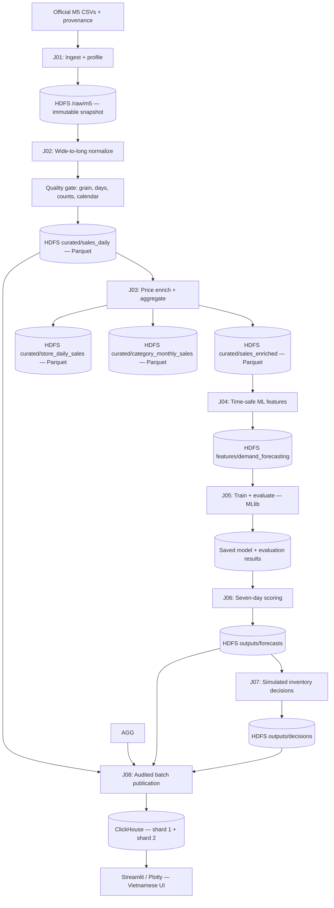
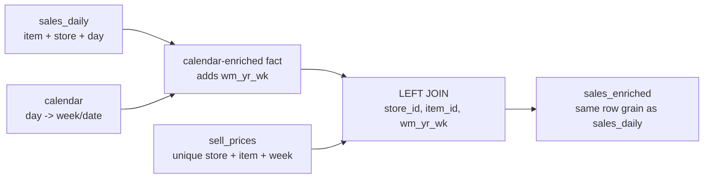
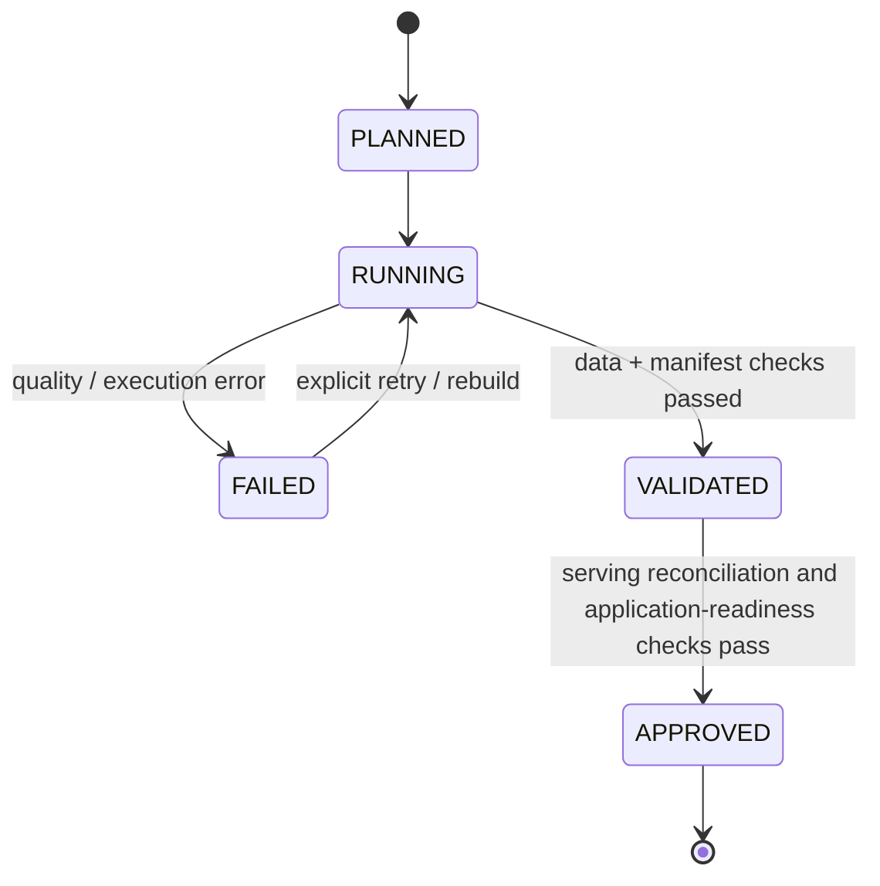

# 06 — Data Pipeline Design

> **Project:** Big Data–Driven Inventory and Distribution Optimization  
> **Original Vietnamese title:** Tối ưu hóa hệ thống quản lý kho hàng  
> **Course:** Introduction to Big Data  
> **Document type:** Batch data-engineering design, transformation contracts, quality gates, and reproducibility specification  
> **Status:** **Proposed design — not an implementation report**  
> **Version:** 1.0 — October 15, 2026  
> **Primary dataset:** [Kaggle — M5 Forecasting – Accuracy](https://www.kaggle.com/competitions/m5-forecasting-accuracy/data)

## 1. Purpose, Ownership, and Engineering Principles

This document specifies **how the project's M5 Walmart data moves from an authorized, immutable source snapshot into validated, analysis-ready datasets and reproducible downstream inputs**. It is written so that either team member can implement, review, rerun, and defend the pipeline without guessing what a record means.

**Owned by this document**:

- Batch orchestration and stage input/output contracts.
- Source ingestion to **Hadoop HDFS** and source integrity checks.
- Scalable wide-to-long sales normalization with **PySpark DataFrames**.
- Calendar/price enrichment, data quality, validation, and aggregations.
- Physical HDFS/Parquet layout, partition strategy, and run metadata.
- The point-in-time data boundary for **Spark MLlib** features.
- Publication contracts for downstream ML, inventory decisions, and **ClickHouse Distributed**.
- Failure recovery, performance measurement, and verifiable distributed-execution evidence.

**Not owned here**:

| Concern | Primary document |
|---|---|
| Academic requirements and acceptance criteria | [`02_SYSTEM_REQUIREMENTS.md`](02_SYSTEM_REQUIREMENTS.md) |
| Service topology and cross-system architecture | [`03_SYSTEM_ARCHITECTURE.md`](03_SYSTEM_ARCHITECTURE.md) |
| Field meanings, original source profiles and provenance | [`04_DATASET.md`](04_DATASET.md) |
| Technology selection and version rationale | [`05_TECH_STACK.md`](05_TECH_STACK.md) |
| ML algorithm, feature selection, multi-step strategy, and final evaluation protocol | [`07_MACHINE_LEARNING.md`](07_MACHINE_LEARNING.md) |
| Replenishment, allocation, and business-policy formulas | [`08_BUSINESS_RULES_AND_OPTIMIZATION.md`](08_BUSINESS_RULES_AND_OPTIMIZATION.md) |
| Exact ClickHouse DDL, sharding expression, and client queries | [`09_DATABASE_DESIGN.md`](09_DATABASE_DESIGN.md) |
| Vietnamese UI and dashboard behaviors | [`10_APPLICATION_DESIGN.md`](10_APPLICATION_DESIGN.md) |
| Software, data-quality, integration and distributed-system tests, performance evaluation, and acceptance evidence | [`11_TESTING.md`](11_TESTING.md) |

**Language rule:** documentation, identifiers, SQL, Python, Docker configuration, logs, and dataset contracts use **English**. Only **user-facing Streamlit text** is in **Vietnamese**.

**Engineering rule:** real distribution, measurable correctness, and reproducibility take precedence over either convenient shortcuts or unnecessary infrastructure. The pipeline is **batch-oriented** because M5 is a static historical dataset; Kafka, live ingestion, and a streaming orchestrator are not justified.

---

## 2. Dataset Scope and Non-Negotiable Semantics

### 2.1 Canonical inputs

| Input | Responsibility | Handling |
|---|---|---|
| `sales_train_evaluation.csv` | **Canonical observed sales history**, days `d_1`–`d_1941` | Ingest, validate, normalize |
| `calendar.csv` | Maps M5 day keys to actual dates, retail weeks, events, SNAP flags | Validate uniqueness and broadcast when appropriate |
| `sell_prices.csv` | Weekly selling price for `(store_id, item_id, wm_yr_wk)` | Validate keys, left-enrich daily facts |
| `sales_train_validation.csv` | Earlier snapshot covering `d_1`–`d_1913` | Optional consistency audit **only** |
| `sample_submission.csv` | Competition prediction template | Provenance only; never treated as observed sales |

**Never append the evaluation and validation snapshots together.** Their historical periods overlap and their competition `id` suffixes may differ. Compare common series by `(item_id, store_id)` if performing snapshot audits.

### 2.2 Scale reconciliation

The primary source has **30,490 item–store series** and **1,941 observed daily sales columns**:

```text
30,490 × 1,941 = 59,181,090 long-format product–store–day observations
```

| What is counted | Number | Meaning |
|---|---:|---|
| Distinct item IDs | 3,049 | Product catalog size |
| Stores | 10 | Physical store-level identifiers in M5 |
| Item–store series | 30,490 | One wide input row per item–store pair |
| Recorded days in evaluation sales file | 1,941 | `d_1` through `d_1941` |
| Expected full long-format fact count | **59,181,090** | Includes zero-unit days |
| Validation snapshot long-form count (if used separately) | 58,327,370 | **Not additional** observations |

The 59.18-million figure describes a **reshape of daily unit-sales values**, not 59 million independent transactions. It is a **reference expected count**, not a measured output until the team has run ingestion and reconciliation on its own copy.

### 2.3 Four different evidence categories

Every downstream dataset must identify the origin of its values:

1. **Observed:** historical `unit_sales`, source calendar fields, and recorded weekly prices.
2. **Derived:** daily/weekly aggregates, features, flags, and quality metrics computed from observed history.
3. **Predicted:** seven-day ML outputs; never presented as historical sales.
4. **Simulated:** inventory balances, central stock, lead times, and business scenarios absent from M5.

**Important:** observed `unit_sales` is not proof of unconstrained customer demand. A zero-unit day may be real zero sales, stock unavailability, or another unknown cause. **Do not drop zero-sale records** simply to make model training or Big Data counts look better.

---

## 3. End-to-End Pipeline and Execution Graph



**J01–J08 are logical stages**, not eight separately deployed services. The implementation may group them into a small number of scripts or CLI commands, but **each stage must have a testable checkpoint and versioned output**.

| Stage | Primary input | Main processing | Durable output | Must pass before next stage |
|---|---|---|---|---|
| **J01** | Official source CSVs | Metadata, hash, schema, ingest to HDFS | Raw snapshot + source manifest | Provenance and required fields |
| **J02** | Evaluation sales + calendar | Chunked unpivot, day/date join, column typing | `sales_daily` | Expected count, unique grain, valid units/days |
| **J03** | `sales_daily` + prices | Left price join, flags, business aggregations | `sales_enriched`, `store_daily_sales`, `category_monthly_sales` | Join cardinality, schema, lineage, aggregate reconciliation |
| **J04** | Curated history | Time-safe lags, rolling statistics, input availability | Feature/label snapshots | Historical cutoff, leakage audit |
| **J05** | Training/validation snapshots | Spark MLlib Random Forest + baseline evaluation | Model + metrics | Measured validation and persistable model |
| **J06** | Model + eligible histories | Predict next seven dated values | `forecast_daily` | Horizon, model-run identity, nonnegative policy |
| **J07** | Forecasts + **simulated** stock | Replenishment/allocation + baseline comparison | Decision outputs | Quantity and supply constraints |
| **J08** | Approved Parquet snapshots | Controlled ClickHouse load and cross-shard reconciliation | Published serving tables | Row/shard/aggregate reconciliation |

**Processing ownership:** J01–J04 and the export contracts for J05–J08 are specified here. Algorithm internals for J05/J06 belong in document 07, J07 rules in 08, and J08 physical database design in 09.

---

## 4. Logical Data Contracts and Storage Zones

### 4.1. Versioned HDFS layout

The following paths are **proposed canonical logical paths**, configurable through one shared project configuration. An actual HDFS URI depends on the running Compose network, e.g. `${HDFS_BASE_URI}/data/warehouse/...`.

```text
/data/warehouse/
  raw/m5/source_version=<source_version>/
      sales_train_evaluation.csv
      sales_train_validation.csv             # optional
      calendar.csv
      sell_prices.csv
      sample_submission.csv                 # optional
      source_manifest.json
  staging/
    pipeline_run_id=<pipeline_run_id>/
      sales_unpivot/
        chunk_0001/                          # distinct, resumable chunk
        chunk_0002/
        ...
      candidate_sales_daily/
      candidate_sales_enriched/
  curated/sales_daily/source_snapshot_id=<source_snapshot_id>/
      sale_year=2011/...
      ...
  curated/sales_enriched/source_snapshot_id=<source_snapshot_id>/
      sale_year=2011/...
      ...
      _dataset_manifest.json
  curated/store_daily_sales/source_snapshot_id=<source_snapshot_id>/
      part-*.parquet
      _dataset_manifest.json
  curated/category_monthly_sales/source_snapshot_id=<source_snapshot_id>/
      part-*.parquet
      _dataset_manifest.json
  features/demand_forecasting/
    source_snapshot_id=<source_snapshot_id>/
      feature_version=<feature_version>/...
  models/<model_run_id>/...
  outputs/forecasts/<forecast_run_id>/...
  outputs/decisions/<decision_run_id>/...
  outputs/evaluation/<evaluation_run_id>/...
  manifests/runs/<pipeline_run_id>.json
  manifests/publications/<publication_id>.json
  manifests/published/current.json
```

- The source snapshot is **immutable**. Do not edit a raw CSV in place.
- `source_version` identifies **the acquired raw package**; `source_snapshot_id` identifies **the validated curated derivation**; `pipeline_run_id` identifies **one transformation attempt**. They are **not interchangeable**. The parent relationship is recorded in manifests.
- Staging directories may be deleted/rebuilt only when the corresponding run is not published; curated releases are promoted **only after quality gates pass**.
- Prefer explicit manifest/pointer files over overwriting the currently active result.
- A release manifest should include the resulting dataset paths, exact contract versions, row counts, schema fingerprint, upstream IDs, status, and timestamps.
- `_SUCCESS` indicates Spark completed a write, **not** that all business-quality checks passed. Only the approved run manifest certifies publication.

### 4.2. Canonical normalized fact: `sales_daily`

**Grain:** one `(item_id, store_id, date)` or, equivalently, one unique `(item_id, store_id, day_key)` within a `source_snapshot_id`; the snapshot identity is authoritative in the manifest/path.

| Field | Suggested logical type | Source / meaning | Null allowed? |
|---|---|---|---|
| `item_id` | String | Original item identifier | No |
| `dept_id` | String | Original department | No |
| `cat_id` | String | Original category | No |
| `store_id` | String | Original store identifier | No |
| `state_id` | String | Original state | No |
| `series_id` | String | Original evaluation `id` (audit identifier) | No |
| `day_key` | String | `d_1` ... `d_1941` | No |
| `day_index` | Integer | Positive numeric part of `day_key` | No |
| `date` | Date | Date from `calendar.csv` | No |
| `wm_yr_wk` | Integer | M5 retail week for the day | No |
| `unit_sales` | Integer | Nonnegative recorded daily units | No |

`sale_year` may be present as a physical Parquet partition column, but it is not a canonical logical field. Retain zero values and do not assume a missing observation can be substituted by zero. Original M5 `id` is renamed **`series_id`** to distinguish a historical source identifier from the logical business key `(item_id, store_id)`.

### 4.3. Price-enriched daily fact: `sales_enriched`

Contains the canonical `sales_daily` fields plus useful context:

| Field | Suggested logical type | Description |
|---|---|---|
| `sell_price` | Double / controlled decimal | Nullable weekly sale price from validated store/item/week join |
| `price_missing` | Boolean | Whether matching weekly price is absent |
| `wday`, `month`, `year` | Integer | Source calendar indicators; no assumption of ISO weeks |
| `event_name_1`, `event_type_1`, `event_name_2`, `event_type_2` | Nullable String | Calendar event metadata; blank events may be valid |
| `snap_applicable` | Integer / Boolean | State-appropriate `snap_CA`, `snap_TX`, or `snap_WI` |
| `is_zero_sale` | Boolean | `unit_sales = 0`, not a missingness indicator |

`unit_sales` is the canonical Spark/Parquet and serving metric. A query may expose `units_sold` as a documented alias, but it is not a physical or logical replacement. Final serving identifiers are owned by `09_DATABASE_DESIGN.md`.

### 4.4. Analytical aggregates

Define grain **per dataset** rather than blending different resolutions:

| Dataset | Key / grain | Measures | Intended use |
|---|---|---|---|
| `store_daily_sales` | `(source_snapshot_id, store_id, date)` | `sum(unit_sales)`; optional row count | Trends and store comparisons |
| `item_store_weekly_sales` | `(item_id, store_id, wm_yr_wk)` | Units and observed-sales-day coverage | Demand patterns, diagnostics |
| `category_monthly_sales` | `(source_snapshot_id, cat_id, month_start)` | Nonnegative Long sum of units | Category dashboard |
| `data_quality_summary` | `(pipeline_run_id, dataset_name, check_name)` | Measured counts/rates/status | Reproducibility and defense |

The number of aggregate rows is **different from** the 59.18-million detailed records. Never label a small dashboard aggregate as the full raw dataset.

### 4.5. Forecast/decision downstream contracts

These are **interface-level contracts**, not a replacement for documents 07–09:

| Dataset | Key | Minimum metadata |
|---|---|---|
| `forecast_daily` | `(forecast_run_id, item_id, store_id, forecast_date)` | Prediction, model/source/feature lineage, issue date, horizon `1..7`, run type |
| `forecast_metrics` | `(evaluation_run_id, holdout_id, method_id, metric_name, horizon)` | Metric value, observation count, evaluation dates, compatible forecast/model IDs |
| `inventory_scenario` | `(scenario_id, issue_date, item_id, store_id)` | **Simulated** stock, units, scenario version/seed/assumptions |
| `central_supply_scenario` | `(scenario_id, issue_date, item_id)` | **Simulated** product-level central supply |
| `replenishment_recommendations` | `(decision_run_id, item_id, store_id)` | Forecast/model/source/scenario lineage, request and policy version |
| `allocation_recommendations` | `(decision_run_id, policy_id, item_id, store_id)` | Forecast/model/source/scenario/policy lineage, allocated and unmet quantities |
| `inventory_policy_evaluation` | `(evaluation_run_id, decision_run_id, policy_id, item_id, store_id, issue_date)` | Historical sales-proxy outcomes and policy lineage |

Outputs must be linked to **the correct historical issue date and input scenario**. They cannot silently join to a newer model or to real stock records that M5 does not contain.

---

## 5. J01 — Authorized Ingestion, Source Manifest, and Raw HDFS

### 5.1. Controlled source acquisition

1. Download the dataset through the **official Kaggle competition interface**, subject to competition access/usage rules.
2. Extract in the **Ubuntu filesystem** (for example `/home/<user>/warehouse-bigdata/data/downloads/`), not into the tracked Git repository.
3. Verify the primary required files are present and retain original filenames.
4. Compute source file byte sizes and, preferably, SHA-256 checksums.
5. Build `source_manifest.json` containing source URL, acquisition time, file metadata, source version, and the ingestion operator/tool version.
6. Upload source CSVs and manifest to a new versioned HDFS raw directory.
7. Compare the local checksums/sizes with HDFS-stored file content when practical; verify HDFS file listing and block locations.

**Do not** commit M5 raw files to public GitHub without checking redistribution permissions. Store official download instructions and manifests in the project instead.

### 5.2. Minimal file/schema checks

| Check | Action on failure |
|---|---|
| Required filenames accessible | **Fail** before Spark ETL |
| Evaluation sales file contains six metadata fields and `d_1` ... `d_1941` | **Fail**; identify snapshot mismatch |
| Calendar includes `d` + `date` + `wm_yr_wk` | **Fail** |
| Weekly prices include `(store_id, item_id, wm_yr_wk, sell_price)` | **Fail** |
| Extra/unexpected source columns | Log and review; do not silently rely on column positions |
| Duplicate or malformed headers | **Fail** |

**Recommended CLI evidence** (illustrative; actual service names and URI are configured in Compose):

```bash
hdfs dfs -ls "/data/warehouse/raw/m5/source_version=${SOURCE_VERSION}/"
hdfs dfs -du -h "/data/warehouse/raw/m5/source_version=${SOURCE_VERSION}/"
hdfs fsck "/data/warehouse/raw/m5/source_version=${SOURCE_VERSION}/" -files -blocks -locations
```

An empty running HDFS service does **not** satisfy the storage requirement. A real project file and demonstrable DataNode/block placement are necessary.

---

## 6. J02 — Scope-Aware Wide-to-Long Normalization

### 6.1. Why this transformation exists

The evaluation sales CSV is a **wide matrix**: one item–store row with 1,941 columns representing days. Analysis, feature-window construction, filtering by date, and ClickHouse analytical queries are easier when the data has **one product–store–day observation per row**.

**Input example (illustrative, not a dataset sample):**

| item_id | store_id | d_1 | d_2 | d_3 |
|---|---|---:|---:|---:|
| ITEM_A | CA_1 | 3 | 0 | 2 |

**Output example:**

| item_id | store_id | day_key | unit_sales |
|---|---|---|---:|
| ITEM_A | CA_1 | d_1 | 3 |
| ITEM_A | CA_1 | d_2 | 0 |
| ITEM_A | CA_1 | d_3 | 2 |

The transformation **does not create new real-world sales events**. It materializes the source matrix's already recorded observations in a different layout.

### 6.2. Normalization strategy for WSL2 and 16 GB physical RAM

**Preferred baseline:** apply PySpark `DataFrame.unpivot()` to **bounded day-column groups** (for example, 128 days per chunk) rather than attempting to construct one enormous 1,941-column unpivot expression and materialize all results at once. `unpivot` is supported in Spark 3.5.x; feature support is verified before implementation.

Rationale:

- Limits width of each transformation plan and the amount of data being expanded per batch.
- Produces independently checkable, resumable staging outputs.
- Allows measured adjustments in chunk size (`64`, `128`, or `256` days) according to memory and runtime.
- Avoids `collect()` / `toPandas()` on the expanded fact table.

**Standard M5 Small execution:** resolve the frozen ten-SKU selection from validated source
identities, then filter to 100 item-store rows **before unpivoting**. Materialize and independently
validate a run-owned filtered-wide Parquet checkpoint containing all 1,941 string day fields.
Chunk actions read that bounded checkpoint rather than reparsing the full CSV. Selection,
checkpoint schema and fresh file checksums must agree on retry; incomplete checkpoints
are preserved and require a new run ID. Source metadata selection and filtered-wide
materialization still read the original source; raw integrity checks remain enabled.

The proposed **128-day** plan requires `ceil(1941 / 128) = 16` chunks. Chunk paths are distinct, and a failed chunk may be retried **without appending duplicated rows** to a shared directory.

### 6.3. Required transformation steps

1. Read the canonical CSV from **HDFS**, not from a local hidden fallback.
2. Validate required metadata columns and the exact selected day range.
3. Validate original source identities, freeze ten SKUs covering available departments and all ten stores, and filter before expansion. Require exactly **100 selected series** and persist `_scope.json` (`m5-scope-v1`). The original 30,490 series remain source/reference lineage.
4. For each bounded day chunk, project only the six metadata fields and selected `d_*` fields.
5. Unpivot that chunk into `day_key` + raw value.
6. Parse and validate a nonnegative **integer** `unit_sales` value. Bad strings/nulls do not silently become zero.
7. Join to validated calendar on `day_key = calendar.d` to obtain `date` and `wm_yr_wk`.
8. Verify the chunk's row count, day coverage, and domain; write to a unique HDFS staging path.
9. After all chunks are complete and reconciled, compact into the versioned `sales_daily` Parquet layout.
10. Reconcile final count, calendar coverage, date range, and total unit sales; promote only after passing validation.

### 6.4. Bounded PySpark reference pattern

The following is an **implementation sketch**, not a claim that a complete pipeline exists. It intentionally omits config loading, rich error reporting, and manifest persistence.

```python
from pyspark.sql import functions as F

ID_FIELDS = ["id", "item_id", "dept_id", "cat_id", "store_id", "state_id"]
FIRST_DAY = 1
LAST_DAY = 1941
DAYS_PER_CHUNK = 128

# Inputs must point to the project's actual HDFS configuration.
wide = (
    spark.read.option("header", True)
    .option("inferSchema", False)
    .csv(source_evaluation_hdfs_path)
)
wide = wide.where(F.col("item_id").isin(scope["selected_item_ids"]))
# Production persists and independently validates these 100 wide rows before chunks.

calendar = (
    spark.read.option("header", True)
    .csv(source_calendar_hdfs_path)
    .select("d", "date", "wm_yr_wk")
    .withColumn("date", F.to_date("date"))
    .withColumn("wm_yr_wk", F.col("wm_yr_wk").cast("int"))
)
# Assert calendar.d is non-null and unique before broadcasting.

for start_day in range(FIRST_DAY, LAST_DAY + 1, DAYS_PER_CHUNK):
    end_day = min(start_day + DAYS_PER_CHUNK - 1, LAST_DAY)
    day_columns = [f"d_{day}" for day in range(start_day, end_day + 1)]

    narrow = wide.select(*ID_FIELDS, *day_columns)
    long_chunk = narrow.unpivot(
        ids=ID_FIELDS,
        values=day_columns,
        variableColumnName="day_key",
        valueColumnName="unit_sales_raw",
    )

    # Validation must reject null, malformed, negative and out-of-range values.
    # These expressions are illustrative, not a substitute for hard failure checks.
    long_chunk = (
        long_chunk
        .withColumn("unit_sales", F.col("unit_sales_raw").cast("int"))
        .withColumn("day_index", F.regexp_extract("day_key", r"^d_(\d+)$", 1).cast("int"))
        .drop("unit_sales_raw")
        .withColumnRenamed("id", "series_id")
    )

    dated = (
        long_chunk
        .join(F.broadcast(calendar), F.col("day_key") == F.col("d"), "left")
        .drop("d")
        .withColumn("sale_year", F.year("date"))
    )

    # Before this write: enforce chunk count, source-domain and join checks.
    # Write to an exclusive chunk directory, never blindly append on retry.
    chunk_path = f"{staging_root}/sales_unpivot/chunk_{start_day:04d}"
    dated.write.mode("errorifexists").parquet(chunk_path)
```

**Mandatory additions in the actual implementation:** hard validation before writes, source key checks, chunk completion manifest, explicit failed-run handling, metric collection, and curated compaction. `cast("int")` alone is **not enough** because invalid strings could become null in permissive configurations. The finished ETL must detect and reject invalid values (including integer overflow) rather than accept cast-induced nulls.

### 6.5. Per-chunk and full-output invariants

For standard M5 Small, each chunk covers `k` days of the frozen 100 series:

```text
expected_chunk_rows = 100 × k
```

Optional full-mode arithmetic reference values (not active smoke workloads):

| Scope | Expected rows |
|---|---:|
| 1 day | 30,490 |
| 7 days | 213,430 |
| 28 days | 853,720 |
| 128 days | 3,902,720 |
| All 1,941 days | **59,181,090** |

For the complete normalized release, require:

- **Exactly 194,100** observed rows for `demo_sample` (100 series × 1,941 days). Optional explicitly authorized `full_m5` retains the 59,181,090-row reference invariant.
- Day coverage `d_1`–`d_1941` with mapped calendar dates **2011-01-29** through **2016-05-22**.
- Exactly one logical row per `(item_id, store_id, day_key)`; uniqueness of source series and calendar day keys should be prevalidated.
- No unexpected null/negative/non-integer daily unit sales.
- Zero-sale rows preserved.
- Source and normalized **total recorded unit sales** reconciled (sum across all source `d_*` fields versus sum of `unit_sales`).
- No records from `d_1942`–`d_1969` inserted as **observed sales** merely because those days appear in the calendar.

If the downloaded source snapshot differs, stop and document the variation; **do not manufacture or duplicate rows to match the reference number**.

---

## 7. J03 — Enrichment, Price Join, and Analytical Aggregation

### 7.1. Calendar join requirements

Join `sales_daily.day_key` to `calendar.d`, where the source calendar is one row per day key. Validate uniqueness **before** joining.

- A left join is preferable during diagnostics so missing dates can be counted rather than silently removed.
- If any expected sales day lacks a mapped calendar row, **fail the curated publication**.
- Cast dates with an explicit format and check `date` is valid/non-null.
- `wm_yr_wk` is the **Walmart retail week**, not ISO week-of-year.
- Event names/types can legitimately be null; they do not imply a corrupt source record.

### 7.2. Weekly price join requirements

First validate that `sell_prices` contains **at most one row** per `(store_id, item_id, wm_yr_wk)` and positive numeric prices wherever populated.



**Do not** join on `item_id` alone or on `date` alone. Such joins can multiply rows or attach the wrong store/week price.

Default treatment:

- Use a **left join**, preserving the full observed sales fact.
- Store absent prices as **NULL** and set `price_missing = true`.
- Do **not** impute missing prices as zero; zero is not a valid retail price substitute.
- Log missing-price count/rate by store, category, and time where useful.
- Investigate expected lifecycle effects (for example, records before a price first appears) rather than assuming every missing price is bad.
- Do not infer that missing price necessarily means a stockout.

The weekly price table is not a tiny dimension; **do not unconditionally broadcast millions of price rows**. Start with measured Spark join planning/AQE and shuffle partitioning; inspect `explain()` and the Spark UI before considering hints.

### 7.3. Calendar-derived transformations

Derived, explicitly named columns may include:

- `sale_year`, `month_start` or a reporting period label.
- `is_zero_sale = (unit_sales == 0)`.
- `snap_applicable` selected from `snap_CA`, `snap_TX`, `snap_WI` based on the row's state, while retaining original provenance.
- An event-presence indicator derived from nullable event labels.

Do not overwrite source fields to make model training convenient. For example, transform blank events to a “no recorded event” category in a **derived feature**, not in the immutable raw representation.

### 7.4. Aggregation definitions

Example Spark DataFrame logic:

```python
store_daily_sales = (
    sales_daily.groupBy("store_id", "date")
    .agg(F.sum("unit_sales").alias("total_units"))
)

category_monthly_sales = (
    sales_daily
    .withColumn("month_start", F.trunc("date", "month"))
    .groupBy("cat_id", "month_start")
    .agg(F.sum("unit_sales").alias("total_units"))
)
```

Reconciliation rules:

1. `sum(store_daily_sales.total_units) == sum(sales_daily.unit_sales)` over the **same scope**.
2. `sum(category_monthly_sales.total_units) == sum(sales_daily.unit_sales)` if every fact maps to exactly one category and no filters are applied.
3. The record count after a left price join must equal the count before joining; otherwise inspect duplicate price keys or unexpected join behavior.
4. Counts/sums for a selected `(item_id, store_id, date)` must match the original wide sales cell.

The store and category aggregates are validated against the same `source_snapshot_id`
before promotion. Their Parquet schemas must match their versioned contracts exactly,
including Long `total_units`, nonnegative values, unique snapshot-scoped keys, and exact
reconciliation to the source snapshot. They are first written under the run-owned staging
directory, then promoted atomically to the curated paths. A retry may reuse only a
validated existing output or finish missing promotions; the final validated J03 run
manifest is the only completion marker for the full output set.

### 7.5. Derived revenue: optional, not a business fact

If adding `estimated_sales_value = unit_sales × sell_price`, label it **derived from recorded units and posted weekly price**, **not** audited revenue, margin, cash flow, or profit. Exclude unknown-price rows from this amount and disclose coverage. The core demo does **not** require revenue analytics.

---

## 8. J04 — Feature Engineering and Strict Time Boundaries

**Purpose:** provide MLlib with well-formed, **point-in-time-correct** features without accidentally using later actual sales while forecasting earlier dates.

### 8.1. Feature candidates

| Candidate | Source | Availability rule |
|---|---|---|
| `lag_1`, `lag_7`, `lag_28` | Prior observed units for that series | Only days **before** the label date in training |
| `rolling_mean_7`, `rolling_mean_28` | Trailing unit sales | Exclude the target day; use full prior window or mark coverage |
| `day_of_week`, month, events | Calendar | Allowed if known at the forecast issuance date |
| Store/category/department identity | M5 sales metadata | Static identifiers; encoding fitted on training split only |
| `last_known_price`, `price_missing` | Historically available price | Must be known at the prediction cutoff; no automatic future-price lookahead |
| Series-history length / availability flag | Observed history | Computed as of cutoff, not from future rows |

The precise final feature set and model are defined by `07_MACHINE_LEARNING.md`. A feature candidate is **not a promise** to use every listed field.

### 8.2. Safe lag and rolling-window construction

For a one-day training target at date `t`:

- `lag_1(t) = actual_sales(t-1)`.
- `lag_7(t) = actual_sales(t-7)`.
- `rolling_mean_7(t) = mean(actual_sales(t-7), ..., actual_sales(t-1))`.
- Do **not** include `actual_sales(t)` in any predictive feature for the target at `t`.

Illustrative Spark pattern:

```python
from pyspark.sql import Window
from pyspark.sql import functions as F

series_window = Window.partitionBy("item_id", "store_id").orderBy("date")

features = (
    sales_enriched
    .withColumn("lag_1", F.lag("unit_sales", 1).over(series_window))
    .withColumn("lag_7", F.lag("unit_sales", 7).over(series_window))
    .withColumn("lag_28", F.lag("unit_sales", 28).over(series_window))
    .withColumn(
        "rolling_mean_7",
        F.avg("unit_sales").over(series_window.rowsBetween(-7, -1)),
    )
    .withColumn(
        "rolling_mean_28",
        F.avg("unit_sales").over(series_window.rowsBetween(-28, -1)),
    )
)
```

This is appropriate for **historical one-step supervised feature construction** with prior observed sales. It is **not** by itself a valid seven-day inference loop. For example, once forecasting from an issue date `T`, features for `T+2` cannot use **actual** sales from `T+1`, because that observation was unknown at issue time.

### 8.3. Seven-day forecast leakage control

The system must produce seven dated forecast rows, but the exact forecast strategy is finalized in **document 07**. Two defensible strategies are:

| Strategy | Concept | Constraint |
|---|---|---|
| Recursive one-step | Predict `T+1`; use that prediction where relevant for `T+2`, and so on | Update all lag/rolling features from the as-of known + predicted series; no observed holdout leakage |
| Direct horizon prediction | Build separate target/horizon training views or an explicitly horizon-aware formulation | Every feature is computed using information known at issue time `T` |

**Hard prohibition:** generate a seven-day backtest by running the historical lag-window DataFrame across the test period and reporting all seven predictions as if they were issued simultaneously at `T`. That would often use earlier **observed test-period sales** in later horizon features and create optimistic evaluation.

### 8.4. Chronological boundaries and release date

For the canonical evaluation sales input:

- `d_1`–`d_1941` are historical **observed** sales.
- `d_1942`–`d_1969` exist in calendar metadata but **do not** contain observed labels in this source sales file.
- A seven-day historical holdout must lie **within** observed days and be predicted from an **earlier** issue date.
- A future-facing final demonstration can issue predictions at `d_1941` for `d_1942`–`d_1948`, but **cannot report realized error for those dates** without separately obtained authorized actuals.

An illustrative backtest is to issue a forecast after `d_1913` and compare predictions for `d_1914`–`d_1920`. This is an **example cutoff**, not a mandated final experimental protocol. Model selection, test-window rules, training coverage, and final evaluation metric aggregation belong in `07_MACHINE_LEARNING.md`.

### 8.5. Standard small ETL and bounded model training

The standard pipeline processes the frozen M5 Small population with complete historical
coverage. J03 validates the J02 publication and identical scope before enrichment; joins
must preserve 194,100 rows and existing calendar/price/aggregate semantics. J04 validates
the same scope and persists its digest in feature bindings. Its 28-day lookback and locked
train/validation/test boundaries remain unchanged. J05 fits at most 10,000 eligible rows.
Full-catalog ETL is not a routine requirement even if more resources become available.

If ML uses a subset:

- Declare whether sampling is across time, item–store series, or both.
- Use reproducible seeds and deterministic selection rules; retain the selected series/date keys.
- Keep enough historical context before each label to compute lag features correctly.
- Record `full_curated_rows`, `eligible_feature_rows`, `training_rows`, `validation_rows`, and `scored_series_count` as **separate** metrics.
- Never claim that an ML algorithm was trained on 59 million rows merely because Spark ETL processed 59 million rows.

---

## 9. Parquet Layout, Partitioning, and Performance Strategy

Current small-profile layout uses four final J02 partitions and four J04 output partitions,
bounded chunk checkpoints and compressed Parquet. Do not infer partition/file counts
for historical full artifacts from these defaults. Reuse immutable VALIDATED small
snapshots through the canonical selector rather than rebuilding missing upstream stages.
Before submitting Spark, the Hadoop owner prepares exactly the requested run staging
directory/events and verifies ownership and narrow Spark ACLs with
`hdfs_namespace prepare-run`. It refuses unsafe existing state and never recursively
changes shared namespace permissions. Publication remains owner-only claim/seal/rename.

Record actual elapsed times, application IDs, completed tasks on both Workers, bytes,
file counts, resource samples, spill and GC. The **J02–J04 under-30-minute** objective is
unverified; J05/J06 timings are measured separately. Full versus demo artifacts use
distinct identities and scope digests. See [SMALL_DEMO_MODE.md](SMALL_DEMO_MODE.md).

### 9.1. Storage design decisions

| Decision | Proposed baseline | Why | Must measure |
|---|---|---|---|
| Raw source format | Preserve original CSV | Provenance and audit | Raw size/hash |
| Curated format | **Parquet with compression** | Typed, columnar, filter-friendly scans | Resulting size/scan time |
| Top-level physical partition | `sale_year` (2011–2016 for observed history) | Coarse partition avoids thousands of tiny files | File sizes and date-filter performance |
| Fine-grained filtering | Date/store/item columns + Parquet statistics | More flexible than store×day partitioning | Scan pruning effectiveness |
| Staging organization | Exclusive day chunks and run IDs | Safe retries without duplicating facts | Retry behavior |
| Repartition/coalesce | Adjust after measurements | Balance file count vs. task parallelism | File count and distribution |
| AQE | Evaluate enabled as supported | Adaptive join/shuffle tuning | Actual plans and spill |

Do **not** partition physical Parquet folders by `(item_id, store_id, date)`: that creates an excessive number of small partitions/files. Also do not assume `sale_year` is always optimal; measure data layout and adjust to **quarter/month** only if the number and size of files, pruning and read patterns justify it.

### 9.2. Why compaction is necessary

The bounded wide-to-long phase may produce many staging files. After all chunk validations:

1. Read the complete approved staging collection with Spark.
2. Repartition using measured worker resources and target file sizes.
3. Write canonical Parquet under `sale_year` partitions.
4. Inspect file counts, sizes and processing plans.
5. Compare row counts, sums, key integrity and date coverage with staging.
6. Promote the candidate snapshot and retain the upstream manifest.

Avoid committing both dozens of chunk directories and a very fragmented set of final files as the application's permanent query layer.

### 9.3. Initial Spark tuning envelope, **not** verified performance

Illustrative starting points on **Windows 16 GB RAM / Ubuntu WSL2**:

| Setting / practice | Starting consideration | Caveat |
|---|---|---|
| WSL2 RAM ceiling | Around 10 GB, subject to Windows stability | Shared physical RAM; limit not reservation |
| Spark workers | 2 configured Workers | Verify tasks actually run on both |
| Executor/worker memory | Begin conservatively and measure; keep aggregate JVM+Python+daemon usage inside available memory | Java overhead/Python workers also consume RAM |
| `spark.sql.shuffle.partitions` | Test modest values such as `16`, `32`, `64` | Not a universal optimum; defaults may create excessive tasks |
| `spark.sql.adaptive.enabled` | Test `true` | Assess joins and shuffle partition coalescing |
| Chunk size | Start at **128 day columns** | Reduce to 64 if unstable; enlarge only after measured tests |
| Cache usage | Cache small repeatedly read data **only when justified** | Do not cache the full expanded fact blindly |
| Spark output | Use Parquet and bounded output files | Inspect `part-*` sizes and disk usage |

Never force 59 million rows into the Python driver with `collect()` or `.toPandas()`. Prefer DataFrame API, Spark SQL, distributed aggregation, and bounded `.limit()` for debugging.

### 9.4. Resource-aware execution modes

| Mode | Active heavy services | Rationale |
|---|---|---|
| **ETL mode** | HDFS + Spark; ClickHouse/app may be stopped | Maximize resources for normalization/joins |
| **ML mode** | HDFS + Spark MLlib | Keep train/evaluate isolated from ClickHouse load |
| **Publication mode** | ClickHouse + required loaders/source access | Control batch inserts and memory; verify shards |
| **Demo mode** | ClickHouse + Streamlit; HDFS/Spark UIs started separately for proof if resources permit | Serve precomputed, validated outputs with stable response |

These modes describe **staged execution**, not separate physical machines. Running multiple containers on one host does not establish physical-host fault tolerance.

---

## 10. Publication to ClickHouse and Dashboard Boundaries

### 10.1. HDFS remains the source-of-truth analytical artifact

HDFS stores the immutable raw files, full curated history, feature snapshots, forecasts, decisions, and manifests. ClickHouse stores **an audited serving copy** appropriate for analytics and interaction.

Why both are justified:

- HDFS/Parquet is optimized for reproducible batch storage, Spark input, and durable intermediate snapshots.
- ClickHouse's distributed `MergeTree`/`Distributed` arrangement is the **database querying layer**, giving fast filtered analytics and visible shard-level distribution.
- Streamlit queries bounded results through ClickHouse rather than scanning the complete Spark fact or training a model on every interaction.

### 10.2. Publication contract for J08

Before ingesting into ClickHouse, every exported logical dataset must have:

- A **declared grain and unique key**.
- A **dataset snapshot/run ID** and path to source Parquet.
- Its exact row count, null counts in required fields, and schema definition.
- A deterministic mapping from Spark fields to target table fields.
- A source/output manifest with status `VALIDATED`.
- All required lineage identifiers, with `publication_id` assigned by J08 rather than inferred from a file-success marker.
- A load mode that prevents accidental duplication on retries.

**Baseline transport:** versioned Parquet + a **bounded-file/bounded-batch loader** after ETL/ML has completed. Avoid a full-driver-memory list of 59 million records. A Spark–ClickHouse connector is an alternative **only after compatibility, resource use, and exactly-once/idempotence behavior are tested**.

### 10.3. Shard-level integrity checks

For a full published `sales_daily` fact snapshot, successful publication should demonstrate:

1. Two configured, active **ClickHouse shards** with separate local storage.
2. Each shard contains nonzero **project-derived rows**.
3. Summed physical-shard row counts equal the distributed-table count for the selected dataset version.
4. Cross-shard totals by store/date match corresponding validated Spark aggregates.
5. A repeated load of the same version **does not double the count**; use a new target version/table or controlled replace/rebuild, not naive `INSERT` retry.
6. If a shard is unavailable, report incomplete/unavailable analytics instead of silently showing partial totals.

**Scope honesty:** publication and dashboards use `demo_sample` and its frozen selection
digest. Counts and metrics describe that population only. Full-M5 publication is optional,
separately authorized compatibility work, not the standard demonstration objective.

Physical ClickHouse configuration, exact DDL, shard key, load protocol, and SQL verification are detailed in `09_DATABASE_DESIGN.md`.

### 10.4. Serving interface for Streamlit

The app may query:

- Filtered store/item/time sales facts or validated aggregates.
- Precomputed seven-day `forecast_daily` rows.
- Reproducibly simulated inventory/replenishment/allocation results.
- Forecast/model/scenario/decision/evaluation metadata selected by one approved `publication_id`.

The HDFS `manifests/published/current.json` pointer is the publication authority. The application-mounted `artifacts/approved_publication.json` is an exact read-only materialized copy with the same publication ID and manifest checksum. J08 must not expose a candidate merely because its computation completed; only `APPROVED` publication metadata may update the pointer. The application receives one coherent context and must not select independent latest run IDs.

No dashboard action should trigger unbounded Spark transformations, random unrestricted CSV reads, or model retraining. All visible charts, menus, filters, metric labels, and error messages are in **Vietnamese**.

---

## 11. Data-Quality Gates, Severity, and Failure Policy

### 11.1. Quality-gate taxonomy

| Gate | Validation | Criticality | Response |
|---|---|---|---|
| `DQ-01` | Source files and manifest fields present | **Blocking** | Stop J01/J02 |
| `DQ-02` | Required six metadata fields and exactly expected evaluation day-column coverage | **Blocking** | Stop or approve documented alternate snapshot |
| `DQ-03` | Unique source `(item_id, store_id)` series, nonnull identifiers | **Blocking** | Stop normalization |
| `DQ-04` | Valid nonnegative integer source sales values | **Blocking** | Reject bad rows/source and report locations |
| `DQ-05` | Unique calendar `d`, valid dates, and mapping coverage for all observed day keys | **Blocking** | Stop curated release |
| `DQ-06` | Full unpivot count and day-range reconciliation | **Blocking** | Stop curated release |
| `DQ-07` | No duplicated `(item_id, store_id, day_key)` after normalization | **Blocking** | Stop release; diagnose source/stage/join |
| `DQ-08` | Price `(store_id, item_id, wm_yr_wk)` unique and positive if populated | **Blocking for bad key/invalid value** | Stop enrichment |
| `DQ-09` | Missing weekly-price coverage measured and retained as null | **Reportable; investigate** | Publish with disclosure if no hard invalid-key issue |
| `DQ-10` | Calendar/price joins preserve sales fact cardinality | **Blocking** | Stop enrichment |
| `DQ-11` | Aggregated totals reconcile to detailed unit totals | **Blocking** | Stop analytics release |
| `DQ-12` | Feature cutoff/lag logic contains no future observed labels | **Blocking** | Stop J04/J05 |
| `DQ-13` | Serving dataset scope/count equals manifest declaration | **Blocking** | Do not expose new ClickHouse dataset |
| `DQ-14` | Forecast/stock scenarios have observed/predicted/simulated provenance tags | **Blocking** | Stop decision publication |

**Avoid inventing pass percentages.** Count exact invariants and measure missingness/skew first; choose any tolerances only after profiling, with rationale and version control.

### 11.2. Dataset checks and minimal evidence

| Output | Check | Evidence artifact |
|---|---|---|
| `raw` | SHA-256, sizes, filenames, source version | `source_manifest.json` |
| `sales_daily` | Expected count, day coverage, unique grain, unit sums | `normalize_quality.json` |
| `sales_enriched` | Price-key uniqueness, join cardinality, missing-price rate | `enrich_quality.json` |
| `store_daily_sales` | Exact schema, snapshot lineage, unique keys, and aggregate reconciliation | Per-output dataset manifest and J03 quality report |
| `category_monthly_sales` | Exact schema, snapshot lineage, unique keys, nonnegative Long totals, and aggregate reconciliation | Per-output dataset manifest and J03 quality report |
| `features` | Historical feature cutoff and split boundaries | `feature_quality.json` |
| `forecasts` | Exactly seven dated predictions per eligible series where required | `forecast_quality.json` |
| `decisions` | Stock and allocation constraints | `decision_quality.json` |
| `clickhouse` | Two-shard audit/count/aggregation match | `publication_quality.json` |

Suggested computation status values are `PLANNED`, `RUNNING`, `COMPLETED`, `FAILED`, and `VALIDATED`. `APPROVED` is reserved for a publication after serving reconciliation. Publication does **not** occur simply because a script exited with code zero or a file-write marker exists.

### 11.3. Example executable invariants

```python
from pyspark.sql import functions as F

# Evaluation fact scope only; run after writing the final curated snapshot.
actual_rows = sales_daily.count()
assert actual_rows == 100 * 1_941, f"Unexpected demo_sample rows: {actual_rows}"

assert sales_daily.filter(F.col("unit_sales").isNull()).limit(1).count() == 0
assert sales_daily.filter(F.col("unit_sales") < 0).limit(1).count() == 0

# Price join must not multiply daily observations.
assert sales_enriched.count() == actual_rows

# A full duplicate audit can be expensive and should be measured as a validation job.
duplicate_keys = (
    sales_daily.groupBy("item_id", "store_id", "day_key")
    .count()
    .filter(F.col("count") > 1)
)
assert duplicate_keys.limit(1).count() == 0
```

This example assumes a source snapshot that matches the published M5 schema and that the selected datasets truly cover **all** days and series. In small test slices, substitute the measured expected count for that slice. Aggregated and ML subset counts must **not** be compared to the complete-fact count.

### 11.4. Invalid-record policy

| Situation | Policy |
|---|---|
| Missing source daily sales cell | Investigate and block canonical full-data normalization; do **not** silently convert to zero |
| `unit_sales = 0` | Preserve: legitimate recorded zero-sales observation |
| Negative/nonintegral units | Reject and quarantine diagnostic evidence |
| Missing calendar key | Block normalized dataset |
| Blank calendar event | Preserve nullable event, possibly derive a downstream flag |
| Missing price for one store/item/week | Preserve sales, set null/flag, report coverage |
| Duplicate price/calendar key | Block corresponding enrichment |
| Invalid future feature availability | Block forecast training/evaluation |
| Incomplete ClickHouse shard load | Do not promote the newly loaded dataset to the dashboard |

---

## 12. Orchestration, Checkpointing, and Idempotent Reruns

### 12.1. Minimal orchestration for two team members

A small CLI/Makefile or Python `argparse` runner is sufficient; do **not** introduce Airflow purely for appearance.

A defensible command interface could be:

```bash
python -m pipeline.run ingest --source-version m5_eval_v1
python -m pipeline.run normalize --source-version m5_eval_v1 --days-per-chunk 128
python -m pipeline.run enrich --source-version m5_eval_v1
python -m pipeline.run features --feature-version "$FEATURE_VERSION" --cutoff "$CUTOFF_DATE"
python -m pipeline.run train --feature-version "$FEATURE_VERSION"
python -m pipeline.run forecast --model-run-id "$MODEL_RUN_ID"
python -m pipeline.run decide --scenario-id "$SCENARIO_ID"
python -m pipeline.run publish --publication-id "$PUBLICATION_ID"
```

**These commands describe the intended CLI; they are not currently implemented.** Production execution will use Spark submission to the configured **Spark Standalone Master** for distributed jobs. Entry points should pass configuration explicitly instead of embedding machine-specific paths.

### 12.2. Chunk checkpoint and retry protocol

1. Assign a `pipeline_run_id` and record `source_version` and code/config revision.
2. For each bounded day chunk, write an **exclusive** staging directory such as `chunk_0001`.
3. After the Spark write completes, independently verify row count and date coverage and write a small completion manifest.
4. On restart: skip a chunk **only if** both its data and validated manifest match the same run/input/configuration.
5. If incomplete/corrupt: quarantine or explicitly remove that **unpublished chunk path** and rebuild it.
6. Compact all validated chunks to a **new candidate** curated path.
7. Validate the candidate; promote it to the versioned curated path and record final snapshot metadata.
8. Never use a general `append` retry that can silently write the same chunk twice.

### 12.3. Release / promotion boundary

Proposed release lifecycle:



A single HDFS filesystem directory rename can support an atomic **candidate-to-final path** promotion when used correctly and when the target does not already exist. **It does not create one transaction spanning HDFS and two ClickHouse shards.** ClickHouse publishing needs its **own** audited promotion/read-selection mechanism.

Do not overwrite a published version in place. Keep the last validated version available if a new load fails.

### 12.4. Run manifest (illustrative shape)

```json
{
  "pipeline_run_id": "etl_20261015_001",
  "status": "VALIDATED",
  "source_version": "m5_eval_v1",
  "source_file": "sales_train_evaluation.csv",
  "code_revision": "<git_commit_sha>",
  "processed_day_start": "d_1",
  "processed_day_end": "d_1941",
  "source_series_count": 30490,
  "expected_fact_rows": 59181090,
  "actual_fact_rows": null,
  "quality_report_path": "<quality_report_uri>",
  "curated_dataset_uri": "<curated_output_uri>",
  "started_at_utc": null,
  "finished_at_utc": null
}
```

Values in this example are **placeholders/reference expectations**. Do **not** publish a manifest with `status=VALIDATED` until actual counts and validation outcomes are populated by a successful executed pipeline. The example shows fields to populate, not actual run evidence.

---

## 13. Observability, Performance Measurement, and Proof of Distribution

The point of the Big Data implementation is not just a large-looking number; the team must show **where and how distributed execution occurred**.

### 13.1. Mandatory evidence per technology

| Claim | Credible demonstration | Invalid substitute |
|---|---|---|
| HDFS holds real data | Raw/Parquet files in HDFS + DataNode/block/replica information | Empty NameNode/UI screenshot |
| Spark performs distributed ETL | Spark UI job/stage/task details + **both Workers** executing actual tasks | Merely importing PySpark or using `local[*]` |
| M5 has ~59M observations after reshape | Count from validated full normalized fact + source manifest | Calling them 59M customer orders |
| ML uses training data | Feature snapshot, fitted model, holdout and baseline metrics | Manual prediction numbers |
| ClickHouse is sharded | Two nonempty local shard tables + cross-shard query reconciliation | Two servers with no distributed table |
| Business decisions are based on data | Forecast outputs + **explicitly simulated** stock + rule result | Claiming real Walmart stock optimization |

### 13.2. Runtime metrics to capture

| Stage | Record |
|---|---|
| Ingestion | Input bytes, checksums, upload duration, DataNode/block status |
| Normalization | Source series, expected/actual rows, chunk times, transformed bytes, Spark tasks, peak memory/spill |
| Enrichment | Join plan, price match ratio, row counts, shuffle/spill metrics |
| Aggregation | Per-query duration, input/output rows, reconciled totals |
| Features | Eligible series/rows, cutoff date, row exclusions with reasons |
| ML | Train size, inference size, model version, MAE/RMSE/WAPE, baseline |
| Publication | Exported/loaded rows, per-shard counts, elapsed time, mismatch count |
| UI | Warm typical filter latency; whether source is actual published dataset |

### 13.3. Honest performance experiment

At minimum, compare a **repeatable workload** using the **same input/output scope** across two Spark configurations, e.g. one worker versus two workers under controlled resource limits.

1. Freeze source snapshot, Spark version, transformation script, output format, and output row-count validation.
2. Use the same transformation and an explicitly stated cluster configuration for each trial.
3. Avoid interpreting differences caused by different caching, file counts, or job scope as pure parallelism benefit.
4. Record at least a few repeated timings when feasible, report variability and Spark UI evidence.
5. Interpret limitations: same host, shared CPU/RAM/disk, startup overhead, and small-source CSV input.

The experiment **may or may not show a speedup**; either outcome is acceptable if measured and explained. Never claim that a two-worker local-container cluster automatically halves ETL time.

---

## 14. Security, Integrity, and Operational Boundaries

- Use local-only credentials/service URLs where possible; do not expose ClickHouse or HDFS administrative interfaces to public networks without need.
- Keep dataset downloads, environment files, passwords, and large raw/Parquet outputs out of Git history.
- Pin dependencies using the compatible baseline in `05_TECH_STACK.md`, but verify actual images/connectors together before declaring a final lockfile.
- Logs must not include secrets or misleading metrics.
- Mark experimental/simulated data clearly in output metadata and user-facing Vietnamese labels.
- Do not use row-level revenue, margins, shipment costs, orders, or inventory quantities as if these existed in M5 when they do not.
- Avoid creating a production-like scheduler, message broker, or orchestration stack without a demonstrated requirement.

---

## 15. Definition of Done and Acceptance Traceability

### 15.1. Stage completion checklist

- [ ] **J01:** Authorized source and manifest in HDFS; schema checks recorded.
- [ ] **J02:** frozen 100-series selection, all 1,941 day columns and exactly 194,100 observed rows independently reconciled; scope/source/publication identity verified.
- [ ] **J02:** Date mapping complete; zero sales preserved; no duplicate logical facts.
- [ ] **J03:** Price join uses `(store_id, item_id, wm_yr_wk)`, preserves row count and reports missing-price coverage.
- [ ] **J03:** At least two useful sales aggregates are persisted and reconcile to source totals.
- [ ] **J04:** Features include explicit time cutoff, lag semantics, and no future-label leakage.
- [ ] **J05–J06:** Model run produces measured holdout results and seven dated predictions according to document 07.
- [ ] **J07:** Simulated-stock decisions meet business constraints according to document 08.
- [ ] **J08:** ClickHouse publication has a declared scope, two nonempty shards, and verified counts/aggregates according to document 09.
- [ ] **Observability:** HDFS/DataNode, Spark Worker/task, and ClickHouse shard evidence captured from actual execution.
- [ ] **Reproducibility:** New team member can identify the exact source, code revision, parameter config, input/output URI, and active published run.

### 15.2. Mapping to project requirements

| Requirement or acceptance case | Pipeline responsibility | Evidence |
|---|---|---|
| **FR-01, DR-01, AT-01** | Official dataset and measured provenance | Raw manifest, checksums |
| **FR-02, NFR-01, AT-02** | HDFS ingest and replication visibility | HDFS CLI/UI and fsck |
| **FR-03, DR-02–DR-03, NFR-04** | Normalization, source semantics, join correctness | Count and quality reports |
| **FR-04** | Historical aggregations | Aggregated Parquet, totals audit |
| **FR-05, DR-06** | Time-safe ML features | Feature manifest, cutoff checks |
| **FR-06–FR-08, AT-03** | Hand-off to Spark MLlib and forecast outputs | Training/forecast artifacts |
| **FR-09–FR-12, DR-04–DR-05, DR-08** | Versioned scenarios and decisions | Source category/decision manifest |
| **FR-13, DR-07, NFR-03, AT-07** | Serving data publication and reconciliation | ClickHouse shard/query audit |
| **FR-18, NFR-02, NFR-05, NFR-06, AT-09** | Distributed execution, repeatability, resource discipline | Spark UI, manifests, measured logs |

The acceptance criteria come from `02_SYSTEM_REQUIREMENTS.md`. This document provides the **data-engineering mechanisms** by which they can be satisfied; it is not a substitute for the SRS or actual run results.

---

## 16. Implementation Risks, Trade-offs, and Explicitly Open Decisions

| ID | Risk / choice | Proposed mitigation or decision gate |
|---|---|---|
| `PIPE-01` | Wide unpivot and repeated CSV parsing can create costly plans | Filter before expansion, reuse the validated filtered-wide checkpoint and measure one explicitly authorized M5 Small configuration |
| `PIPE-02` | Chunking rereads wide CSV many times | Observe scan time; consider cached/preconverted source or single-pass approach if justified |
| `PIPE-03` | Conversion may create many small files | Compact and profile Parquet before publication |
| `PIPE-04` | Price table join may cause large shuffle/memory pressure | Validate keys, inspect join plans/AQE, tune partition count |
| `PIPE-05` | Model features may accidentally use held-out observed sales | Enforce cutoff-specific feature generation and seven-step inference tests |
| `PIPE-06` | ML sample smaller than full processed fact | Report training coverage and full-vs-sample counts separately |
| `PIPE-07` | ClickHouse publication crashes halfway through | Stage to isolated dataset/version and reconcile before activating |
| `PIPE-08` | Shard distribution uneven | Record per-shard rows and assess key distribution; finalize in document 09 |
| `PIPE-09` | 16 GB physical RAM / WSL2 memory contention | Use execution modes and constrain processes after observing real peak usage |
| `PIPE-10` | M5 lacks stockout, lead-time, and true available-stock fields | Simulated inventory remains a separately labeled, versioned scenario |

**Decisions still requiring a real benchmark:** chunk width, physical Parquet file sizing, exact repartition counts, price-enrichment join strategy, ML training coverage, final forecast approach, ClickHouse data volume, and ingestion connector/loader. No invented latency or model accuracy is considered a verified result.

---

## 17. Primary Technical References

1. [Kaggle — M5 Forecasting – Accuracy dataset](https://www.kaggle.com/competitions/m5-forecasting-accuracy/data) — original competition source and access rules.
2. [Apache Spark 3.5 — `DataFrame.unpivot`](https://dlcdn.apache.org/spark/docs/3.5.6/api/python/reference/pyspark.sql/api/pyspark.sql.DataFrame.unpivot.html) — wide-to-long API and accepted parameters.
3. [Apache Spark 3.5 — SQL performance tuning](https://spark.apache.org/docs/3.5.5/sql-performance-tuning.html) — joins, caching, AQE, and shuffle considerations.
4. [Apache Spark SQL — Window functions](https://spark.apache.org/docs/3.5.7/sql-ref-syntax-qry-select-window.html) — partitioned temporal computations.
5. [Apache Hadoop HDFS Architecture](https://hadoop.apache.org/docs/stable/hadoop-project-dist/hadoop-hdfs/HdfsDesign.html) — NameNode/DataNode and file/block storage semantics.
6. [Apache Parquet project](https://parquet.apache.org/) — columnar storage format.
7. [ClickHouse — `Distributed` table engine](https://clickhouse.com/docs/engines/table-engines/special/distributed) — distributed analytical table/query concepts.
8. [Microsoft — WSL configuration](https://learn.microsoft.com/en-us/windows/wsl/wsl-config) — WSL2 memory ceilings and host behavior.

---

## 18. Related Documents

- [`01_PROJECT_OVERVIEW.md`](01_PROJECT_OVERVIEW.md) — business context, overall objectives, and project scope.
- [`02_SYSTEM_REQUIREMENTS.md`](02_SYSTEM_REQUIREMENTS.md) — mandatory requirements and acceptance criteria.
- [`03_SYSTEM_ARCHITECTURE.md`](03_SYSTEM_ARCHITECTURE.md) — component and deployment architecture.
- [`04_DATASET.md`](04_DATASET.md) — original dataset semantics and field-by-field contracts.
- [`05_TECH_STACK.md`](05_TECH_STACK.md) — selected technologies, alternatives, and version considerations.
- [`07_MACHINE_LEARNING.md`](07_MACHINE_LEARNING.md) — training, backtesting, and seven-day forecasting mechanics.
- [`08_BUSINESS_RULES_AND_OPTIMIZATION.md`](08_BUSINESS_RULES_AND_OPTIMIZATION.md) — inventory decisions and distribution constraints.
- [`09_DATABASE_DESIGN.md`](09_DATABASE_DESIGN.md) — ClickHouse local/distributed schemas and sharding.
- [`10_APPLICATION_DESIGN.md`](10_APPLICATION_DESIGN.md) — Vietnamese Streamlit UI.
- [`11_TESTING.md`](11_TESTING.md) — software, data-quality, integration and distributed-system tests, performance evaluation, and acceptance evidence.

> **Implementation status:** This file is an engineering design and validation contract. Actual schemas, counts, timings, Spark UI screenshots, ClickHouse shard counts, and ML scores must be collected by executing the system and then recorded as measured evidence. None are asserted as already achieved.
