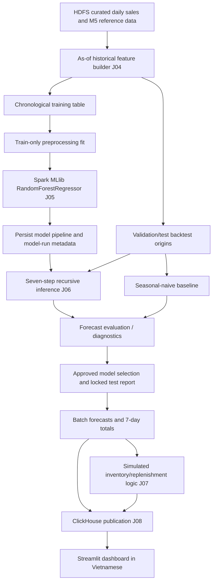
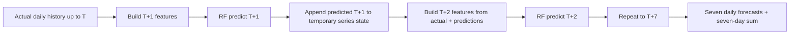

# 07 — Machine Learning Design

> **Project:** Warehouse Inventory Optimization with Big Data  
> **Document ID:** `07_MACHINE_LEARNING.md`  
> **Status:** Proposed design — implementation and measured results pending  
> **Primary algorithm:** Apache Spark MLlib `RandomForestRegressor`  
> **Forecast horizon:** Seven daily predictions per eligible product–store pair  
> **Language convention:** Documentation, code, identifiers, and database fields in English; end-user Streamlit UI in Vietnamese.

---

## 1. Purpose, Scope, and Document Boundaries

This document specifies **what is forecast, how the forecasting model is trained, how seven-day forecasts are generated without information leakage, and how forecasting quality is evaluated and evidenced**. It is the model-design authority for pipeline stages **J04 (features), J05 (train/evaluate), and J06 (forecast)** in [`06_DATA_PIPELINE.md`](06_DATA_PIPELINE.md).

The project is a decision-support prototype for warehouse management and store replenishment. Machine learning provides a **demand signal**; it does **not** directly optimize shipping routes, reconstruct real Walmart inventory, or place purchase orders.

| Concern | Owned by this document | Owned elsewhere |
|---|---|---|
| Business forecasting target, modeling grain, horizon | Yes | Overview gives purpose |
| Feature eligibility and anti-leakage protocol | Yes | Data pipeline implements extraction and feature storage |
| Training, validation, model selection, evaluation | Yes | Testing document describes runnable acceptance tests |
| Recursive seven-day inference | Yes | Pipeline orchestrates the production batch |
| Replenishment/stock allocation formulas | No | [`08_BUSINESS_RULES_AND_OPTIMIZATION.md`](08_BUSINESS_RULES_AND_OPTIMIZATION.md) |
| ClickHouse physical schema, sharding, ingestion | No | [`09_DATABASE_DESIGN.md`](09_DATABASE_DESIGN.md) |
| Dashboard widgets and Vietnamese copy | No | [`10_APPLICATION_DESIGN.md`](10_APPLICATION_DESIGN.md) |
| Spark/HDFS cluster topology, memory envelope | Referenced only | [`03_SYSTEM_ARCHITECTURE.md`](03_SYSTEM_ARCHITECTURE.md), [`05_TECH_STACK.md`](05_TECH_STACK.md) |

**Engineering contract:** Prefer a robust, measurable forecasting workflow to a more elaborate model that cannot be fairly tested or repeatedly run on the team's Windows host (16 GB physical RAM, Ubuntu under WSL2).

### 1.1. Requirements addressed

| Requirement | How the ML subsystem contributes |
|---|---|
| `FR-05` | Constructs time-aware, documented model features |
| `FR-06` | Fits and persists Spark MLlib Random Forest with reproducible configuration |
| `FR-07` | Compares recursive forecasts against a leakage-safe baseline using MAE, RMSE and WAPE |
| `FR-08` | Emits exactly seven dated, nonnegative predictions per **supported** selected series |
| `FR-09`–`FR-12` | Supplies forecasts to the separate simulated-inventory decision layer |
| `FR-18` | Produces defensible model, scope, Spark execution, and evaluation evidence |

Data-grain integrity and technical limitations additionally follow the Data Requirements (DR) and Non-Functional Requirements (NFR) in [`02_SYSTEM_REQUIREMENTS.md`](02_SYSTEM_REQUIREMENTS.md).

---

## 2. Key Modeling Decisions (Baseline Design)

| Decision ID | Decision | Reason / trade-off |
|---|---|---|
| `ML-ADR-01` | **One global Random Forest regression model**, rather than one model per SKU | Trains on observations across eligible item–store series; avoids thousands of separate models |
| `ML-ADR-02` | **Recursive one-step forecasting for seven days** | One fitted model, seven daily outputs; requires careful update of lag/rolling features and can accumulate error |
| `ML-ADR-03` | Spark MLlib `RandomForestRegressor` | Meets the distributed-ML commitment and suits nonlinear, tabular lag features |
| `ML-ADR-04` | Chronological train/validation/test with seven-day rolling-origin backtesting | Evaluates the actual seven-day decision scenario and prevents random-split time leakage |
| `ML-ADR-05` | Seasonal naïve (`same weekday last week`) is mandatory baseline | Simple, strong comparison for retail daily sales |
| `ML-ADR-06` | Fit on a **representative, reproducible training subset** when required by RAM; score a declared eligible population | Do not confuse full-scale Spark ETL with ML fit size |
| `ML-ADR-07` | Predict **unit sales**, not unconstrained demand or actual stock | M5 records sales, not inventory, lost sales or fulfilled order backlog |
| `ML-ADR-08` | Fixed training-time preprocessing and artifact versioning | Prevents fitting encoders/imputers using future validation/test data |

Any change to these decisions must update this document, the pipeline contract, model-run manifests and acceptance tests before results are presented.

---

## 3. Forecasting Problem and Dataset Semantics

### 3.1. Primary data source

Use the official [M5 Forecasting — Accuracy dataset](https://www.kaggle.com/competitions/m5-forecasting-accuracy/data), subject to the competition's usage rules.

| Dataset fact | Reference design value |
|---|---|
| Base series | 30,490 item–store combinations = 3,049 items × 10 stores |
| Historical reference file | `sales_train_evaluation.csv` |
| Daily historical labels in that file | `d_1` through `d_1941` |
| Unpivoted item–store–day observations | `30,490 × 1,941 = 59,181,090` |
| Auxiliary tables | `calendar.csv`, `sell_prices.csv` |
| Supervised target | Daily `unit_sales` (count of units sold) |

**Important:** Approximately 59.18 million refers to the **normalized sales-history fact**, not 59.18 million independent transactions or the number of rows passed to `RandomForestRegressor.fit()`. The validation file (`d_1`–`d_1913`) overlaps with the evaluation file: never concatenate those histories.

### 3.2. Forecast unit of analysis

A **series** is defined by a unique `(item_id, store_id)` pair. A historical observation is:

```
(item_id, store_id, date, d_int, unit_sales)
```

A forecast is issued at a **cutoff** `T`, after the actual daily sales for date `T` are assumed available. Its output grain is:

```
(forecast_run_id, item_id, store_id, forecast_date, horizon)
```

`model_run_id` remains required model lineage on each forecast row but is not the forecast-batch uniqueness key. Re-scoring one model for another issue date or scope therefore receives a distinct `forecast_run_id`.

where `horizon ∈ {1, 2, ..., 7}` and `forecast_date = issue_date + horizon days` using the M5 calendar mapping.

The model estimates:

\[
\widehat{y}_{s,T+h \mid T} \geq 0,\qquad h=1,\ldots,7
\]

where `s` is an item–store series and `y` is **units sold per day**. For inventory decisions, the seven-day estimate is:

\[
\widehat{D}_{s,T}^{(7)}=\sum_{h=1}^{7}\widehat{y}_{s,T+h\mid T}.
\]

The seven values and total are explicitly **forecasts**. If M5 sales were censored by a real stockout, the dataset alone cannot reveal the unmet demand. Do not relabel observed sales as true unconstrained demand.

### 3.3. Scope of coverage

- The data pipeline processes the full canonical history subject to the verified ETL contract.
- Model training may use a smaller, justified, reproducible subset of eligible historical rows.
- Forecast generation should **attempt broad coverage** of item–store pairs with sufficient history and valid features, starting with a pilot population and expanding only after a measured runtime test.
- A forecast is not fabricated for unsupported, inactive or invalid series. Dashboard selections must expose a clear Vietnamese unsupported-coverage message.
- Coverage (`series_total`, `series_eligible`, `series_scored`, and `series_not_scored_by_reason`) is mandatory run metadata.

---

## 4. Architecture of the ML Workflow



**Batch-oriented:** The project does not require real-time ingestion or training from the Streamlit UI. The UI reads published forecasts and metadata; training and backtesting remain offline Spark jobs.

### 4.1. Minimum logical components

| Component | Responsibilities | Main artifact |
|---|---|---|
| Feature builder | Lag/rolling/time/reference features and as-of correctness | Versioned training/scoring feature Parquet |
| Trainer | Training-only preprocessing and RF fit | Versioned `PipelineModel` |
| Recursive forecaster | Forecast one day, update predicted history, repeat seven times | `forecast_daily` Parquet |
| Baseline forecaster | Produce exactly comparable seven-day baselines | Baseline prediction Parquet |
| Evaluator | Score against chronological actuals; report slices and coverage | `forecast_metrics`, evaluation report |
| Publisher | Validate keys, stage-specific IDs and totals, then hand off to ClickHouse stage | Approved publication manifest |

---

## 5. Temporal Contract and Leakage Prevention

### 5.1. The forecast-origin information rule

For an issue date `T`, an input is valid only if its value would be known by **the end of `T`** in the declared experiment. This applies even when later observed sales already exist in the downloadable dataset.

**Allowed** at origin `T`:

- Actual unit sales for dates `≤ T`.
- Static product/category/store metadata available by `T`.
- Calendar-derived future day-of-week/month (deterministic) and truly pre-announced future holidays/events if the study assumes those schedules were known by `T`.
- Historical prices or last known listed price as of `T`.
- Previously fitted preprocessing stages and trained model using only the permitted training period.

**Not allowed** at origin `T`:

- Actual `unit_sales` for `T+1` ... `T+7`.
- Rolling features incorporating those unknown actuals.
- Actual future price changes unless an independently documented advance price plan existed at `T` (not assumed here).
- Target-derived statistics, imputation values, encodings or selection rules learned from future validation/test labels.
- Any metric-driven model revisions after the final test results have been unblinded.

### 5.2. The one-day training target

For a supervised row whose target is date `t`:

\[
\text{label}(s,t)=y_{s,t}
\]

\[
\begin{aligned}
\text{lag}_1(t)&=y_{s,t-1}\\
\text{lag}_7(t)&=y_{s,t-7}\\
\text{lag}_{28}(t)&=y_{s,t-28}\\
\text{mean}_7(t)&=\frac{1}{7}\sum_{j=1}^{7}y_{s,t-j}\\
\text{mean}_{28}(t)&=\frac{1}{28}\sum_{j=1}^{28}y_{s,t-j}.
\end{aligned}
\]

Calendar features describe **target date `t`** (known from the calendar), but sale/price-history inputs describe information known **no later than `t-1`**. A strictly earlier historic-price value is the default, even if the competition CSV contains later weeks.

### 5.3. Why a single historical feature table is insufficient for seven-day backtesting

At origin `T`, it is wrong to take precomputed historical training rows for `T+1` through `T+7` and pass them all through `model.transform()`. Those rows' `lag_1` and rolling statistics for `T+2` onward would contain actual sales **after `T`**. That reports a collection of easier, hindsight-assisted one-day forecasts—not the required simultaneous seven-day decision forecast.

The seven-day backtest must instead follow the recursive protocol in Section 9, substituting the model's earlier predictions for unavailable future observations.

### 5.4. Timing assumptions to disclose

- A day's actual sales are available once that day has closed. Historical backtests assume zero reporting delay; production reporting delays are out of scope.
- Future calendar dates are known. Optional event flags are used only for events that can reasonably be pre-announced; otherwise omit the feature.
- Future price changes are **not** presumed known; hold the last observed price/price-state constant through the seven-day issue window unless a separate, explicitly documented plan is supplied.

---

## 6. Eligibility, Missing Data and Sampling Policy

### 6.1. Eligibility rules

A series may be scored if all of the following hold at its issue date:

1. `(item_id, store_id)` is a valid known series, with a unique contiguous daily history for the required lookback.
2. At least **28 previous calendar days** of usable unit-sales history are present; using **56 days** of lookback is recommended for diagnostics and future feature flexibility.
3. No corrupt, duplicated or impossible negative unit-sales rows remain.
4. Metadata required by the fitted pipeline can be encoded, or an explicit unknown-category policy handles it.
5. Required lag features can be generated (genuine zeros are allowed; zero sales do not mean missing data).

Price may legitimately be unavailable for some lifecycle periods. Prefer `last_known_price` plus `price_missing` and a training-fitted imputation step; do not invent an actual price of zero. If a series is not eligible, emit a coverage-exception record with a reason code such as `INSUFFICIENT_HISTORY`, `INVALID_SERIES`, or `UNKNOWN_CATEGORY`.

**Lifecycle limitation:** Long zero-sales stretches may reflect poor demand, a product not yet offered, or unknown availability. M5 alone cannot resolve all cases. A sensitivity check may compare results with and without clearly documented inactive-series exclusions, but must never silently delete inconvenient zeros.

### 6.2. Full-data ETL versus sampled ML fitting

| Quantity | What it measures | How reported |
|---|---|---|
| `full_curated_rows` | All normalized daily M5 observations kept in the canonical pipeline | Expected reference: 59,181,090 for full evaluation history; verify actual count |
| `feature_eligible_rows` | Historical rows with sufficient lookback and required known features | Count from feature job |
| `training_rows` | Rows actually passed to RF model fit | Count and subset manifest |
| `validation_forecast_rows` | Seven-step predictions scored for all validation issue dates | Count and coverage |
| `test_forecast_rows` | Locked-test predictions scored | Count and coverage |
| `final_forecast_rows` | Seven-day forecasts published for an actual/demo issue | Count and coverage |

**Prohibited claim:** “Random Forest was trained on 59 million examples” unless execution logs and the saved training manifest explicitly prove that exact fact. Processing the full data with Spark and fitting a smaller sample are both valid, different achievements.

### 6.3. Representative training sample

The initial **engineering target**, not an achieved or fixed benchmark, is around **100,000–300,000 training rows**, with later scaling driven by measured training time, memory use and accuracy.

Requirements for the selected rows:

- Select only within the approved **training** date range.
- Retain a range of stores, departments, fast-/slow-selling series, weekdays and seasonal periods.
- Calculate sales-volume strata only from the **training past**, never from the locked test period.
- Avoid exclusively choosing top sellers: that would bias low-volume inventory decisions.
- Use a fixed seed plus an explicit selection/sampling algorithm and persist the exact sampled `(item_id, store_id, date)` keys or a reproducible selection manifest.
- Keep full unsampled history required for a selected row's lag/rolling calculations; sampling the source time axis *before* feature creation would corrupt lag distances.
- Prefer deterministic series/time coverage where possible; if rows are randomly downsampled **within the training range**, explain how repeated per-series histories and class/volume imbalance are handled.

No specific sample size is guaranteed to fit until tested on the actual host. A small pilot is allowed, but the final sample and coverage must be disclosed.

---

## 7. Feature Specification

### 7.1. Baseline feature set

| Feature | Type | Definition | Availability / rule |
|---|---|---|---|
| `lag_1` | Numeric | Units on `t-1` | Known historical actual for training; may be recursive prediction at inference |
| `lag_7` | Numeric | Units on `t-7` | Same constraint |
| `lag_28` | Numeric | Units on `t-28` | Same constraint |
| `rolling_mean_7` | Numeric | Mean units over `t-7` ... `t-1` | Must exclude target day |
| `rolling_mean_28` | Numeric | Mean units over `t-28` ... `t-1` | Must exclude target day |
| `day_of_week` | Numeric or encoded | Target-day weekday | Deterministically known for future date |
| `month` | Numeric or encoded | Target-day month | Known from calendar |
| `is_weekend` | Numeric (0/1) | Target-day weekend flag | Known from calendar |
| `event_flag` | Numeric (0/1) | Known scheduled calendar event | Include only if event-known-at-issue assumption holds |
| `store_id` | Categorical | Store identity | Fixed metadata; encode on training only |
| `dept_id` | Categorical | Department identity | Fixed metadata; encode on training only |
| `last_known_price` | Numeric | Most recent usable price **before** target or as of issue | Forward-looking price unavailable by default |
| `price_missing` | Numeric (0/1) | Historical price missing indicator | Must not assume an unknown price is zero |

`item_id` identifies the forecast series but is **not** put directly into the first model's categorical input vector. With 3,049 unique item categories, tree categorical splitting and `maxBins` may become expensive and would not necessarily generalize. Product-specific sales patterns are represented by lag/rolling features; product department and store provide shared context.

Candidate additions **only after baseline measurement**: trailing nonzero-day ratio, rolling volatility, longer lags, current-week price change, or known holiday subtypes. Each addition needs an as-of definition and a validation gain or a clear diagnostic rationale.

### 7.2. Encoding and imputation

- Fit `StringIndexer` stages on **training rows only** for store/department, using `handleInvalid="keep"` only where sensible.
- Prefer one-hot vectors for store/department, or declare an explicitly fitted compact categorical mapping. Avoid pretending numerical index order has meaning.
- Use `Imputer` fitted on training data for missing `last_known_price`, with a separate `price_missing` indicator.
- `VectorAssembler` must receive all required non-null features, in a **fixed, versioned order**.
- A tree-based Random Forest does not require standardization as a mandatory preprocessing step.
- Do not fill missing lag values with zero and call them observed zero sales. Exclude ineligible warm-up rows or preserve explicit missingness where the selected estimator allows it.

### 7.3. Spark historical feature logic (illustrative)

The following pattern demonstrates historical point-in-time correctness. It assumes one **contiguous daily row per series** and ordered `d_int`. Tests must establish that assumption before using row-offset windows.

```python
from pyspark.sql import Window
from pyspark.sql import functions as F

w = Window.partitionBy("item_id", "store_id").orderBy("d_int")

historical_features = (
    sales_daily
    .withColumn("lag_1", F.lag("unit_sales", 1).over(w))
    .withColumn("lag_7", F.lag("unit_sales", 7).over(w))
    .withColumn("lag_28", F.lag("unit_sales", 28).over(w))
    .withColumn("rolling_mean_7",
                F.avg("unit_sales").over(w.rowsBetween(-7, -1)))
    .withColumn("rolling_mean_28",
                F.avg("unit_sales").over(w.rowsBetween(-28, -1)))
    .withColumnRenamed("unit_sales", "label")
    .filter(F.col("lag_28").isNotNull())
)
```

Do not replace the recursive inference engine with this code; it is only for training and for one-step feature inspection. Calendar and historical as-of-price joins are designed in [`06_DATA_PIPELINE.md`](06_DATA_PIPELINE.md).

---

## 8. Time-Based Experimental Protocol

### 8.1. The locked development/test division

The **proposed** protocol below uses the 1,941 labeled days in the evaluation-history CSV. Treat `d_int` as the integer part of `d_####` and use `calendar.csv` to derive actual dates.

| Phase | Days | What may use these days |
|---|---|---|
| **Initial training labels** | `d_29` to `d_1885` | Fit preprocessing/model and select representative training examples |
| **Validation outcomes** | `d_1886` to `d_1913` | Tune limited candidate configurations and inspect failures |
| **Locked test outcomes** | `d_1914` to `d_1941` | Final unbiased comparison **once** after selection |

Training rows may begin later than `d_29` for feature availability or lifecycle filters. The first 28 days are historical lookback context, **not training labels** under this baseline specification.

**Versioning rule:** Changing split boundaries after observing test scores constitutes a new experimental protocol and requires a new run/version with a disclosed reason. Do not silently optimize splits for a nicer result.

### 8.2. Seven-day rolling-origin evaluation

Each backtest starts immediately after a known observed day. For each origin, issue seven forecasts **without accessing target-period actual sales as inputs**.

| Evaluation | Forecast issue day `T` | Predicted/observed outcome days |
|---|---|---|
| Validation window 1 | `d_1885` | `d_1886`–`d_1892` |
| Validation window 2 | `d_1892` | `d_1893`–`d_1899` |
| Validation window 3 | `d_1899` | `d_1900`–`d_1906` |
| Validation window 4 | `d_1906` | `d_1907`–`d_1913` |
| Test window 1 | `d_1913` | `d_1914`–`d_1920` |
| Test window 2 | `d_1920` | `d_1921`–`d_1927` |
| Test window 3 | `d_1927` | `d_1928`–`d_1934` |
| Test window 4 | `d_1934` | `d_1935`–`d_1941` |

The windows are **nonoverlapping in outcomes**. At a *later* issue date, actual sales that happened before or on that new issue date are legitimately known. For example, the `d_1920` issue may use observed sales through `d_1920`, including earlier test outcomes, **as input history**, but may not refit or tune the model using those test outcomes. This is ordinary rolling-origin evaluation, not data leakage.

For model-selection experiments, keep the initially trained model fitted to `≤ d_1885`. After validation selection, either:

1. **Preferred for clarity:** freeze that trained model and evaluate it on the test origins; **or**
2. Refit the selected configuration on `≤ d_1913`, then run the test exactly once. This refit plan must be declared in the model-run manifest **before test scoring**; no test labels influence tuning.

Do **not** mix test scores from both variants to cherry-pick the better one. The baseline release plan is option **1** unless the team explicitly records a decision to refit.

### 8.3. Final forward-looking demo issue

After a model is approved, a forecast can be issued from the end of `d_1941` for `d_1942`–`d_1948`, assuming the future dates needed are present in the provided calendar or can be constructed reliably. Those seven days are **future relative to the labeled evaluation file** and therefore have **no observed labels in that file**. Do not present an MAE/RMSE/WAPE for them.

Historical backtesting and forward-looking demonstration are separate outputs with separate `run_type` metadata.

---

## 9. Seven-Day Recursive Forecast Algorithm

### 9.1. Why recursive forecasting is the chosen baseline

A single one-step Random Forest is trained to predict `y(t)` from features known at `t-1`. At issue time `T`, it predicts `T+1`. For `T+2` onward, unknown previous days' sales are replaced with **model predictions**, not holdout truths.



Advantages: one Spark ML pipeline, straightforward training target, bounded seven inference steps. Cost: forecast uncertainty and errors can compound. Report error by horizon (`h=1` through `h=7`) rather than hiding later-horizon deterioration in a single score.

### 9.2. Exact inference protocol

For each eligible series `s` and issue date `T`:

1. Initialize a **temporary** daily history state with actual `y_{s,d}` for `d ≤ T`. Do not mutate the source-of-truth `sales_daily` fact.
2. Resolve known future calendar features for `T+1` ... `T+7` and pin non-calendar inputs such as last known price at the issue date.
3. For `h = 1..7`, construct one feature row for target `T+h` from the current temporary history state.
4. Apply **the same saved Spark `PipelineModel`**. Obtain `raw_prediction`.
5. Produce `predicted_units = max(0.0, raw_prediction)`; reject NaN, infinity or invalid feature rows rather than silently converting them to zeros.
6. Append `predicted_units` to the temporary state for that series at `T+h`.
7. Record the result with its issue date, future date, horizon, model version, feature version and `was_recursive=True` for `h ≥ 2`.
8. Validate exactly seven unique forecast dates per successfully scored series and compute the seven-day sum.

**Feature examples:** At horizon 2, `lag_1` uses the predicted `T+1` value. At horizon 7, the seven-day rolling mean for `T+7` uses actual `T` and predictions `T+1` through `T+6`, as appropriate. Do not use real `T+1`...`T+6` outcomes inside this same issue-window forecast.

### 9.3. Pseudocode: forecasting state (not full production implementation)

```python
# Inputs: approved PipelineModel, issue_date T, eligible series histories,
# and known-at-T future calendar fields.
# A Spark DataFrame implementation should batch all eligible series per step.

state = load_recent_as_of_history(issue_date=T, lookback_days=56)
all_daily_forecasts = []

for horizon in range(1, 8):
    target_date = calendar_date_after(T, horizon)
    step_features = build_as_of_features(
        state=state,
        target_date=target_date,
        known_future_calendar=True,
        price_policy="hold_last_known_at_issue",
    )
    scored = approved_pipeline_model.transform(step_features)
    scored = validate_and_clip_nonnegative(scored)
    all_daily_forecasts.append(
        stamp_run_issue_date_and_horizon(scored, T, target_date, horizon)
    )
    state = append_predictions_to_temporary_history(state, scored, target_date)

forecast_daily = union_by_name(all_daily_forecasts)
validate_seven_rows_per_scored_series(forecast_daily)
```

The helper names describe contracts; they are **not** claims that these functions already exist. Implementation belongs in the project source code.

### 9.4. Resource-aware Spark inference

Recomputing 59.18 million historical rows for each of seven horizons would be unnecessary and expensive. For inference:

- Keep only the last 28–56 chronological rows of each eligible series in a **bounded recent-history state**; roughly 30,490 × 56 ≈ 1.71 million history-state rows before filtering, rather than the full history on every step.
- Generate **one scoring row per eligible series per horizon**, not one row per historical day.
- Call the saved Spark model in seven bounded batch transforms; use DataFrame operations instead of Python per-row loops collecting all series to the driver.
- Limit cache/persist use; unpersist superseded feature/state DataFrames; checkpoint measured long lineage when needed.
- Retain all run keys and shortfall/exception records; publish only after quality checks pass.

A simplified loop with approximately 30,490 active series would produce at most about **213,430 daily forecast rows** (`30,490 × 7`), *if every series is eligible*. This is an upper-bound reference, **not a promised forecast coverage**.

---

## 10. Baselines and Fair Model Comparison

### 10.1. Mandatory baseline: seasonal naïve

For each seven-day issue at `T` and `h=1,...,7`:

\[
\widehat{y}^{\mathrm{SNaive}}_{s,T+h\mid T}=y_{s,T+h-7}.
\]

Because `h ≤ 7`, the referenced historical date is `≤ T`. Thus this baseline uses only **known actual history at issue time**. For example, the forecast for the next Wednesday is the observed sales on the previous Wednesday.

If history is insufficient, return an explicit baseline-eligibility exception or a separately named fallback. Do not silently impute history with future sales.

### 10.2. Optional diagnostic baseline

An additional trailing-28-day mean baseline may be evaluated:

\[
\widehat{y}^{\mathrm{Mean28}}_{s,T+h\mid T}=\frac{1}{28}\sum_{j=0}^{27}y_{s,T-j}.
\]

This is constant across the seven future days, uses only observed history at `T`, and may be useful for irregular sellers. It is a diagnostic addition, not a second required ML algorithm.

### 10.3. Strict comparison conditions

- **Same issue dates, horizon days, actual labels, eligible item–store pairs, and filtering policy** for RF and baselines.
- The RF cannot claim victory by excluding hard low-sales series from its evaluation without also excluding them from the baseline comparison and disclosing the reduced coverage.
- Compute overall and segmented diagnostics from row-level joined prediction/actual records, not from hand-selected screenshots.
- If RF is worse, report that finding and analyze why. A failed improvement does not invalidate a correctly implemented Big Data/ML experiment.

---

## 11. Metrics and Diagnostic Views

Let `n` be the number of **aligned, actually evaluated forecast rows**, with actual `y_i` and prediction `ŷ_i`.

### 11.1. MAE, RMSE, WAPE

\[
\mathrm{MAE}=\frac{1}{n}\sum_{i=1}^{n}|y_i-\widehat{y}_i|
\]

\[
\mathrm{RMSE}=\sqrt{\frac{1}{n}\sum_{i=1}^{n}(y_i-\widehat{y}_i)^2}
\]

\[
\mathrm{WAPE}=\frac{\sum_{i=1}^{n}|y_i-\widehat{y}_i|}{\sum_{i=1}^{n}|y_i|}\times100\%
\]

| Metric | Meaning | Caveat |
|---|---|---|
| MAE | Mean absolute error in **units/day** | Stable interpretation, but high-volume series can dominate pooled MAE |
| RMSE | Root mean squared error in **units/day** | More sensitive to large misses/outliers |
| WAPE | Total absolute error relative to total actual volume | Undefined if summed actual sales are zero; report `N/A`, not zero percent |

For a slice where `sum(abs(actual)) == 0`, WAPE is **undefined**. Preserve `sum_absolute_error` and `sum_actual_units` and report WAPE only when the denominator is positive. The system must not divide by an arbitrary epsilon and claim an exact WAPE.

### 11.2. Additional evaluation views

Minimum reporting slices:

- Overall validation and locked test results, separately.
- Results by **horizon 1 through 7** (to expose recursive error growth).
- Results by **store** and, where supported, **department/category**.
- Results by low/medium/high volume segment defined **from training-period observations only**.
- Number of eligible series, scored series, eligible forecast rows, observed alignment rows and dropped/error rows.
- Seven-day **total-demand** error as a separate decision-relevant diagnostic, computed by first summing each *series + issue date* across seven days.

Optional: forecast bias (`mean(prediction - actual)`), zero-sales-day error, active-series accuracy or error distribution. Do not add complex business-weighted M5 competition metrics unless their weights, aggregation hierarchy and computation are fully implemented and validated.

### 11.3. Relative performance reporting

For any metric for which smaller is better, one can report:

\[
\mathrm{RelativeChange}=\frac{\mathrm{BaselineError}-\mathrm{RFError}}{\mathrm{BaselineError}}\times100\%.
\]

Only report this when the baseline denominator is positive. A **positive** value indicates a reduction in measured error; a negative value indicates deterioration. It does **not** imply the same percentage reduction in real inventory costs.

### 11.4. Separate forecast quality from inventory-policy quality

The ML subsystem optimizes and measures **forecast quality**. The downstream simulation measures **business decision outcomes** (unmet demand proxy, residual stock proxy, fulfillment rate) under identical scenario assumptions. Better MAE does not automatically guarantee better replenishment results, and simulated benefits are not measured Walmart savings. See Document 08.

---

## 12. Spark MLlib Model Construction

### 12.1. Design rationale

`RandomForestRegressor` uses an ensemble of regression trees to learn nonlinear relationships in tabular features. The committed implementation must be the **`pyspark.ml` DataFrame-based estimator**, executed on the configured Spark cluster—not a scikit-learn forest simply called from a Spark notebook.

Random Forest can handle nonlinearities and feature interactions, but it cannot infer unavailable stock or future price changes. It also has nontrivial memory, fit-time and overfitting costs, so the training sample, tree count and depth must be measured.

### 12.2. Version-controlled starter configuration

The following is a **pilot configuration** to test, not a final tuned model or guarantee of performance:

| Setting | Initial pilot | Candidate comparison | Rationale |
|---|---|---|---|
| `numTrees` | 20 | 40, optionally 60 | Increase only if validation benefit justifies runtime |
| `maxDepth` | 6 | 8 | Limit tree complexity and fit memory |
| `maxBins` | 32 | 32 | Enough for low-cardinality fields represented through one-hot features |
| `minInstancesPerNode` | 5 | 5 or 10 | Regularization against tiny leaf groups |
| `featureSubsetStrategy` | `auto` | `auto` | RF default for regression |
| `subsamplingRate` | 0.8 | 0.8 or 1.0 | Tune only with recorded evidence |
| `seed` | 42 | Fixed for fair experiments | Reproducibility |
| `maxMemoryInMB` | 128 | Measured adjustment only | Bounds histogram aggregation memory **per training task**; not total Spark RAM |

All values are subject to observed host capacity and compatibility with the pinned Spark version. Do not try a large grid search by default on a single 16 GB laptop.

### 12.3. Spark Pipeline reference skeleton

This is a code **template**, not an assertion that the module already runs against the project schema. The feature table must provide the named columns and preserve training-only time boundaries before this function is called.

```python
from pyspark.ml import Pipeline
from pyspark.ml.feature import (
    Imputer,
    OneHotEncoder,
    StringIndexer,
    VectorAssembler,
)
from pyspark.ml.regression import RandomForestRegressor


def build_training_pipeline(seed: int = 42) -> Pipeline:
    numeric_features = [
        "lag_1", "lag_7", "lag_28",
        "rolling_mean_7", "rolling_mean_28",
        "day_of_week", "month", "is_weekend",
        "event_flag", "price_missing",
    ]

    store_indexer = StringIndexer(
        inputCol="store_id", outputCol="store_index",
        handleInvalid="keep",
    )
    dept_indexer = StringIndexer(
        inputCol="dept_id", outputCol="dept_index",
        handleInvalid="keep",
    )
    encoder = OneHotEncoder(
        inputCols=["store_index", "dept_index"],
        outputCols=["store_vector", "dept_vector"],
        handleInvalid="keep",
    )
    price_imputer = Imputer(
        inputCols=["last_known_price"],
        outputCols=["price_imputed"],
        strategy="median",
    )
    assembler = VectorAssembler(
        inputCols=numeric_features + [
            "price_imputed", "store_vector", "dept_vector"
        ],
        outputCol="features",
        handleInvalid="error",
    )
    forest = RandomForestRegressor(
        labelCol="label",
        featuresCol="features",
        predictionCol="raw_prediction",
        numTrees=20,
        maxDepth=6,
        maxBins=32,
        minInstancesPerNode=5,
        subsamplingRate=0.8,
        maxMemoryInMB=128,
        seed=seed,
    )
    return Pipeline(stages=[
        store_indexer, dept_indexer, encoder,
        price_imputer, assembler, forest,
    ])


# IMPORTANT: training_df already contains only approved training labels.
# Do not call .fit() on a union of training, validation and test data.
# fitted_pipeline = build_training_pipeline().fit(training_df)
# fitted_pipeline.write().overwrite().save(model_artifact_path)
```

`StringIndexer`/`OneHotEncoder`/`Imputer` are fitted as part of the pipeline **only on approved training data**. Inference uses the saved fitted pipeline without recomputing statistics from holdout periods.

**Compatibility gate:** Run a small smoke test on the actual pinned Spark version before committing the model schema. All stage inputs must exist and use compatible types (`is_weekend`, `event_flag`, and `price_missing` numeric 0/1). If `last_known_price` is entirely missing in a pilot slice, the median imputer cannot provide a meaningful fit: address coverage, not fake future prices.

### 12.4. Why no global item-ID one-hot at baseline?

At 3,049 item categories, an item-ID one-hot vector can inflate the feature representation and increase model complexity without establishing predictive benefit. Treat raw IDs as record keys. Department/store vectors and series-specific lag statistics are sufficient for a defendable first model. Revisit item-level encoding only after measured validation error analysis and resource profiling.

---

## 13. Model Selection Without Overengineering

### 13.1. Limited development experiment plan

| Trial | Description | Gate to continue |
|---|---|---|
| `M0` | Seasonal-naïve baseline only | Verify backtest protocol and result integrity |
| `M1` | RF pilot (20 trees, depth 6) on bounded representative sample | Spark fit succeeds; no leakage; basic metrics logged |
| `M2` | RF (40 trees, depth 8) with same split/population | Proceed only if measured resource usage acceptable |
| `M3` (optional) | One justified feature or hyperparameter change | Execute only after diagnosing a specific M1/M2 error |

Choose the candidate based on **validation** MAE/WAPE, supported coverage and runtime, rather than only one attractive chart. Lock the chosen configuration and test procedure **before scoring the test set**.

Do not use `randomSplit()` for the *train–test* time division. Do not use unconstrained `CrossValidator` with random folds as evidence for time-series generalization. Model-family changes (e.g. XGBoost/deep learning) require an explicit new design decision and are not necessary for the committed scope.

### 13.2. Possible failure modes

- A simple seasonal baseline beats RF because weekly seasonality dominates short-term demand.
- Recursive predictions become biased for later horizons, especially volatile sales.
- Fast-moving items dominate pooled errors; slow-moving items have noisy relative errors.
- A catalog-wide model underfits unusual or intermittent products.
- Historical zeros can hide product unavailability; this cannot be fully solved without real inventory data.
- Sampling may underrepresent certain stores, departments, seasons or low-volume items.

For each failure, present a diagnosis, a measurement and a bounded corrective action—not a claim that Random Forest must be superior.

---

## 14. Prediction Post-processing and Artifact Contracts

### 14.1. Nonnegativity and units

The baseline raw RF output is numeric. Persist both:

- `raw_prediction`: original model output (double).
- `predicted_units`: validated `max(0.0, raw_prediction)` as a **nonnegative floating-point expected unit count**.

Keep fractional expectations for metric calculations and seven-day totals. If the inventory decision layer requires discrete order quantities, it performs documented **integer rounding after demand aggregation**. Do not round each daily prediction before MAE/RMSE unless the experiment explicitly compares that post-processing as its target policy.

Reject `NaN`, infinities, missing issue-day keys and duplicate forecast records. The downstream UI must never silently display them as zero-demand results.

### 14.2. Required forecast schema (logical contract)

| Field | Type / rule | Description |
|---|---|---|
| `model_run_id` | String, non-null | Immutable model/training identity |
| `forecast_run_id` | String, non-null | Unique issue/scoring invocation identity |
| `issue_date` | Date, non-null | Latest observed information date |
| `item_id`, `store_id` | String, non-null | Forecast series key |
| `forecast_date` | Date, non-null | Future date, after issue date |
| `horizon` | Integer, 1–7 | Sequential day ahead |
| `raw_prediction` | Double, finite | RF raw output |
| `predicted_units` | Double, finite, `≥ 0` | Published daily estimated units |
| `feature_version` | String | Features/encoder contract |
| `source_snapshot_id` | String | Exact M5 processed source snapshot |
| `run_type` | Enum/string | `validation`, `test`, or `forward_demo` |
| `created_at` | Timestamp | Batch publication provenance |

**Uniqueness:** `(forecast_run_id, item_id, store_id, forecast_date)`; `model_run_id` is lineage, not a replacement key. `horizon` and `forecast_date` must agree with `issue_date`.

The seven-day total is an aggregation keyed by `(forecast_run_id, item_id, store_id)` from the **seven saved daily rows**, not a separately fitted, inconsistent second prediction.

### 14.3. Model and metric artifacts

Store together, versioned and immutable after approval:

```text
models/
  <model_run_id>/
    spark_pipeline_model/          # Saved MLlib PipelineModel
    model_manifest.json            # Params, features, cutoffs, seed, counts
    training_selection_manifest/   # Selection method / keys / digest
    feature_schema.json            # Feature order, types, availability rules
    validation_metrics/            # Metrics and diagnostic slices
    test_metrics/                  # Only after configuration lock
    evidence/                      # Spark job IDs / screenshots / logs

outputs/forecasts/
  <forecast_run_id>/
    forecast_daily/                # Parquet
    coverage_exceptions/          # Parquet or JSON
    scoring_manifest.json
```

The actual HDFS/local directory roots are finalized in Document 06; this is a logical grouping, not a demand for duplicate copies in every storage system.

### 14.4. Publication to ClickHouse and UI

- Publish only approved `forecast_daily` rows, seven-day totals and metrics with compatible run identifiers.
- Preserve `run_type`, so forward-demo predictions cannot be mistaken for scored historical test predictions.
- Preserve `source_snapshot_id`, `model_run_id`, `forecast_run_id`, and `feature_version` as required lineage. `forecast_status` may describe serving completeness but cannot replace `run_type` or lineage.
- `raw_prediction` is required in the logical Parquet contract. Its retention in ClickHouse remains an explicit mapping decision pending contract approval; it must not be silently dropped without the mapping record in [`CONTRACTS.md`](CONTRACTS.md).
- Dashboard labels and error messages are in **Vietnamese**, while stored column names and code remain in English.
- A user selecting a supported product/store sees the seven forecast dates, daily predictions, seven-day sum, model identifier or friendly version, and model-performance context.
- If no forecast is available, show the explicit reason/coverage state; never substitute generated placeholder predictions.
- Inventory recommendations must read a consistent `(source_snapshot_id, model_run_id, forecast_run_id, scenario_id, decision_run_id, policy_version, issue_date)` combination.

---

## 15. Experiments, Resource Budget and Reproducibility

### 15.1. Expected runtime constraints

The host has **16 GB total physical RAM** shared between Windows and WSL2. Spark, Hadoop, ClickHouse, Docker and the notebook/dashboard cannot all assume independent access to 16 GB.

Default sequencing:

1. Run Spark/HDFS data preparation and publish curated Parquet.
2. Train/test ML with a bounded sample and run manifests; pause unneeded ClickHouse services if resources demand it.
3. Perform compact bounded seven-step inference and write forecast Parquet.
4. Publish finished output to the two ClickHouse shards.
5. Use the low-memory, read-oriented Streamlit app for the final demonstration.

Spark workers must actually execute the model-training job to claim distributed ML. A container topology diagram alone does not establish this. Show executor/task evidence from Spark UI and application logs.

### 15.2. Required run manifest

A model-run manifest should contain at least:

```json
{
  "model_run_id": "rf_global_example_001",
  "status": "proposed_example_not_a_real_run",
  "manifest_schema_version": "1.0",
  "contract_name": "model_manifest",
  "contract_version": "1.0",
  "source_snapshot_id": "m5_evaluation_snapshot_placeholder",
  "feature_version": "features_v1",
  "algorithm": "spark_ml_random_forest_regressor",
  "forecast_strategy": "recursive_one_step_horizon_7",
  "train_label_end_d_int": 1885,
  "validation_start_d_int": 1886,
  "validation_end_d_int": 1913,
  "test_start_d_int": 1914,
  "test_end_d_int": 1941,
  "seed": 42,
  "training_rows": null,
  "eligible_series_count": null,
  "scored_series_count": null,
  "spark_version": "record_at_runtime",
  "model_parameters": {
    "numTrees": 20,
    "maxDepth": 6,
    "maxBins": 32
  },
  "validation_metrics": null,
  "test_metrics": null,
  "evaluation_run_id": null,
  "artifact_path": "to_be_recorded_after_fit"
}
```

**Do not** commit or present this example as a completed experiment. Runtime must populate exact dataset checksums, software versions, training rows, timestamps, job identifiers, wall-clock times, memory estimates and evaluated metrics.

### 15.3. Evidence for instructor defense

| Claim | Required reproducible evidence |
|---|---|
| Training uses ML | Source code shows `pyspark.ml.regression.RandomForestRegressor` and stored fitted model |
| Training was distributed | Spark Master/Worker UI and job history show the fit executed with distributed tasks |
| Forecast horizon is seven days | Seven dated rows per supported item–store, with one issue date |
| No seven-day test lookahead | Code/tests show recursive state update from predictions rather than future actuals |
| ML quality is measured | Saved baseline and RF metrics from identical locked holdout rows |
| Training data size is honest | `training_rows`, sample manifest and actual source/feature counts |
| Reproducibility exists | Run manifest, seed, splits, source snapshot, model artifact, feature versions |
| Results power the app | Matching `model_run_id`/`forecast_run_id` in Parquet, ClickHouse and dashboard |

---

## 16. Verification and Acceptance Tests

### 16.1. Feature and temporal unit tests

| ID | Test | Expected result |
|---|---|---|
| `ML-T01` | Tiny series with manually known lag values | `lag_1`, `lag_7`, `lag_28` match prior days, never label day |
| `ML-T02` | Rolling-mean example | `rolling_mean_7` uses seven **previous** days only |
| `ML-T03` | Remove/alter future sales after issue `T` | All seven predictions issued at `T` remain unchanged |
| `ML-T04` | Simulate `T+1` actual different from `T+1` forecast | `T+2` features at the same issue depend on the forecast, not altered actual |
| `ML-T05` | Last historical price versus future price change | No forecast at `T` reads the future realized price change |
| `ML-T06` | Model preprocessing fit bounds | Encoders/imputer fitted only on train; validation/test `.transform()` only |
| `ML-T07` | All-zero observed sales segment | Retained as valid sales history when structurally eligible |
| `ML-T08` | Missing/inactive history | Explicit exception; no fake seven-day predictions |

### 16.2. Forecast, baseline and metric tests

| ID | Test | Expected result |
|---|---|---|
| `ML-T09` | Seven-step recursive inference | Exactly seven unique, consecutive future dates and finite nonnegative predictions |
| `ML-T10` | Seasonal-naïve forecast at `h=1..7` | Each target uses a day `≤ T` |
| `ML-T11` | Aligned backtest | RF and baseline share exact `(series, issue, target)` keys |
| `ML-T12` | Known small MAE/RMSE/WAPE example | Matches hand calculation within floating-point tolerance |
| `ML-T13` | All actual sales equal zero | WAPE is `N/A`; numerator and denominator remain visible |
| `ML-T14` | Model persistence | Reloaded PipelineModel yields equivalent predictions on the same input |
| `ML-T15` | Locked test procedure | Recorded model/configuration was fixed before test metrics were generated |
| `ML-T16` | Final demo issue after `d_1941` | Outputs prediction only; never fabricates realized performance |
| `ML-T17` | Series coverage/accounting | Eligible + excluded categories reconcile; missing outputs are not hidden |

### 16.3. Minimum acceptance gates

**A. Data and time validity**

- Canonical daily keys and date ordering are valid.
- Features satisfy the as-of rule, independently inspected on small hand-computed fixtures.
- Forecast evaluation uses seven-step origins and a chronologically locked test.

**B. Model implementation**

- Spark MLlib Random Forest is actually fitted and persisted.
- Training subset, sample/population coverage, software versions, parameters and training job metadata are recorded.
- A saved model can be loaded and scored without fitting in Streamlit.

**C. Evaluation**

- Baseline and RF use the same holdout keys.
- MAE, RMSE, WAPE (or explicit undefined status), segment and horizon diagnostics are published.
- Negative or inconclusive results are disclosed without rebranding them as success.

**D. Downstream usability**

- Eligible series produce exactly seven dated nonnegative forecast values.
- Forecast totals equal the sum of daily predictions, within numeric tolerance.
- Forecast run identifiers match the inventory policy and ClickHouse publication lineage.

---

## 17. Risks, Limitations, and Deliberate Trade-offs

| Risk / limitation | Consequence | Treatment |
|---|---|---|
| M5 contains sales but not real stock | Cannot identify stockouts or true lost demand | Forecast unit sales; keep inventory claims explicitly simulated |
| WSL2 + 16 GB hardware | Large RF fit or repeated shuffles may fail | Representative bounded fit, limited tuning, compact inference state |
| Error accumulation in recursive prediction | Horizon-7 performance may be worse than horizon-1 | Report per-horizon metrics; do not conceal deterioration |
| Fixed latest known price | Real future price/promotion changes may reduce quality | Disclose assumption; avoid future-price leakage |
| Time-based drift | Older patterns may not generalize | Validation/test by chronological windows, discuss drift |
| Retail intermittency and lifecycle ambiguity | Zeros may represent different mechanisms | Preserve actual zeros, disclose assumptions, use diagnostic slices |
| Training subset bias | Worse performance on excluded/rare segments | Training-only representative sample with coverage manifest |
| Global model underfit | Not all products behave alike | Analyze segment-specific errors before considering more models |
| Competing infrastructure memory demand | ML and distributed DB cannot be heavy simultaneously | Staged execution and precomputed serving outputs |
| Complicated alternatives | Overengineering or unfinished demo | Avoid LSTM, Kafka, Kubernetes and seven-model ensembles without proof of need |

**Accepted trade-off:** A global RF with recursive forecasts is not guaranteed to be the most accurate model available, but it is a coherent, testable and explainable choice for a two-student Big Data prototype with limited hardware. It must still justify itself against the seasonal-naïve baseline.

---

## 18. Open Implementation Decisions (Must Be Recorded, Not Guessed)

1. **Final eligible-series policy:** Whether and how to flag product pre-launch or prolonged inactive periods; justify with training-era data only.
2. **Final training-sample design and size:** After measuring data availability, Spark executor RAM and fit time.
3. **Price imputation availability:** Validate missingness and as-of join cardinality before applying the proposed fitted imputer.
4. **Known future events:** Decide which exact calendar fields are legitimately known at forecast issuance; omit uncertain future event features.
5. **Pilot RF hyperparameters:** Freeze the selected baseline from actual validation evidence, then record it in the run manifest.
6. **Final inference population:** Decide all eligible 30,490 series versus a documented subset based on measured runtime and demo coverage.
7. **Final model release policy:** Choose between no refit or predeclared train+validation refit before opening locked test outcomes.
8. **Physical artifact paths:** Align with approved HDFS zones and ClickHouse publication interface without duplicating source-of-truth roles.

These items are explicit engineering validation tasks, **not missing promises disguised as completed decisions**.

---

## 19. Cross-Document Interfaces and Traceability

| Related document | Relationship |
|---|---|
| [`01_PROJECT_OVERVIEW.md`](01_PROJECT_OVERVIEW.md) | Business rationale and project boundaries |
| [`02_SYSTEM_REQUIREMENTS.md`](02_SYSTEM_REQUIREMENTS.md) | Normative FR-05, FR-06, FR-07, FR-08; evidence expectations |
| [`03_SYSTEM_ARCHITECTURE.md`](03_SYSTEM_ARCHITECTURE.md) | Logical ML component, deployment and source-of-truth boundaries |
| [`04_DATASET.md`](04_DATASET.md) | M5 source semantics, valid day/series keys, missing operational stock |
| [`05_TECH_STACK.md`](05_TECH_STACK.md) | Spark MLlib selection, bounded complexity and host compatibility |
| [`06_DATA_PIPELINE.md`](06_DATA_PIPELINE.md) | J04 feature contracts, J05 train/evaluate, J06 forecast, J08 publish |
| [`08_BUSINESS_RULES_AND_OPTIMIZATION.md`](08_BUSINESS_RULES_AND_OPTIMIZATION.md) | Forecast-to-replenishment/allocation policy and simulated outcome evaluation |
| [`09_DATABASE_DESIGN.md`](09_DATABASE_DESIGN.md) | Physical distributed schema for published forecast/metric records |
| [`10_APPLICATION_DESIGN.md`](10_APPLICATION_DESIGN.md) | Vietnamese forecast screens and supported-coverage behavior |
| [`11_TESTING.md`](11_TESTING.md) | Software and data-quality test plan, performance evaluation, evidence capture, and acceptance checks |

---

## 20. Technical References

1. **Kaggle — M5 Forecasting: Accuracy, Dataset Description**  
   https://www.kaggle.com/competitions/m5-forecasting-accuracy/data  
   Official description of M5 inputs and the historical coverage of `sales_train_evaluation.csv`.
2. **Apache Spark — PySpark RandomForestRegressor API (Spark 3.5 line)**  
   https://dist.apache.org/repos/dist/release/spark/docs/3.5.8/api/python/reference/api/pyspark.ml.regression.RandomForestRegressor.html  
   Estimator parameters, supported feature types and training interface. Check against the project's actual pinned Spark version.
3. **Apache Spark — PySpark RandomForestRegressionModel API**  
   https://spark.apache.org/docs/3.5.8/api/python/reference/api/pyspark.ml.regression.RandomForestRegressionModel.html  
   Model persistence, prediction and feature-importance interfaces.
4. **Apache Spark — ML Pipelines Guide**  
   https://spark.apache.org/docs/3.5.7/ml-pipeline.html  
   Estimator/Transformer boundaries and persistence concepts; verify the final documentation URL against the installed Spark release.
5. **Apache Spark — SQL Window Functions**  
   https://spark.apache.org/docs/3.5.7/sql-ref-syntax-qry-select-window.html  
   Basis for historical lag/rolling feature construction.
6. **M5 competition context / participants' guide**  
   Refer to the official Kaggle competition Data/Overview pages and the organizer-provided guide for intended forecasting task and evaluation context. This project deliberately evaluates its own seven-day operational horizon, not the competition's official 28-day leaderboard metric.

---

## 21. Implementation Readiness Summary

This ML design is **ready to implement** when the following conditions are met:

- Curated M5 history and integrity checks from J01–J03 are available.
- The train/validation/test day boundaries are frozen in configuration.
- Feature creation and recursive as-of unit tests are passing.
- Spark MLlib estimator and Pipeline persistence work on the pinned environment.
- A bounded pilot fit and its training-row count have been measured on the host.
- A baseline and RF can be evaluated using identical seven-day origins.
- A source/version manifest ties forecasts to the fitted model and published results.

**No measured accuracy, training time, resource consumption or inventory benefit is claimed in this document.** The team must populate those outcomes from actual experiments and retain the corresponding evidence.
