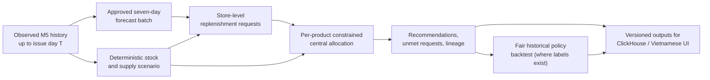

# 08 — Business Rules and Inventory Optimization Design

> **Project:** Big Data–Driven Inventory and Distribution Optimization  
> **Original title:** Tối ưu hóa hệ thống quản lý kho hàng  
> **Course:** Introduction to Big Data  
> **Document ID:** `08_BUSINESS_RULES_AND_OPTIMIZATION.md`  
> **Document type:** Business-rule and decision-policy specification  
> **Status:** Proposed design — implementation and experimental results pending  
> **Version:** 1.0  
> **Last updated:** October 15, 2026  
> **Maintainers:** Two-person project team  
> **Language convention:** Documentation, source code, variable names, and database fields in English; all end-user Streamlit text in Vietnamese.

---

## 1. Purpose, Scope, and Ownership

This document specifies how the project turns **seven-day sales forecasts** into **explainable store replenishment requests**, **feasible central-warehouse allocations**, and **measurable decision-policy comparisons**.

It is the design authority for **J07 — Simulated Inventory Decisions** in [`06_DATA_PIPELINE.md`](06_DATA_PIPELINE.md). It does **not** define how the forecasting model is trained, how ClickHouse tables are physically sharded, or how Streamlit screens are laid out.

The operational setting is a **simulation-driven decision-support prototype**, not a connected Walmart inventory system. The actual M5 dataset records unit sales, not real warehouse balances, lost customer demand, supplier stock, lead time, transportation costs, or customer orders. Any inventory management or distribution outcome is therefore **conditional on declared simulation assumptions**.

| Topic | This document owns | Detailed source elsewhere |
|---|---|---|
| Inventory terminology, units, time horizon | Normative business definitions | Dataset interpretation: [`04_DATASET.md`](04_DATASET.md) |
| Simulated stock, central supply, scenario reproducibility | Scenario contracts and generation policy | Data pipeline execution: [`06_DATA_PIPELINE.md`](06_DATA_PIPELINE.md) |
| Replenishment request | Mathematical rule, constraints, rounding, examples | Functional requirements: [`02_SYSTEM_REQUIREMENTS.md`](02_SYSTEM_REQUIREMENTS.md) |
| Allocation across stores | Objective, two-phase priority policy, tie-breaking, feasible outputs | Physical serving schema: [`09_DATABASE_DESIGN.md`](09_DATABASE_DESIGN.md) |
| Historical policy evaluation | Simulation and fair baseline comparison | Forecast evaluation: [`07_MACHINE_LEARNING.md`](07_MACHINE_LEARNING.md) |
| UI descriptions | Expected user-visible information only | UX details: [`10_APPLICATION_DESIGN.md`](10_APPLICATION_DESIGN.md) |
| Testing and performance evaluation | Invariants and illustrative acceptance cases | End-to-end software, data-quality, integration and distributed-system verification: [`11_TESTING.md`](11_TESTING.md) |

**Central engineering principle:** Every claim of “optimization” must specify an **objective**, a **feasible set**, an **alternative policy**, and **measured evidence**. A business rule is not automatically optimal simply because it produces a recommendation.

### 1.1. Requirement traceability

| ID | Requirement | Decision-layer response |
|---|---|---|
| `FR-09` | Reproducible simulated inventory scenarios | Versioned stock, safety, and supply inputs; no real-stock claims |
| `FR-10` | Nonnegative replenishment quantities | Horizon-aligned target-stock formula with explicit integer conversion |
| `FR-11` | Feasible constrained allocation | Per-product capacity, per-store request caps, stable priority/tie-breaking |
| `FR-12` | Comparison against a policy baseline | Chronological backtest, common initial conditions and simulation metrics |
| `FR-16` | Inventory dashboard | Clearly labeled stock assumptions, shortage flags, and requests |
| `FR-17` | Distribution dashboard | Actual allocation decisions, unmet requests, and baseline differences |
| `FR-18` | Verifiable evidence | Scenario manifests, policy versions, numerical tests and backtest results |
| `DR-04`, `DR-05` | Data-source honesty | Observed sales ≠ unconstrained demand; simulated stock ≠ Walmart stock |
| `DR-06`, `DR-08` | Temporal and numeric correctness | No future outcome in decisions; integral, bounded, nonnegative quantities |
| `NFR-05`, `NFR-09` | Reproducibility and honest evaluation | Deterministic policies and disclosed non-improvements |

---

## 2. Business Problem and Decision Boundaries

### 2.1. Business question

At the end of historical day **T**, for an eligible product sold in several stores:

1. How many units is each store expected to sell during **T+1 through T+7**?
2. Given the store's **simulated** current inventory, how many units should it **request** to meet forecast demand and a declared safety-stock target?
3. Given a **simulated**, finite quantity of the same product at a central warehouse, how should the warehouse **allocate available units** across requesting stores?
4. Under the same scenario and observed evaluation period, does the proposed decision policy outperform a transparent alternative on defined service and inventory indicators?

The outputs are **recommendations**, not executed purchase orders, shipment records, or verified operational savings.

### 2.2. Operational topology



**Operational model:** one *logical* central warehouse supplies the ten M5 stores. The central warehouse and its supply balances are **simulated project entities**; the dataset does not provide physical warehouse locations or movements.

### 2.3. Explicitly in scope

- Seven-day, per-product/per-store replenishment recommendations.
- Store inventory and central available stock generated from declared scenario inputs.
- An interpretable, integer, two-stage allocation policy when stock is insufficient.
- A meaningful baseline under the *same* scenario and constraints.
- Backtests of lost-sales proxy, remaining-inventory proxy, fulfillment rate and service patterns.
- Versioned, auditable results that can be served from ClickHouse to Streamlit.

### 2.4. Explicitly out of scope

- Supplier purchase-order workflows, invoicing, returns, purchase pricing or real operational stock ledgers.
- Vehicle routing, store-to-store transfers, pallet/truck capacities, geographic optimization or delivery-route cost.
- Multi-echelon network planning, dynamic replenishment with real lead times, perishability or expiry.
- Real-time sensor/RFID ingestion, streaming decisions, automatic supplier execution.
- Claims of globally optimal supply-chain performance or actual financial improvements at Walmart.

---

## 3. Information Categories: Never Mix Them

| Category | Example | Provenance | Permitted interpretation |
|---|---|---|---|
| **Observed** | Daily `unit_sales` for `item_id × store_id × date` | Original M5 sales history | Actual *recorded* sales in the dataset |
| **Observed** | `sell_price`, `wm_yr_wk`, calendar fields | Original M5 reference tables | Historical price/calendar metadata with documented missingness |
| **Derived** | Last-seven-day sales, seven-day historical mean | Spark transforms of pre-cutoff observed values | Historical signals |
| **Predicted** | Seven daily `predicted_units` and their sum | Approved Spark MLlib model output | Expected future unit sales, **not known demand** |
| **Simulated** | Available store stock, safety stock, central supply | Reproducible scenario generator or explicit user inputs | Hypothetical operating conditions |
| **Calculated** | Replenishment request, allocation, unmet quantity | Deterministic decision-policy implementation | Recommendation subject to assumed conditions |
| **Evaluated** | Simulated fulfilled and unmet units against holdout sales | Backtest simulator | Policy **proxy** outcome under assumed sales-as-demand evaluation |

**Critical caveat:** M5 recorded sales can be lower than true customer demand if real stockouts occurred. Because stockouts are unobserved, the simulator uses the evaluation-period recorded sales as a **demand proxy**; it must not claim to measure real lost Walmart sales.

A forward-looking `forward_demo` forecast (e.g. after `d_1941`) has **no observed future sales labels** in the selected source history. It may produce decisions but not measured outcome-based policy scores for those unseen days.

---

## 4. Canonical Terms, Units, and Time Contract

### 4.1. One planning epoch

A decision is issued **after the actual recorded sales for date `T` are available**. The planning horizon is the next **seven whole calendar days**: `T+1, …, T+7`, using the M5 `calendar.csv` mapping.

| Symbol | Suggested field | Unit | Meaning |
|---|---|---|---|
| `p` | `item_id` | Identifier | One product (SKU) |
| `s` | `store_id` | Identifier | One M5 store |
| `T` | `issue_date` | Date | Last day of information available to the decision |
| `h` | `horizon` | Integer, 1–7 | Day ahead |
| `f[p,s,h]` | `predicted_units` | Nonnegative float, units | Predicted units sold on future day `T+h` |
| `F[p,s]` | `forecast_7d_units` | Nonnegative float, units | Sum of the seven predictions |
| `D[p,s]` | `planning_demand_units` | Nonnegative integer, units | `ceil(F[p,s])` for discrete allocation |
| `I[p,s]` | `opening_stock_units` | Nonnegative integer, units | Simulated usable on-hand stock at end of `T` |
| `S[p,s]` | `safety_stock_units` | Nonnegative integer, units | Simulated **end-of-horizon** safety target |
| `R[p,s]` | `request_units` | Nonnegative integer, units | Amount requested by a store from the central warehouse |
| `K[p]` | `central_available_units` | Nonnegative integer, units | Simulated central supply for item `p`, at `T` |
| `A[p,s]` | `allocated_units` | Nonnegative integer, units | Units proposed to be dispatched to store `s` |
| `U[p,s]` | `unmet_request_units` | Nonnegative integer, units | `R[p,s] − A[p,s]` |
| `Y[p,s,h]` | `observed_holdout_sales` | Nonnegative integer, units | Historical holdout sales *revealed only for evaluation* |

Do not interchange a **fractional expected number of units**, an **integer order quantity**, and a **currency value**. Demand aggregation and forecast-error scoring preserve fractional predictions; **integerization occurs once per seven-day store demand total for decisions**.

### 4.2. Consistent timing assumptions (baseline)

- Store stock `I` is the **available balance just after day T closes**, not an amount at the start of T.
- Central supply `K` is available for allocation at the same decision epoch.
- The allocated stock is assumed **delivered before selling starts on T+1** (zero simulated lead time).
- No other receipts, returns, transfers, spoilage or supply releases occur during the seven-day horizon.
- Stock that remains at T+7 is carried as ending inventory; unmet demand is lost, not backordered.
- Safety stock is a **target remaining at the end of the seven days**, not a physical reserve that must never be consumed. The simulator permits it to be sold.

These assumptions are simplifications, not facts about Walmart. A longer or nonzero replenishment lead time would require a **different** protection-period calculation and model of arrival timing; it must not be introduced silently.

### 4.3. Product independence

The initial allocation problem is solved **independently for each SKU**. There is no shared fleet capacity, total-volume weight constraint, multi-SKU warehouse-space restriction, or substitutability between products. Therefore a stock unit of item A can never satisfy demand for item B.

### 4.4. Inventory vocabulary

- **Replenishment request:** how many units a store *wants* under its demand and safety-stock policy.
- **Central allocation:** how many of those requested units the simulated warehouse *can* supply.
- **Unmet request:** requested minus allocated units; **not necessarily customer demand lost**.
- **Forecast shortage:** part of forecast demand not covered by pre-allocation stock.
- **Simulated unmet sales:** observed holdout demand-proxy units not served during the simulated horizon.
- **Ending stock:** units remaining after simulated seven-day sales.

Confusing “unmet store request” with “unmet customer demand” is a correctness error; the former can include **safety-stock replenishment** even when customer sales can still be fulfilled.

---

## 5. Policy Design Principles and Scope of Optimization

The proposed business decision policy has two deterministic components:

1. **Target-stock replenishment** creates store-level requests.
2. **Shortage-first allocation** distributes finite per-SKU central supply between stores.

The allocation **priority** is:

1. Cover the **predicted sales deficit** before adding units solely to build the safety buffer.
2. Within each priority class, allocate available units **proportionally to the remaining requested units**.
3. Use stable largest-remainder integer rounding and `store_id` lexical order to break exact ties.

### 5.1. Primary objective under the stated model

For each product, favor fulfillment of projected sales before satisfying desired end-of-horizon buffers. A simple projected shortage proxy is:

\[
L_{p}(A)=\sum_s\max\left(0,D_{p,s}-I_{p,s}-A_{p,s}\right).
\]

A feasible allocation must satisfy:

\[
0\le A_{p,s}\le R_{p,s},\quad A_{p,s}\in\mathbb Z,
\qquad \sum_s A_{p,s}\le K_p.
\]

Under these **very simplified** equal-value-per-unit assumptions, allocating units to genuine forecast deficits before pure safety replenishment can minimize the total **integerized predicted unmet-units proxy** for a fixed supply. It is **not** guaranteed to uniquely minimize the proxy: many shortage-first allocations can tie. The proportional second criterion distributes stock more consistently across stores but is a **policy**, not proof of a universally optimal fair allocation.

**No claim is made** about minimizing actual Walmart lost sales, transportation expenses or economic cost. If the project later adopts differentiated service penalties or a mathematical optimizer, it must explicitly specify those weights and evaluate the added complexity.

### 5.2. Why this policy is preferred to a full mathematical solver

The initial constraints are separable by product, linear in inventory units and contain only up to ten stores per SKU. A deterministic two-phase allocator is easy to audit, test and demonstrate; a mixed-integer optimization framework would add dependencies without obvious gain under the simplified objective.

A solver becomes justified if future requirements add minimum shipment sizes, routes, budgets, capacity across SKUs, multiple warehouses or heterogeneous service priorities. Those are outside the committed demo scope.

---

## 6. Scenario Engineering: Simulated Operational Data

### 6.1. Scenario identity and reproducibility

A scenario must record the information that fully determines its input stock and supply:

| Field | Meaning |
|---|---|
| `scenario_id` | Immutable identifier or content hash of scenario inputs |
| `scenario_version` | Version of generator/formulas and input schema |
| `issue_date` | Historical forecast-origin date T |
| `source_snapshot_id` | Historical M5/Parquet version |
| `scenario_type` | `historical_scaled`, `manual`, or declared alternative |
| `scenario_seed` | Integer for any randomized optional factor, or `null` when purely deterministic |
| `stock_cover_factor` | Scalar controlling store opening stock vs. prior observable sales |
| `safety_cover_factor` | Scalar controlling safety target vs. prior observable sales |
| `central_cover_factor` | Scalar controlling warehouse available stock vs. prior observable sales |
| `generation_code_version` | Git revision / policy generator version |
| `created_at` | Creation timestamp, metadata only (not part of deterministic value) |
| `origin_label` | Literal `SIMULATED_FROM_M5_HISTORY` or `MANUAL_SIMULATION` |

**Do not overwrite a scenario in place.** Changing any stock number, factor or issue date creates a new scenario identity or explicit version. A batch rerun with identical input artifacts and parameters must produce byte-equivalent logical values, irrespective of Spark partition order.

### 6.2. Baseline deterministic generator (proposed)

For each eligible product–store pair, compute the **observed previous-seven-day units** using days `T−6` through `T` (all known by decision time):

\[
H_{p,s,T}^{(7)}=\sum_{d=T-6}^{T}y_{p,s,d}.
\]

Define integer scenario parameters as follows:

\[
I_{p,s}=\max(0,\lfloor \alpha H_{p,s,T}^{(7)}\rfloor),
\quad S_{p,s}=\max(0,\lceil\gamma H_{p,s,T}^{(7)}\rceil),
\]

\[
K_p=\max\left(0,\left\lfloor\beta\sum_{s\in E_p}H_{p,s,T}^{(7)}\right\rfloor\right),
\]

where `E_p` is the **fixed eligible-store population for product p** and parameters `alpha`, `gamma` and `beta` are recorded as nonnegative scenario factors.

**Illustrative scenario factors only (not empirically calibrated):**

| Preset | `alpha` store-stock factor | `gamma` safety factor | `beta` central-stock factor | Intended test |
|---|---:|---:|---:|---|
| `balanced` | 0.75 | 0.20 | 0.60 | Typical request/allocation flow |
| `scarce_supply` | 0.35 | 0.20 | 0.20 | Strong central-capacity pressure |
| `ample_supply` | 1.00 | 0.20 | 1.50 | Requests often fully satisfied |

These are **starting test fixtures**, not optimized thresholds or real inventory policies. Presets do not guarantee a shortage for every SKU; actual scarcity is determined **after** the store requests are calculated (`K_p < Σ_s R_{p,s}`). Record the number of constrained SKU scenarios instead of falsely labeling every scenario constrained.

If historical lookback is insufficient or unavailable, the scenario must be marked **ineligible**, or a separate, explicitly named cold-start rule must be used. Never use an unseen holdout period to reconstruct simulated opening stock.

### 6.3. Comparison fairness

For a given `(issue_date, scenario_id, item_id)`:

- Both proposed and baseline policies receive **identical** `I`, `S`, `K`, eligible stores and forecast issue time.
- Central capacity is generated from pre-issue observed history (or manual input), **not** calibrated to a policy's resulting shortage or actual future demand.
- If comparing **forecast methods**, forecasts may differ, but scenario stock/supply and allocation algorithm remain identical.
- If comparing **allocation policies**, use the **same approved forecast** and replenishment requests for both policies.
- Evaluation labels `Y` for T+1..T+7 are withheld from all decision inputs until outcomes are scored.

A scenario with stock/central capacity engineered using the held-out actual future sales creates leakage and invalidates the evaluation.

### 6.4. User-adjusted scenarios

Streamlit may allow bounded changes to stock or central available supply for **one selected product**. The UI must clearly mark such values **“Dữ liệu tồn kho mô phỏng”** and must never save manual edits as original M5 data.

- Reject negatives, fractions for stock units, nonfinite values and quantities above a declared application safety bound.
- Recompute `R` and `A` for the currently selected SKU; do not retrain Random Forest.
- Label results as a **new in-session simulated scenario**, with parameter summary and identifier/digest if persisted.
- Do not mutate the approved batch-result tables. Export/persist a manually edited scenario as a separate artifact if needed.

---

## 7. Replenishment Business Rules

### 7.1. Preconditions

For every requested `(forecast_run_id, issue_date, item_id, store_id)`:

1. There are **exactly seven** valid dated predictions with horizons `1..7`.
2. Predictions are finite, nonnegative and correspond to the same immutable forecast run.
3. The scenario contains exactly one valid store inventory record for the corresponding issue date and key.
4. `I` and `S` are integer quantities `≥ 0`.
5. The product and store are valid for the supported forecast population.

If any required input fails, **reject that decision row with an explicit reason**; do not invent a zero forecast or replace a missing stock value with zero.

### 7.2. Seven-day aggregate and integer planning demand

\[
F_{p,s}=\sum_{h=1}^{7}\widehat y_{p,s,T+h\mid T},
\qquad D_{p,s}=\lceil F_{p,s}\rceil.
\]

- Aggregate the seven **unrounded daily predictions** first.
- Use a consistent, documented **ceiling** of the seven-day expectation for discrete planning.
- Keep the unrounded `F` in outputs to preserve auditability.
- Forecast evaluation uses unrounded predictions as defined in Document 07; do not substitute integerized `D` into model error reports.

### 7.3. Target stock and replenishment request

The baseline rule aims to cover seven-day planning demand and leave `S` units at the horizon end:

\[
\text{target\_stock}_{p,s}=D_{p,s}+S_{p,s},
\]

\[
\boxed{R_{p,s}=\max(0,D_{p,s}+S_{p,s}-I_{p,s})}.
\]

This is a **store request**, not a guaranteed central shipment. If a store already has enough simulated opening stock (`I ≥ D + S`), the request is exactly **zero**.

Example:

| Input | Units |
|---|---:|
| Seven-day predicted sales total `F` | 80.0 |
| Integer planning demand `D` | 80 |
| End-of-horizon safety target `S` | 10 |
| Opening usable stock `I` | 50 |
| Target stock `D+S` | 90 |
| **Replenishment request `R`** | **40** |

If `I=100` with the same `D,S`, then `R=0`.

### 7.4. Two parts of a store's request

Split requested units into two nonoverlapping priority classes:

\[
\text{critical}_{p,s}=\max(0,D_{p,s}-I_{p,s}),
\]

\[
\text{safety}_{p,s}=R_{p,s}-\text{critical}_{p,s}.
\]

`critical` represents units required to cover **integerized expected sales** when opening stock is insufficient. `safety` represents the additional buffer requested after projected sales are covered.

Because `S ≥ 0`, `R ≥ critical` always holds. Both values are integers and cannot be negative.

### 7.5. Interpretation of risk flags

Recommended simple UI flags are:

| Flag | Condition | Meaning |
|---|---|---|
| `forecast_shortage` | `I < D` | Simulated opening stock does not cover integerized forecast demand |
| `below_safety_target` | `I < D + S` | Additional units requested to meet desired horizon-end safety target |
| `no_request` | `R == 0` | Opening stock already covers the declared target |
| `unmet_request` | `A < R` | Warehouse did not fulfill the entire store request |

These flags are deterministic **proxies**, not probabilities or confirmed real-world stockout events.

### 7.6. Input and output invariants

For all valid rows:

- `F` is finite and `≥ 0`.
- `D`, `I`, `S`, `R`, `critical`, `safety` are nonnegative integers.
- `R = critical + safety`.
- `R = 0` if `I ≥ D + S`.
- The recommendation never changes the simulated opening balance `I`; allocation is a separate decision.
- Every output carries `forecast_run_id`, `scenario_id`, `policy_version`, `issue_date`, `item_id`, and `store_id`.

---

## 8. Constrained Central-Stock Allocation Rules

### 8.1. Allocation scope

For **each SKU independently**, collect all eligible stores and their requests `R_s`, critical needs `C_s`, and safety needs `B_s`. The central warehouse provides `K` units of that SKU.

Require:

\[
A_s\in\mathbb{Z}_{\geq0},\qquad A_s\le R_s,\qquad
\sum_s A_s\le K.
\]

The unallocated portion of central stock is:

\[
\text{central\_remaining}=K-\sum_s A_s\ge0.
\]

Never pool central supply from different `item_id` values. Do not count warehouse stock as store inventory until allocation is simulated to arrive.

### 8.2. Policy `shortage_first_proportional_v1`

**Stage 1 — cover projected sales shortages.** Let `C_s = critical_s`. Allocate up to `min(K, Σ C_s)` units proportionally to `C_s`, using largest-remainder integer rounding.

**Stage 2 — satisfy horizon-end safety target.** If central supply remains after all critical needs are covered, allocate up to `min(remaining, Σ B_s)` proportionally to `B_s` using the same rounding rule.

**Stage 3 — finish.** For each store `A_s = critical_alloc_s + safety_alloc_s`; publish `R_s − A_s`, remaining central supply, stage allocations and decision metadata.

When `K ≥ Σ_s R_s`, the result is simply `A_s = R_s` and the central warehouse keeps `K − Σ_s R_s` units. When `K=0`, every `A_s=0`.

### 8.3. Bounded integer proportional apportionment

For nonnegative integer `need_s` and a stage supply `B ≤ Σ need_s`:

1. Compute exact rational quotas `q_s = B × need_s / Σ need_s`.
2. Assign `base_s = floor(q_s)`.
3. Let `r = B − Σ base_s`.
4. Give one extra unit to the `r` stores with the **largest fractional remainders**, breaking ties by ascending `store_id`.
5. The stage allocation is integer, sums exactly to `B`, and does not exceed each store's need.

For reproducibility, compute the ranking from **integer numerators and denominators**, not floating-point equality checks. Since `B ≤ Σ need_s`, exact quota allocations do not exceed individual needs.

### 8.4. Reference pseudocode

The following **Python-like pseudocode** defines business behavior; full Spark implementation, persistence and error handling belong in executable modules.

```python
from typing import Mapping


def apportion_proportionally(needs: Mapping[str, int], supply: int) -> dict[str, int]:
    assert supply >= 0
    assert all(isinstance(v, int) and v >= 0 for v in needs.values())

    stores = sorted(needs)
    total_need = sum(needs.values())
    capacity = min(supply, total_need)
    allocated = {store: 0 for store in stores}
    if capacity == 0:
        return allocated

    # Integer quotas avoid platform-dependent floating-point tie behavior.
    for store in stores:
        allocated[store] = (capacity * needs[store]) // total_need

    remaining = capacity - sum(allocated.values())
    ranked = sorted(
        stores,
        key=lambda store: (
            -((capacity * needs[store]) % total_need),
            store,
        ),
    )
    for store in ranked[:remaining]:
        allocated[store] += 1

    assert sum(allocated.values()) == capacity
    assert all(0 <= allocated[s] <= needs[s] for s in stores)
    return allocated


def allocate_shortage_first(
    critical: Mapping[str, int],
    safety: Mapping[str, int],
    central_available: int,
) -> dict[str, int]:
    assert set(critical) == set(safety)
    assert isinstance(central_available, int) and central_available >= 0

    first = apportion_proportionally(critical, central_available)
    available_for_safety = central_available - sum(first.values())
    second = apportion_proportionally(safety, available_for_safety)
    result = {store: first[store] + second[store] for store in critical}

    assert sum(result.values()) <= central_available
    assert all(result[s] <= critical[s] + safety[s] for s in result)
    return result
```

**Implementation note:** In production, replace the compact remainder expression with a clearly named `remainder_numerator` helper and explicit validation. Executable code must not rely only on `assert` (assertions can be disabled).

> **Correctness checkpoint:** Before merging code, run the numerical acceptance tests in Section 16. In particular, integer quotas and stable ties must not depend on Spark partition order.

### 8.5. Distributed versus local execution

There are **up to ten M5 stores per item**, so allocation of a single item is a tiny bounded computation. The distributed ETL/ML pipeline has already performed the large-scale work. Two valid execution patterns are:

- **Batch:** Spark groups validated store requests by `item_id` and applies the deterministic allocator to every eligible SKU, writing versioned recommendation Parquet.
- **Interactive:** Streamlit requests one SKU's small scenario/forecast result from ClickHouse, then recomputes decisions locally for an explicitly edited simulated scenario.

Do not collect the complete 59-million-row sales fact into the Streamlit process. Do not call the model or restart Spark from an interactive allocation button.

---

## 9. Allocation Edge Cases and Business Decisions

| Situation | Required behavior | Explanation |
|---|---|---|
| No central units (`K=0`) | Allocate zero everywhere | Requests remain unmet |
| Central units cover all requests | Allocate every store's full request | Unused central supply may remain |
| Some store has `R=0` | Allocate zero to that store | It is not eligible for a shipment |
| Forecast zero and stock positive | Usually `R=0`, unless safety target exceeds stock | Avoid phantom sales demand |
| Forecast fractional (`F=2.1`) | `D=3` for decisions | Aggregate then ceiling once |
| Store has stock above target | Request exactly zero | Never force negative replenishment |
| All critical needs zero, safety needs positive | Allocate to safety directly | No projected sales shortage to prioritize |
| Central supply is limited within critical phase | Proportional critical allocation | No units used for safety first |
| Exact proportional-remainder tie | Ascending `store_id` wins | Independent of input row order |
| Missing eligible store record | Reject with coverage reason | Do not silently pretend stock zero |
| Multiple forecast-run IDs in one batch | Reject incompatible join | Avoid mixing model/scenario vintages |
| Invalid negative/decimal stock input | Reject, explain which field | Inventory quantities are discrete |
| No eligible stores for an SKU | No allocation row; preserve manifest/exception | Avoid misleading success |
| Extremely large values/overflow risk | Explicit bounded-int validation | Protect arithmetic and ClickHouse types |
| Item included in dataset but not ML coverage | No ML-based recommendation | Report eligibility/coverage gap |

A nonempty input and **correct error behavior** are both part of a defensible demo; a blank chart or silent zero substitution is not acceptable.

---

## 10. Baseline Policies and Fair Comparison

A useful experiment must separate the effect of **forecasting** from the effect of **allocation**. The following two comparison axes may be tested independently.

### 10.1. Mandatory policy baseline: `equal_share_v1`

Under the **same** store requests `R_s` and central supply `K`:

1. Start with stores that have `R_s > 0`.
2. Share capacity **as evenly as possible**, capped by each remaining request.
3. Redistribute unused capacity from stores reaching their cap to stores with remaining requests.
4. Use ascending `store_id` for one-unit tie-breaking.
5. Stop when stock is exhausted or all requests are fulfilled.

This is a **capped equal-share water-filling policy**. It intentionally does **not** prioritize forecast deficits over safety buffers. Consequently, it can allocate extra safety stock to one store while another store still has an uncovered projected shortage.

In implementation, use a bounded algorithm rather than a literal unit-by-unit loop if quantities are large; pseudocode is provided in Section 10.3.

**Controlled comparison:** `shortage_first_proportional_v1` versus `equal_share_v1`, with the same approved forecasts, stock scenario, eligible stores and central stock.

### 10.2. Optional forecasting comparison: `seasonal_naive_request_v1`

To inspect how forecast accuracy affects inventory decisions:

- Compute store demand totals from Document 07's **seasonal-naïve**, leakage-safe seven-day predictions.
- Recalculate replenishment requests using the **same** `I` and `S`.
- Apply the **same** selected central allocation policy to those new requests.
- Evaluate against the same holdout daily sales outcomes.

**Controlled comparison:** RF-driven decisions versus seasonal-naïve-driven decisions. This isolates the forecast source more cleanly than changing both forecasts and allocation algorithm simultaneously.

Use different decision run identifiers for different policies and forecast sources. Never choose whichever variant scores better on the locked test set and then present that post hoc winner as a precommitted result.

### 10.3. Capped equal-share baseline pseudocode

```python

def allocate_equal_share(requests: dict[str, int], central_available: int) -> dict[str, int]:
    assert isinstance(central_available, int) and central_available >= 0
    assert all(isinstance(v, int) and v >= 0 for v in requests.values())

    result = {s: 0 for s in sorted(requests)}
    remaining = min(central_available, sum(requests.values()))

    while remaining > 0:
        active = [s for s in sorted(requests) if result[s] < requests[s]]
        if not active:
            break

        bulk = remaining // len(active)
        if bulk > 0:
            for store in active:
                add = min(bulk, requests[store] - result[store])
                result[store] += add
                remaining -= add
        else:
            # One-unit deterministic tie-break; at most len(active)-1 iterations here.
            for store in active[:remaining]:
                result[store] += 1
            remaining = 0

    return result
```

The production implementation must include explicit validation and a termination check. This small baseline has no Spark-model dependency and is intentionally easy to audit.

### 10.4. What policy improvements can and cannot mean

- If a policy uses limited stock to cover **actual demand-proxy units** that another policy leaves uncovered, it can show higher simulated fulfillment.
- When both policies allocate all limited units exclusively to stores that still have deficits, **aggregate fulfilled demand may be identical** even when allocation patterns differ. Do not manufacture an improvement.
- A more aggressive safety buffer may reduce shortage but increase ending stock in some scenarios: report both.
- Forecast-driven rules can underperform the baseline; negative outcomes are valid findings.
- The proposed allocation is not claimed to minimize a full real-world logistics cost function.

---

## 11. Historical Backtesting Protocol

### 11.1. Reuse the locked ML evaluation origins

Document 07 defines the following origin windows:

| Type | Issue day T | Holdout days (never used for a decision issued at T) |
|---|---|---|
| Validation 1 | `d_1885` | `d_1886`–`d_1892` |
| Validation 2 | `d_1892` | `d_1893`–`d_1899` |
| Validation 3 | `d_1899` | `d_1900`–`d_1906` |
| Validation 4 | `d_1906` | `d_1907`–`d_1913` |
| Test 1 | `d_1913` | `d_1914`–`d_1920` |
| Test 2 | `d_1920` | `d_1921`–`d_1927` |
| Test 3 | `d_1927` | `d_1928`–`d_1934` |
| Test 4 | `d_1934` | `d_1935`–`d_1941` |

Use the **same eligible product–store set** at an origin when comparing policies. A later origin may use real history through that later T because it was genuinely observed by then; it must not use any outcome from **after** that origin in features, initial inventory or scenario capacity.

Do not tune the policy using locked test results. If policy factors are selected using the validation windows, freeze those factors and versions before test evaluation.

### 11.2. Evaluation sequence per origin and scenario

1. Fix `issue_date`, `forecast_run_id`, eligible series, simulation preset/inputs, and policy versions.
2. Construct `I`, `S`, and `K` from information **available at or before T**.
3. Calculate the approved seven-day forecasts and store requests.
4. Allocate central supply under both policies independently, resetting the **same initial stock** for each policy.
5. Freeze and persist decisions **before exposing holdout outcomes to evaluation logic**.
6. Reveal seven historical holdout sales values (the declared demand proxy).
7. Simulate daily fulfillment, unmet units and ending stock under each allocation.
8. Aggregate metrics per origin, SKU, store, category and all eligible rows with explicit denominators.
9. Publish the paired results and scope counts. Missing or invalid scenario pairs must be reported as exclusions, not zero-loss outcomes.

### 11.3. Daily inventory simulation

For each policy and `(item_id, store_id)`:

- Set simulated usable stock at the start of `T+1`: `stock_0 = I + A`.
- For each day `h = 1..7`, take historical `Y_h` **only in evaluation**:

\[
\text{fulfilled}_h=\min(\text{stock}_{h-1},Y_h),
\]

\[
\text{unmet}_h=\max(0,Y_h-\text{stock}_{h-1}),
\]

\[
\text{stock}_h=\max(0,\text{stock}_{h-1}-Y_h).
\]

- Lost units are not backordered. There is no replenishment arriving mid-horizon.
- `ending_stock_units = stock_7`.
- The simulated demand stream is the **observed historical sales proxy**, not reconstructed true demand.

This is equivalent to a seven-day aggregate for total fulfilled units under the assumptions, but daily simulation also supports showing the **day** on which a simulated stockout first occurs.

### 11.4. Scenario experiment design

Recommended minimum matrix:

| Controlled factor | Minimum values | Purpose |
|---|---|---|
| Time | Four locked test origins | Reduce dependence on one unusual week |
| Supply setting | A non-scarce and a constrained scenario | Distinguish ordinary replenishment from actual allocation pressure |
| Allocation policy | Shortage-first vs capped equal share | Isolate allocation value |
| Forecast source | Approved RF (mandatory); seasonal naïve (optional) | Isolate forecast value |
| SKU coverage | Declared eligible population | Avoid presenting cherry-picked examples as universal |

Run larger evaluation scopes only after correctness and available memory are verified. Report the actual evaluated number of `item_id × store_id × origin` records; do not imply all 59.18 million historical fact rows were directly simulated or scored.

---

## 12. Outcome Metrics and Objective Interpretation

### 12.1. Core unit-based metrics

For each store, SKU and evaluation horizon, write:

\[
Y=\sum_{h=1}^7 Y_h,\quad
\text{served}=\sum_{h=1}^7\text{fulfilled}_h,\quad
\text{unmet}=\sum_{h=1}^7\text{unmet}_h.
\]

Required aggregate measures (sum numerator and denominator **before** computing a percentage):

| Metric | Definition | Interpretation |
|---|---|---|
| `simulated_unmet_units` | `Σ unmet` | Sales-as-demand proxy units not fulfilled in simulation; lower is better |
| `simulated_fulfilled_units` | `Σ fulfilled` | Proxy units served under the scenario; higher is better |
| `demand_fulfillment_rate` | `Σ fulfilled / Σ Y` when `ΣY > 0` | Fraction of proxy demand served; higher is better |
| `ending_stock_units` | `Σ stock_7` | Remaining units at the end of the simulated horizon; context dependent |
| `excess_over_safety_units` | `Σ max(0, stock_7 − S)` | Explicit *proxy* for inventory above declared safety buffer |
| `store_horizon_stockout_count` | Number of `(p,s,T)` with any simulated unmet units | Number of series/horizons experiencing simulated shortage |
| `simulated_stockout_days` | Sum of days where daily `unmet_h > 0` | Number of affected store–SKU–days |
| `unmet_request_units` | `Σ (R−A)` | Incomplete replenishment request; **not** customer stockout |
| `central_utilization_rate` | `Σ A / Σ K` when `ΣK > 0` | Proportion of simulated central supply allocated |

`ending_stock_units` is **not inherently waste**. A positive ending balance can be intentional safety inventory, so the dashboard must avoid calling it “waste” or proven cost.

For zero total proxy demand, store `demand_fulfillment_rate = null` / `N/A` and report the denominator; do not quietly set it to 100% or 0%.

### 12.2. Paired differences

With identical evaluation cases for policies `P` (proposed) and `B` (baseline):

\[
\Delta_\text{unmet}=\text{unmet}(B)-\text{unmet}(P),
\]

\[
\Delta_\text{fulfillment}=\text{fillrate}(P)-\text{fillrate}(B).
\]

A positive `Δ_unmet` favors the proposed policy; a positive `Δ_fulfillment` favors it. Also publish ending stock, central utilization and per-store differences so that the improvement is not misinterpreted as being free of trade-offs.

Optional relative improvement may be shown only when its baseline denominator is positive, and must label the denominator and scope. Never compute misleading percentages of zero-baseline stockouts.

### 12.3. Optional weighted objective (not required)

If needed for a sensitivity analysis, define a **synthetic, dimensionless** policy score:

\[
J = w_u \cdot \text{simulated_unmet_units}
  + w_e \cdot \text{excess_over_safety_units},
\]

where `w_u`, `w_e ≥ 0` are explicitly **assumed weights**, not empirical supplier or shortage costs. A lower `J` is preferable **only under the chosen weights**. Never state that `J` is Walmart's real financial cost.

The **mandatory evaluation** remains the individual interpretable metrics; a single synthetic score must not hide a deterioration on an important dimension.

---

## 13. Fully Worked Numerical Examples

### 13.1. Example A — basic replenishment, matching SRS acceptance

```text
SKU: EXAMPLE_ITEM
Store: CA_1
Issue day: T
Forecasts for next 7 days (units): 10, 11, 12, 9, 14, 12, 12
F = 80.0
D = ceil(80.0) = 80
I = 50 (simulated)
S = 10 (simulated)
Target stock = D + S = 90
Request R = max(0, 90 - 50) = 40
Critical = max(0, 80 - 50) = 30
Safety request = 40 - 30 = 10
```

With `I=100`, the same inputs produce `R=0`. The example is synthetic arithmetic, **not a real M5 inventory record**.

### 13.2. Example B — shortage-first integer allocation

For one SKU at one issue date:

| Store | `D` | `I` | `S` | `Critical` | `Safety` | `Request R` |
|---|---:|---:|---:|---:|---:|---:|
| `CA_1` | 80 | 50 | 10 | 30 | 10 | 40 |
| `TX_1` | 50 | 35 | 5 | 15 | 5 | 20 |
| `WI_1` | 25 | 10 | 5 | 15 | 5 | 20 |
| **Total** | | | | **60** | **20** | **80** |

Assume `K=35` central units. Stage 1 allocates all 35 units across `[30,15,15]` critical needs by largest remainder:

| Store | Exact critical quota | Integer allocation | Unmet total request |
|---|---:|---:|---:|
| `CA_1` | 17.50 | **17** | 23 |
| `TX_1` | 8.75 | **9** | 11 |
| `WI_1` | 8.75 | **9** | 11 |
| **Total** | **35.00** | **35** | **45** |

There are no units left for safety. Invariants: `ΣA=35 ≤K`, `A_s≤R_s`, and `Σ(R−A)=80−35=45`. This example proves **correct allocation**, not that aggregate demand fulfillment must beat the baseline.

### 13.3. Example C — where shortage priority changes simulated outcomes

Take a second intentionally simple SKU scenario:

| Store | Planning demand `D` | Opening stock `I` | Safety `S` | Critical need | Store request |
|---|---:|---:|---:|---:|---:|
| `CA_1` | 100 | 20 | 10 | 80 | 90 |
| `TX_1` | 20 | 18 | 10 | 2 | 12 |
| `WI_1` | 20 | 18 | 10 | 2 | 12 |

Central stock: `K = 30` units. Both policies use **exactly these same inputs**.

| Policy | Allocation CA_1 | TX_1 | WI_1 | Total allocated |
|---|---:|---:|---:|---:|
| **Shortage-first proportional** | 28 | 1 | 1 | 30 |
| **Equal share** | 10 | 10 | 10 | 30 |

For illustration **only**, assume each store's *future holdout sales proxy equals its listed planning demand* and simulate delivery at the start of T+1:

| Metric | Shortage-first | Equal share |
|---|---:|---:|
| Total proxy sales to serve | 140 | 140 |
| Total fulfilled units | **86** | **70** |
| Total unmet units | **54** | **70** |
| Demand fulfillment rate | **61.43%** | **50.00%** |
| Total ending stock | **0** | **16** |

The difference occurs because equal share sends units into buffer stock at the two smaller stores while the first store still lacks units for projected sales. **These are synthetic example results, not empirical evaluation results on M5.** Other scenarios may produce equal or worse performance for the proposed policy.

### 13.4. Example D — ample central supply

If the requests from Example B are `[40,20,20]` and `K=100`:

```text
Allocated = [40,20,20]
Total dispatched = 80
Central remaining = 20
All unmet store requests = 0
```

Even with every request fulfilled, later simulated customer shortages may still arise if actual proxy sales greatly exceed the forecast used to determine requests. Request fulfillment is not the same as perfect forecast accuracy.

---

## 14. Logical Data Contracts and Lineage

The following contracts describe **semantic datasets**. ClickHouse physical engines, partition expressions and shard placement belong to [`09_DATABASE_DESIGN.md`](09_DATABASE_DESIGN.md). Contract names can be mapped in a versioned implementation schema.

### 14.1. `inventory_scenario`

**Grain:** one `(scenario_id, issue_date, item_id, store_id)` record.

| Field | Meaning / constraint |
|---|---|
| `scenario_id` | Unique stable scenario identity |
| `scenario_version`, `scenario_type` | Generator version and scenario classification |
| `issue_date` | Day T, matching the forecast run |
| `item_id`, `store_id` | Exact M5-compatible series keys |
| `opening_stock_units` | Nonnegative integer, **simulated** |
| `safety_stock_units` | Nonnegative integer, **simulated** |
| `source_snapshot_id` | Historical source provenance |
| `parameter_digest` | Digest of all stock-generation inputs |
| `origin_label` | Explicit simulated-data classification |

`central_supply_scenario` is a **separate** product-level contract keyed by `(scenario_id, issue_date, item_id)` with `central_available_units ≥0`. Do not duplicate central quantities per store and then accidentally sum them as if they were independent supplies.

### 14.2. `replenishment_recommendations`

**Grain:** one `(decision_run_id, item_id, store_id)` for a particular declared origin and scenario.

| Field | Meaning / constraint |
|---|---|
| `decision_run_id` | Immutable decision batch identity |
| `forecast_run_id`, `model_run_id` | Versioned source forecast/model |
| `scenario_id`, `policy_version` | Exact scenario and rule version |
| `issue_date`, `item_id`, `store_id` | Decision grain |
| `forecast_7d_units` | Raw nonnegative float sum of seven predictions |
| `planning_demand_units` | Integer ceiling of forecast total |
| `opening_stock_units`, `safety_stock_units` | Declared simulated integers |
| `target_stock_units` | `D+S` |
| `critical_need_units` | `max(0,D−I)` |
| `safety_need_units` | `R−critical` |
| `request_units` | Store replenishment request `R` |
| `forecast_shortage_flag` | Truth value of `I<D` |
| `origin_label` | Simulated decision lineage |

### 14.3. `allocation_recommendations`

**Grain:** one `(decision_run_id, policy_id, item_id, store_id)` for the same declared origin. The central source is the single logical simulated warehouse `CENTRAL_01`.

| Field | Meaning / constraint |
|---|---|
| `decision_run_id`, `policy_id` | Decision run and proposed/baseline rule |
| `scenario_id`, `forecast_run_id`, `issue_date` | Identical origin metadata |
| `item_id`, `store_id`, `source_warehouse_id` | Item, destination and simulated origin |
| `requested_units` | `R`, copied from corresponding replenishment result |
| `critical_allocated_units` | First-stage quantity (baseline may use `null`) |
| `safety_allocated_units` | Second-stage quantity (baseline may use `null`) |
| `allocated_units` | Total `A`, integer |
| `unmet_request_units` | `R−A`, integer |
| `central_available_units` | Product-level capacity for reference, **not** a value to sum per store |
| `policy_version` | Immutable allocator implementation version |

If ClickHouse exposes replicated central capacity on each row for UI convenience, aggregation must use the **product-level supply contract** or an appropriate distinct value; never sum those repeated capacities per store.

### 14.4. `inventory_policy_evaluation`

**Grain:** one `(evaluation_run_id, decision_run_id, policy_id, item_id, store_id, issue_date)`.

Minimum fields:

```text
evaluation_run_id
source_snapshot_id
forecast_run_id
scenario_id
decision_run_id
policy_id
policy_version
issue_date
item_id
store_id
actual_sales_proxy_7d_units
simulated_fulfilled_units
simulated_unmet_units
ending_stock_units
excess_over_safety_units
simulated_stockout_days
run_type            # validation | test; never forward_demo for scored outcomes
observed_label_window_start
observed_label_window_end
```

All holdout-derived fields are **evaluation-only artifacts** and may never be fed back into the same origin's recommendation inputs.

### 14.5. Stable identities and failure handling

- Join forecasts to scenarios only on matching `issue_date`, `item_id`, `store_id` and compatible published run/source snapshot IDs.
- Carry `forecast_run_id`, `scenario_id` and `policy_version` into every decision output.
- Reject duplicate key rows, ambiguous scenario versions, or mixed historical/forward-demo outputs.
- A logical run manifest contains input versions, row counts, exclusions, parameter digest, timestamps, code revision and a completion state.
- Publish as an approved batch only after all required stock and allocation consistency checks pass.

---

## 15. Integration, Execution and User-Facing Behavior

### 15.1. Pipeline stage ownership

| Pipeline stage | Role |
|---|---|
| `J01`–`J03` | Prepare and validate M5 observed sales history |
| `J04`–`J06` | Produce leakage-safe features, trained model and seven-day forecasts |
| **`J07`** | Generate simulated stock; compute replenishment, allocation and fair backtests |
| `J08` | Load approved analytical/decision result datasets to distributed ClickHouse tables |
| Streamlit | Read bounded records; optionally recalculate one SKU's explicitly edited scenario |

`J07` should write **durable, versioned Parquet** outputs before publication. ClickHouse is a query-serving database, not the authoritative source of the computational run or the historical M5 files.

### 15.2. Minimal implementation modules (suggested, not mandatory microservices)

```text
src/
  policies/
    scenario_generator.py      # deterministic stock/supply inputs
    replenishment.py           # seven-day target-stock request
    allocation.py              # shortage-first and equal-share policies
    simulation.py              # seven-day holdout sales-proxy simulation
    metrics.py                 # aggregate and paired policy metrics
    contracts.py               # input validation and stable run identities
  jobs/
    run_inventory_decisions.py # J07 batch orchestration
```

Keep pure allocation/math functions independent of Spark so they can be unit tested quickly. Spark performs large input/partitioned batch work when necessary, while per-SKU integer allocation remains bounded and deterministic.

### 15.3. Vietnamese application presentation

Example user-visible labels (the code identifiers remain English):

| Internal meaning | Vietnamese UI text |
|---|---|
| `forecast_7d_units` | “Nhu cầu dự báo 7 ngày” |
| `opening_stock_units` | “Tồn kho giả lập hiện tại” |
| `safety_stock_units` | “Tồn kho an toàn giả lập” |
| `request_units` | “Số lượng đề xuất bổ sung” |
| `allocated_units` | “Số lượng được phân bổ” |
| `unmet_request_units` | “Số lượng yêu cầu chưa được đáp ứng” |
| `simulated_unmet_units` | “Số lượng thiếu hàng mô phỏng” |
| `demand_fulfillment_rate` | “Tỷ lệ đáp ứng nhu cầu mô phỏng” |

The UI should visibly explain: **“Dữ liệu tồn kho và nguồn cung là dữ liệu mô phỏng, không phải tồn kho thực tế của Walmart.”** If a number depends on historical sales used only as a demand proxy, explain that limitation in the policy-evaluation section.

### 15.4. Resource-aware demo behavior

On a Windows host with **16 GB total physical RAM** running Ubuntu through WSL2:

- Process the full M5 normalized history in the designated Spark/HDFS batch stages, not inside the UI.
- Run scenario generation and offline policy backtests on **eligible, versioned forecast subsets**, with accurate coverage counts.
- Compute results on one SKU/ten stores for user-adjusted scenarios; do not start multiple heavyweight cluster jobs for a single slider or click.
- Pre-publish stable decision outputs so the app remains responsive even when Spark batch containers are stopped.
- Show stored evidence for HDFS/Spark/ClickHouse execution separately from the interactive simulation.

---

## 16. Verification and Acceptance Test Matrix

The team should implement these tests as **executable unit tests plus data-quality checks**, not only screenshots.

### 16.1. Replenishment rules

| Test ID | Inputs | Expected result |
|---|---|---|
| `BR-01` | `F=80, I=50, S=10` | `D=80`, `R=40`, critical=30, safety=10 |
| `BR-02` | `F=80, I=100, S=10` | `R=0` |
| `BR-03` | `F=0, I=0, S=0` | `R=0` |
| `BR-04` | `F=2.1, I=0, S=0` | `D=3`, `R=3` |
| `BR-05` | `F=0.1, I=2, S=3` | `D=1`, `R=2` |
| `BR-06` | Any negative `I`, `S`, or nonfinite `F` | Explicit validation error |
| `BR-07` | Six or eight forecast-day records instead of seven | Decision rejected with coverage issue |
| `BR-08` | Duplicate `(forecast_run_id, item_id, store_id, forecast_date)` | Decision rejected |

### 16.2. Allocation correctness

| Test ID | Inputs | Expected result |
|---|---|---|
| `AL-01` | Requests `[40,20,20]`, `K=0` | All allocations zero |
| `AL-02` | Requests `[40,20,20]`, `K=100` | Allocation `[40,20,20]`, central remaining 20 |
| `AL-03` | Critical `[30,15,15]`, safety `[10,5,5]`, `K=35` | Shortage-first `[17,9,9]` |
| `AL-04` | Same inputs, `K=75` | Shortage-first `[37,19,19]` |
| `AL-05` | Critical `[80,2,2]`, safety `[10,10,10]`, `K=30` | Shortage-first `[28,1,1]` |
| `AL-06` | Requests `[90,12,12]`, `K=30` | Capped equal-share `[10,10,10]` |
| `AL-07` | Same needs supplied in arbitrary row order | Identical allocation by `store_id` |
| `AL-08` | Two SKUs, each with `K=5` | No cross-item stock transfer |
| `AL-09` | Any negative, fractional, or missing `K` | Explicit validation error |
| `AL-10` | All requests zero and `K>0` | Zero dispatch, central stock untouched |

**Property checks on every test:** `0≤A≤R`, `ΣA≤K`, integer results, nonnegative unmet request, and conservation `ΣA + central_remaining = K`.

### 16.3. Historical simulation and comparison

| Test ID | Expected behavior |
|---|---|
| `SIM-01` | Daily simulator never fulfills more than remaining stock or daily demand proxy |
| `SIM-02` | `fulfilled_h + unmet_h = observed_holdout_sales_h` |
| `SIM-03` | `stock_h = max(0, stock_(h-1) − observed_holdout_sales_h)` |
| `SIM-04` | Final stock and total fulfilled/unmet reconcile with seven daily rows |
| `SIM-05` | Zero denominator gives `null` fulfillment rate and exposes zero demand |
| `SIM-06` | Both policies use exactly the same opening stock and supply per pair |
| `SIM-07` | Evaluations using T+1..T+7 outcomes cannot be inputs to the T decision |
| `SIM-08` | Forward-demo run has no actual outcome scores or fabricated test metrics |
| `SIM-09` | Repeating with same input manifests produces equal business outputs |
| `SIM-10` | Any negative improvement is retained; no winner filtering or cherry-picking |

### 16.4. Acceptance gates before publication

A decision batch is **publishable** only when all the following hold:

1. Required forecast series have exactly seven finite, valid daily predictions.
2. Stock/supply data are explicitly marked as simulation, with reproducible provenance.
3. Every request follows the selected replenishment formula and rounding policy.
4. Per-SKU allocation constraints and capacity conservation hold.
5. All published rows share a compatible `forecast_run_id`, `scenario_id`, `issue_date`, and policy version.
6. Scenario/policy comparisons use the same cases, resources and holdout labels.
7. All exclusions and coverage counts are recorded.
8. Outcome-based metrics exist **only** for historical validation/test labels, not unseen forward-demo dates.
9. Row counts and representative sums reconcile between final Parquet outputs and ClickHouse serving tables after J08 publication.

---

## 17. Experiment Reporting and Instructor-Defense Evidence

Minimum evidence packet for the inventory/distribution part:

| Evidence item | What it must prove |
|---|---|
| Scenario manifest | Stock, safety and central supply are simulated, versioned and reproducible |
| Forecast linkage | Every decision traces to one approved forecast run and issue date |
| Replenishment arithmetic | Example `80 + 10 − 50 = 40` matches stored output |
| Constrained SKU example | Warehouse supply less than requests; allocations remain feasible |
| Per-store allocation comparison | Proposed versus capped equal-share differences visible |
| Historical backtest | Proxy unmet units, ending stock and fulfillment rate computed from locked outcomes |
| Negative/neutral outcomes | Unfavorable results and ties are reported rather than hidden |
| Input/coverage summary | Number of SKUs, stores, origins and excluded records stated |
| Distributed publication | Decision rows stored/retrieved via the ClickHouse serving layer where deployed |

Suggested defense explanation:

> “M5 supplies observed daily **sales**, not actual inventory. We generate explicitly simulated opening stock and central supply using only past information. The forecasting model produces seven-day expected unit sales. A target-stock rule creates store requests; a two-stage priority policy allocates finite warehouse supply, favoring forecast deficits over buffer stock. We compare it with a capped equal-share policy on identical historical scenarios and report simulated fulfillment, unmet sales-proxy units and ending stock. We do not claim real Walmart inventory savings.”

The team may present this spoken explanation in Vietnamese. The technical document and associated code remain in English.

---

## 18. Risks, Limitations, and Engineering Trade-offs

| Risk or limitation | Consequence | Mitigation / honest disclosure |
|---|---|---|
| M5 sales are not unconstrained demand | Sales-proxy shortage estimates can misrepresent real unmet demand | State proxy explicitly and do not infer true lost sales |
| Inventory balances are simulated | Benefits are conditional on artificial settings | Version assumptions; run sensitivity comparisons |
| Zero lead time and instant central delivery | Not a true replenishment lead-time policy | Restrict conclusions to next-seven-day simplified horizon |
| `ceil` is conservative for fractional expected sales | Can modestly over-request | Aggregate first, disclose integerization; optionally sensitivity-test later |
| RF point estimates have no uncertainty quantiles | Fixed safety-stock rules ignore forecast uncertainty | Document limitation; no invented service probabilities |
| Stage-1 apportionment has ties/equal proxy objectives | A given allocation may not be uniquely optimal | Stable tie-break and avoid global-optimum claims |
| Equal-share is a deliberately simple baseline | Real logistics policies can be more sophisticated | Defend baseline choice and avoid broad generalizations |
| Synthetic scarcity presets may not generate scarcity for every item | Unconstrained items dilute evaluation | Report constrained subset results separately |
| Derived stock/scenarios can be sensitive to selected factors | Reported ranking can vary with scenario | Use predeclared presets, sensitivity analysis, locked test rules |
| Missing ML coverage | Not all 30,490 series may have decisions | Report exact eligible series and coverage/exclusions |
| On one physical host, all software nodes share hardware | No physical fault-tolerance guarantee | Do not claim multi-machine resilience |
| ClickHouse is an analytical serving layer, not an ERP transaction engine | Not suitable for real stock updates/order execution in this demo | Keep scenario batches versioned and app read-oriented |

The most important limitation is **epistemic**: experiments demonstrate decisions **under explicit assumptions**, not verified operational optimization of Walmart's actual supply chain.

---

## 19. Versioned Configuration and Open Implementation Decisions

### 19.1. Proposed policy configuration (illustrative)

```yaml
business_policy:
  version: shortage_first_proportional_v1
  planning_horizon_days: 7
  demand_integerization: ceil_after_sum
  safety_stock_role: end_of_horizon_target
  lead_time_days_assumed: 0
  lost_sales_not_backordered: true
  central_warehouse_id: CENTRAL_01
  tie_break: store_id_ascending

simulation:
  scenario_generator_version: historical_scaled_v1
  use_history_through_issue_day: true
  lookback_days: 7
  origin_label: SIMULATED_FROM_M5_HISTORY
  presets:
    balanced:
      stock_cover_factor: 0.75
      safety_cover_factor: 0.20
      central_cover_factor: 0.60
    scarce_supply:
      stock_cover_factor: 0.35
      safety_cover_factor: 0.20
      central_cover_factor: 0.20
    ample_supply:
      stock_cover_factor: 1.00
      safety_cover_factor: 0.20
      central_cover_factor: 1.50

policy_comparison:
  proposed: shortage_first_proportional_v1
  baseline: equal_share_v1
  minimum_metrics:
    - simulated_unmet_units
    - ending_stock_units
    - demand_fulfillment_rate
    - store_horizon_stockout_count
```

**The above is a proposed contract, not deployed configuration.** Factor values are illustrative defaults and may be changed **before** locked experiments, with explicit revision and rationale.

### 19.2. Decisions to record before final implementation

| Decision | Baseline recommendation | Required follow-through |
|---|---|---|
| Scenario generator | Previous-seven-day scaled historical sales | Implement exact lookback and eligibility rules |
| Coverage | Common eligible forecast series across policy pairs | Publish inclusion/exclusion counts |
| Forecast issue cutoffs | Inherit Document 07 chronological protocol | Lock origins and holdout boundaries |
| Units | Integer simulated inventory, nonnegative float predictions | Validate schema conversions and overflow |
| Central warehouse model | One simulated central pool per SKU | Maintain product-level supply contract |
| Allocation policy | Two-stage shortage-first proportional | Test deterministic largest-remainder rounding |
| Baseline | Capped equal-share | Test bounded redistribution and ties |
| Operating mode | Offline J07 + bounded app scenario recomputation | Avoid full retraining from UI |
| Scenario tuning | Predeclare presets and freeze before final test | Publish scenario versions and no post-test selection |
| Reporting | Primary unit-based metrics with paired differences | Do not claim real costs or physical stockouts |

No implementation detail may silently change the meaning of `scenario_id`, `forecast_run_id`, policy version or the test-set time boundary. Any such change creates a **new experiment version**.

---

## 20. Related Documents and Reference Material

### 20.1. Project document index

- [`01_PROJECT_OVERVIEW.md`](01_PROJECT_OVERVIEW.md) — problem scope and non-goals.
- [`02_SYSTEM_REQUIREMENTS.md`](02_SYSTEM_REQUIREMENTS.md) — binding requirements and acceptance criteria, especially `FR-09`–`FR-12`.
- [`03_SYSTEM_ARCHITECTURE.md`](03_SYSTEM_ARCHITECTURE.md) — component boundaries, HDFS/Spark/ClickHouse roles and deployment modes.
- [`04_DATASET.md`](04_DATASET.md) — actual M5 sales schema, meaning and data provenance.
- [`05_TECH_STACK.md`](05_TECH_STACK.md) — technology choices and engineering trade-offs.
- [`06_DATA_PIPELINE.md`](06_DATA_PIPELINE.md) — J07 orchestration and versioned Parquet handoffs.
- [`07_MACHINE_LEARNING.md`](07_MACHINE_LEARNING.md) — the global Random Forest, recursive seven-day inference and chronological evaluation.
- [`09_DATABASE_DESIGN.md`](09_DATABASE_DESIGN.md) — future detailed physical ClickHouse schema and two-shard publication.
- [`10_APPLICATION_DESIGN.md`](10_APPLICATION_DESIGN.md) — future Vietnamese Streamlit interaction flows.
- [`11_TESTING.md`](11_TESTING.md) — future end-to-end software, data-quality, integration and distributed-system verification, performance evaluation, and acceptance evidence.

### 20.2. External references (conceptual background)

- [M5 Forecasting — Accuracy (Kaggle dataset)](https://www.kaggle.com/competitions/m5-forecasting-accuracy/data) — observed sales, calendar, price data and competition context.
- [PySpark MLlib — RandomForestRegressor](https://spark.apache.org/docs/latest/api/python/reference/api/pyspark.ml.regression.RandomForestRegressor.html) — model algorithm used to supply the demand signal.
- [Apache Spark SQL documentation](https://spark.apache.org/docs/latest/sql-programming-guide.html) — batch computation and data-frame processing.
- [ClickHouse documentation](https://clickhouse.com/docs/) — distributed analytical serving concepts.

**Source boundary:** These public references support understanding of source data and technologies. **Inventory formulas, constraints, assumptions and policies in this document are explicit project design choices**, not official Walmart inventory practices.

---

## 21. Implementation Readiness Summary

This document defines an implementable, testable business decision layer:

- **Input:** seven valid forecast days per selected series, plus a declared simulation of opening stock, safety target and per-item central available supply.
- **Replenishment:** `R = max(0, ceil(sum(forecast_days)) + S − I)`.
- **Allocation:** finite central units split **first for forecast shortages, then for safety targets**; feasible integer allocations and stable ties.
- **Baseline:** capped equal-share allocation on identical requests and supply.
- **Backtest:** same locked historical periods, same simulated conditions, recorded sales as **explicit demand proxy**, and reported unit-based service/stock metrics.
- **Outputs:** immutable decision and evaluation artifacts linked to their forecasting/scenario/policy versions, published for a Vietnamese-language dashboard.

**Status:** The algorithm, assumptions and acceptance cases are **specified but not yet empirically validated on M5 or the final WSL2 cluster**. Coding, numerical testing, full-data lineage checks and measured policy comparisons must be performed before the team makes performance or optimization claims.
