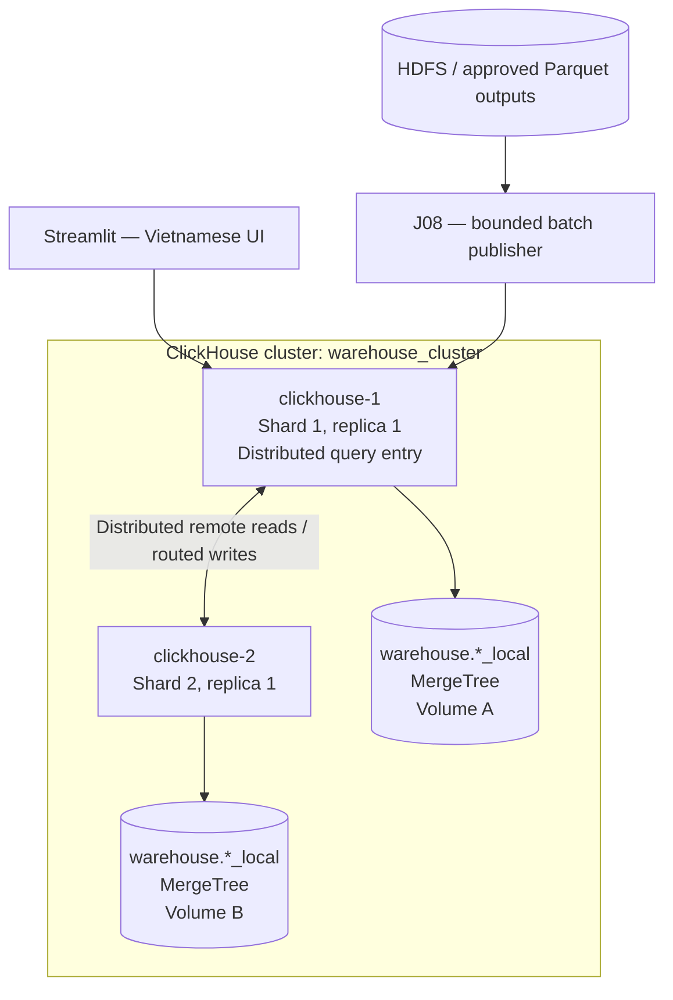
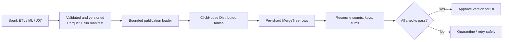

# 09 — Distributed Database Design

**Project:** Big Data–Driven Warehouse Inventory Optimization  
**Document ID:** `09_DATABASE_DESIGN`  
**Status:** Proposed technical design; implementation and benchmark evidence pending  
**Documentation language:** English; user-facing Streamlit labels: Vietnamese  
**Database:** Self-managed ClickHouse, **two shards × one replica per shard**  
**Primary runtime:** Docker Compose on Ubuntu / WSL2, Windows host with 16 GB physical RAM

> **Design principle:** Use genuine database sharding and distributed SQL because they directly support the project's analytical workload and defense requirements. Do not add components whose benefits cannot be demonstrated; do not call two ordinary database containers a sharded database.

---

## 1. Purpose and Scope

This document defines the physical and logical analytical-serving database for the M5 Walmart warehouse optimization prototype. It is the **design authority** for ClickHouse schema, data grain, shards, query access, batch publication, database quality checks, and the evidence required to demonstrate **distributed storage and queries**.

The solution includes:

- A **real two-shard ClickHouse cluster** with separate persistent volumes and one local `MergeTree` data copy on each shard.
- Cluster-aware `Distributed` tables that route inserts and fan out analytical reads.
- Versioned projections of observed sales, seven-day forecasts, **simulated** inventory and warehouse supply, replenishment requests, and stock allocation decisions.
- A controlled boundary for publishing Spark/HDFS-derived outputs to ClickHouse.
- A minimal, read-oriented query interface for Vietnamese Streamlit dashboards.

This document **does not** own the official M5 data definitions, Spark ETL logic, forecasting algorithms, allocation formulas, Streamlit page layout, or Docker installation walkthrough. Those belong to:

| Topic | Source of truth |
|---|---|
| Project goals, scope, and claims | [`01_PROJECT_OVERVIEW.md`](01_PROJECT_OVERVIEW.md) |
| Functional/nonfunctional requirements | [`02_SYSTEM_REQUIREMENTS.md`](02_SYSTEM_REQUIREMENTS.md) |
| System topology and inter-service responsibilities | [`03_SYSTEM_ARCHITECTURE.md`](03_SYSTEM_ARCHITECTURE.md) |
| M5 source files, semantics, and provenance | [`04_DATASET.md`](04_DATASET.md) |
| Rationale for ClickHouse and compatible stack | [`05_TECH_STACK.md`](05_TECH_STACK.md) |
| Spark stages, Parquet contracts, J08 publication | [`06_DATA_PIPELINE.md`](06_DATA_PIPELINE.md) |
| Forecast output and model-evaluation methodology | [`07_MACHINE_LEARNING.md`](07_MACHINE_LEARNING.md) |
| Inventory simulation, allocation policies, backtests | [`08_BUSINESS_RULES_AND_OPTIMIZATION.md`](08_BUSINESS_RULES_AND_OPTIMIZATION.md) |
| UI presentation and queries | [`10_APPLICATION_DESIGN.md`](10_APPLICATION_DESIGN.md) |
| Testing and performance evaluation | [`11_TESTING.md`](11_TESTING.md) |

### 1.1. Normative language

- **MUST / MUST NOT:** mandatory design or verification constraint.
- **SHOULD:** strong initial recommendation; record deviations.
- **MAY:** optional optimization or enhancement, justified by measurement.
- **Example / illustrative:** syntax or values that still require integration testing, not evidence of an already functioning deployment.

### 1.2. Requirement traceability

| Requirement area | Database obligation | Evidence |
|---|---|---|
| `FR-13`, `NFR-03` | Two real shards, both populated; all-shard analytical SQL | Configuration, local and distributed queries, reconciled counts |
| Data correctness / `DR-07`, `NFR-04` | Clear source, grain, key and record count for each published dataset | Manifest, schema, aggregate comparisons, duplicate tests |
| Forecast / inventory / dashboard FRs | Serve actual versioned forecasts and **simulated** inventory decisions | Filtered queries and four Vietnamese application views |
| `NFR-05` / reproducibility | Rebuild deterministic serving data and avoid duplicate publication | Controlled reload, run metadata, immutable HDFS/Parquet inputs |
| `NFR-08` | Never pass missing shard data off as complete output | Failed query, visible error state, no silent fallback |

---

## 2. Database Workload and Design Objectives

### 2.1. Workload characteristics

The application is an **offline-compute, online-read analytical prototype**:

1. M5 history is ingested into HDFS and normalized by Spark.
2. Spark produces trusted sales summaries, forecasts, metrics, and inventory-policy outputs.
3. A bounded publication stage loads selected validated outputs to ClickHouse.
4. Streamlit issues **small, filtered `SELECT` queries**; it does not launch Spark jobs or mutate the sales fact table.

Typical reads include:

- Units sold by store over a selectable date range.
- Actual sales history for one product–store series.
- Seven predicted days and the seven-day total for a selected approved forecast run.
- Simulated stock, replenishment request, allocation and unmet request for a selected scenario.
- Model and policy metric comparisons between named versions.
- Physical counts and distributed query evidence across two ClickHouse shards.

### 2.2. Non-goals

This database is **not** a transactional warehouse management system. The prototype does not implement purchase-order posting, concurrent stock decrements, ACID inventory reservations, or a retail ERP. Streamlit scenario edits may exist only in **session state** until explicitly submitted to an offline decision run. A future multiuser transactional module would require separate justification.

### 2.3. Architectural invariants

1. HDFS/Parquet remains the authoritative source for normalized and computed batch artifacts; ClickHouse is a **derived analytical serving copy**.
2. A `Distributed` table is a **query and insert routing layer**, not a third physical copy of all rows.
3. Every sharded serving table must have an identically named local table with a compatible schema **on both shard nodes**.
4. Exactly **two active shards** and **one replica per shard** are planned. No high-availability claim is permitted.
5. No raw M5 row may be relabeled as a customer order, actual stock snapshot, shipment, or true unconstrained demand.
6. Reads MUST select explicit approved run/scenario identifiers; they MUST NOT silently combine runs.
7. Offline ETL can process **59,181,090** normalized sales observations without requiring all 59,181,090 to be stored in ClickHouse. The **actual ClickHouse coverage must be measured and disclosed**.

---

## 3. Physical and Logical Topology

### 3.1. Self-managed two-shard layout



The arrows represent **logical data movement**, not a requirement to run Spark and ClickHouse at peak load concurrently. Docker containers are separate software nodes on **one physical host**; loss of that host loses the entire local demo.

| Item | Initial design |
|---|---|
| Cluster name | `warehouse_cluster` |
| Database name | `warehouse` |
| Shard 1 | `clickhouse-1`, one local `MergeTree` table per physical dataset |
| Shard 2 | `clickhouse-2`, one local `MergeTree` table per physical dataset |
| Replica count | 1 per shard; **not replicated** |
| Query endpoint | ClickHouse HTTP endpoint on `clickhouse-1` (internal network) |
| Distributed metadata | Same static `remote_servers` topology on both nodes |
| Schema creation | Run migrations on **each node explicitly**; no `ON CLUSTER` dependency |
| Persistence | Separate Docker named volumes for each shard |
| Authentication | Separate restricted application reader and publisher credentials |

**Why no ClickHouse Keeper initially?** Static cluster definitions plus local `MergeTree` and `Distributed` tables do not need Keeper. `ON CLUSTER` distributed DDL and replicated engines are different features with coordination requirements. Adding them now would increase operations cost without demonstrating a required capability.

### 3.2. Example cluster configuration

Place a valid XML fragment on **both nodes**, adapting users and credentials to the real private configuration. Service names resolve only inside the Docker Compose network.

```xml
<clickhouse>
  <remote_servers>
    <warehouse_cluster>
      <shard>
        <internal_replication>false</internal_replication>
        <replica>
          <host>clickhouse-1</host>
          <port>9000</port>
        </replica>
      </shard>
      <shard>
        <internal_replication>false</internal_replication>
        <replica>
          <host>clickhouse-2</host>
          <port>9000</port>
        </replica>
      </shard>
    </warehouse_cluster>
  </remote_servers>
</clickhouse>
```

This is a **topology-only illustration**. ClickHouse service users, server-to-server authentication, access control and filesystem paths must be validated in actual container configuration. Do not copy a privileged, passwordless default account into a publicly exposed deployment. Bind ports to localhost if a host mapping is needed.

### 3.3. Inspecting the actual topology

```sql
SELECT
    cluster,
    shard_num,
    replica_num,
    host_name,
    port,
    is_local
FROM system.clusters
WHERE cluster = 'warehouse_cluster'
ORDER BY shard_num, replica_num;
```

**Acceptance:** exactly two shard numbers (`1`, `2`), one configured replica each, and both container services reachable. `system.clusters` proves configuration, **not actual populated data**; separate checks are mandatory.

### 3.4. What distributed means here

| Mechanism | Demonstrated | Not demonstrated |
|---|---|---|
| ClickHouse sharding | Different original project rows live on different physical shard volumes | Replica-based failover |
| `Distributed` queries | One SQL query reaches both shards and reconciles their results | A multi-datacenter deployment |
| Container networking | Real inter-process distributed database protocol | Isolation across physical computers |
| HDFS and Spark | Separate distributed storage and compute stages | ClickHouse substituting for HDFS/Spark |

---

## 4. Data Zones and Semantic Classification

### 4.1. Data ownership

| Data class | Authoritative owner | ClickHouse role | Trust label |
|---|---|---|---|
| M5 daily sales | Source CSV in HDFS; curated Spark Parquet | Optional full/detail serving copy | **Observed M5 unit sales** |
| Store/day sales aggregates | Spark curated Parquet | Dashboard metrics | Derived from observed M5 |
| Forecasts | Approved ML run + Parquet | Seven-day projection | **Predicted**, not observed |
| Simulated store stock | Deterministic scenario Parquet | Decision input display | **Simulated** |
| Simulated central supply | Scenario Parquet | Allocation capacity | **Simulated** |
| Replenishment requests | J07 policy output Parquet | Decision display | **Recommended** |
| Store allocation outputs | J07 policy output Parquet | Distribution display | **Recommended/simulated** |
| Model and policy scores | Locked evaluation artifacts | Evaluation dashboard | **Measured on declared holdout** |

### 4.2. Grain is mandatory

A dataset name alone does not define its meaning. Every publication manifest MUST include the exact grain, key columns, run/snapshot ID, source range and row count.

| Logical dataset | Logical unique grain | Proposed name (local / distributed) |
|---|---|---|
| Daily M5 sales | `(source_snapshot_id, item_id, store_id, sale_date)` | `sales_daily_local` / `sales_daily` |
| Store daily totals | `(source_snapshot_id, store_id, sale_date)` | `store_daily_sales_local` / `store_daily_sales` |
| Daily forecast | `(forecast_run_id, issue_date, item_id, store_id, forecast_date)` | `forecast_daily_local` / `forecast_daily` |
| Store inventory scenario | `(scenario_id, issue_date, item_id, store_id)` | `inventory_scenario_local` / `inventory_scenario` |
| Central warehouse supply | `(scenario_id, issue_date, item_id)` | `central_supply_scenario_local` / `central_supply_scenario` |
| Replenishment | `(decision_run_id, item_id, store_id)` | `replenishment_local` / `replenishment` |
| Allocation | `(decision_run_id, policy_id, item_id, store_id)` | `allocation_local` / `allocation` |
| Forecast metric | `(model_run_id, holdout_id, method_id, metric_name, horizon)` | `forecast_metrics_local` / `forecast_metrics` |
| Policy backtest | `(evaluation_run_id, decision_run_id, policy_id, item_id, store_id, issue_date)` | `policy_evaluation_local` / `policy_evaluation` |

**Physical sort keys are not uniqueness constraints.** ClickHouse `MergeTree ORDER BY` arranges/indexes data; duplicate business keys are rejected by the **publisher validation process**, not automatically prevented by the database engine. The names above are an implementation proposal; actual published schemas must match the final versioned Parquet contracts.

### 4.3. Required versus optional serving datasets

- **Core for app:** `store_daily_sales`, `forecast_daily`, `inventory_scenario`, `central_supply_scenario`, `replenishment`, `allocation`, `forecast_metrics`, and `policy_evaluation` for scored comparisons.
- **Detail/enhanced defense:** `sales_daily` is strongly recommended for fine-grained history and shard proof, but publication of the entire ~59.18 million rows is **conditional on tested RAM/disk/runtime**. A declared subset is acceptable for serving if its coverage is explicit and the full ETL is independently validated in Spark.
- A tiny aggregate alone **must not** be described as a 59-million-row ClickHouse table.

---

## 5. Sharding Strategy

### 5.1. Co-locate product–store facts

For daily sales, forecasts, store scenarios, replenishment and allocation, use:

```sql
cityHash64(item_id, store_id)
```

This makes all rows of the same `(item_id, store_id)` pair use the same shard when inserted consistently through the `Distributed` table. Benefits: natural locality for single-series history and per-store decision lookup, with **a shared sharding rule** for related tables.

**Trade-off:** A report that aggregates **all 10 stores for one item** may contact both shards; data is intentionally partitioned by product–store, not by product alone. Some query optimizations may require examining the full sharding expression. No sharding strategy is assumed optimal without measurement.

### 5.2. Shard keys for other datasets

| Dataset | Sharding expression | Rationale |
|---|---|---|
| `store_daily_sales` | `cityHash64(store_id, sale_date)` | Distributes dashboard aggregates beyond ten stores |
| `central_supply_scenario` | `cityHash64(item_id)` | One central product-level supply record, not multiplied by store |
| `forecast_metrics` | `cityHash64(model_run_id, holdout_id, method_id)` | Small analytical metric rows spread by evaluation context |
| `policy_evaluation` | `cityHash64(item_id, store_id)` | Co-locate store-level decisions and scores |

If a table is too small for balanced distribution, that is not itself a correctness failure. The flagship sharding proof should use a **sufficiently populated project-derived table** with measurable rows on both nodes.

### 5.3. Distribution checks

A valid two-shard data distribution MUST show:

- At least one dataset with **nonempty local rows on both physical nodes**.
- The sum of local counts equals the count returned by the corresponding `Distributed` table.
- Source totals for the **declared loaded population** reconcile with approved Parquet input.
- No repeated full copy of the same logical keys on both shards masquerades as sharding.
- No complete-query result is accepted with `skip_unavailable_shards = 1`.

---

## 6. Physical Schema and Naming Conventions

### 6.1. Type conventions

| Semantics | Recommended ClickHouse type | Notes |
|---|---|---|
| M5 identifiers / version IDs | `String` | Preserve exact strings; no implicit integer IDs |
| Small repeated store/category IDs | `LowCardinality(String)` where useful | Must match loaders and chosen schema exactly |
| Sales/stock/allocations | `UInt32` | Validate nonnegative integers and range before cast |
| Forecasted sales / error metrics | `Float64` | Validate finite/nonnegative forecasts before load |
| Observed/forecast/issue dates | `Date` | Source M5 calendar mapping is authoritative |
| Missing price | `Nullable(Float64)` | Never replace missing price with zero by default |
| Boolean indicators | `UInt8` | Restrict logical values to `0` or `1` before publication |
| Optional backtest values | `Nullable(...)` | Null means unavailable/not applicable, not fabricated zero |

Constrain the accepted domain in the publisher; ClickHouse numeric types are not a substitute for business validation. Do not cast negative inputs to unsigned types and hope for meaningful results.

### 6.2. Local MergeTree versus Distributed tables

Create `warehouse` and every required `*_local` table on **each ClickHouse server individually**. Create a matching `Distributed` table on the coordinator (`clickhouse-1`); creating it on both nodes is optional for symmetric tooling, not a reason to use Keeper.

```sql
-- Execute independently on clickhouse-1 AND clickhouse-2.
CREATE DATABASE IF NOT EXISTS warehouse;

CREATE TABLE IF NOT EXISTS warehouse.sales_daily_local
(
    source_snapshot_id String,
    sale_date Date,
    day_index UInt16,
    item_id String,
    store_id LowCardinality(String),
    dept_id LowCardinality(String),
    cat_id LowCardinality(String),
    state_id LowCardinality(String),
    unit_sales UInt32,
    sell_price Nullable(Float64),
    price_missing UInt8
)
ENGINE = MergeTree
ORDER BY (store_id, item_id, sale_date, source_snapshot_id);

-- Execute on clickhouse-1, after BOTH local tables exist.
CREATE TABLE IF NOT EXISTS warehouse.sales_daily
AS warehouse.sales_daily_local
ENGINE = Distributed(
    'warehouse_cluster', 'warehouse', 'sales_daily_local',
    cityHash64(item_id, store_id)
);
```

This `ORDER BY` supports series lookups by store and product and date-range filtering. It is **not a unique key**, and a different access-pattern analysis could justify a different physical sort order.

> **Partitioning decision:** Start **without** ClickHouse `PARTITION BY`; prefer a sensible sort key and controlled batch sizes. Add a low-cardinality time partition **only if** measured retention, replacement or performance needs justify it. Excessively fine partitions or thousands of tiny inserts create unnecessary MergeTree parts.

### 6.3. Store-level daily summaries

```sql
CREATE TABLE IF NOT EXISTS warehouse.store_daily_sales_local
(
    source_snapshot_id String,
    store_id LowCardinality(String),
    sale_date Date,
    total_units UInt64,
    observed_series_count UInt32
)
ENGINE = MergeTree
ORDER BY (store_id, sale_date, source_snapshot_id);
```

`observed_series_count` counts series/day observations in the aggregate (including zero-sales observations). It does **not** count purchase orders or distinct customers.

### 6.4. Daily forecasts

```sql
CREATE TABLE IF NOT EXISTS warehouse.forecast_daily_local
(
    forecast_run_id String,
    model_run_id String,
    source_snapshot_id String,
    issue_date Date,
    forecast_date Date,
    horizon UInt8,
    item_id String,
    store_id LowCardinality(String),
    predicted_units Float64,
    forecast_status LowCardinality(String)
)
ENGINE = MergeTree
ORDER BY (store_id, item_id, issue_date, forecast_date, forecast_run_id);
```

Rules: exactly **seven** unique horizons `1..7` for each completed/eligible forecast series, `forecast_date = issue_date + horizon` in calendar days, predictions finite and `>= 0`. Forecasts are predicted sales, not real stock or guaranteed future demand.

### 6.5. Simulated stock and central supply

```sql
CREATE TABLE IF NOT EXISTS warehouse.inventory_scenario_local
(
    scenario_id String,
    scenario_version String,
    scenario_type LowCardinality(String),
    source_snapshot_id String,
    issue_date Date,
    item_id String,
    store_id LowCardinality(String),
    opening_stock_units UInt32,
    safety_stock_units UInt32,
    parameter_digest String,
    origin_label LowCardinality(String)
)
ENGINE = MergeTree
ORDER BY (store_id, item_id, issue_date, scenario_id);

CREATE TABLE IF NOT EXISTS warehouse.central_supply_scenario_local
(
    scenario_id String,
    issue_date Date,
    item_id String,
    source_warehouse_id LowCardinality(String),
    central_available_units UInt32,
    origin_label LowCardinality(String)
)
ENGINE = MergeTree
ORDER BY (item_id, issue_date, scenario_id);
```

`origin_label` MUST identify these values as **simulated**. Central supply has **one product-level record per scenario/origin**; do not sum a copied warehouse capacity across the ten store rows.

### 6.6. Replenishment recommendations

```sql
CREATE TABLE IF NOT EXISTS warehouse.replenishment_local
(
    decision_run_id String,
    forecast_run_id String,
    model_run_id String,
    scenario_id String,
    policy_version String,
    issue_date Date,
    item_id String,
    store_id LowCardinality(String),
    forecast_7d_units Float64,
    planning_demand_units UInt32,
    opening_stock_units UInt32,
    safety_stock_units UInt32,
    target_stock_units UInt32,
    critical_need_units UInt32,
    safety_need_units UInt32,
    request_units UInt32,
    forecast_shortage_flag UInt8,
    origin_label LowCardinality(String)
)
ENGINE = MergeTree
ORDER BY (store_id, item_id, issue_date, decision_run_id);
```

Equations, ceiling policy, shortage priority and consistency constraints are **normative in document 08**. The database stores their validated outputs; it must not implement a second, divergent copy of the business algorithm in SQL.

### 6.7. Store allocations

```sql
CREATE TABLE IF NOT EXISTS warehouse.allocation_local
(
    decision_run_id String,
    forecast_run_id String,
    scenario_id String,
    policy_id LowCardinality(String),
    policy_version String,
    issue_date Date,
    item_id String,
    store_id LowCardinality(String),
    source_warehouse_id LowCardinality(String),
    requested_units UInt32,
    critical_allocated_units Nullable(UInt32),
    safety_allocated_units Nullable(UInt32),
    allocated_units UInt32,
    unmet_request_units UInt32,
    central_available_units UInt32
)
ENGINE = MergeTree
ORDER BY (store_id, item_id, issue_date, decision_run_id, policy_id);
```

`critical_allocated_units` and `safety_allocated_units` MAY be `NULL` for baselines that do not separately compute the two phases. The duplicated `central_available_units` is for display **only**; do not sum it across stores. For correct warehouse totals use `central_supply_scenario` or one distinct `(scenario_id, item_id, issue_date)` capacity.

### 6.8. Forecast and allocation evaluation metrics

```sql
CREATE TABLE IF NOT EXISTS warehouse.forecast_metrics_local
(
    model_run_id String,
    holdout_id String,
    method_id LowCardinality(String),
    metric_name LowCardinality(String),
    horizon UInt8,
    metric_value Float64,
    observation_count UInt32,
    evaluation_start Date,
    evaluation_end Date
)
ENGINE = MergeTree
ORDER BY (model_run_id, holdout_id, method_id, metric_name, horizon);

CREATE TABLE IF NOT EXISTS warehouse.policy_evaluation_local
(
    evaluation_run_id String,
    source_snapshot_id String,
    forecast_run_id String,
    scenario_id String,
    decision_run_id String,
    policy_id LowCardinality(String),
    policy_version String,
    issue_date Date,
    item_id String,
    store_id LowCardinality(String),
    actual_sales_proxy_7d_units UInt32,
    simulated_fulfilled_units UInt32,
    simulated_unmet_units UInt32,
    ending_stock_units UInt32,
    excess_over_safety_units UInt32,
    simulated_stockout_days UInt8,
    run_type LowCardinality(String),
    observed_label_window_start Date,
    observed_label_window_end Date
)
ENGINE = MergeTree
ORDER BY (store_id, item_id, issue_date, evaluation_run_id, policy_id);
```

`forecast_metrics.horizon = 0` denotes an explicitly documented pooled aggregate; `1..7` denotes horizon-specific metrics. The publisher MUST enforce that convention. `policy_evaluation` is **holdout-only**; a forward-demo run with unknown future labels MUST NOT have fabricated evaluation outcomes.

### 6.9. Distributed counterparts

After the local tables are created **on both nodes**, run the following on `clickhouse-1`. The physical table definitions remain local to each server.

```sql
CREATE TABLE IF NOT EXISTS warehouse.store_daily_sales
AS warehouse.store_daily_sales_local
ENGINE = Distributed('warehouse_cluster', 'warehouse', 'store_daily_sales_local', cityHash64(store_id, sale_date));

CREATE TABLE IF NOT EXISTS warehouse.forecast_daily
AS warehouse.forecast_daily_local
ENGINE = Distributed('warehouse_cluster', 'warehouse', 'forecast_daily_local', cityHash64(item_id, store_id));

CREATE TABLE IF NOT EXISTS warehouse.inventory_scenario
AS warehouse.inventory_scenario_local
ENGINE = Distributed('warehouse_cluster', 'warehouse', 'inventory_scenario_local', cityHash64(item_id, store_id));

CREATE TABLE IF NOT EXISTS warehouse.central_supply_scenario
AS warehouse.central_supply_scenario_local
ENGINE = Distributed('warehouse_cluster', 'warehouse', 'central_supply_scenario_local', cityHash64(item_id));

CREATE TABLE IF NOT EXISTS warehouse.replenishment
AS warehouse.replenishment_local
ENGINE = Distributed('warehouse_cluster', 'warehouse', 'replenishment_local', cityHash64(item_id, store_id));

CREATE TABLE IF NOT EXISTS warehouse.allocation
AS warehouse.allocation_local
ENGINE = Distributed('warehouse_cluster', 'warehouse', 'allocation_local', cityHash64(item_id, store_id));

CREATE TABLE IF NOT EXISTS warehouse.forecast_metrics
AS warehouse.forecast_metrics_local
ENGINE = Distributed('warehouse_cluster', 'warehouse', 'forecast_metrics_local', cityHash64(model_run_id, holdout_id, method_id));

CREATE TABLE IF NOT EXISTS warehouse.policy_evaluation
AS warehouse.policy_evaluation_local
ENGINE = Distributed('warehouse_cluster', 'warehouse', 'policy_evaluation_local', cityHash64(item_id, store_id));
```

The `sales_daily` counterpart was created in §6.2. The sharding expression for each dataset MUST remain consistent across all publication paths. A single-server `MergeTree` is **not** a substitute for these distributed views.

### 6.10. Schema review checklist

- [ ] All corresponding `*_local` schemas match on both shards.
- [ ] Data types match the approved Spark exports; nullable fields are intentional.
- [ ] Each fact table has a documented grain and key.
- [ ] Each `Distributed` table references the correct `*_local` name.
- [ ] Sharding expression columns exist and have compatible types.
- [ ] No accidental `ReplicatedMergeTree`, `ON CLUSTER` or Keeper dependency.
- [ ] Sample typed inserts and queries succeed on the **pinned** ClickHouse image.
- [ ] `SHOW CREATE TABLE` output is captured for defense.

---

## 7. Data Publication from Spark/HDFS (J08)

### 7.1. Separation of computation from serving

The accepted transfer is:



The Spark cluster need not stay up when Streamlit reads ClickHouse. The publication loader SHOULD read Parquet in bounded chunks or stream a tested, supported format rather than collecting an entire distributed Spark DataFrame into the driver's RAM.

### 7.2. Initial ingestion method

**Preferred first integration:** versioned HDFS/Parquet exports with a **bounded loader** and `INSERT` to the coordinator's `Distributed` table. For testing, a small export can be read by Python/Arrow or another well-supported batch reader; a larger load may use a compatible connector or server-side file ingestion if integration tests justify it.

Reasons:

- Allows HDFS/Spark processing and ClickHouse ingestion at different times on the 16 GB host.
- Gives a durable, inspectable artifact between stages.
- Makes counts and failure recovery observable.
- Avoids treating Spark-to-ClickHouse connector compatibility as a project prerequisite before a small smoke test.

**Do not** use `collect()` or `toPandas()` on the full M5 fact table. Choose batch size and parallelism from measured memory and disk behavior, not arbitrary throughput claims.

### 7.3. Publication contract

Every approved publication must record at minimum:

| Field | Purpose |
|---|---|
| `publication_id` | Immutable identifier of one publish attempt/accepted version |
| `dataset_name` | Logical dataset name and exact grain |
| `source_snapshot_id` | M5 source lineage |
| `model_run_id` / `forecast_run_id` | When the dataset contains model-derived results |
| `scenario_id` / `decision_run_id` | When the dataset contains policy outputs |
| `input_hdfs_path` and checksum/manifest | Reproducibility |
| `expected_rows`, `loaded_rows_shard_1`, `loaded_rows_shard_2` | Row count reconciliation |
| Representative measure sum/checksum | Detect truncated/doubled/inaccurate loads |
| `schema_version`, `policy_version`, `code_revision` | Cross-component compatibility |
| `started_at`, `completed_at`, `status` | Auditable run state |

The manifest remains durable outside ClickHouse (for example, in versioned Parquet and a JSON/CSV metadata artifact). An optional **small coordinator-local** publication registry can assist the app in selecting an approved batch; it does not need distributed sharding and is **not** the data-plane proof.

### 7.4. Inserts and consistency

Inserting into `Distributed` ordinarily routes rows according to its sharding expression. For a deterministic demonstration, prefer tested foreground insertion where compatible, and **do not approve a version until remote data has landed and reconciled**.

```sql
-- Execute using publisher credentials on clickhouse-1.
-- Illustrative small-batch insertion; the real loader must preserve schema types.
INSERT INTO warehouse.store_daily_sales
    (source_snapshot_id, store_id, sale_date, total_units, observed_series_count)
SETTINGS distributed_foreground_insert = 1
VALUES
    ('test_source_snapshot', 'CA_1', '2011-01-29', 1200, 3049),
    ('test_source_snapshot', 'TX_1', '2011-01-29', 900, 3049);
```

The two illustrative rows above are **synthetic smoke-test rows**, not M5 measurements; they MUST be removed before reporting a production/demo dataset count. Setting support and syntax must be confirmed on the pinned ClickHouse build. If a compatible insertion setting cannot be used, check pending `system.distribution_queue` entries and physical shard counts before marking publication complete.

### 7.5. Idempotency and safe retry

`MergeTree` is append-oriented; repeating a full `INSERT` can duplicate logical facts. Do **not** use `ReplacingMergeTree` merges as a substitute for correct batch identity and publication workflow.

Recommended rule for this academic, single-user **batch** prototype:

1. Create new versioned outputs and run a complete pre-publish validation in HDFS.
2. Publish into clean **staging physical tables** for the attempted batch, or into a freshly rebuilt offline database/table set for a controlled full reload.
3. Validate both shards: counts, keys, totals, forecast coverage and policy constraints.
4. Mark the new version approved **only after** complete reconciliation. The UI continues using the last approved version until then.
5. If a staging load fails, **discard its staged data and restart from the manifest**; never blindly append the same attempt again.
6. Switch the approved version only during a controlled app refresh; record any period when the database is intentionally unavailable.

For the minimum demo, an **offline stop–clear–reload–verify–start** procedure is acceptable if documented and it never leaves duplicated data visible. True atomic cross-shard swap and production-grade exactly-once publication are **out of scope**; do not claim those guarantees.

### 7.6. How much M5 data to publish?

Three distinct counts MUST be reported:

1. **Source matrix observations after Spark normalization:** target **59,181,090** for the canonical evaluation file (if verified).
2. **ML training/evaluation rows:** possibly a smaller eligible/representative population, fully disclosed.
3. **ClickHouse physical serving rows:** the actually loaded set, perhaps a filtered slice or aggregates, independently counted on the shards.

Prefer publishing at least one meaningful, sufficiently broad **real** M5-derived detailed or aggregated table across both shards. Attempt the full 59.18-million-row sales-detail serving copy only after successful smaller runs and disk/memory measurements. Do not assert it is required for course compliance or already completed.

---

## 8. Query Contracts for the Vietnamese Dashboard

The dashboard owns Vietnamese presentation labels; **SQL identifiers remain English**. All user-selected values are validated and passed as **bound parameters** through a supported ClickHouse client API, not interpolated into raw SQL strings.

### 8.1. Page 1 — Overview

Store trend:

```sql
SELECT
    sale_date,
    sum(total_units) AS units_sold
FROM warehouse.store_daily_sales
WHERE source_snapshot_id = {source_snapshot_id:String}
  AND store_id = {store_id:String}
  AND sale_date BETWEEN {start_date:Date} AND {end_date:Date}
GROUP BY sale_date
ORDER BY sale_date
LIMIT 365;
```

Required UI meaning: “Doanh số theo ngày (đơn vị sản phẩm)”. `units_sold` denotes recorded sold **units**, not revenue. Queries should use the named active source snapshot; never select an arbitrary latest string without consulting the approved publication manifest.

### 8.2. Page 2 — Forecast

```sql
SELECT
    forecast_date,
    horizon,
    predicted_units
FROM warehouse.forecast_daily
WHERE forecast_run_id = {forecast_run_id:String}
  AND issue_date = {issue_date:Date}
  AND item_id = {item_id:String}
  AND store_id = {store_id:String}
  AND forecast_status = 'ok'
ORDER BY forecast_date
LIMIT 7;
```

The app MUST verify **exactly seven** returned days `1..7`; fewer rows means “Dữ liệu dự báo chưa đầy đủ”, not zero demand. Render daily floats without silently rounding away the model's predictions; round only at the inventory **decision** boundary.

### 8.3. Page 3 — Inventory / Replenishment

```sql
SELECT
    item_id,
    store_id,
    forecast_7d_units,
    opening_stock_units,
    safety_stock_units,
    request_units,
    forecast_shortage_flag
FROM warehouse.replenishment
WHERE decision_run_id = {decision_run_id:String}
  AND item_id = {item_id:String}
  AND store_id = {store_id:String}
LIMIT 1;
```

Always show a Vietnamese annotation such as “Tồn kho và mức cung là dữ liệu mô phỏng”, sourced from the dataset/run metadata. The `LIMIT 1` is only safe after the publisher has enforced the logical unique key.

### 8.4. Page 4 — Distribution / Allocation

```sql
SELECT
    policy_id,
    store_id,
    requested_units,
    allocated_units,
    unmet_request_units,
    central_available_units
FROM warehouse.allocation
WHERE decision_run_id = {decision_run_id:String}
  AND item_id = {item_id:String}
  AND policy_id = {policy_id:String}
ORDER BY store_id
LIMIT 100;
```

The ten store rows may repeat the same central capacity for readability. **Do not calculate total available central stock as `sum(central_available_units)` from this output.** Instead query the unique central supply record.

### 8.5. Metrics and comparisons

```sql
SELECT
    method_id,
    metric_name,
    horizon,
    metric_value,
    observation_count
FROM warehouse.forecast_metrics
WHERE model_run_id = {model_run_id:String}
  AND holdout_id = {holdout_id:String}
ORDER BY metric_name, method_id, horizon
LIMIT 200;
```

Policy evaluations MUST use the same actual-sales proxy window, forecast run, scenario and decision conditions for fair comparisons. The UI should explicitly distinguish ML prediction metrics from simulated inventory-policy outcomes.

### 8.6. Query safety and performance

- Use the ClickHouse Connect driver with supported parameter binding; verify parameter semantics with the pinned client version.
- Require bounded date ranges, validated identifiers and practical `LIMIT` values.
- Do not issue unbounded `SELECT *` against `sales_daily` from Streamlit.
- Keep a read-only app account; no `INSERT`, DDL or table maintenance permissions.
- Disable misleading fallbacks: if ClickHouse or a shard is unavailable, show an error rather than cached fabricated success data.
- Cached results, if used, MUST be keyed by approved publication IDs and filter parameters; invalidate on version change.

---

## 9. Distributed Verification and Defense Queries

All commands here are **test specifications**, not screenshots of an already running cluster.

### 9.1. Confirm actual cluster configuration

```sql
SELECT shard_num, replica_num, host_name, port
FROM system.clusters
WHERE cluster = 'warehouse_cluster'
ORDER BY shard_num;
```

Expected logical shape: exactly `1 / 1 / clickhouse-1` and `2 / 1 / clickhouse-2` (port values depend on the deployment).

### 9.2. Check rows physically held on each shard

Run this from `clickhouse-1` after publishing actual project data:

```sql
SELECT
    hostName() AS physical_node,
    count() AS local_rows,
    sum(unit_sales) AS local_units
FROM clusterAllReplicas('warehouse_cluster', warehouse.sales_daily_local)
WHERE source_snapshot_id = {source_snapshot_id:String}
GROUP BY physical_node
ORDER BY physical_node;
```

If the full-detail table is not part of the approved serving release, run this proof on another genuinely populated `*_local` dataset and report its **actual grain and size**. `clusterAllReplicas` interrogates local tables on each configured host; it is different from merely printing two configured service names.

### 9.3. Check shard routing through the Distributed view

```sql
SELECT
    _shard_num AS shard_number,
    count() AS shard_rows,
    sum(unit_sales) AS shard_units
FROM warehouse.sales_daily
WHERE source_snapshot_id = {source_snapshot_id:String}
GROUP BY _shard_num
ORDER BY shard_number;
```

The virtual `_shard_num` is available on ClickHouse `Distributed` tables. If the chosen project-derived dataset is not `sales_daily`, replace names and measures with the equivalent deployed table.

### 9.4. Reconcile global totals

```sql
SELECT
    count() AS total_rows,
    sum(unit_sales) AS total_units
FROM warehouse.sales_daily
WHERE source_snapshot_id = {source_snapshot_id:String};
```

Require:

```text
physical_rows_shard_1 + physical_rows_shard_2 == distributed_total_rows
physical_units_shard_1 + physical_units_shard_2 == distributed_total_units
distributed_total_rows == published_parquet_expected_rows
published_subset_definition == recorded_manifest_scope
```

For a full approved load of the canonical M5 evaluation matrix, the expected **normalized source** row count is **59,181,090**. If only a subset was published, `distributed_total_rows` must equal that subset's **approved** count, not 59,181,090.

### 9.5. Verify no repeated logical rows

```sql
SELECT
    count() AS total_rows,
    uniqExact(tuple(source_snapshot_id, item_id, store_id, sale_date)) AS distinct_business_keys
FROM warehouse.sales_daily
WHERE source_snapshot_id = {source_snapshot_id:String};
```

For the declared approved data scope, the two numbers MUST match. This full-key check can be memory-expensive; run on a bounded test population first, or perform full-scale key checks in Spark and record their results. Never exceed host limits simply to produce one UI screenshot.

### 9.6. Validate real distributed work

The evidence package SHOULD include:

- Physical node/container identifiers and separate ClickHouse data volumes.
- The `system.clusters` result.
- Actual shard-local counts and one cross-shard `Distributed` result.
- A matching aggregate sourced from approved Spark Parquet.
- Query execution details and measured runtime under a declared dataset scope.
- Failure/recovery demonstration on a disposable test dataset, if resources permit.

**Do not** turn on `skip_unavailable_shards=1` to make a broken cluster look healthy. With a shard down, a query requiring a complete result should fail visibly.

---

## 10. Data Quality and Integrity Gates

| Check | Mandatory acceptance rule | Responsible stage |
|---|---|---|
| Source lineage | Every row references an approved snapshot/run/scenario | Spark + J08 |
| Schema match | No unexpected casts or silently dropped columns | J08 |
| Logical uniqueness | Exact grain key does not repeat in the approved dataset | Spark pre-publish; post-load spot/full check |
| Observed sales | Nonnegative integer units; zero sales retained | J02/J03 + J08 |
| Store/day total | Sum of detailed units equals matching published aggregate for covered range | Spark + J08 |
| Missing prices | Represented as Nullable + explicit missing marker | J03/J08 |
| Forecast coverage | Seven distinct consecutive dates for every eligible complete series | J06/J08 |
| Model metrics | Only locked evaluation windows have scored observed-label metrics | J06/J08 |
| Inventory simulation | Every stock/supply row is marked simulated; integers nonnegative | J07/J08 |
| Replenishment | `request_units`, shortage, target and component totals obey document 08 | J07/J08 |
| Allocation | Per-store allocation <= request; sum per product <= central capacity | J07/J08 |
| Policy comparison | Methods use consistent forecast, scenario, supply and label window | J07/J08 |
| Shard placement | Both shards contain real project-derived data for the selected proof dataset | ClickHouse/J08 |
| Cross-shard reconciliation | Physical counts/sums equal Distributed totals and approved manifest | ClickHouse/J08 |
| Publish status | Unvalidated/incomplete versions never appear as approved UI releases | J08 + app |

**Important:** ClickHouse does not enforce application foreign keys or business-key uniqueness in the way a transactional relational database might. These are explicit publication and testing obligations, not invisible guarantees.

---

## 11. Resource Strategy for WSL2 / 16 GB RAM

### 11.1. Runtime modes

| Mode | Essential running components | Avoid running concurrently |
|---|---|---|
| Raw ingestion / full ETL | HDFS, Spark master/workers, batch driver | Full ClickHouse bulk ingestion and interactive ML tuning |
| ML training / forecast | HDFS, Spark, bounded training jobs | Heavy ClickHouse compaction/large analytics |
| ClickHouse publication | Two ClickHouse shards and a bounded loader | Peak Spark training |
| Interactive demo | Two ClickHouse shards, Streamlit | Bulk publication and Spark training |
| Defense evidence | Short, targeted jobs plus necessary services | Unbounded simultaneous benchmark tasks |

A WSL2 cap around **10 GB** is a starting point, not guaranteed free memory. Windows, Docker, Linux processes, file-system cache and JVMs share the machine's **16 GB physical RAM**.

### 11.2. Configuration discipline

- Place volumes and active datasets in the Ubuntu filesystem when feasible.
- Pin the same ClickHouse server version on both shards; version candidates in `05_TECH_STACK.md` require a smoke test.
- Begin with a **small actual sample**, then scale to 1 million, 5 million and larger rows only as resources permit.
- Monitor resident memory, ClickHouse active parts, background merges, and disk capacity.
- Use bounded batch inserts rather than thousands of tiny individual-row inserts.
- Keep some disk headroom for HDFS block replicas, Parquet, ClickHouse parts, and temporary merges.
- Set CPU/memory limits based on measured headroom; do not publish optimistic throughput targets before benchmarking.

### 11.3. Disk amplification is intentional and must be budgeted

The same project-derived information may exist as raw CSV, HDFS blocks, curated Parquet, ClickHouse parts and temporary merges. HDFS replication factor two creates extra HDFS copies, while ClickHouse sharding **splits rows** rather than replicating them. Document actual storage per layer, including database parts and staging copies.

---

## 12. Security, Access Control and Operational Limits

### 12.1. Roles

| Role | Minimum capability |
|---|---|
| `warehouse_reader` | `SELECT` on approved analytical `warehouse` Distributed tables only |
| `warehouse_publisher` | Required `INSERT` / controlled staging operations; no routine public UI access |
| Admin / migration operator | DDL and maintenance; used only for setup and controlled schema changes |

Credentials MUST be in private local configuration, not tracked Git files. Restrict exposed ports to localhost where feasible. Administrative ClickHouse endpoints must not be accessible from the public Internet.

### 12.2. Service availability and failure response

- A missing shard means a full cross-shard result may be unavailable. The app must display **unavailable**, not zero.
- A successful local coordinator query alone does not prove all shard data is healthy.
- If publication fails halfway, do not approve the batch.
- Losing one shard volume can lose that shard's only copy of data; the **authoritative Parquet outputs** support rebuilding the ClickHouse serving copy.
- This topology is **not HA**: there is no replica-based data durability or automatic failover.

### 12.3. Schema migration rule

Use versioned SQL migrations committed to Git, applied explicitly to both local nodes and the coordinator. Before changes:

1. Record the schema version and current approved release.
2. Verify that both shard schemas match.
3. Apply and smoke-test changes on a disposable/small dataset first.
4. Rebuild/reconcile changed publication tables before exposing the new release.
5. Record compatibility changes for Streamlit query contracts.

Do not quietly run `ON CLUSTER` in a Keeper-free setup and assume it guarantees cross-node DDL consistency.

---

## 13. Performance Benchmarks and Evaluation Design

Performance claims require repeatable tests. At minimum record:

| Experiment | Variables | Metrics | Notes |
|---|---|---|---|
| Small versus larger data volumes | Tested dataset slice sizes | Load time, query time, disk footprint | Report actual row count, not nominal M5 volume |
| Local versus Distributed aggregate | Same approved data and equivalent logic | Query latency and result equality | Do **not** compare a one-shard subset directly with a two-shard full dataset |
| Filtered series lookups | Store/item/date range | p50/p95 or repeated query latencies, rows read | Consider cold/warm cache explicitly |
| Insert batch sizing | Batch rows/bytes | Throughput, parts growth, peak memory | Use a bounded range; avoid tiny inserts |
| Shard distribution | Sharding expression | Count and storage skew by shard | Document imbalance rather than hiding it |

**Fair single-node comparator:** load a **full equivalent experimental dataset** into one ClickHouse node/table and compare with the same dataset distributed across two shards, holding SQL semantics, filters and hardware as similar as possible. A 2-shard setup on one laptop does **not** guarantee faster SQL; overhead and CPU/RAM contention may make it slower. Report measured outcomes, not invented speedups.

---

## 14. Test Matrix and Acceptance Checklist

| ID | Scenario | Expected result |
|---|---|---|
| DB-01 | ClickHouse starts on both services | Both servers reachable; independent data volumes |
| DB-02 | Cluster metadata queried | Exactly two configured shards, one replica each |
| DB-03 | Local schemas inspected | Matching field names/types on both nodes |
| DB-04 | Publish real project-derived records | Nonzero appropriate table rows on **both** physical nodes |
| DB-05 | Distributed count and sum | Equal sum of shard-local counts/sums and Parquet manifest |
| DB-06 | Repeat a previously completed publication | No silent duplicate approved business keys |
| DB-07 | Inject duplicate forecast business key | Publication rejected |
| DB-08 | Inject invalid negative/NaN or inconsistent metric | Publication rejected before unsigned/Float64 coercion |
| DB-09 | Filter an eligible forecast | Exactly seven valid dated predictions |
| DB-10 | Select unknown forecast combination | Explicit missing/unsupported result, never fabricated zeros |
| DB-11 | Stock/allocation constraints | Nonnegative/feasible quantities; capacity not exceeded |
| DB-12 | Shut down one shard for a test query | Incomplete read fails visibly; no silent partial success |
| DB-13 | Reset/rebuild from approved Parquet | Reconciled data restored after a controlled process |
| DB-14 | Vietnamese Streamlit data access | Actual ClickHouse queries, parameter binding, bounded results |
| DB-15 | Load different forecast/scenario runs | No cross-run mixing in app or decision joins |
| DB-16 | Measure publication/queries | Evidence includes data scope, hardware, settings and timing |

### 14.1. Definition of done

This database design is considered implemented only when:

- [ ] Two real ClickHouse shard processes are running with separate volumes.
- [ ] Both have compatible `MergeTree` local tables and are named by `system.clusters`.
- [ ] Distributed table SELECTs actually fan out across both shards.
- [ ] Real project-derived rows occupy **both** shards; per-shard and combined totals reconcile.
- [ ] Publication of actual forecast/inventory decision output is verified end-to-end.
- [ ] Missing data and unavailable shards produce explicit failures, not misleading results.
- [ ] The dashboard displays only approved, consistently versioned data with Vietnamese labels.
- [ ] The report accurately distinguishes 59.18M **Spark-normalized observations** from the actual ClickHouse-serving row count.
- [ ] Resource and query-performance findings are measured and recorded.
- [ ] The architecture is described as **two shards, one replica per shard, on one physical laptop**, with no HA claim.

---

## 15. Architectural Decisions and Trade-offs

| ADR | Decision | Reason | Accepted cost / limitation |
|---|---|---|---|
| DB-ADR-01 | ClickHouse instead of PostgreSQL for analytical serving | Demonstrable distributed database and analytic SQL | Less suitable for frequent stock transactions |
| DB-ADR-02 | Two independent shards, no replication | Real sharding proof with limited RAM | One shard failure loses access to its data |
| DB-ADR-03 | Static topology and per-node DDL | Avoid unnecessary Keeper/DDL services | Operator must keep schemas consistent |
| DB-ADR-04 | Derived analytical copy, HDFS as data source of truth | Offline recomputation and clean provenance | Storage duplication |
| DB-ADR-05 | Stable product–store sharding for core facts | Single-series locality and straightforward reconciliation | Item-wide queries may span both shards |
| DB-ADR-06 | Bounded, versioned batch publishing | Reproducible under 16 GB host | Not continuous streaming; controlled update gaps |
| DB-ADR-07 | Precomputed ML and policy results | Dashboard remains lightweight | Interactive scenario edits limited to small subsets |
| DB-ADR-08 | No transactional ERP features | Keeps solution aligned with course rubric and demo | Not production WMS software |

### 15.1. Open decisions to close with integration tests

- Concrete ClickHouse image tag and server/client versions, compatible with `05_TECH_STACK.md`.
- Chosen bounded loader (ClickHouse Connect / tested connector / another supported reader).
- Exact serving scope of `sales_daily` on available disk; mandatory disclosure of actual count.
- Dataset-specific sort keys and whether any partitioning demonstrably improves the workload.
- Measured memory limits, batch sizes, background merges and query time.
- Final approved publication registry format and how the app selects its active run IDs.

Until tested, these are **design choices pending verification**, not completed implementation claims.

---

## 16. Documentation and Technical References

Primary ClickHouse reference material (official):

1. [Distributed table engine](https://clickhouse.com/docs/reference/engines/table-engines/special/distributed) — logical distributed tables, insert routing, `_shard_num`, shard availability behavior.
2. [MergeTree table engine](https://clickhouse.com/docs/reference/engines/table-engines/mergetree-family/mergetree) — physical parts, sorting keys and local storage.
3. [system.clusters](https://clickhouse.com/docs/reference/system-tables/clusters) — shard, replica and host configuration fields.
4. [ClickHouse documentation](https://clickhouse.com/docs/) — SQL types, table DDL, permissions and observability.
5. [ClickHouse: query optimization considerations](https://clickhouse.com/blog/ai-generated-clickhouse-schemas-mistakes-and-advice) — avoid unjustified partitioning and premature optimization.

Project references:

- [`03_SYSTEM_ARCHITECTURE.md`](03_SYSTEM_ARCHITECTURE.md) — node topology, separation of HDFS and ClickHouse responsibilities.
- [`04_DATASET.md`](04_DATASET.md) — correct M5 structure and source-versus-transformed row count.
- [`06_DATA_PIPELINE.md`](06_DATA_PIPELINE.md) — Spark outputs, validation, and J08 publication.
- [`07_MACHINE_LEARNING.md`](07_MACHINE_LEARNING.md) — seven-day forecast contracts and evaluation.
- [`08_BUSINESS_RULES_AND_OPTIMIZATION.md`](08_BUSINESS_RULES_AND_OPTIMIZATION.md) — authoritative inventory and allocation business rules.

---

**Project database principle:** A successful demonstration is **not** a screenshot of two database containers. It is a reproducible record of **real rows on two shards**, a **correct cross-shard query**, a **validated Spark-to-ClickHouse data lineage**, and a Vietnamese dashboard presenting actual approved forecast/decision results without claiming unmeasured performance or operational realism.
