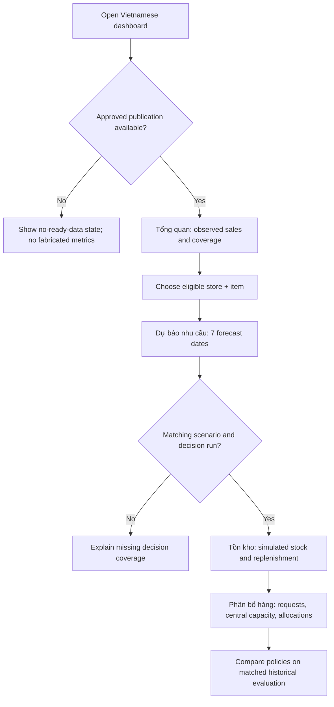
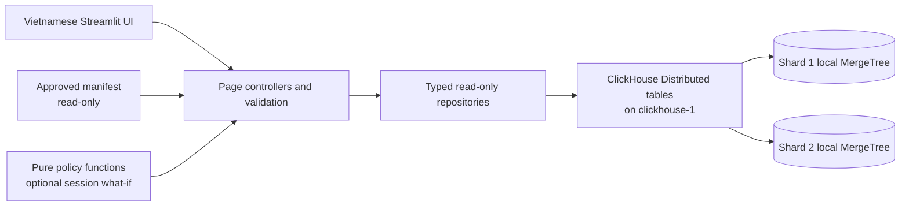
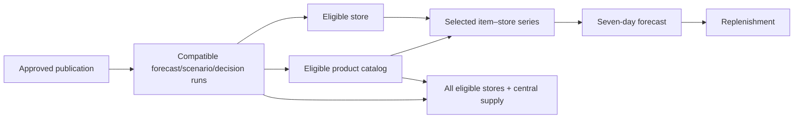

# 10 — Application Design

**Project:** Big Data–Driven Warehouse Inventory Optimization  
**Document ID:** `10_APPLICATION_DESIGN`  
**Status:** Proposed implementation design; application execution and usability validation pending  
**Documentation and code language:** English  
**User-facing application language:** **Vietnamese**  
**Primary UI:** Streamlit + Plotly  
**Analytical backend:** ClickHouse `warehouse_cluster` (two shards, one replica per shard)  
**Execution environment:** Ubuntu on WSL2, Windows host with 16 GB physical RAM

> **Engineering principle:** Keep the demonstration application deliberately small, but make every displayed number explainable, traceable, queryable, and honest about its origin. The UI is a decision-support interface on top of a real distributed pipeline—not a replacement for Spark, a transactional warehouse ERP, or a collection of fabricated charts.

---

## 1. Purpose, Audience, and Document Boundary

This document specifies the **presentation layer and interactive user journeys** for the project. It is the implementation reference for:

- The four-page Streamlit navigation and Vietnamese content.
- Page components, filter contracts, visualizations, and interaction behavior.
- Queries and result mapping at the ClickHouse serving boundary.
- Selection of approved dataset/model/scenario/decision runs.
- UI state, data freshness, validation, performance, failure behavior, and accessibility.
- Testable acceptance criteria, including evidence a reviewer can inspect.

It does **not** redefine M5 fields, implement Spark transformations, choose Random Forest parameters, invent inventory business formulas, create ClickHouse tables, or specify Docker installation steps.

| Topic | Design authority |
|---|---|
| Goals, scope, business value and language convention | [01_PROJECT_OVERVIEW.md](01_PROJECT_OVERVIEW.md) |
| Mandatory requirements and acceptance criteria | [02_SYSTEM_REQUIREMENTS.md](02_SYSTEM_REQUIREMENTS.md) |
| End-to-end topology and component ownership | [03_SYSTEM_ARCHITECTURE.md](03_SYSTEM_ARCHITECTURE.md) |
| M5 data meaning, provenance and counts | [04_DATASET.md](04_DATASET.md) |
| Technology selection and constraints | [05_TECH_STACK.md](05_TECH_STACK.md) |
| ETL, aggregates, batch artifacts and publication interface | [06_DATA_PIPELINE.md](06_DATA_PIPELINE.md) |
| Seven-day forecasting, baseline and model metrics | [07_MACHINE_LEARNING.md](07_MACHINE_LEARNING.md) |
| Scenario, replenishment and allocation rules | [08_BUSINESS_RULES_AND_OPTIMIZATION.md](08_BUSINESS_RULES_AND_OPTIMIZATION.md) |
| ClickHouse table definitions, sharding and SQL semantics | [09_DATABASE_DESIGN.md](09_DATABASE_DESIGN.md) |
| Acceptance evidence and presentation script | [11_TESTING_AND_DEMO.md](11_TESTING_AND_DEMO.md) |

**Requirement priorities:** `P0` means essential to the demonstrated project; `P1` enhances usability/evidence after P0; `P2` is optional. The application must not imply unsupported capabilities simply because they would make an attractive screenshot.

---

## 2. Application Concept and Design Goals

### 2.1 Product concept

**User-facing working title:** **Hệ thống hỗ trợ quản lý tồn kho**.

The application helps a warehouse manager answer four practical questions:

1. **What has been sold?** Inspect observed historical unit sales by store, product and date.
2. **What is likely to be sold next?** Read seven-day forecasts for an eligible product–store pair.
3. **What should a store request?** Review replenishment recommendations calculated from the forecast and clearly simulated stock.
4. **How should limited stock be shared?** Compare proposed store allocations with a baseline, including unfulfilled requests and evaluation results when available.

### 2.2 Design priorities

| Priority | Principle | Visible consequence |
|---|---|---|
| P0 | Trustworthy data meaning | Prominent provenance/status labels: observed, predicted, simulated, recommended, historically evaluated |
| P0 | Four clear task-centered pages | No login/registration, procurement checkout, staff administration, or CRUD management console |
| P0 | Read-only analytical serving | Database queries retrieve approved artifacts; UI interaction never triggers a 59-million-row Spark job |
| P0 | Consistent context | All pages use compatible source/model/forecast/scenario/decision identifiers |
| P0 | Honest missing/error states | Incomplete forecasts, missing stock, failed shard requests and unsupported pairs are never replaced with invented zeros |
| P0 | Lightweight rendering | Bounded SQL, aggregate server-side results, finite dropdowns and explicit date windows |
| P1 | Reproducible exploration | Visible batch identity, refresh semantics, downloadable filtered CSV |
| P2 | Scenario experimentation | Clearly labeled temporary, in-session “what-if” inputs; no mutation of approved artifacts |

### 2.3 Actors and supported journeys

| Actor | Primary actions | Non-goals |
|---|---|---|
| Inventory manager | Review trends, forecasts, shortage flags, suggested requests | Submit a real purchase order |
| Distribution coordinator | Inspect central supply and allocation to eligible stores | Schedule trucks or optimize geographic routes |
| Instructor / evaluator | Follow a reproducible demo, inspect model scores and proof links | Administer production services through the public UI |

For the academic prototype all three roles access the **same read-only application**. Role-based login is intentionally out of scope; credentials are required at the database integration boundary, not from demo users.

---

## 3. Information Architecture and Navigation

### 3.1 Exactly four primary pages

| Page key / suggested file | Vietnamese navigation label | Main task | Core requirements |
|---|---|---|---|
| `overview` / `pages/overview.py` | **Tổng quan** | Understand historical sales and declared data scope | FR-04, FR-14 |
| `forecast` / `pages/forecast.py` | **Dự báo nhu cầu** | Inspect seven daily forecasts and ML evaluation | FR-07, FR-08, FR-15 |
| `inventory` / `pages/inventory.py` | **Tồn kho** | Review simulation inputs and replenishment request | FR-09, FR-10, FR-16 |
| `distribution` / `pages/distribution.py` | **Phân bổ hàng** | Review stock-constrained allocation and baseline comparison | FR-11, FR-12, FR-17 |

No separate fifth diagnostics page is necessary for the base app. A compact sidebar expander **“Thông tin dữ liệu và phiên chạy”** can show provenance, approved run identifiers, loaded data scope and links to technical evidence. HDFS/Spark/ClickHouse administration remains outside the app.

### 3.2 Navigation and layout skeleton

```text
+--------------------------------------------------------------------------------------+
| HỆ THỐNG HỖ TRỢ QUẢN LÝ TỒN KHO                                                       |
| Phân tích dữ liệu bán hàng M5 Walmart • Mô hình dự báo • Quyết định tồn kho mô phỏng  |
+--------------------------+-----------------------------------------------------------+
| MENU                     | CURRENT PAGE TITLE                                        |
|                          |                                                           |
| > Tổng quan              | [Context summary / data source / forecast issue date]    |
|   Dự báo nhu cầu         |                                                           |
|   Tồn kho               | [Filters selected for this page]                          |
|   Phân bổ hàng          |                                                           |
|                          | [KPI cards]                                               |
| Bộ lọc chung            | [Plotly charts / tables]                                  |
| - Cửa hàng              |                                                           |
| - Sản phẩm              | [Explanations, source caveats, evaluation when relevant]   |
|                          |                                                           |
| Thông tin dữ liệu        |                                                           |
| - Phiên dữ liệu          |                                                           |
| - Trạng thái tải         |                                                           |
+--------------------------+-----------------------------------------------------------+
| Dữ liệu bán hàng: M5 Walmart | Tồn kho: mô phỏng | Kết quả: phục vụ nghiên cứu       |
+--------------------------------------------------------------------------------------+
```

**Layout constraints:** use Streamlit's built-in sidebar, columns, metrics, native dataframes and Plotly visuals. Avoid custom React frontend, CSS-heavy fake widgets, or API microservices just for presentation.

### 3.3 Primary user journey



### 3.4 Shared navigation behavior

- Navigation must retain compatible `store_id`, `item_id`, `forecast_run_id` and scenario context when moving between pages.
- Changing a parent selection invalidates incompatible dependent selections and all cached query outputs for that context.
- Page-specific preferences (chart grouping or date window) may remain in session state, but must never silently change an approved run.
- The application must present **one selected coherent analysis context**, not auto-merge forecast results from unrelated runs.
- Every page must work when visited first, by deriving safe defaults from an **approved** manifest rather than relying on a previous page being opened.

---

## 4. UI Language, Domain Vocabulary, and Truth Labels

### 4.1 Mandatory language rule

**All end-user strings must be Vietnamese:** menus, headings, buttons, input help, chart legends, axes, column labels, toasts, warnings, empty states and export labels. **Code, function/class names, SQL identifiers, comments and engineering logs remain English.** M5 identifiers (`item_id`, `store_id`) may appear as raw values, but their labels are translated.

| Engineering concept | Recommended Vietnamese label | Required caveat |
|---|---|---|
| `unit_sales` | **Số lượng bán thực tế** | Observed *units*, not currency revenue or customer orders |
| `predicted_units` | **Số lượng bán dự báo** | Future estimate, not guaranteed actual demand |
| `forecast_7d_units` | **Tổng dự báo 7 ngày** | May be a non-integer ML result |
| `opening_stock_units` | **Tồn kho đầu kỳ (mô phỏng)** | Not real Walmart inventory |
| `safety_stock_units` | **Tồn kho an toàn (giả định)** | Scenario-specific policy input |
| `request_units` | **Số lượng đề xuất nhập** | Recommendation, not a supplier order |
| `central_available_units` | **Hàng sẵn có tại kho trung tâm (mô phỏng)** | Per product/scenario, not per store |
| `allocated_units` | **Số lượng phân bổ** | Output of documented allocation policy |
| `unmet_request_units` | **Số lượng chưa được đáp ứng** | Unfulfilled request, not necessarily realized lost sales |
| `simulated_unmet_units` | **Nhu cầu chưa đáp ứng trong mô phỏng** | Historical policy-backtest output |
| `forecast_shortage_flag` | **Nguy cơ thiếu hàng theo dự báo** | Forecast-based warning, not observed stockout |
| `MAE` / `RMSE` / `WAPE` | **Sai số dự báo MAE / RMSE / WAPE** | Define metric and evaluation period in a tooltip |
| `issue_date` | **Ngày lập dự báo** | Cutoff of information available to the model |
| `forecast_date` | **Ngày dự báo** | A distinct future or historical-backtest date |
| `scenario_id` | **Kịch bản tồn kho** | Simulated inputs and version |
| `source_snapshot_id` | **Phiên dữ liệu nguồn** | Measured coverage, not automatically all 59.18M rows in ClickHouse |

### 4.2 Required notices and presentation rules

Show near the relevant charts, not hidden only inside a footer:

- History: **“Dữ liệu bán hàng lịch sử từ bộ M5 Walmart.”**
- Forecast: **“Số lượng bán dự báo từ mô hình; không phải doanh số thực tế.”**
- Inventory: **“Tồn kho và nguồn cung trong chức năng này là dữ liệu mô phỏng, không phải tồn kho thực tế của Walmart.”**
- Distribution: **“Phân bổ là đề xuất mô phỏng, không phải lệnh điều chuyển hàng đã thực hiện.”**
- Historical evaluation: **“Kết quả đánh giá trên dữ liệu lịch sử; không phải mức tiết kiệm đã đạt được tại Walmart.”**

For metric units, prefer **“sản phẩm”**, **“đơn vị sản phẩm”**, **“ngày”** or **“%”** as appropriate. Never label unit sales as `doanh thu`, and never label the 59.18-million long-format observations as transaction count.

### 4.3 Visual distinction without relying only on color

- Historical actuals: labels/legend explicitly include **“Thực tế”**.
- Forecast: legend explicitly includes **“Dự báo”** and optionally a dashed line.
- Simulated scenario quantities: section heading/badge-text **“Mô phỏng”**.
- Recommendation: **“Đề xuất”**.
- Measured holdout outcomes: **“Đánh giá lịch sử”**.
- Add axis titles, units, hover labels and accessible table equivalents. Never make red/green color the only indicator of risk.

### 4.4 Numbers and dates

- Display dates consistently as `DD/MM/YYYY` in the UI; send typed `Date` parameters to SQL.
- Format unit quantities as integers with Vietnamese thousands separators for decisions.
- Display forecast float values with a consistent, declared decimal precision (for example one decimal); retain full precision for aggregation and for decision calculation in the offline policy stage.
- Do not apply displayed rounding back into the underlying approved metrics.
- WAPE is displayed as a percentage; handle zero actual-demand denominator according to document 07 and show **“Không xác định”** rather than dividing by zero.

---

## 5. Approved Data and Run-Selection Contract

### 5.1 Why explicit run identity matters

The pipeline can produce multiple historical snapshots, trained models, forecast issues, simulated stock scenarios, decision policies and evaluation runs. Combining independently newest rows is unsafe. The app must read an **approved publication manifest** produced at the end of validation (see documents 06 and 09).

**Recommended small read-only file** mounted into the app container: `artifacts/approved_publication.json`. It is deployment metadata, not a new database. Its exact format may evolve, but it must be versioned and checked.

```json
{
  "schema_version": "1",
  "publication_id": "approved_run_identifier",
  "approved": true,
  "source_snapshot_id": "source_snapshot_identifier",
  "forecast_run_id": "forecast_run_identifier",
  "model_run_id": "model_run_identifier",
  "scenario_id": "scenario_identifier",
  "decision_run_id": "decision_run_identifier",
  "evaluation_run_id": "historical_evaluation_identifier_or_null",
  "holdout_id": "holdout_identifier_or_null",
  "issue_date": "YYYY-MM-DD",
  "published_at_utc": "YYYY-MM-DDTHH:MM:SSZ",
  "available_stores": ["CA_1"],
  "coverage_note": "Declared and measured serving subset or full population"
}
```

**Example only:** the strings above are placeholders, not valid executed project run IDs. Real metadata should additionally record manifest checksum, exact item–store population, source date coverage and any policy IDs. If `evaluation_run_id` or `holdout_id` does not apply to a forward-demo run, use JSON `null`, not the literal placeholder text.

### 5.2 Manifest validation before page rendering

The application MUST validate:

1. Manifest is present, parseable, supported in `schema_version`, and explicitly `approved=true`.
2. Required identifiers are nonempty and the date is valid.
3. Database queries confirm at least the necessary serving data exists for that publication; no silent partial reads if a shard is unavailable.
4. Compatible model, forecast, scenario and decision data all refer to the same issue date and expected population.
5. The selected `item_id`/`store_id` pair is in the approved **forecast and decision** coverage; do not assume every M5 product is covered by the trained demo model.
6. Only historical holdout publications with valid observed labels expose measured policy comparisons.

If any gate fails, show a localized, specific **not-ready** state. The application must not guess the latest string ID from `max()` or quietly substitute an older incompatible run.

### 5.3 Context state model

| State field | Ownership | Selection behavior |
|---|---|---|
| `publication_id` | Approved manifest | Read-only; refreshed only through explicit version reload |
| `source_snapshot_id` | Approved manifest | Read-only; used to filter observed sales |
| `forecast_run_id`, `model_run_id` | Approved manifest | Read-only unless multiple coherent approved bundles explicitly supported |
| `issue_date` | Approved forecast issue | Display and use for all joined decisions |
| `scenario_id`, `decision_run_id` | Approved scenario/policy bundle | Read-only for core demo; switching requires validated compatible bundle |
| `policy_id` | Defined policies in document 08 | Default `shortage_first_proportional_v1`, baseline `equal_share_v1` |
| `store_id` | Eligible `store_id` list | Global user selection, restricted to available coverage |
| `item_id` | Bounded product search | Selection under active coverage and optional selected store |
| `history_date_range` | Page 1 and optional Page 2 | Must be within loaded observed period |
| `ui_scenario_overrides` | Current Streamlit session only | P2 temporary values, separate from published outputs |

**Version change:** clear dependent states and query caches, reload bounded available-store/product options, and visually confirm the new batch ID. Avoid mixing two approved versions during a single rendered view.

---

## 6. Application Data Access Design

### 6.1 Direct access to ClickHouse is intentional

The application calls the distributed `warehouse.*` tables through the designated query endpoint at `clickhouse-1`. It uses a **restricted read-only database account**. No separate FastAPI/Flask service is required for a local, small-user demo.



The UI must not call raw HDFS data, reload the M5 CSV, launch Spark, retrain Random Forest or perform 59-million-row pandas computations.

### 6.2 Suggested project modules

```text
app/
├── main.py                     # Streamlit navigation and shared context
├── pages/
│   ├── overview.py             # Page 1: observed sales
│   ├── forecast.py             # Page 2: seven-day forecasts and metrics
│   ├── inventory.py            # Page 3: simulated stock and replenishment
│   └── distribution.py         # Page 4: constrained allocation
├── components/
│   ├── filters.py              # Bounded, compatible selectors
│   ├── notices.py              # Provenance, simulation and failure banners
│   ├── charts.py               # Plotly formatting
│   └── tables.py               # Vietnamese column mapping and CSV formatting
├── data_access/
│   ├── client.py               # ClickHouse client and timeouts
│   ├── repository.py           # Typed, parameterized queries
│   └── publication.py          # Approved manifest validation
├── domain/
│   ├── models.py               # Data classes and typed response contracts
│   └── view_models.py          # Pure presentation mapping, not ML training
├── i18n/
│   └── vi.py                   # Vietnamese user-visible text constants
└── tests/
    ├── test_presentation.py
    ├── test_repository.py
    ├── test_session_state.py
    └── test_pages.py
```

This is a **suggested logical layout**, not a claim that these modules already exist. Reuse the authoritative **pure inventory-policy functions** from document 08 for optional what-if functionality; do not create a second set of rounding or allocation formulas in `app/`.

### 6.3 Repository APIs (logical signatures)

```python
from datetime import date


def get_store_trend(source_snapshot_id: str, store_id: str,
                    start_date: date, end_date: date) -> list[dict]: ...


def get_eligible_items(forecast_run_id: str, store_id: str,
                       search_text: str, limit: int = 50) -> list[dict]: ...


def get_forecast_series(forecast_run_id: str, issue_date: date,
                        item_id: str, store_id: str) -> list[dict]: ...


def get_forecast_metrics(model_run_id: str, holdout_id: str) -> list[dict]: ...


def get_replenishment(decision_run_id: str, item_id: str,
                      store_id: str) -> dict | None: ...


def get_central_supply(scenario_id: str, issue_date: date,
                       item_id: str) -> dict | None: ...


def get_allocation(decision_run_id: str, item_id: str,
                   policy_id: str) -> list[dict]: ...


def get_policy_evaluation(evaluation_run_id: str, item_id: str,
                          allowed_policy_ids: tuple[str, ...]) -> list[dict]: ...
```

- Return typed rows or explicit missing values/errors; never return made-up success rows.
- The public UI may show raw item identifiers such as `FOODS_1_001`; M5 does not supply consumer-friendly product names that should be invented.
- The application should use a small **manifest-generated product/store catalog** when appropriate to avoid searching a large sales fact table with every keystroke. Catalog rows must be derived from approved source/prediction coverage, not from arbitrary demo content.
- Repository methods own SQL. Page files must not contain ad hoc query string interpolation.

### 6.4 Safe parameterized query pattern

```python
from datetime import date
import clickhouse_connect


def create_clickhouse_client(host: str, port: int, user: str, password: str):
    return clickhouse_connect.get_client(
        host=host,
        port=port,
        username=user,
        password=password,
        connect_timeout=5,
        send_receive_timeout=20,
    )


def read_store_trend(client, snapshot_id: str, store_id: str,
                     start_date: date, end_date: date):
    if start_date > end_date:
        raise ValueError("Invalid date range")
    sql = """
        SELECT sale_date, sum(total_units) AS units_sold
        FROM warehouse.store_daily_sales
        WHERE source_snapshot_id = {snapshot:String}
          AND store_id = {store:String}
          AND sale_date BETWEEN {from_date:Date} AND {to_date:Date}
        GROUP BY sale_date
        ORDER BY sale_date
        LIMIT 365
    """
    result = client.query(sql, parameters={
        "snapshot": snapshot_id,
        "store": store_id,
        "from_date": start_date,
        "to_date": end_date,
    })
    return list(result.named_results())
```

**Compatibility gate:** test the parameters, client timeouts, `named_results()` API and the pinned ClickHouse Connect version in a live integration test before relying on this example. SQL parameters apply to **values**; SQL table names and arbitrary SQL clauses must never be constructed from user input. Credential values must come from environment secrets rather than committed files.

### 6.5 Query limits and access policy

- Always use approved snapshot/run identifiers and bounded series or date filters.
- Cap plotted history at a declared useful range (for example **365 days** after per-day aggregation).
- Filter or aggregate in ClickHouse before moving results to Python.
- Never call `.toPandas()` or equivalent on the full M5 fact table in the UI.
- Enforce a maximum number of candidate product IDs returned by search (initial target: **50**).
- Read-only app database account; disable DDL/INSERT permissions.
- Do not enable `skip_unavailable_shards` for a “successful” completeness claim; partial shard failures must be explicit.
- Ensure the ClickHouse query endpoint is available through the Docker network; do not depend on untested Windows/WSL hostnames.

---

## 7. Page 1 — “Tổng quan” (Overview)

### 7.1 Purpose and provenance

Show what M5 historical sales actually contain, the **declared ClickHouse-loaded coverage**, and interpretable sales trends. This is the first trust-building page for users and the instructor.

**Data classification:** observed historical sales + derived Spark aggregates, **not** observed stock or total revenues.

### 7.2 Wireframe

```text
TỔNG QUAN
Dữ liệu bán hàng lịch sử từ bộ M5 Walmart

[ Cửa hàng ▼ ] [ Từ ngày 📅 ] [ Đến ngày 📅 ]   [ Áp dụng ]

[ Số cửa hàng trong phạm vi ] [ Số mã sản phẩm hỗ trợ ] [ Số ngày dữ liệu ]
[ Tổng số lượng bán trong phạm vi chọn ]

[ ĐƯỜNG BIỂU DIỄN: SỐ LƯỢNG BÁN THEO NGÀY ]

[ BẢNG: NGÀY | CỬA HÀNG | SỐ LƯỢNG BÁN ]

Lưu ý: Số quan sát Spark xử lý và số dòng ClickHouse lưu trữ có thể khác nhau.
Nguồn: M5 Walmart | Phiên dữ liệu: ... | Phạm vi tải: ...
```

### 7.3 Components and calculation sources

| Component | UI wording | Source/behavior |
|---|---|---|
| Title | **Tổng quan** | Static, localized |
| Store selector | **Cửa hàng** | Approved store catalog, not manually invented |
| Date range | **Khoảng thời gian** | Restricted to loaded `store_daily_sales` range |
| Total units | **Tổng số lượng bán** | `sum(total_units)` from approved aggregate for the selected range |
| Store count | **Số cửa hàng trong dữ liệu** | Derived from measured approved manifest or bounded distinct count |
| Covered items | **Số mã sản phẩm được hỗ trợ** | Coverage metadata; not automatically 3,049 trained item predictions |
| History plot | **Xu hướng số lượng bán theo ngày** | `store_daily_sales` grouped by `sale_date` |
| Optional product detail | **Lịch sử bán của sản phẩm** | Only if detail dataset is published and declared; otherwise explicit unavailability note |
| Metadata expander | **Nguồn và phạm vi dữ liệu** | Source files, normalized count, published row count and snapshot dates |

**Important:** `store_daily_sales` alone does not answer individual-product history questions. If product-specific historical detail is mandatory for a chosen scenario, expose a measured, compatible portion of `warehouse.sales_daily` or publish an approved product/day-serving projection under document 09. Do not synthesize product history from store totals.

### 7.4 Reference query

```sql
SELECT
    sale_date,
    sum(total_units) AS units_sold
FROM warehouse.store_daily_sales
WHERE source_snapshot_id = {source_snapshot_id:String}
  AND store_id = {store_id:String}
  AND sale_date BETWEEN {start_date:Date} AND {end_date:Date}
GROUP BY sale_date
ORDER BY sale_date
LIMIT 365;
```

If the dashboard supports “Tất cả cửa hàng”, use a **separate vetted query** without the `store_id` predicate rather than interpolating arbitrary text into SQL. Its totals cover all stores present in the **loaded dataset**, not implicitly all M5 data.

### 7.5 Chart requirements

- X-axis: **Ngày**. Y-axis: **Số lượng bán (đơn vị sản phẩm)**.
- Data must be ascending by date, with truthful handling of missing aggregate dates.
- Zero is a real zero-sales value when represented by approved source observations; an **absent** row is not automatically zero.
- A “selected window” KPI must match the chart query period and filter context.
- Do not display data-size/cardinality values as real-time production throughput metrics.

### 7.6 Empty/error behavior

- No approved snapshot: **“Chưa có phiên dữ liệu được phê duyệt để hiển thị.”**
- No measurements in the selected window: **“Không có dữ liệu bán hàng trong khoảng thời gian đã chọn.”**
- Shard unavailable: **“Không thể tải dữ liệu đầy đủ từ hệ thống phân tán. Vui lòng thử lại sau.”**
- Product detail not published: **“Lịch sử chi tiết sản phẩm chưa được tải vào cơ sở dữ liệu phục vụ ứng dụng.”**

---

## 8. Page 2 — “Dự báo nhu cầu” (Forecast)

### 8.1 Purpose and scope

Allow selection of a **supported `item_id`–`store_id`** pair, display **exactly seven** dated predictions from one approved recursive Random Forest forecast run, and expose the corresponding model evaluation against a seasonal-naïve baseline.

**Data classification:** predicted unit sales and independently measured historical forecast errors.

### 8.2 Wireframe

```text
DỰ BÁO NHU CẦU
Số lượng bán dự báo từ mô hình; không phải doanh số thực tế

[ Cửa hàng ▼ ] [ Tìm mã sản phẩm 🔎 ] [ Sản phẩm ▼ ]
Ngày lập dự báo: DD/MM/YYYY   |   Mã phiên dự báo: ...

[ Tổng dự báo 7 ngày ] [ Trung bình/ngày ] [ Số ngày dự báo hợp lệ: 7/7 ]

[ LINE/BAR CHART: T+1 ... T+7; SỐ LƯỢNG BÁN DỰ BÁO ]

[ BẢNG: NGÀY | NGÀY DỰ BÁO THỨ | SỐ LƯỢNG DỰ BÁO ]

ĐÁNH GIÁ MÔ HÌNH TRÊN DỮ LIỆU LỊCH SỬ
[ Method ▼: Random Forest vs. Seasonal Naïve ]
[ MAE ] [ RMSE ] [ WAPE ]
[ BẢNG SO SÁNH CÙNG KHOẢNG KIỂM THỬ ]
```

### 8.3 Selection contract

1. Store options come from eligible published forecast coverage.
2. Product search is limited and scoped to the approved store/forecast run; do not populate 3,049 products with unsupported predictions.
3. `issue_date` is the approved issue date, not automatically today's date.
4. A completed series returns **seven distinct horizons `1..7`** with `forecast_date = issue_date + horizon` and finite, nonnegative `predicted_units`.
5. Missing, duplicate, nonconsecutive or invalid forecast rows are **errors/incomplete results**, not zeros.
6. If observed historical sales are shown beside a backtest forecast, actuals must be labeled **“Thực tế (dùng để đánh giá)”** and be restricted to historical labels explicitly available for that evaluation. A forward forecast must never show invented actuals.

### 8.4 Seven-day query

```sql
SELECT forecast_date, horizon, predicted_units
FROM warehouse.forecast_daily
WHERE forecast_run_id = {forecast_run_id:String}
  AND issue_date = {issue_date:Date}
  AND item_id = {item_id:String}
  AND store_id = {store_id:String}
  AND forecast_status = 'ok'
ORDER BY forecast_date
LIMIT 7;
```

**Critical:** This query by itself does **not** establish completeness when duplicates exist. The approved publication must pass uniqueness validation; for the UI, check returned horizon set equals `{1,2,3,4,5,6,7}` and validate each date. If a duplicate occupies a limited slot or any daily prediction is missing, reject display of “7/7”.

### 8.5 Forecast metrics contract

```sql
SELECT method_id, metric_name, horizon, metric_value, observation_count
FROM warehouse.forecast_metrics
WHERE model_run_id = {model_run_id:String}
  AND holdout_id = {holdout_id:String}
ORDER BY metric_name, method_id, horizon
LIMIT 200;
```

- Prefer pooled `horizon = 0` metrics for a concise headline if the evaluation artifact defines them; otherwise label the horizon explicitly.
- Present Random Forest and seasonal-naïve values on **the same held-out cohort/window**.
- Explain that MAE/RMSE are error in **units sold**, while WAPE is a ratio or percentage.
- If no comparable historical evaluation exists for the selected forward forecast, show **“Chưa có kết quả đánh giá tương ứng với phiên dự báo này.”** Do not render a made-up accuracy gauge.
- Evaluation success does not equal improved inventory results; keep these sections separate.

### 8.6 Edge states

| Condition | Behavior |
|---|---|
| Supported series with 7 valid predictions | Show chart, table, total and coverage label |
| Unsupported product–store pair | **“Sản phẩm/cửa hàng này chưa có dự báo được công bố.”** |
| Fewer than 7 rows or duplicated horizons | **“Dữ liệu dự báo chưa đầy đủ (cần đủ 7 ngày).”** |
| Negative/nonfinite predictions | Block chart; show data-integrity warning |
| Model score unavailable | Explain why; do not treat as zero error |
| Query failure | Show database-error state without pretending a forecast succeeded |

---

## 9. Page 3 — “Tồn kho” (Inventory and Replenishment)

### 9.1 Purpose and truth boundary

Turn an approved seven-day forecast into a **readable stock recommendation** using the versioned simulated inventory scenario and the policy output calculated in document 08. All original M5 sales remain unchanged.

**Data classification:** predicted demand + **simulated** store stock + **recommended** replenishment.

### 9.2 Wireframe

```text
TỒN KHO
Tồn kho và mức cung là dữ liệu mô phỏng, không phải tồn kho của Walmart

[ Cửa hàng ▼ ] [ Mã sản phẩm 🔎 ]
Kịch bản: balanced / ...    Ngày lập dự báo: DD/MM/YYYY

[ Tổng dự báo 7 ngày ] [ Tồn kho đầu kỳ (mô phỏng) ]
[ Tồn kho an toàn (giả định) ] [ Đề xuất nhập thêm ]

[ Biểu đồ so sánh: nhu cầu 7 ngày | tồn đầu kỳ | mức mục tiêu ]

[ Bảng chi tiết: Mã SP | Cửa hàng | Tồn | Mức an toàn | Đề xuất nhập ]

[ Giải thích quyết định ] [ Có nguy cơ thiếu hàng? ]
```

### 9.3 Inputs and source of truth

| Quantity | Read from | UI meaning |
|---|---|---|
| Forecast seven-day total | `replenishment.forecast_7d_units` | Continuous ML-derived total from one approved forecast run |
| Opening stock | `replenishment.opening_stock_units` and matching scenario | Simulated units held at store at the planning epoch |
| Safety stock | `replenishment.safety_stock_units` | Scenario-dependent safety target |
| Planning demand | `replenishment.planning_demand_units` | Integer planning quantity derived by documented policy |
| Replenishment request | `replenishment.request_units` | Proposed additional quantity before central-supply constraints |
| Forecast shortage | `replenishment.forecast_shortage_flag` | Rule-based flag, not evidence of observed Walmart stockout |

**Authoritative formula and rounding:** document 08. The UI must **display stored approved outputs**, not recompute a different formula. Simple display consistency checks may verify arithmetic without silently overwriting persisted results.

### 9.4 Reference query

```sql
SELECT
    item_id, store_id, forecast_7d_units,
    planning_demand_units, opening_stock_units, safety_stock_units,
    target_stock_units, request_units, forecast_shortage_flag,
    origin_label
FROM warehouse.replenishment
WHERE decision_run_id = {decision_run_id:String}
  AND item_id = {item_id:String}
  AND store_id = {store_id:String}
LIMIT 1;
```

The publisher must enforce the logical unique key before `LIMIT 1` is treated as safe. Also verify the selected row belongs to the approved forecast run and scenario (either by checking returned IDs or by an approved join/manifest-contract check).

### 9.5 Explanation panel

Recommended Vietnamese explanation template (values supplied by actual rows):

> **Giải thích đề xuất:** Hệ thống dự báo sản phẩm này sẽ bán khoảng `{forecast_7d_units}` đơn vị trong 7 ngày. Với tồn kho đầu kỳ **mô phỏng** là `{opening_stock_units}` và mức tồn kho an toàn **giả định** là `{safety_stock_units}`, chính sách hiện tại đề xuất yêu cầu bổ sung `{request_units}` đơn vị. Đây là đề xuất hỗ trợ quyết định, chưa phải đơn nhập hàng.

All injected quantities must come from validated result fields. Never hardcode specific numbers into the final page.

### 9.6 Optional what-if controls (P2 only)

A bounded in-session experiment may let the reviewer adjust **opening stock** and **safety stock** for one eligible item–store pair. To satisfy the overall allocation problem, a more advanced what-if can also adjust one product's central capacity **only if** all participating store inputs are available.

Rules:

- Set default mode to **“Kết quả đã công bố”** (approved, read-only); put what-if under a clearly labeled expander **“Thử nghiệm kịch bản (mô phỏng)”**.
- Use `st.form` with an explicit **“Tính lại trong phiên làm việc”** action; no database write occurs.
- Accept bounded, nonnegative integer inputs, with an application-configured safety maximum. Reject floats, negative values, missing series and unsupported IDs.
- Reuse the **same versioned pure policy function** as offline J07; do not duplicate formulas or tie-breaking inside `inventory.py`.
- If a what-if result was recomputed only for one store, do **not** silently claim that a full ten-store distribution was recomputed.
- Visually distinguish **“Kết quả mô phỏng tạm thời”** from approved results, and clear it when product, run or scenario changes.
- What-if does not retrain Spark MLlib or persist changes to M5.

**Decision:** P0 delivers a read-only, fully traceable inventory page. Add what-if only after the P0 workflow has passed the relevant tests.

---

## 10. Page 4 — “Phân bổ hàng” (Distribution and Allocation)

### 10.1 Purpose

For **one product** across its eligible stores, show how a finite simulated central supply is allocated under a documented policy. Make allocation feasibility and the baseline comparison visible and mathematically consistent.

**Data classification:** simulated central stock + recommended allocation + measured **simulated historical policy** outcome when evaluated.

### 10.2 Wireframe

```text
PHÂN BỔ HÀNG
Đề xuất điều phối hàng giữa các cửa hàng • Dữ liệu nguồn cung mô phỏng

[ Mã sản phẩm 🔎 ] [ Kịch bản đã phê duyệt ] [ Chính sách ▼ ]

[ Hàng kho trung tâm ] [ Tổng nhu cầu đề xuất nhập ]
[ Tổng hàng đã phân bổ ] [ Tổng còn thiếu ]

[ BIỂU ĐỒ THANH: ĐỀ XUẤT NHẬP vs. ĐÃ PHÂN BỔ THEO CỬA HÀNG ]

[ BẢNG: CỬA HÀNG | YÊU CẦU | ĐƯỢC CẤP | CHƯA ĐÁP ỨNG ]

[ GIẢI THÍCH: BÙ THIẾU TRƯỚC, AN TOÀN SAU ]

SO SÁNH CHÍNH SÁCH (CHỈ KHI CÓ BACKTEST)
[ shortage_first_proportional_v1 vs equal_share_v1 ]
[ Nhu cầu chưa đáp ứng mô phỏng ] [ Tồn dư mô phỏng ] [ Tỷ lệ đáp ứng ]
```

### 10.3 Core SQL queries

**Allocations for one product, one decision run and one policy:**

```sql
SELECT
    policy_id, store_id, requested_units, allocated_units,
    unmet_request_units, critical_allocated_units, safety_allocated_units,
    central_available_units
FROM warehouse.allocation
WHERE decision_run_id = {decision_run_id:String}
  AND item_id = {item_id:String}
  AND policy_id = {policy_id:String}
ORDER BY store_id
LIMIT 100;
```

**Central supply: unique product-level record:**

```sql
SELECT
    source_warehouse_id, central_available_units, origin_label
FROM warehouse.central_supply_scenario
WHERE scenario_id = {scenario_id:String}
  AND issue_date = {issue_date:Date}
  AND item_id = {item_id:String}
LIMIT 1;
```

Before displaying totals, assert the central-supply key is unique in the approved publication. The UI must not compute central warehouse supply by summing the repeated `central_available_units` column from ten allocation rows.

### 10.4 KPI and reconciliation rules

Given one product `p`, one scenario, one approved policy and eligible stores `E_p`:

| KPI | Correct calculation | Mandatory constraint |
|---|---|---|
| **Hàng kho trung tâm** | One value from `central_supply_scenario` | Nonnegative integer; not `sum` over stores |
| **Tổng đề xuất nhập** | `sum(requested_units)` across approved eligible stores | Same product/decision/policy scope |
| **Tổng hàng phân bổ** | `sum(allocated_units)` across stores | `0 <= total_allocated <= central_available` |
| **Tổng chưa đáp ứng** | `sum(unmet_request_units)` | Must equal `sum(requested - allocated)` |
| **Mức được đáp ứng** | Ratio of allocated units to requested units when denominator > 0 | Label as **request fulfillment**, not realized sales fulfillment |

Also enforce per store `0 <= allocated_units <= requested_units` and `unmet_request_units = requested_units - allocated_units`. A zero total request does not mean 100% performance by default; label the denominator case consistently (e.g. **“Không phát sinh yêu cầu”**).

When `central_available >= total_requested`, every approved request should be fully allocated. When supply is constrained, the visualization must show the trade-off; it must never allocate more units than physically available in the simulated scenario.

### 10.5 Policy comparison: separate decision vs. measured backtest

**Decision comparison:** show allocation results for `shortage_first_proportional_v1` and `equal_share_v1` under identical forecasts, stock, supply and eligible stores. This comparison can be displayed for a forward simulation even without observed future labels.

**Historical outcome comparison:** show policy scores only if a **matching historical backtest** is published. The following quantities come from `warehouse.policy_evaluation` and must be aggregated over the **same exact evaluated product/store/origin population** for both policies:

- `simulated_unmet_units` — unmet sales-proxy units under the simulated inventory trajectory.
- `excess_over_safety_units` — explicit ending-stock over-safety proxy, not real obsolete inventory.
- `simulated_stockout_days` — simulated days with unavailable stock, interpreted under document 08.
- Fulfillment rate = `sum(simulated_fulfilled_units) / sum(actual_sales_proxy_7d_units)` when the denominator is positive.

Example bounded summary query for an approved historical evaluation:

```sql
SELECT
    policy_id,
    sum(actual_sales_proxy_7d_units) AS observed_sales_proxy_units,
    sum(simulated_fulfilled_units) AS fulfilled_units,
    sum(simulated_unmet_units) AS unmet_units,
    sum(excess_over_safety_units) AS excess_units,
    sum(simulated_stockout_days) AS stockout_days
FROM warehouse.policy_evaluation
WHERE evaluation_run_id = {evaluation_run_id:String}
  AND scenario_id = {scenario_id:String}
  AND forecast_run_id = {forecast_run_id:String}
  AND item_id = {item_id:String}
  AND policy_id IN ('shortage_first_proportional_v1', 'equal_share_v1')
  AND run_type = 'historical_backtest'
GROUP BY policy_id
ORDER BY policy_id;
```

**Fairness gate:** the two policies must use the same observation windows, eligible stores, issue dates, source snapshot, scenario and forecast. A table with one missing policy cannot be described as a comparison. Do not claim operational cost savings, actual delivery optimization or real warehouse improvement based solely on simulated results.

### 10.6 Distribution-specific empty/error states

- No supply row: **“Chưa có dữ liệu nguồn cung mô phỏng cho sản phẩm này.”**
- Unavailable policy: **“Chính sách phân bổ chưa có kết quả được công bố.”**
- Incomplete store population: **“Dữ liệu phân bổ chưa đầy đủ, không thể tổng hợp chính xác.”**
- Zero requests: **“Không có yêu cầu nhập thêm trong kịch bản đã chọn.”**
- No fair holdout comparison: **“Chưa có kết quả đánh giá lịch sử đủ điều kiện so sánh hai chính sách.”**
- Shard unavailable: show failed-query state, not a partially summed allocation.

---

## 11. Cross-Page Filter and Interaction Rules

### 11.1 Dependency model



- The forecast and inventory pages are **store-specific**.
- Distribution is **product-specific across eligible stores**; do not restrict its allocation query to the globally selected store.
- Store changes can invalidate `item_id` if the pair is not eligible in the new store.
- A product may have valid forecasts for fewer than ten stores; show actual eligible coverage, not “all ten” unless verified.
- Allow the user to inspect a selected store's row within distribution, but preserve the whole-product capacity calculation.

### 11.2 Form submission vs. rerun

- Streamlit reruns on widget changes; group related filters into a form when query volume would otherwise be wasteful.
- Search controls must not fire a full fact-table scan per keystroke; use a bounded catalog, minimum search text where useful, or an explicit **“Tìm sản phẩm”** action.
- Use `st.session_state` for stable selections, but ensure all state is validated against the approved current publication.
- Recalculate only cheap **presentation** aggregations locally, never daily Spark data transformations.

### 11.3 Export (P1)

Use `st.download_button` to export **the exact approved filtered table currently visible**, with Vietnamese headers if intended for users. Export must include a compact provenance header/sidecar or visible metadata (publication/run IDs, issue date, scenario and policy). Do not export a different filter context than the displayed chart; never download a full fact table accidentally.

---

## 12. Visualization Specification

### 12.1 Approved chart set

| Page | Chart | Required axes/encoding | Data size |
|---|---|---|---|
| Overview | Daily unit-sales line | X: `sale_date`; Y: observed units | <= 365 daily points after SQL aggregation |
| Forecast | Seven-day forecast bar/line | X: `forecast_date`; Y: predicted units; horizon annotated | Exactly 7 points |
| Forecast (evaluation) | Model-vs-baseline grouped bars/table | Method vs. metric, same held-out cohort | Small metric set |
| Inventory | Demand/stock/target comparison | Categories for **forecast**, **stock**, **safety/target** | 1 pair, small set |
| Distribution | Requested vs. allocated horizontal bars | Store on Y; requested/allocated units on X | <= eligible stores (up to 10 for M5) |
| Distribution (evaluation) | Policy comparison bar/table | Same metric, same evaluation cohort | 2 policies |

### 12.2 Truthful chart semantics

- **Do not stack stock, safety stock and 7-day forecast as if they were independent parts of a single total.** Safety is a target buffer; chart annotations must reflect that.
- Do not plot forecasts and historical actuals in the same continuous series without distinct legends and time boundaries.
- Use fixed, informative chart titles and units; supply small tables for numeric verification.
- Do not use a pie chart merely because it looks polished if a bar/time series is more informative.
- An empty chart is not a zero chart. Show a descriptive missing-data message.
- No fake demo numbers: screenshot examples in documentation, if any, must carry a visible **“Synthetic illustration”** label.

### 12.3 Plotly integration pattern

```python
import plotly.express as px
import streamlit as st


def render_forecast_chart(forecast_df):
    fig = px.bar(
        forecast_df,
        x="forecast_date",
        y="predicted_units",
        labels={
            "forecast_date": "Ngày dự báo",
            "predicted_units": "Số lượng bán dự báo (đơn vị sản phẩm)",
        },
        title="Dự báo số lượng bán trong 7 ngày",
    )
    st.plotly_chart(fig, width="stretch")
```

The example assumes `forecast_df` has passed all data-validity checks. Pin an actual compatible Streamlit/Plotly pair and test the supported `st.plotly_chart` arguments. The function does **not** fetch data or manufacture the seven forecast rows.

---

## 13. Application State, Caching, and Freshness

### 13.1 Small-data-first strategy

Spark/HDFS/ClickHouse provide the heavy data plane; the Streamlit process should hold only:

- The approved manifest and small lookup catalog.
- The currently selected sales trend (bounded days).
- Seven prediction rows for one item–store pair.
- Ten or fewer allocation rows for one item and one policy.
- Small evaluation summaries and local UI state.

The UI must not use large cached copies of all M5 observations.

### 13.2 Caching recommendations

- `st.cache_data`: only for validated, **read-only, bounded** query results. Include `publication_id`, the run IDs and all filters in cache keys.
- `st.cache_resource`: only for supported reusable ClickHouse client/resource patterns; verify thread safety in the selected driver and Streamlit version. Prefer a scoped client if sharing is unsafe.
- Set finite TTLs or explicit clear-on-version-change; caching is an optimization, not the authority for whether a shard is currently healthy.
- At minimum, perform a live health check before entering a defense scenario if freshness/availability is in question; cached records must not mask current shard failures.
- Manual what-if overrides stay session-scoped and **must not contaminate shared caches of approved query results**.

### 13.3 Snapshot consistency during application use

- The approved manifest must be fully written and verified before being exposed to Streamlit.
- Do not automatically switch to a new run while a page is assembling its data.
- Provide **“Làm mới dữ liệu đã công bố”** only after validating the new version and clearing incompatible cache/state.
- If a publication was withdrawn or an endpoint is unavailable, prefer a visible read-only/error state over mixing old and new partial results.

---

## 14. Error Handling and Failure Transparency

### 14.1 States every page must support

| State | Trigger | User-facing behavior |
|---|---|---|
| Initializing | Loading small metadata / approved manifest | **“Đang tải thông tin dữ liệu...”** |
| Ready | Queries valid and data complete | Render results with source/status labels |
| Empty valid result | No data in allowed filter range | **“Không tìm thấy dữ liệu phù hợp với bộ lọc.”** |
| Unsupported selection | Product/store outside approved coverage | **“Lựa chọn này chưa được hỗ trợ trong phiên dữ liệu hiện tại.”** |
| Incomplete publication | Missing run, seven-day coverage, or expected store set | **“Dữ liệu chưa đầy đủ để hiển thị kết quả đáng tin cậy.”** |
| Database error / shard down | Timeout or failed distributed query | **“Không thể kết nối hoặc truy vấn đầy đủ dữ liệu phân tán.”** |
| Invalid scenario | Negative/invalid/excessive input | **“Vui lòng nhập số nguyên không âm trong giới hạn cho phép.”** |
| No historical labels | Forward-looking forecast | **“Chưa có dữ liệu thực tế tương ứng để đánh giá kết quả.”** |

### 14.2 Developer behavior

- Log technical context **in English** with `publication_id`, relevant run IDs, page, query operation and exception category (without passwords or unnecessary sensitive data).
- Map expected data/connection exceptions to understandable Vietnamese text.
- Never display a raw Python traceback or ClickHouse credential in Streamlit.
- Do not recover from missing data by inserting fake values or switching to a random older run.
- Preserve diagnostic information sufficient to reproduce a failed query without logging user-provided SQL (users never input SQL).

### 14.3 Integrity checks before rendering

| UI object | Check |
|---|---|
| Daily sales chart | Dates valid, finite nonnegative totals, selected range bounded |
| Forecast chart | Seven unique horizons with dates and finite, nonnegative values |
| Inventory card | Exactly one row for intended key; simulated marker and rule output valid |
| Central-supply card | One product/scenario/date record; nonnegative capacity |
| Allocation table | Unique store rows; per-row and global resource constraints pass |
| Policy comparison | Both policies, same cohort/window/run/scenario; valid denominators |
| Metrics | Method, holdout, horizon and metric definitions verified |

These are presentation **guards**, not replacements for Spark/ClickHouse publisher checks.

---

## 15. Security and Operational Boundaries

- Application DB credentials must be read from environment variables or supported local secret facilities; never store passwords in the repository.
- Use a **read-only** ClickHouse account to query `warehouse` Distributed tables.
- Bind demo ports to the developer machine (prefer loopback); do not expose ClickHouse management ports publicly.
- No user-supplied arbitrary SQL or Python evaluation fields.
- Parameterize all user-filter values and enforce integer/date/search limits.
- Avoid exposing internal container credentials or full stack traces in charts or downloadable exports.
- The system is designed for a **local single-user educational demonstration**, not as a hardened multi-tenant web service.

---

## 16. Performance and Resource Budget

### 16.1 Runtime intent

The host has 16 GB physical RAM; Ubuntu runs inside WSL2. The application is one relatively small process which queries **precomputed** and **approved** ClickHouse data. Spark training must not run because a Streamlit user clicked a button.

| Work | Target approach | Rationale |
|---|---|---|
| UI initial load | Load manifest + small metadata + bounded overview aggregates | Fast navigation without giant datasets |
| Product selection | Bounded eligible product catalog, server-side filtering | Avoid huge searchable query results |
| Forecast lookup | 7 rows for one product/store/run | Cheap and auditable |
| Allocation lookup | Up to 10 store rows for one item/policy | Cheap and auditable |
| Historical trends | Group on server; return daily totals for <= 365 days | Small plots |
| ML metrics and policy comparison | Precomputed offline; select matching holdout/evaluation | No expensive live computation |
| What-if scenario (optional) | Pure in-process rules for one small SKU cohort | No Spark/ClickHouse writes |

### 16.2 Performance measurement protocol

Do **not** promise a query latency without measuring it on the actual host. Record during acceptance:

- Cold and warm application start behavior.
- Individual repository query durations and returned row counts.
- Memory use of the app process and ClickHouse containers during the four-page demo.
- Database error and timeout outcomes with both shards healthy and with one disabled (in a **controlled** test).
- Cache behavior when the approved publication changes.

If a query is slow, first verify table grain, filter selectivity, active ClickHouse shards, scanned rows and query plan. Do not introduce Redis, Kafka, FastAPI or another service until a specific measured bottleneck justifies it.

---

## 17. Suggested UI Code Skeleton (Illustrative)

The following is a **wiring example**, not a complete implementation or a tested working app. Each page controller is responsible for fetching validated results through the repositories and rendering localized content.

```python
# app/main.py
import streamlit as st


def main() -> None:
    st.set_page_config(
        page_title="Hệ thống hỗ trợ quản lý tồn kho",
        page_icon="📦",
        layout="wide",
    )

    st.title("Hệ thống hỗ trợ quản lý tồn kho")
    st.caption("Dữ liệu lịch sử M5 Walmart · Tồn kho và phân phối mô phỏng")

    pages = [
        st.Page("pages/overview.py", title="Tổng quan", icon="📊"),
        st.Page("pages/forecast.py", title="Dự báo nhu cầu", icon="📈"),
        st.Page("pages/inventory.py", title="Tồn kho", icon="📦"),
        st.Page("pages/distribution.py", title="Phân bổ hàng", icon="🚚"),
    ]

    # A production-quality implementation validates the approved manifest,
    # binds a consistent run context and renders a shared failure state here.
    selected_page = st.navigation(pages)
    selected_page.run()


if __name__ == "__main__":
    main()
```

**Important:** `st.Page` / `st.navigation` and `width="stretch"` are subject to the project's pinned Streamlit version; resolve that with package compatibility tests. The real app should have a shared context guard *before* sensitive queries, and should avoid creating an unbounded client on every rerun.

### 17.1 Presentation view-model example

```python
from dataclasses import dataclass
from datetime import date


@dataclass(frozen=True)
class ForecastPoint:
    forecast_date: date
    horizon: int
    predicted_units: float


def validate_forecast_points(points: list[ForecastPoint], issue_date: date) -> None:
    from datetime import timedelta
    if len(points) != 7:
        raise ValueError("Exactly seven forecast rows are required")
    horizons = {p.horizon for p in points}
    if horizons != set(range(1, 8)):
        raise ValueError("Expected unique consecutive forecast horizons 1..7")
    for point in points:
        if point.forecast_date != issue_date + timedelta(days=point.horizon):
            raise ValueError("Forecast date does not match horizon")
        if not (float("-inf") < point.predicted_units < float("inf")):
            raise ValueError("Forecast value must be finite")
        if point.predicted_units < 0:
            raise ValueError("Forecast value must be nonnegative")
```

The domain meaning and validation requirements above match documents 07 and 09. A real implementation should also validate types and avoid ambiguous floating-point/cast edge cases. This view-model is not the Random Forest implementation.

---

## 18. Acceptance and Test Matrix

### 18.1 P0 functional and data presentation tests

| ID | Test and expected outcome | Related requirements |
|---|---|---|
| UI-01 | Open app with an approved manifest; exactly four Vietnamese navigation entries render. | FR-14–17, NFR-07 |
| UI-02 | No manifest / unapproved manifest: no dashboard fake values; clear not-ready banner. | NFR-08 |
| UI-03 | Open Overview, select store/date range; KPI and chart match an independently checked ClickHouse aggregate. | FR-04, FR-14 |
| UI-04 | Display data source, historical granularity and measured serving coverage; do not claim 59M physical ClickHouse rows if not loaded. | DR-01, DR-02, DR-07 |
| UI-05 | Supported store–item pair returns exactly seven dated forecast points and correct floating-point sum. | FR-08, FR-15 |
| UI-06 | Missing/duplicate/negative forecast prediction triggers localized integrity error, not zeros. | NFR-04, NFR-08 |
| UI-07 | Baseline comparison uses the same historical holdout; MAE/RMSE/WAPE labels and units are correct. | FR-07, FR-15 |
| UI-08 | Inventory selection shows matching approved forecast, simulated opening stock, safety stock and request. | FR-09, FR-10, FR-16 |
| UI-09 | Inventory with sufficient stock shows zero unnecessary request according to document 08. | FR-10 |
| UI-10 | Distribution shows **one** central capacity, request, allocated and unmet totals for an item. | FR-11, FR-17 |
| UI-11 | Allocation rejects any store over-request or global supply over-allocation. | FR-11, NFR-04 |
| UI-12 | Baseline policy and proposed policy use matched cohorts; historical outcomes never shown for a future-only issue. | FR-12, DR-05, DR-06 |
| UI-13 | Simulated stock and measured historical sales are visually and textually distinguished across pages. | DR-04, NFR-07 |
| UI-14 | Stopping one ClickHouse shard causes explicit incomplete-query/error feedback rather than silently successful partial results. | FR-13, NFR-08 |
| UI-15 | Changing item, store or approved publication invalidates mismatched cache and dependent selections. | NFR-04, NFR-05 |
| UI-16 | Parameterized filters reject invalid date ranges, unsupported IDs and unsafe free-form input. | NFR-08 |

### 18.2 P1/P2 behavior tests

| ID | Test | Expected outcome |
|---|---|---|
| UI-17 | Export selected filtered rows (P1) | Export content and metadata match visible results |
| UI-18 | Inspect publication/model metadata (P1) | IDs, versions, issue date and published coverage are visible |
| UI-19 | Change one what-if stock input (P2) | Pure policy logic recomputes session result without writing ClickHouse |
| UI-20 | Navigate after a what-if override (P2) | Draft state is visibly retained only if compatible, otherwise reset |

### 18.3 Test layers

- **Pure unit tests:** formatting, localization maps, dates, forecast validation, distribution arithmetic, manifest parsing.
- **Repository integration tests:** parameter binding, valid SQL schemas, result shapes, timeouts, shard outage behavior and read-only permissions.
- **UI smoke tests:** route pages, select valid/invalid pairs, verify localized labels and messages, export if implemented.
- **Data cross-checks:** independently reconcile UI numbers to approved Parquet and actual ClickHouse Distributed outputs.
- **Defense dry run:** demonstrate all four pages without restarting the full ML training pipeline.

Automated tests should use small **explicitly synthetic fixtures** for edge cases; final demo data and screenshot evidence must come from actually executed M5-derived pipelines and labeled simulated inventory scenarios.

---

## 19. Demonstration Walkthrough and Evidence

A compact suggested user-facing walkthrough; the full grading demo script belongs to document 11.

1. Open **Tổng quan**; point out that the plotted series is historical observed M5 unit sales and show the selected snapshot/date/coverage.
2. Open **Dự báo nhu cầu**; choose a supported product–store pair; show seven forecast days, the total and the measured Random Forest vs. seasonal-naïve comparison.
3. Open **Tồn kho** with the same pair/run; explain simulated opening stock, safety stock and the approved replenishment recommendation.
4. Open **Phân bổ hàng** for that product across the eligible stores; show central capacity once, total requests, allocations, unmet requests and the chosen policy.
5. Show policy comparison on an approved **historical** evaluation run, clearly separating forecast accuracy from inventory-simulation results.
6. When asked about distribution, exit the app to show the **ClickHouse sharding queries**, **HDFS DataNodes** and **Spark workers/jobs** as specified in document 11. The UI is the visualization layer, not the sole proof of these underlying systems.

### Evidence to capture

- Four Vietnamese page screenshots with an approved publication ID/date visible.
- Query samples and row counts backing selected KPIs.
- The seven-point forecast table and matching ClickHouse query result.
- A replenishment case with a transparent simulated-stock explanation.
- A constrained allocation case with central supply and per-store accounting.
- One historical policy comparison derived from a fair matched evaluation.
- Clear error/incomplete-data screenshots from test fixtures, not an invented “perfect” demo story.

---

## 20. Open Decisions and Risk Register

The following decisions must be **closed by implementation/integration testing**, not silently assumed:

| Decision / risk | Initial recommendation | Closure evidence |
|---|---|---|
| Exact Streamlit / Plotly versions | Pin a mutually compatible release pair | Smoke test `st.navigation`, charts and downloads |
| ClickHouse Connect client and query parameters | Use official Python client with typed server parameters | Live read-only query integration tests |
| Approved manifest location and schema | Small atomic JSON manifest mounted into Streamlit | Schema validation and version-switch test |
| Product/store selector catalog | Publish versioned eligible coverage catalog | Compare against actual forecast row keys |
| Historical product-specific chart | Use approved `sales_daily` slice if loaded; otherwise declare limitation | Query and coverage reconciliation |
| Optional scenario what-if | Defer until read-only P0 pages complete | Same pure algorithm as J07, test invariants |
| Scope of ClickHouse sales-detail load | Declare actual loaded count/range | Physical shard and distributed count checks |
| Query timeouts / caching TTLs | Tune from measured 16 GB WSL2 runtime | Cold/warm timing and shard-down tests |
| Model-metric comparison interpretation | Same holdout/cohort, not arbitrary model rows | Published evaluation manifest |
| Manual Vietnamese terminology quality | Review with both members against document 08 | Terminology checklist and dry-run feedback |

### Explicit limitations

- The interface is a **read-oriented analytical demo**, not an operational warehouse management system.
- Real stock, supplier purchasing, transit delays, delivery cost and route optimization **are not available** in M5 and are not fabricated.
- Forecasts estimate **unit sales patterns**, not true unconstrained customer demand in the presence of unknown historical stockouts.
- Two ClickHouse shards on one WSL2 host prove sharded storage/query behavior, **not** physical-host fault tolerance or high availability.
- Some ClickHouse serving datasets may contain a measured subset/aggregate even though Spark ETL processed all 59,181,090 long-format observations.
- Any numerical improvement claim requires **actual, fair historical experiments** and a clearly named metric.

---

## 21. Definition of Done for Application Design

The application design is **ready to implement** when:

- [ ] All four pages have defined user flows, controls, validated data contracts and empty/error states.
- [ ] Every user-visible phrase is Vietnamese; code, SQL and engineering docs remain English.
- [ ] Page queries target actual `warehouse` Distributed schema and use bounded typed parameters.
- [ ] Source, approved run, scenario and policy selection cannot produce mixed/inconsistent results.
- [ ] Seven-day forecasts cannot render as complete unless all seven horizons are valid.
- [ ] Simulated stock is never presented as observed Walmart data.
- [ ] Central capacity is counted once per product/scenario, not multiplied by stores.
- [ ] Allocation constraints and historical comparison fairness are checked before display.
- [ ] ClickHouse outages and missing coverage remain visible failures, not fake success.
- [ ] Performance strategy is compatible with the 16 GB WSL2 host and a precomputed-batch architecture.

The **implementation** is done only after all P0 UI tests pass against the real, approved data and the team captures the corresponding demonstration evidence.

---

## 22. References

**Project design references**

1. [01 — Project Overview](01_PROJECT_OVERVIEW.md)
2. [02 — System Requirements](02_SYSTEM_REQUIREMENTS.md)
3. [03 — System Architecture](03_SYSTEM_ARCHITECTURE.md)
4. [04 — Dataset](04_DATASET.md)
5. [05 — Technology Stack](05_TECH_STACK.md)
6. [06 — Data Pipeline](06_DATA_PIPELINE.md)
7. [07 — Machine Learning](07_MACHINE_LEARNING.md)
8. [08 — Business Rules and Optimization](08_BUSINESS_RULES_AND_OPTIMIZATION.md)
9. [09 — Database Design](09_DATABASE_DESIGN.md)
10. [11 — Testing and Demo](11_TESTING_AND_DEMO.md)

**External technical references (official documentation)**

- Streamlit — [Multipage apps: `st.navigation` and `st.Page`](https://docs.streamlit.io/develop/concepts/multipage-apps/overview)
- Streamlit — [`st.cache_data`](https://docs.streamlit.io/develop/api-reference/caching-and-state/st.cache_data)
- Streamlit — [`st.cache_resource`](https://docs.streamlit.io/develop/api-reference/caching-and-state/st.cache_resource)
- Streamlit — [`st.plotly_chart`](https://docs.streamlit.io/develop/api-reference/charts/st.plotly_chart)
- ClickHouse — [Python integration (`clickhouse-connect`)](https://clickhouse.com/integrations/python)
- M5 Forecasting — [Official Kaggle competition data page](https://www.kaggle.com/competitions/m5-forecasting-accuracy/data)

**Document state:** All layouts, SQL snippets, API signatures, thresholds and walkthroughs in this file are *design specifications or illustrative examples*. No running application, latency measurement, trained model result, live cluster state or improved inventory outcome is claimed solely by this document.
