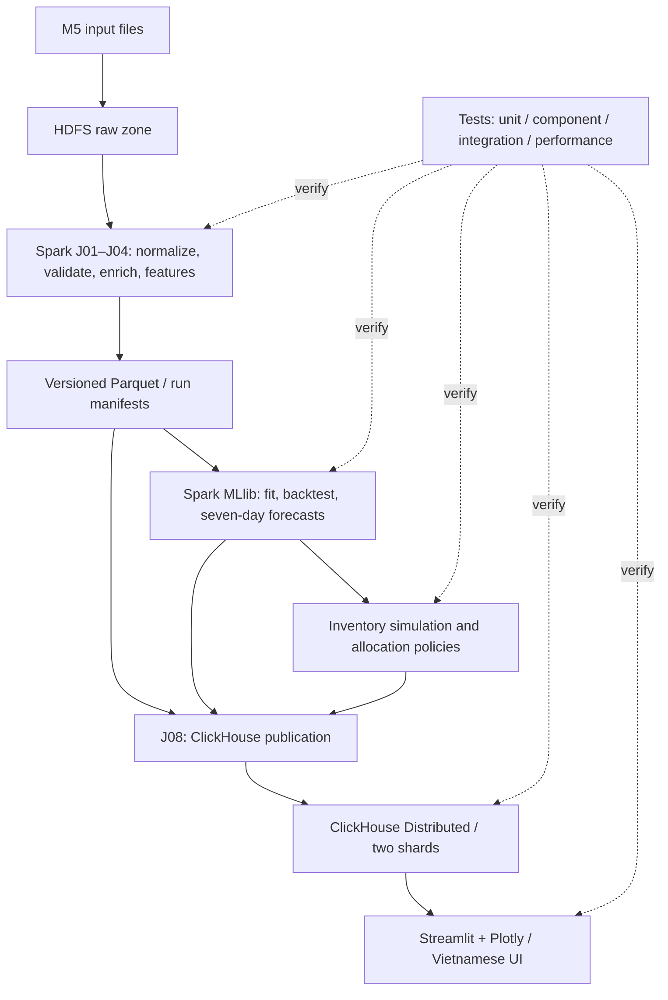

# 11 — Testing and Performance Evaluation

> **Project:** Big Data–Driven Inventory and Distribution Optimization  
> **Original title:** Tối ưu hóa hệ thống quản lý kho hàng  
> **Course:** Introduction to Big Data  
> **Document type:** Software Test Strategy, Test Specification, and Performance Evaluation Plan  
> **Status:** Proposed verification baseline — **no test result is claimed until executed**  
> **Version:** 1.0 — October 15, 2026  
> **Related specifications:** [02 — System Requirements](02_SYSTEM_REQUIREMENTS.md), [03 — System Architecture](03_SYSTEM_ARCHITECTURE.md)

---

## 1. Purpose and Scope

This document defines **how to verify correctness, data integrity, distributed behavior, integration, resource consumption, and measured performance** of the warehouse analytics application.

It covers:

1. Unit and property-based tests for deterministic logic.
2. Data profiling and data-quality checks for M5-derived datasets.
3. HDFS and Spark distributed-storage/processing verification.
4. Forecast feature, model, backtesting, and metric verification.
5. Simulated inventory replenishment and allocation-policy tests.
6. ClickHouse two-shard correctness and distributed-query tests.
7. Streamlit/Plotly application functional and failure-state tests.
8. Cross-component integration, reproducibility, and recovery tests.
9. Controlled benchmarks for Spark, ML, ClickHouse, and interactive queries.
10. Test artifacts, pass/fail gates, defect management, and requirement traceability.

**Explicitly out of scope:** live demonstration scripts, presentation instructions, oral-defense questions/answers, slide content, deployment walkthroughs, production penetration tests, physical multi-host failover certification, and actual Walmart business-impact claims.

This is a **testing and performance document**. It does not redefine business formulas, design new database schemas, or select a different forecasting model. Those decisions belong to documents 06–10.

### 1.1 Normative language

| Term | Meaning |
|---|---|
| **MUST** | Required for a valid P0 implementation or a trustworthy test. |
| **SHOULD** | Preferred, unless a recorded engineering trade-off explains otherwise. |
| **MAY** | Optional extension after core verification works. |
| **Expected** | Predicted by requirements or a controlled fixture, not necessarily observed. |
| **Observed** | Produced by a recorded execution with identifiable artifacts. |
| **Pass / Fail / Blocked / Not Run** | Test status; `Blocked` requires a recorded dependency or environment reason. |
| **Baseline** | Reproducible comparison using the same declared dataset/conditions. |

**No fabricated observations:** all example results, test IDs, timings, thresholds, and paths in this document are specifications or templates unless explicitly marked as *observed* in a future test report.

### 1.2 Project invariants that tests must preserve

- M5 `sales_train_evaluation.csv` has **30,490 item–store series** and **1,941 daily fields**. Full unfiltered normalization is expected to produce **59,181,090 product–store–day observations**; these are **not independent customer transactions**.
- `sales_train_validation.csv` overlaps with the evaluation-history file. The two files MUST NOT be appended as independent observations.
- Source M5 sales, Spark-derived records, ML predictions, and simulated inventory are different provenance classes.
- HDFS has at least two active DataNodes; Spark executes work through a Master and at least two Workers; ClickHouse has two active shards with one replica per shard.
- ClickHouse sharding does **not** imply replication or high availability; all containers run on one physical Windows 16 GB host through WSL2 Ubuntu.
- The baseline model is **Spark MLlib Random Forest Regression** for **seven sequential daily sales forecasts**, with a seasonal-naive comparator.
- Source sales-data coverage, ML training/evaluation coverage, and ClickHouse published coverage are **separate measured quantities**.
- Engineering documentation, identifiers, code, and test names use **English**; all end-user Streamlit wording uses **Vietnamese**.

---

## 2. Testing Goals and Quality Gates

### 2.1 Testing objectives

| ID | Objective | Evidence needed |
|---|---|---|
| TG-01 | Verify M5 source and transformed data integrity | File manifest, key checks, counts, reconciliation |
| TG-02 | Verify authentic HDFS storage and Spark processing | Two DataNodes holding real blocks, actual Worker/Executor tasks |
| TG-03 | Verify forecast semantics and temporal correctness | Feature tests, cutoffs, seven-step backtest, baseline, metrics |
| TG-04 | Verify feasible simulated inventory decisions | Deterministic fixtures, invariants, fairness of comparison |
| TG-05 | Verify two-shard ClickHouse serving | Physical local rows on both shards, distributed results, reconciliation |
| TG-06 | Verify application correctness and Vietnamese UI | Page, filter, state, cache, empty/error, data-provenance tests |
| TG-07 | Verify integration and reproducible recovery | Run-ID consistency, rerun checks, controlled failure/rebuild tests |
| TG-08 | Quantify resource consumption and performance | Controlled runs, timings, memory, query profiles and dataset scope |

### 2.2 Mandatory pass conditions versus measured outcomes

**P0 correctness gates:** required input keys valid; full-scope row count reconciles; no unjustified cardinality inflation; temporal leakage controls pass; all seven forecast horizons valid; allocation constraints pass; both ClickHouse shards contain project-derived rows; distributed reads reconcile; application never fabricates unavailable results.

**Performance reporting obligations:** publish actual durations, resource measurements, variance, dataset sizes and configurations. Faster-than-baseline performance is **not** a universal P0 acceptance criterion.

**P1 engineering target from the SRS:** a typical **warm, filtered dashboard operation should complete in no more than 10 seconds** in the specified environment. This is a *target to measure*, not an established system property. If missed, keep the measurement, identify the bottleneck, and record remediation or acceptance rationale. Other thresholds are set only after baseline measurement and recorded before final comparison.

### 2.3 Test priority

| Level | Definition | Release handling |
|---|---|---|
| **P0** | Requirement violation can invalidate a core project claim or produce misleading results | Must pass, or be explicitly documented as an unresolved blocker/deviation |
| **P1** | Quality, responsiveness, recovery or maintainability expectation | Prefer pass; unresolved issues tracked with impact |
| **P2** | Optional extra analysis or enhancement | Does not block core release |

---

## 3. System Under Test and Test Boundaries

### 3.1 Components under test



### 3.2 Test isolation boundaries

| Boundary | Approach | Reason |
|---|---|---|
| Pure business functions | Small deterministic Python fixtures | Fast identification of mathematical defects |
| Spark transformations/features | Small local Spark fixtures, followed by actual cluster tests | Fast feedback without pretending `local[*]` proves distribution |
| HDFS block placement and Spark distribution | Real configured Docker services | Claims must be supported by actual distributed components |
| Model evaluation | Immutable chronological holdout and saved model artifact | Prevent target leakage and unrepeatable metrics |
| ClickHouse SQL / shard tests | Two actual ClickHouse shard processes | A single `MergeTree` instance cannot prove sharding |
| UI presentation | Mock repository for UI unit tests; real ClickHouse for integration tests | Separate visual logic from database integration |
| Performance | Pinned dataset/configuration and controlled host | Avoid misleading comparisons |

**Mocking is allowed for unit tests but never substitutes for the P0 end-to-end and distributed authenticity tests.**

### 3.3 Test levels and execution cadence

| Level | When | Target duration class | Required components |
|---|---|---|---|
| L0 — Static checks | Every code change | Seconds | Python/SQL/Markdown tools |
| L1 — Unit/property tests | Every code change | Seconds to minutes | Python, small fixtures |
| L2 — Component tests | After a component changes | Minutes | Spark local or specific service |
| L3 — Cluster integration tests | Before merging substantial pipeline/database work | Minutes to longer | HDFS, Spark Workers, ClickHouse as applicable |
| L4 — Full-scope data/model validation | At reproducible checkpoints | Potentially lengthy; measure | M5, HDFS, Spark, saved artifacts |
| L5 — Performance benchmarks | After stable correctness gates | Controlled runs | Selected subset/full scope and instrumentation |

Do **not** run expensive full-data jobs for every minor UI edit. Conversely, a successful L1 local Spark test is insufficient to claim distributed processing.

---

## 4. Test Environment, Fixtures, and Reproducibility

### 4.1 Environment baseline

| Item | Baseline / recording rule |
|---|---|
| Physical host | Windows machine with 16 GB physical RAM; record CPU model, core/thread counts and free disk |
| Linux environment | Ubuntu on WSL2; record Ubuntu and WSL versions |
| Container environment | Docker Compose; capture image digests, container quotas, service list |
| HDFS | NameNode + two DataNodes; capture actual block status and replication setting |
| Spark | Standalone Master + two Workers; record driver/executor core and memory allocations |
| ClickHouse | Two shards, one replica per shard; separate local data volumes |
| Application | Streamlit/Plotly and ClickHouse query client versions |
| Libraries | Python, Java, Spark, Hadoop, MLlib and pytest versions recorded from installed environment |
| Code | Git commit and clean/dirty status |
| Data | Source SHA-256, source snapshot ID, feature version, model run ID, scenario ID |

Versions proposed in [05 — Tech Stack](05_TECH_STACK.md) are **candidates**, not presumed installed facts. An actual run manifest must record the binaries and image digests used.

### 4.2 WSL2 resource discipline

- Record the WSL2 memory and swap limits, Docker/worker memory settings, and host available RAM before each benchmark.
- Avoid simultaneous ML fitting, large Parquet compaction, ClickHouse bulk inserts, and application load tests.
- Run heavy tests by **phase**, with an explicit service topology per test.
- Record whether files reside in the WSL2 Linux filesystem or on a `/mnt/c/` mount. I/O comparisons MUST NOT silently switch storage location.
- Treat any OOM kill, worker loss, major swap pressure or host instability as an observed result, not something to conceal by deleting logs.

Suggested diagnostic commands (not a setup guide):

```bash
free -h
cat /proc/meminfo | head -n 12
docker stats --no-stream
docker compose ps
df -h
```

### 4.3 Data and fixture tiers

| Tier | Dataset | Primary use |
|---|---|---|
| F0 — Handcrafted | 3–20 rows with exact expected outputs | Logic and edge cases |
| F1 — Deterministic sample | Small multi-store, multi-day, reproducibly selected source subset | Joins, feature and SQL integration |
| F2 — Scale slices | Explicitly selected larger subsets, e.g. 1M / 5M / 10M normalized rows **if feasible** | Scaling/throughput experiments |
| F3 — Full M5 evaluation-history reshape | Expected 59,181,090 normalized rows, with exact source scope | Full ETL correctness and scale validation |
| F4 — Locked chronological ML holdout | Versioned eligible series and predefined issue dates | Valid forecast/policy evaluation |
| F5 — Simulated inventory scenarios | Fixed seeds, known on-hand/central stock, fixed business-policy versions | Decision correctness and sensitivity |

The dataset size labels F2 and F3 are **not claims of a completed execution**. For every measured run, retain the **actual** row count, bytes and distinct item–store series.

### 4.4 Deterministic test-data policy

1. Fix and record seeds for any data selection, model training and simulation.
2. Never call a randomly enlarged or duplicated test dataset *additional real Walmart transactions*.
3. Use a stable hash-based selection on canonical keys when choosing a repeatable subset; record its filter and count.
4. Avoid sampling individual future target rows into a training fold without respecting chronology.
5. Keep all expected-value fixtures version-controlled; keep large Kaggle raw files outside Git.
6. Keep test records distinct from production/approved serving rows by using isolated schemas, data directories or run IDs.

### 4.5 Minimal test repository layout (proposed)

```text
tests/
  conftest.py
  fixtures/
    m5_small/
    stock_scenarios/
    expected_outputs/
  unit/
    test_replenishment.py
    test_allocation.py
    test_metric_formulas.py
    test_forecast_dates.py
  data/
    test_source_manifest.py
    test_normalization.py
    test_calendar_price_join.py
    test_features_asof.py
  integration/
    test_hdfs_spark.py
    test_clickhouse_shards.py
    test_publish_reconciliation.py
    test_application_repository.py
  application/
    test_ui_states.py
    test_vietnamese_labels.py
  performance/
    bench_spark_etl.py
    bench_clickhouse_queries.py
    bench_application.py
  manifests/
    test_matrix.yaml

artifacts/                     # Generated; generally not committed
  test-runs/<test_run_id>/
    manifest.json
    pytest-results.xml
    component-logs/
    quality-checks/
    forecast-metrics/
    policy-metrics/
    benchmarks/
```

Paths and module names above are **organizational proposals**, not assertions that those files already exist.

### 4.6 Recommended tools

- `pytest` for unit, property and integration test orchestration; `pytest-cov` for optional module coverage.
- Python `assert`, `unittest.mock` or `pytest` fixtures for small deterministic logic tests.
- Spark SQL/DataFrame checks and Spark event logs for distributed jobs.
- SQL assertions or a Python ClickHouse client for query and shard reconciliation.
- Streamlit's supported testing facilities (where compatible), plus focused real application integration checks.
- `time.perf_counter()`, Docker container telemetry, Spark UI/event logs, and ClickHouse `system.query_log` for performance.

Do not add a heavyweight testing platform or separate monitoring infrastructure unless a clear verification need justifies it.

---

## 5. Source Dataset and Pipeline Data-Quality Tests

Detailed source contracts and job stages remain in [04 — Dataset](04_DATASET.md) and [06 — Data Pipeline](06_DATA_PIPELINE.md). This section specifies **the assertions**.

### 5.1 Source manifest and structural tests

| ID | Priority | Test | Expected behavior |
|---|---|---|---|
| DATA-01 | P0 | Verify file source, size, SHA-256 and ingestion metadata | Actual files match recorded manifest |
| DATA-02 | P0 | Inspect `sales_train_evaluation.csv` series keys and day fields | 30,490 canonical series, 1,941 `d_` columns for declared source |
| DATA-03 | P0 | Detect mixing of overlapping validation/evaluation histories | No double counting or silent append |
| DATA-04 | P0 | Check `item_id × store_id` uniqueness in source series | One row per series in selected evaluation-history file |
| DATA-05 | P0 | Check `calendar.d` uniqueness and date mapping | Exactly one calendar match per covered day |
| DATA-06 | P0 | Check sell-price key cardinality | At most one applicable `(store_id, item_id, wm_yr_wk)` price record |
| DATA-07 | P0 | Check sales value parsing and domains | Finite, nonnegative integer unit-sales values; invalid values flagged |
| DATA-08 | P0 | Check null/invalid required identifiers | No invalid published fact keys |

### 5.2 Full reshape and enrichment assertions

Let `source_series = 30,490`, `day_count = 1,941`. For the fully unfiltered reshape:

\[
N_{\mathrm{expected}} = 30{,}490 \times 1{,}941 = 59{,}181{,}090.
\]

**Key checks:**

- Row count equals `N_expected` **only** for the declared full evaluation-history reshape retaining zero-sales days.
- Every normalized record has a unique `(item_id, store_id, d)` key; no source day column is omitted or mapped twice.
- Each source series appears for exactly 1,941 days in this specific full reshape.
- `sales_units` is finite, nonnegative and integer-valued; **zero is a valid observed value**.
- Calendar enrichment is many-to-one for the long sales fact; price enrichment never multiplies sales records.
- A missing historical price is **not automatically zero** and does not by itself justify deleting a legitimate zero-sales day.
- Date, product, store, department and category mappings remain consistent with the approved source schema.
- Results written to HDFS Parquet and reread through Spark preserve the approved schema, row count and aggregate checksums.

| ID | Priority | Test | Expected behavior |
|---|---|---|---|
| DATA-09 | P0 | Full raw-to-long normalization | Expected full count after unfiltered reshape; measured count recorded |
| DATA-10 | P0 | Long-format uniqueness and per-series dates | No duplicate item–store–day keys; correct day coverage |
| DATA-11 | P0 | Zero-sales preservation | Explicit zero days remain present where in source |
| DATA-12 | P0 | Calendar join cardinality | Output row count unchanged; date fields consistent |
| DATA-13 | P0 | Price join cardinality and null semantics | Row count unchanged; price missingness reported, not fabricated |
| DATA-14 | P0 | Store/department/time aggregation | Independent fixture totals match Spark results |
| DATA-15 | P0 | Parquet round trip | Persisted output reads with matching counts and schema |
| DATA-16 | P1 | File-size/partition and small-files audit | Actual output file count and sizes measured |

### 5.3 Chunked normalization correctness

The pipeline proposes bounded groups of daily columns for its wide-to-long transform. Verify that:

1. Each `d_####` source column belongs to **exactly one** chunk.
2. Chunk union spans exactly all required days, with no overlap or gap.
3. The sum of per-chunk counts equals the final normalized count.
4. Retrying an interrupted chunk does not duplicate already approved output.
5. Published data are promoted only after required checks pass.

Sample invariant checker (reference implementation; adapt column names to the actual approved schema):

```python
from typing import Iterable


def validate_day_chunks(chunks: Iterable[list[str]], expected_days: list[str]) -> None:
    flattened = [day for chunk in chunks for day in chunk]
    assert len(flattened) == len(set(flattened)), "Day columns overlap"
    assert set(flattened) == set(expected_days), "Day-column coverage differs"
    assert len(flattened) == len(expected_days), "Day-column count differs"
```

### 5.4 Failure and negative-data tests

Deliberately construct a separate **test fixture**, never modify the canonical downloaded Kaggle files, containing:

- A duplicate `(item_id, store_id)` source row.
- A missing `calendar.d` match.
- Duplicate price keys that would inflate a join.
- A malformed numeric sales value and a missing required ID.
- A chunk with one skipped day or one repeated day.
- A partition whose output write fails before promotion.

Expected behavior: the affected run or dataset quality gate **fails visibly**, records the offending scope/count, and does not publish misleading approved data.

---

## 6. HDFS and Spark Distributed Tests

### 6.1 HDFS tests

| ID | Priority | Test | Expected behavior |
|---|---|---|---|
| DIST-01 | P0 | Inspect actual HDFS DataNode registration | At least two active DataNodes |
| DIST-02 | P0 | Write project source and curated Parquet through HDFS | Files reachable via HDFS URI and real blocks on nodes |
| DIST-03 | P0 | Inspect block placement for project data | Real stored blocks/placement, not merely running containers |
| DIST-04 | P1 | Restart an HDFS service under controlled conditions | Behavior follows configured replication and recovery rules |
| DIST-05 | P0 | Read input from HDFS in a submitted Spark job | Resolved input path uses HDFS, not a hidden local fallback |

Example inspection commands (service/container names depend on actual deployment):

```bash
hdfs dfs -ls -h /data/warehouse/raw/m5
hdfs dfs -count -q -h /data/warehouse/curated
hdfs fsck /data/warehouse/raw/m5 -files -blocks -locations
hdfs dfsadmin -report
```

**Interpretation caveat:** two DataNodes do not imply every block is replicated. Inspect the actual HDFS replication factor and block replicas. Tests MUST NOT describe a single-machine, multi-container setup as host-level fault tolerant.

### 6.2 Spark tests

| ID | Priority | Test | Expected behavior |
|---|---|---|---|
| DIST-06 | P0 | Submit transformation to Spark Standalone | Application connects to the configured Master |
| DIST-07 | P0 | Confirm task execution across both Workers | Worker/Executor task activity observed during actual job |
| DIST-08 | P0 | Compare simple fixture outputs with local Spark | Data and aggregates equal within the declared numeric precision |
| DIST-09 | P0 | Validate saved/reloaded Parquet using Spark | Identical declared keys and aggregates |
| DIST-10 | P1 | Restart/retry a safe, checkpointed stage | Idempotent outputs with no duplicate approved partitions |
| DIST-11 | P1 | Detect shuffle spill, skew and task failure | Metrics recorded and failure visible, not silently ignored |

**Evidence fields:** Spark application ID, submitted command/config hash, job and stage IDs, number of tasks, per-Worker/Executor task counts, input/shuffle bytes, GC/spill where available, execution timestamps and outcome.

Enable persistent Spark event logs when practical so completed jobs remain inspectable. See [Spark Monitoring and Instrumentation](https://spark.apache.org/docs/3.5.7/monitoring.html).

### 6.3 Distributed authenticity acceptance

A P0 distributed-processing claim passes only if **all** are true:

- Services are configured as distinct processes/containers with the required logical topology.
- The actual submitted Spark workload uses Spark Standalone, not only `local[*]`.
- Both Workers execute real tasks associated with the specified workload; merely listing both Workers as healthy is insufficient.
- HDFS stores actual source or curated blocks on at least two DataNodes.
- Data results are validated against an independent count or aggregate.

**Correctness and performance are different claims:** two Workers may execute tasks correctly yet not run faster than a single Worker on the same host.

---

## 7. Machine Learning Verification

The algorithm and time protocol remain defined in [07 — Machine Learning](07_MACHINE_LEARNING.md). Tests enforce those contracts without duplicating the full feature engineering specification.

### 7.1 Locked temporal protocol

| Phase | Label period | Permitted purpose |
|---|---|---|
| Training | `d_29`–`d_1885` (subject to eligibility) | Fit initial preprocessing/model |
| Validation | `d_1886`–`d_1913` | Select settings using four seven-day windows |
| Locked test | `d_1914`–`d_1941` | Final comparison once, after configuration lock |

Evaluation issue dates and predicted periods MUST match document 07. For later rolling origins, past observed sales may be used as history, but never as future labels for the same issue date. Test outcomes MUST NOT inform hyperparameter selection after the lock.

### 7.2 ML functional test cases

| ID | Priority | Test | Expected behavior |
|---|---|---|---|
| ML-01 | P0 | Lag feature at known target date | `lag_1`, `lag_7`, `lag_28` select the correct **past** dates |
| ML-02 | P0 | Rolling feature on a small known series | Trailing window excludes target day |
| ML-03 | P0 | Future-label poisoning | Altering outcomes strictly after forecast origin does not change that origin's feature/forecast inputs |
| ML-04 | P0 | Price availability at issue date | `last_known_price` uses information available at issue time |
| ML-05 | P0 | Train-only transformer fit | Imputation/encoding fit on training data only |
| ML-06 | P0 | Chronological splits | Configured validation/test label windows not used for model selection improperly |
| ML-07 | P0 | RF fit and persistence | Spark MLlib model trains and reloads with same approved feature schema |
| ML-08 | P0 | Seven-day recursive prediction | Exactly seven contiguous future dates, horizons 1–7 |
| ML-09 | P0 | Recursive state update | Horizons 2–7 never consume target-period actual sales |
| ML-10 | P0 | Forecast domain checks | Nonnegative, finite, defined units and totals |
| ML-11 | P0 | Seasonal-naive baseline fairness | Same origins, horizon, coverage and observed outcomes as RF |
| ML-12 | P0 | Metric calculations | MAE, RMSE, WAPE match hand-computed fixtures |
| ML-13 | P0 | Zero-demand WAPE guard | Undefined denominator handled explicitly, not NaN reported as valid performance |
| ML-14 | P0 | Coverage accounting | Supported vs. unsupported series and observation count documented |
| ML-15 | P1 | Repeat fit with declared seed/environment | Differences measured and logged, not assumed bit-identical across environments |
| ML-16 | P0 | Run-type semantics | `validation`/`test`/`forward_demo` never confused |

### 7.3 Exact feature-timing tests

Use a tiny hand-built series with distinguishable values, e.g. `sales_units[t] = t` for eligible dates, to test lag and rolling windows. Given the target day `t = 35`:

- `lag_1 = 34`, `lag_7 = 28`, `lag_28 = 7`.
- `rolling_mean_7 = mean(28, 29, 30, 31, 32, 33, 34) = 31`.
- `rolling_mean_28 = mean(7, ..., 34) = 20.5`.

If `sales_units[35]` changes, features evaluated **for target day 35** must remain unchanged.

For a seven-day forecast issued at day `T`:

1. Keep the history through `T` fixed.
2. Replace actual outcomes at `T+1 .. T+7` with conspicuous sentinel values **only in an isolated test copy**.
3. Run the same approved forecast model with the same known-at-issue calendar assumptions.
4. Confirm predictions are unchanged for that issue origin.
5. Confirm no test-label values appear in any feature or preprocessing statistics used by the model.

A failed test indicates leakage even if test accuracy appears good.

### 7.4 Metric definitions and reference fixture

For paired observations `(y_i, p_i)`, with `N` valid pairs:

\[
\operatorname{MAE}=\frac{1}{N}\sum_i|y_i-p_i|,
\qquad
\operatorname{RMSE}=\sqrt{\frac{1}{N}\sum_i(y_i-p_i)^2}.
\]

\[
\operatorname{WAPE}=\frac{\sum_i|y_i-p_i|}{\sum_i|y_i|}\times100\%,
\quad \text{when }\sum_i|y_i|>0.
\]

Example fixture: `actual = [2, 4, 0]`; `predicted = [1, 5, 1]`.

- MAE = `(1 + 1 + 1) / 3 = 1`.
- RMSE = `sqrt((1 + 1 + 1)/3) = 1`.
- WAPE = `3 / 6 × 100 = 50%`.

Test zero-actual groups separately. A zero WAPE denominator is **undefined** rather than 0% or infinity. For pooling across series, compute WAPE from **pooled error and pooled actual totals**, not by naively averaging series-level WAPE values.

### 7.5 Model-comparison protocol

- Freeze selected RF parameters and sampling policy before the locked test evaluation.
- Use identical seven-day issue origins, eligible series, observed outcomes, coverage rules and metric definitions for the RF and seasonal-naive baseline.
- Report pooled and horizon-specific metrics (1–7); identify weighting by rows versus by series.
- Store predictions and results for both methods so published values are auditable.
- Retain negative/inconclusive results. **Do not require Random Forest to win as a correctness gate.**
- Report model-fit time, inference time, rows/series used and resource consumption separately from predictive quality.

### 7.6 Persistent model and inference checks

After writing the fitted Spark MLlib `PipelineModel`, reload it in a fresh process/session with the same compatible library versions. Check feature ordering, categorical/indexer metadata, predicted-unit domain and representative inference consistency to a documented floating-point tolerance. Do not force unrealistic exact binary equality when Spark execution plan or floating-point ordering changes.

---

## 8. Inventory Business Rule and Optimization Tests

The source of truth for formulas, simulation, integer allocation, and policy interpretation is [08 — Business Rules & Optimization](08_BUSINESS_RULES_AND_OPTIMIZATION.md).

### 8.1 Replenishment tests

| ID | Priority | Test | Expected behavior |
|---|---|---|---|
| INV-01 | P0 | Known rule fixture (`D=80`, `S=10`, `I=50`) | Proposed replenishment **40 units** |
| INV-02 | P0 | Sufficient inventory | Replenishment zero, never negative |
| INV-03 | P0 | Fractional forecast total | Apply the specified rounding once at the correct planning boundary |
| INV-04 | P0 | Zero forecast and zero stock | Correct rule output; no fabricated demand |
| INV-05 | P0 | Negative/NaN/invalid quantities | Reject or produce explicit invalid-input status |
| INV-06 | P0 | Repeat identical scenario seed and inputs | Identical generated stock and recommendations |
| INV-07 | P0 | Change scenario parameter only | Derived decision changes as appropriate; M5 history stays unchanged |

### 8.2 Allocation properties

For each product, scenario, and planning issue date, let store request `r_s`, allocation `a_s`, and available central supply `C`.

\[
\forall s:\; 0 \le a_s \le r_s, \quad
\sum_s a_s \le C, \quad
u_s = r_s-a_s \ge 0.
\]

All operational quantities are integer units. When total eligible requests exceed supply, there must be no over-allocation. When supply is sufficient for all eligible requests, the approved policy should meet them all under its documented eligibility rules.

| ID | Priority | Test | Expected behavior |
|---|---|---|---|
| INV-08 | P0 | Single store / single unit | Request and supply constraints satisfied |
| INV-09 | P0 | Multiple stores, constrained supply | Shortage-first policy honors critical-then-safety priority |
| INV-10 | P0 | Supply zero | All allocations zero and unmet requests preserved |
| INV-11 | P0 | Abundant supply | All eligible requests fully covered |
| INV-12 | P0 | Rounding and ties | Deterministic integer result; stable documented tie-break |
| INV-13 | P0 | Permutation of store input order | Result stable under canonical tie-break, not accidental row order |
| INV-14 | P0 | Multi-product processing | Supply constraints enforced independently by product |
| INV-15 | P0 | Shared supply displayed per store | UI/database aggregates do not multiply central stock across store rows |

### 8.3 Property-based test pattern

The following independent properties apply regardless of the internal proportional-apportionment implementation:

```python

def assert_allocation_invariants(
    requests: dict[str, int],
    allocations: dict[str, int],
    central_supply: int,
) -> None:
    assert set(allocations) == set(requests)
    assert isinstance(central_supply, int) and central_supply >= 0
    for store_id, request in requests.items():
        allocated = allocations[store_id]
        assert isinstance(request, int) and request >= 0
        assert isinstance(allocated, int)
        assert 0 <= allocated <= request
    assert sum(allocations.values()) <= central_supply
```

These assertions catch infeasible outputs, but **not** a policy that distributes stock in the wrong priority order. Priority-policy fixtures are required in addition.

### 8.4 Policy backtesting and fairness

| ID | Priority | Test | Expected behavior |
|---|---|---|---|
| INV-16 | P0 | Proposed vs `equal_share_v1` | Same scenario, product, planning origin, supply and outcome window |
| INV-17 | P0 | Shortage and fulfillment accounting | Fulfilled + unmet = modeled demand proxy, according to stated simulation |
| INV-18 | P0 | Ending-stock accounting | No creation of units; initial + received − fulfilled = ending stock |
| INV-19 | P0 | Seven-day daily simulation | No use of later true sales when computing earlier inventory decisions |
| INV-20 | P0 | Policy outcome report | Unmet-demand proxy, remaining/overstock proxy, fulfillment rate retained |
| INV-21 | P1 | Scenario sensitivity | Effects of scarcity/safety parameters measured without changing history |

**Do not equate a lower simulated shortage proxy with proven real-world Walmart inventory savings.** Observed sales may be censored by past stockouts, and actual inventory/shipments are absent from M5.

---

## 9. ClickHouse Distributed Database Tests

### 9.1 Core distributed behavior

| ID | Priority | Test | Expected behavior |
|---|---|---|---|
| DBT-01 | P0 | Cluster metadata | Two configured shards, one replica per shard |
| DBT-02 | P0 | Physical data on both shards | Each has nonempty project-derived rows and its own storage volume |
| DBT-03 | P0 | Local schema agreement | Corresponding tables have compatible columns and types |
| DBT-04 | P0 | Distributed count and aggregate | Equal sum of physical shard-local results for approved scope |
| DBT-05 | P0 | Reconcile published records to Spark manifest | Same logical grain, filters, run version and row counts |
| DBT-06 | P0 | Verify data routing | Sharding expression matches the published data and distribution policy |
| DBT-07 | P0 | Repeat approved publication | No duplicate approved business keys or silent mixed versions |
| DBT-08 | P0 | Duplicate/invalid forecast publication | Rejected before serving publication |
| DBT-09 | P0 | Versioned filtering | No cross-model, cross-scenario or cross-policy mixes |
| DBT-10 | P0 | Restricted two-shard query when shard fails | Explicit failure; no silent successful partial aggregate |
| DBT-11 | P1 | Controlled rebuild from approved source | Restored outputs reconcile to manifest |
| DBT-12 | P1 | Small-batch insert pressure | Bounded part count and memory in tested ingest profile |

### 9.2 Reference SQL for cluster and row reconciliation

Run topology checks on the configured query-entry node:

```sql
SELECT shard_num, replica_num, host_name
FROM system.clusters
WHERE cluster = 'warehouse_cluster'
ORDER BY shard_num, replica_num;
```

Check physical local rows **on each node separately**, for the same approved dataset and version:

```sql
SELECT count() AS local_rows
FROM warehouse.store_daily_sales_local;
```

Check global rows through the Distributed table:

```sql
SELECT count() AS distributed_rows
FROM warehouse.store_daily_sales;
```

Where supported by the ClickHouse version/table context, inspect shard routing through the virtual column:

```sql
SELECT _shard_num AS shard_number, count() AS rows_per_shard
FROM warehouse.store_daily_sales
GROUP BY _shard_num
ORDER BY shard_number;
```

**Required reconciliation:**

\[
\operatorname{count}(\text{distributed rows})
= \operatorname{count}(\text{shard 1 local})
+ \operatorname{count}(\text{shard 2 local})
= \operatorname{count}(\text{published source scope}).
\]

Apply the **same filters** and approved run/date/grain contract on every side. For a derived or aggregated serving table, compare against its matching Spark export, **not** against 59,181,090 full daily M5 observations.

### 9.3 Robustness, consistency, and failure visibility

- The baseline has **one replica per shard**. Bring down a shard only in an isolated test and verify queries that need it fail visibly.
- Ensure relevant queries do not silently ignore unavailable shards; for test queries specify `skip_unavailable_shards = 0` (or validate the corresponding session setting).
- Do not claim a production failover guarantee from the single-host layout.
- Publication tests should verify staged output and validation-before-promotion semantics described in document 09. ClickHouse MergeTree does **not** automatically enforce relational uniqueness constraints for these business keys.
- Query authorization uses an application-appropriate read-only identity where supported. Query inputs must be parameterized or safely validated.
- If `system.query_log` is used for timing, verify the logging configuration, query ID and `QueryFinish` entries on the applicable nodes.

### 9.4 Query semantics for inventory decisions

Check that:

1. `central_available_units` is sourced from the central-supply dataset **once per product/scenario**, not summed over every destination store.
2. Forecast metrics join by the approved `model_run_id`, holdout and method.
3. Replenishment and allocation use the same `forecast_run_id`, `scenario_id`, and decision version.
4. Date filters correspond to observed sale dates or forecast dates as explicitly indicated.
5. The dashboard never aggregates forecast copies across multiple runs as if they were one forecast.

---

## 10. Streamlit and Visualization Tests

### 10.1 Page-level functional tests

| ID | Priority | Page / condition | Expected behavior |
|---|---|---|---|
| UI-01 | P0 | `Tổng quan` loads | Source-derived metrics and historical trend are visible |
| UI-02 | P0 | `Dự báo nhu cầu` loads | Eligible series gives seven dated forecast values and total |
| UI-03 | P0 | `Tồn kho` loads | Forecast + clearly marked simulated stock + proposed replenishment |
| UI-04 | P0 | `Phân bổ hàng` loads | Supply, requests, allocations, unmet quantities reconcile |
| UI-05 | P0 | Select unsupported item–store pair | Clear Vietnamese unavailable message; no synthetic zeros |
| UI-06 | P0 | Empty filter result | Appropriate Vietnamese empty-state message |
| UI-07 | P0 | ClickHouse unavailable | Explicit error state; no stale/fake current data represented as live |
| UI-08 | P0 | Switch model/scenario/run | All affected plots and tables update consistently |
| UI-09 | P0 | Data provenance display | Observed, predicted and simulated content distinguishable |
| UI-10 | P0 | Vietnamese localization | User-facing navigation, chart captions, units, errors in Vietnamese |
| UI-11 | P0 | Visual computation consistency | Chart, table and KPI totals agree within documented rounding |
| UI-12 | P1 | Filter/parameter safety | Input validation and parameter binding; no SQL injection by text field |
| UI-13 | P1 | Caching invalidation | Approved new run changes cache key; old run not silently reused |
| UI-14 | P1 | CSV export, if implemented | Export equals filtered visible approved data |

### 10.2 Testing methodology

- Test pure formatting and repository adapter behavior with controlled fixtures.
- Integration-test real read-only queries against ClickHouse for each supported page.
- Verify every UI data state: loading, valid result, empty result, invalid selection, unavailable dependency, and inconsistent run metadata.
- Use *semantic assertions* (correct quantity, label, provenance, date) rather than only screenshot pixel comparison.
- Verify Plotly chart traces refer to the intended data series and axes declare correct units/date meaning.
- Check that any page cache is keyed by data snapshot/model/scenario context, not only by SQL text.
- Run a simple viewport/layout inspection at the actual environment resolution if feasible; it is not a replacement for functional assertions.

**Application language rule:** visible UI text is Vietnamese, while internal Python symbols, SQL identifiers, logs and this test document remain in English.

---

## 11. End-to-End Integration and Recovery Tests

### 11.1 Integration contracts

| ID | Priority | Test path | Expected outcome |
|---|---|---|---|
| INT-01 | P0 | Kaggle file → HDFS → Spark normalization | Correct full/declared subset count and provenance |
| INT-02 | P0 | Spark normalization → Parquet → Spark reread | Stable schema, key and aggregate integrity |
| INT-03 | P0 | Curated data → approved features → saved RF model | Compatible input/output schema and valid model manifest |
| INT-04 | P0 | Saved model → seven-day forecast → stock decision | Matching origin, model run, forecast run and scenario identifiers |
| INT-05 | P0 | Spark export → ClickHouse two shards | Published scope reconciles; both shards hold real data |
| INT-06 | P0 | ClickHouse → four Streamlit pages | UI values agree with approved database queries |
| INT-07 | P0 | Test origin and forecast dates | No training/future label leakage across pipeline boundaries |
| INT-08 | P0 | Missing published forecast | No fabricated stock recommendation with hidden fallback |
| INT-09 | P1 | Controlled interrupted batch write and rerun | No duplicate approved keys or half-published release |
| INT-10 | P1 | Controlled shard outage | Explicit dependent-query/application failure, not silent partial success |
| INT-11 | P1 | Rebuild from manifest and artifacts | Equivalent declared outputs after repeat run |
| INT-12 | P1 | New model/scenario publication | Old and new approved runs remain distinguishable |

### 11.2 Run identity consistency

At the output boundary, verify the relevant identifiers (names may differ by artifact, but semantics must match):

- `source_snapshot_id`: approved dataset derivation used.
- `pipeline_run_id` or transformation-manifest identifier: exact ETL version.
- `feature_version`: feature availability and transformation rules.
- `model_run_id`: trained model and parameters.
- `forecast_run_id`: forecast issue/scoring batch.
- `scenario_id`: deterministic simulated inventory input.
- `decision_run_id` / `policy_version`: stock decision and allocation policy.
- `run_type`: chronological validation/test versus unscored forward-looking result.

Tests MUST reject accidental many-to-many joins or key collisions caused by missing a run identifier.

### 11.3 Failure injection rules

Inject failures only in isolated test environments, then restore services and datasets:

- Wrong source path, missing calendar mapping, invalid price key.
- Interrupted Parquet chunk write, followed by safe retry.
- Invalid/incomplete model artifact or feature schema mismatch.
- ClickHouse shard unavailable during an aggregate query.
- Unavailable ClickHouse during application load.
- Out-of-range scenario quantities and unknown store/product selectors.

Recovery is considered valid only after re-running required quality gates and comparing declared results. A successful container restart alone is insufficient.

---

## 12. Performance Evaluation Design

### 12.1 Principles of a credible benchmark

1. **Correctness first:** compare only jobs or queries producing the same logical result for the same approved dataset scope.
2. **Define workload identity:** include input row count, bytes, data grain, date range, filter, run ID and query/job text or hash.
3. **Freeze the environment:** record WSL2 limit, CPU, Docker allocations, service topology, storage path, JVM/Spark/ClickHouse settings, and background load.
4. **Separate startup from steady state:** cold startup, cold-cache and warm-cache results answer different questions.
5. **Repeat executions:** use multiple measurements for latency distributions; do not report the fastest lucky run as representative.
6. **Avoid resource-advantage confusion:** when varying Worker/shard counts, record total available cores and memory; distinguish fixed-budget versus scaled-budget experiments.
7. **Keep all outcomes:** including regressions, timeouts, OOMs and crashed workers.
8. **Do not generalize beyond hardware:** a two-shard cluster on one host may be slower due to contention and interprocess overhead.
9. **No precomputed "speedups":** derive speedup only from observed comparable runs.
10. **Do not use a cold-cache number beside a warm-cache baseline** without a clear label.

### 12.2 Benchmark matrix

| ID | Priority | Workload | Variables | Main measurements |
|---|---|---|---|---|
| PERF-01 | P1 | CSV → normalized Parquet | Deterministic data volumes | Wall time, input/output rows, throughput, memory, spill |
| PERF-02 | P1 | Spark normalization/aggregation | 1 vs 2 Workers; equal logical task | Wall time, task balance, CPU/memory, shuffle |
| PERF-03 | P1 | Spark partition sizing | Candidate partition counts on fixed data | Runtime, shuffle, small files, skew |
| PERF-04 | P1 | Spark MLlib training | Recorded sample sizes/feature configuration | Fit time, peak RAM, train rows/series, error metrics |
| PERF-05 | P1 | Seven-day recursive scoring | Number of eligible series | Forecast rows/sec, wall time, executor utilization |
| PERF-06 | P1 | Spark/Parquet → ClickHouse publication | Bounded batch sizes | Insert throughput, elapsed time, memory, parts growth |
| PERF-07 | P1 | ClickHouse filtered and aggregated queries | Query shapes, cold vs warm | Client latency, `query_duration_ms`, rows/bytes read |
| PERF-08 | P1 | Equivalent one-shard vs two-shard analytical query | Same full comparator dataset, equivalent SQL | Wall time, result equality, memory, overhead |
| PERF-09 | P1 | Streamlit filtered user operations | Common page/filter combinations | End-user elapsed time, p50/p95, error rate |
| PERF-10 | P1 | Resource saturation and recovery | Bounded workload under WSL2 16 GB | Peak memory, swap use, disk, failures, successful recovery |

If time is limited, prioritize PERF-01, PERF-02, PERF-04, PERF-07, PERF-08 and PERF-09 **after all related P0 correctness gates pass**. Avoid manufacturing additional complexity just to expand the benchmark matrix.

### 12.3 Input-scale tests

Select reproducible data volumes and record *exact* processed counts. A valid experiment may use:

- Small analytical subset (for calibration).
- Approximately 1 million normalized records.
- Approximately 5 million normalized records.
- Full planned evaluation-history scope, if successfully processed.

Do not claim that runtime grows linearly by assumption. Report measured runtime, byte volume, partition/file count and memory. Distinguish **data transformation expansion** (30,490 wide rows becoming up to 59,181,090 long observations) from newly acquired transactions.

For a completed operation:

\[
\text{Throughput}_{\text{rows/s}}=\frac{N_{\text{processed}}}{T_{\text{seconds}}},
\qquad
\text{Speedup}=\frac{T_{\text{baseline}}}{T_{\text{candidate}}}.
\]

When testing scaling across different data volumes, compute observed throughput and **time-per-million-rows**; do not use speedup to compare different datasets as though workloads were identical.

### 12.4 Spark performance protocol

Run each candidate against the **same data and transformation**:

1. Record Spark app ID, Worker count, active executors, allocated/used cores and executor memory.
2. Record input rows, input bytes, date range and exact HDFS paths.
3. Use the same Spark plan/code and comparable partition/output configuration.
4. Trigger a materializing action (e.g. a validated Parquet write and count) and time the declared operation end-to-end; note if the count is a separate job.
5. Collect stage metrics: task distribution, read/write bytes, shuffle read/write, spill, GC and retries where available.
6. Repeat after controlled restart/cache policy; identify warm/cold status.
7. Confirm identical outputs. If not equal, the benchmark is **invalid**, regardless of elapsed time.

**Fixed-budget experiment (recommended):** keep total allowed CPU cores/memory roughly equal while comparing different Worker counts. If total resources change, label it a **scaled-budget experiment** and do not attribute all acceleration solely to parallel architecture.

**Do not confuse `local[2]` with a two-Worker Spark Standalone cluster.**

Example Spark event-log configuration concept (the event-log directory must exist, be writable by the Spark user, and be defined in the shared environment configuration):

```properties
spark.eventLog.enabled=true
spark.eventLog.dir=hdfs:///data/warehouse/system/spark-event-logs
```

### 12.5 Machine-learning training/scoring benchmarks

Keep **quality evaluation** and **computational performance** separate:

- Training fit time and peak memory for the declared eligible sample.
- Features included, `numTrees`, `maxDepth`, `maxBins`, sample size, number of series and seed.
- Scoring time for a fixed seven-day forecast population; include all recursive horizons.
- Output rows, failed/unsupported series and versioned manifest.
- MAE, RMSE and WAPE evaluated on the **same holdout** for all compared settings.

If a smaller training set finishes faster, this alone is not a better ML result. Discuss the associated predictive metrics and coverage; sampling must remain time-safe and documented.

### 12.6 ClickHouse query benchmark protocol

Use the SQL templates in [09 — Database Design](09_DATABASE_DESIGN.md). Select workloads representing actual application reads:

| Query class | Representative selection | Correctness assertion |
|---|---|---|
| CH-Q1 | Sales trend by store and date window | Sum matches approved Spark aggregation |
| CH-Q2 | Seven-day forecast for one item/store/run | Exactly 7 rows, correct dates and total |
| CH-Q3 | Replenishment requests by store/scenario | No mixed runs; quantities nonnegative |
| CH-Q4 | Product allocation across stores | Supply counted once; allocation cap holds |
| CH-Q5 | Forecast/policy metric summary | Approved holdout/run/method only |

For each query:

1. Execute with an explicit run ID, dataset scope and bounded result set.
2. Collect client wall time using a monotonic clock; also collect server query time when logging is enabled.
3. Repeat a fixed number of times (e.g. **10 or more** for stable, cheap query classes); record per-run samples, not only the average.
4. Separate cold-cache and warm-cache groups, if cold cache can be reliably controlled. If it cannot, say so.
5. Report p50 and p95 along with min/max, errors, rows/bytes read and memory where available.
6. Verify each repetition returns an equivalent logical result.
7. Keep ClickHouse insert/merge activity controlled and record any concurrent background merges that could affect latency.

Inspect recent ClickHouse query logs only after confirming logging is enabled:

```sql
SYSTEM FLUSH LOGS;

SELECT
    query_id,
    query_duration_ms,
    read_rows,
    read_bytes,
    memory_usage,
    type
FROM system.query_log
WHERE type = 'QueryFinish'
ORDER BY event_time DESC
LIMIT 20;
```

`system.query_log` is node-local in common deployments. The entry-node value is not automatically a full cluster-wide sum of CPU or memory. Use per-node inspection where appropriate and avoid double-counting distributed subqueries.

### 12.7 Fair one-shard versus two-shard comparison

**Invalid:** compare one shard's half-dataset with both shards' complete dataset and call the faster query a sharding benefit.

**Valid:** materialize the **same full experimental table** in a single-node comparator and in a two-shard cluster, then compare equivalent query outputs and measured durations. Record:

- Same logical rows, schema and aggregation semantics.
- Same total host CPU/RAM budget where feasible, or explicitly note differences.
- Comparable filter selectivity and materialized-data layout.
- Whether one-node results are warm and two-shard results are warm (or both cold).
- ClickHouse client-side elapsed times plus resource observations.

A 2-shard design can cost more latency on a single laptop. Such a result is legitimate and supports an honest assessment of sharding overhead.

### 12.8 Application responsiveness

From the **client-visible operation** (selection/filter action until final updated data are available), measure:

- Overview historical trend query.
- Item/store seven-day forecast lookup.
- Inventory replenishment selection.
- Product distribution/allocation selection.
- Empty selection and dependency-error behavior (measured separately).

The SRS P1 target is **≤ 10 seconds for a typical warm filtered operation** on the configured host. Record what *typical* means in terms of query scope and filters. Server query latency alone is not equivalent to UI response time; include Python data conversion, cache behavior, and rendering in the end-to-end measurement.

Do not benchmark browser/network latency across unrelated machines and compare those numbers directly with local ClickHouse SQL timing.

### 12.9 Resource pressure and failure indicators

Record at least:

| Resource | Observation | Interpretation |
|---|---|---|
| Host/WSL memory | Used, available, swap used; configured WSL2 limit | Detect memory pressure and unrealistic concurrency |
| Containers | Memory use/limit, CPU percent, process exit | Identify service bottlenecks |
| Spark | Executor heap, shuffle spill, GC, task retries | Detect poor partitioning or memory pressure |
| HDFS | Storage used and block/replica distribution | Confirm actual storage consumption |
| ClickHouse | Query peak memory, part count, merges, disk bytes | Identify analytical-query and insert pressure |
| Disk | Free space and I/O saturation | Prevent incomplete artifacts and hidden swap bottlenecks |

Example diagnostic SQL:

```sql
SELECT
    table,
    count() AS active_parts,
    sum(rows) AS part_rows,
    sum(bytes_on_disk) AS bytes_on_disk
FROM system.parts
WHERE database = 'warehouse'
  AND active = 1
GROUP BY table
ORDER BY bytes_on_disk DESC;
```

`system.parts` reports a **local node's** physical parts; inspect both shards before describing cluster-wide storage. A large number of tiny parts can indicate excessively small insert batches.

### 12.10 Benchmark statistical reporting

For repeated comparable durations `t_1 ... t_n`, report:

- `n` (number of successful repetitions) **and** number of failed/timeout runs.
- Median (`p50`), `p95`, arithmetic mean where useful, min and max.
- Cold/warm designation and the exact reset method.
- The sample distribution or raw per-run values in CSV/JSON.
- Configuration and data size needed to interpret the measurements.

With small `n`, percentile estimates are noisy; do not express false precision. Do not discard outliers without a documented rule and preserving raw samples.

---

## 13. Performance and Quality Result Templates

> **All tables in this section are EMPTY TEMPLATES.** Fill them only after executing the corresponding tests. `TBD` is not a passing result.

### 13.1 Correctness test summary

| Suite | Planned P0 | Passed | Failed | Blocked | Not run | Report/reference |
|---|---:|---:|---:|---:|---:|---|
| Data and pipeline | TBD | TBD | TBD | TBD | TBD | TBD |
| HDFS and Spark | TBD | TBD | TBD | TBD | TBD | TBD |
| ML / time leakage | TBD | TBD | TBD | TBD | TBD | TBD |
| Inventory policies | TBD | TBD | TBD | TBD | TBD | TBD |
| ClickHouse | TBD | TBD | TBD | TBD | TBD | TBD |
| Streamlit UI | TBD | TBD | TBD | TBD | TBD | TBD |
| Integration/recovery | TBD | TBD | TBD | TBD | TBD | TBD |

### 13.2 Spark ETL experiment table

| Run ID | Input rows/bytes | Workers | Total cores / memory | Partitions | Wall time (s) | Throughput (rows/s) | Peak memory / spill | Correct? |
|---|---|---:|---|---:|---:|---:|---|---|
| TBD | TBD | TBD | TBD | TBD | TBD | TBD | TBD | TBD |

### 13.3 ML quality and runtime table

| Model run | Series / fit rows | Forecast origins | Model / baseline | MAE | RMSE | WAPE | Fit time | Score time |
|---|---|---|---|---:|---:|---:|---:|---:|
| TBD | TBD | TBD | TBD | TBD | TBD | TBD | TBD | TBD |

### 13.4 ClickHouse query benchmark table

| Query ID | Scope / row count | 1 or 2 shards | Warm/cold | n | p50 (ms) | p95 (ms) | Errors | Reconciled? |
|---|---|---:|---|---:|---:|---:|---:|---:|
| TBD | TBD | TBD | TBD | TBD | TBD | TBD | TBD | TBD |

### 13.5 Application response table

| Operation | Data context | Cache state | n | p50 (s) | p95 (s) | ≤ 10s target status | Errors |
|---|---|---|---:|---:|---:|---|---|
| TBD | TBD | TBD | TBD | TBD | TBD | TBD | TBD |

### 13.6 Business-policy evaluation table

| Evaluation run | Scenario | Forecast method | Policy | Simulated unmet units | Ending stock units | Fulfillment rate | Baseline difference |
|---|---|---|---|---:|---:|---:|---|
| TBD | TBD | TBD | TBD | TBD | TBD | TBD | TBD |

Only compare policies over the same origin/date window, eligible stores, forecast availability and simulated supply constraints. Identify whether observed sales serve as a demand proxy and label all inventory outcomes as **simulated**.

---

## 14. Test Automation and Execution Protocol

### 14.1 Suggested markers

| Marker | Purpose | Typical prerequisites |
|---|---|---|
| `unit` | Pure, fast deterministic functions | Python only |
| `data` | Source/ETL and quality contracts | Small fixtures or Spark |
| `ml` | Temporal feature and model tests | Spark MLlib, controlled artifacts |
| `integration` | Multi-component boundaries | Running required services |
| `distributed` | Real multi-node logical topology | HDFS/Spark/ClickHouse cluster |
| `performance` | Repeatable timing experiments | Stable environment and manifest |
| `slow` | Full-data or expensive tests | Bounded resources and explicit approval |

Reference invocation **after tests are implemented**:

```bash
pytest -m "unit and not slow" -q
pytest -m "data or ml" -q
pytest -m "integration and not slow" -q
pytest -m "distributed" -q
pytest -m "performance" -q
```

These commands are **examples of a future test suite**; no outcome is implied.

### 14.2 Run order

1. Static checks and fast unit tests.
2. Small data/feature/decision fixtures.
3. Isolated Spark and ClickHouse component tests.
4. Distributed HDFS/Spark and two-shard ClickHouse tests.
5. Full declared pipeline and locked chronological model evaluation.
6. Cross-component application checks and recovery tests.
7. Performance experiments **only after correctness checks pass**.
8. Store a complete, immutable test summary for each candidate release.

### 14.3 Test run manifest

The following JSON is a **schema example**, not a measured run:

```json
{
  "test_run_id": "REPLACE_WITH_REAL_RUN_ID",
  "status": "not_run",
  "git_commit": "REPLACE_WITH_COMMIT",
  "environment": {
    "host_ram_gb": 16,
    "wsl_memory_limit_gb": null,
    "cpu_model": null,
    "ubuntu_version": null,
    "docker_compose_version": null,
    "spark_version": null,
    "hadoop_version": null,
    "clickhouse_version": null
  },
  "source_snapshot_id": null,
  "pipeline_run_id": null,
  "model_run_id": null,
  "forecast_run_id": null,
  "scenario_id": null,
  "test_suite": null,
  "tests_passed": null,
  "tests_failed": null,
  "tests_blocked": null,
  "tests_not_run": null,
  "performance_samples_path": null,
  "observations_path": null
}
```

### 14.4 Artifact quality rules

- Test results must include **executed command/test ID, timestamp, Git revision, result, scope and output path**.
- Keep raw logs/CSV samples where possible; summary tables alone are insufficient to audit a benchmark.
- Use unique run IDs and do not overwrite previous approved results.
- Never label a fabricated unit fixture as a source-data measurement.
- Sensitive access keys, tokens and passwords MUST NOT appear in committed test logs.
- If a test is skipped/blocked, record the reason and which acceptance gate remains unverified.

---

## 15. Defect Classification and Release Readiness

### 15.1 Defect severity

| Severity | Examples | Response |
|---|---|---|
| **Critical** | Temporal leakage, wrong shard totals, fabricated UI values, impossible allocations, wrong M5 full count | Block P0 acceptance until fixed |
| **High** | Missing seven-day rows, broken published run links, non-working second Spark Worker, incorrect policy comparison | Fix before P0 acceptance |
| **Medium** | Slow query beyond P1 target, unstable cache, inaccurate optional labels, excessive parts | Track impact and remediation |
| **Low** | Cosmetic layout issue, nonessential chart formatting | Address if time permits |

### 15.2 Definition of testing complete

Testing is complete for the agreed core scope when:

- [ ] Every implemented P0 requirement has a linked test ID and an actual result.
- [ ] Source scope and expected full-reshape count are reconciled where claimed.
- [ ] HDFS two-DataNode and Spark two-Worker tests show actual data/task activity.
- [ ] ML temporal tests, chronological holdout, seven-day recursive output, baseline and MAE/RMSE/WAPE all have recorded results.
- [ ] Replenishment/allocation invariants and paired policy comparisons pass on declared fixtures/scenarios.
- [ ] Both ClickHouse shards hold real project-derived data; distributed results reconcile to the correct published scope.
- [ ] All four Vietnamese application views pass basic valid/invalid/unavailable-state checks.
- [ ] Rerun/idempotency and run-version consistency tests are executed for the approved release.
- [ ] Resource and performance results include configuration, exact workload scope, raw samples and measured outcomes.
- [ ] Any failed/blocked test, limitation or unachieved target is documented without invented success claims.

**Test completion does not require a positive speedup or a model outperforming its baseline.** It requires correct implementation, faithful measurement, and transparent reporting of results.

---

## 16. Requirement Traceability Matrix

| Requirement IDs | Verification suites / test IDs | Primary design reference |
|---|---|---|
| FR-01, DR-01–DR-02 | DATA-01–DATA-04, DATA-09–DATA-11 | [04 — Dataset](04_DATASET.md) |
| FR-02, NFR-01 | DIST-01–DIST-05 | [03 — Architecture](03_SYSTEM_ARCHITECTURE.md) |
| FR-03–FR-04, DR-03, NFR-04 | DATA-05–DATA-16, INT-01–INT-02 | [06 — Data Pipeline](06_DATA_PIPELINE.md) |
| FR-05–FR-08, DR-06, NFR-09 | ML-01–ML-16, INT-03–INT-04, INT-07 | [07 — Machine Learning](07_MACHINE_LEARNING.md) |
| FR-09–FR-12, DR-04–DR-05, DR-08 | INV-01–INV-21 | [08 — Business Rules & Optimization](08_BUSINESS_RULES_AND_OPTIMIZATION.md) |
| FR-13, DR-07, NFR-03 | DBT-01–DBT-12, INT-05 | [09 — Database Design](09_DATABASE_DESIGN.md) |
| FR-14–FR-17, NFR-07–NFR-08 | UI-01–UI-14, INT-06, INT-08 | [10 — Application Design](10_APPLICATION_DESIGN.md) |
| FR-18, NFR-05, NFR-12 | INT-01–INT-12, manifests/artifact checks | [02 — Requirements](02_SYSTEM_REQUIREMENTS.md) |
| NFR-02 | DIST-06–DIST-11 | [03 — Architecture](03_SYSTEM_ARCHITECTURE.md) |
| NFR-06 | PERF-01–PERF-10, resource measurements | [05 — Tech Stack](05_TECH_STACK.md) |
| NFR-10 | PERF-07, PERF-09 | [10 — Application Design](10_APPLICATION_DESIGN.md) |
| NFR-11 | L0 static checks, unit suite structure | [05 — Tech Stack](05_TECH_STACK.md) |
| FR-19 (P1), FR-20 (P1) | UI-14, INT-12, metadata checks | [10 — Application Design](10_APPLICATION_DESIGN.md) |
| FR-21 (P1), FR-22 (P2) | PERF-02, INV-21 | [06 — Data Pipeline](06_DATA_PIPELINE.md) |

If a requirement changes, update both its source specification and the corresponding tests before claiming completion.

---

## 17. Risks, Limitations, and Honest Interpretation

| Risk / limitation | Effect on tests | Mitigation |
|---|---|---|
| 16 GB host with WSL2 and many containers | OOM, swap and unstable timings | Phase workloads; bounded quotas; record failures |
| Two ClickHouse shards on one host | No host-level resilience; contention | Test sharding correctness separately from high availability/performance |
| Historical sales may not equal unconstrained demand | Inventory benefit metrics are proxies | Label simulated outcomes and caveats |
| No real M5 inventory or central supply | Cannot validate real physical stock | Deterministic scenario fixtures and invariants |
| Model sampling for resource limits | Reduced series coverage or changed distribution | Record eligible/sample populations and slice metrics |
| Future-price or event availability assumptions | Potential ML leakage | Conservative issue-date features and poisoning tests |
| Cache, Docker scheduling and background merges | Variable performance samples | Control workload, repeat runs, record variance |
| M5 file history overlap | Accidental double count | Canonical evaluation-history source and manifest checks |
| Parquet vs ClickHouse published scope mismatch | Invalid comparisons and UI claims | Grain/date/run count reconciliation at publication |

**Interpretation rule:** observed sales, predicted unit sales, and simulated fulfillment are not equivalent to real stock telemetry, confirmed future demand, or measured savings. Every evaluation report must preserve the distinction.

---

## 18. References and Related Documents

### 18.1 Project documentation

- [01 — Project Overview](01_PROJECT_OVERVIEW.md)
- [02 — System Requirements](02_SYSTEM_REQUIREMENTS.md)
- [03 — System Architecture](03_SYSTEM_ARCHITECTURE.md)
- [04 — Dataset](04_DATASET.md)
- [05 — Tech Stack](05_TECH_STACK.md)
- [06 — Data Pipeline](06_DATA_PIPELINE.md)
- [07 — Machine Learning](07_MACHINE_LEARNING.md)
- [08 — Business Rules and Optimization](08_BUSINESS_RULES_AND_OPTIMIZATION.md)
- [09 — Database Design](09_DATABASE_DESIGN.md)
- [10 — Application Design](10_APPLICATION_DESIGN.md)

### 18.2 Primary external technical references

- [Apache Spark 3.5.7 — Monitoring and Instrumentation](https://spark.apache.org/docs/3.5.7/monitoring.html)
- [Apache Spark 3.5.7 — MLlib Guide](https://spark.apache.org/docs/3.5.7/ml-guide.html)
- [Apache Hadoop — HDFS User Guide](https://hadoop.apache.org/docs/stable/hadoop-project-dist/hadoop-hdfs/HdfsUserGuide.html)
- [ClickHouse — Distributed Table Engine](https://clickhouse.com/docs/engines/table-engines/special/distributed)
- [ClickHouse — System Tables and Debugging](https://clickhouse.com/blog/clickhouse-debugging-issues-with-system-tables)
- [ClickHouse — Query Optimization and Observability](https://clickhouse.com/resources/engineering/clickhouse-query-optimisation-definitive-guide)
- [Streamlit — App Testing](https://docs.streamlit.io/develop/concepts/app-testing)
- [pytest — Documentation](https://docs.pytest.org/en/stable/)

> **Document boundary:** This file owns tests, measurements, pass/fail criteria, and actual evidence requirements. It does **not** contain demonstration scripts, oral-defense preparation, deployment instructions, or presentation content.
